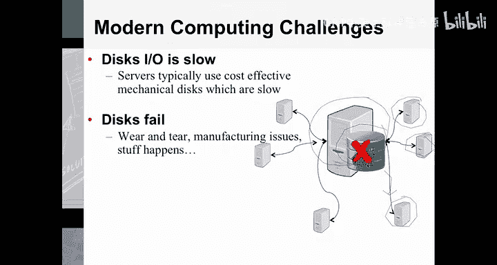
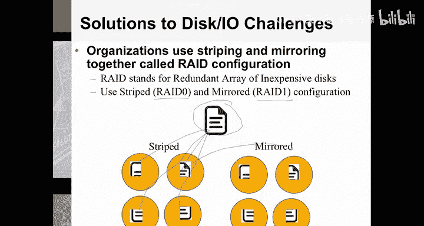
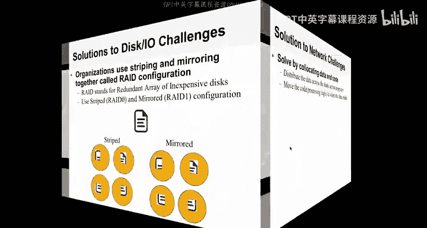
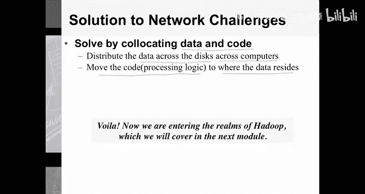

# 约翰霍普金斯大学《Hadoop大数据处理｜Big Data Processing Using Hadoop》中英字幕 - P7：6_现代数据处理技术.zh_en - GPT中英字幕课程资源 - BV1g5u6zBExs

Big data computing in the modern world。In this section。

 we are going to specifically look at computing trends that make big data possible。

We will also look at today's computing challenges and see what solutions exist。

Let's look at modern computing benefits or trends。Today we have faster processing CPU and more memory thanks to Moore's law every two years our CPU capacity and RAM capacity is being doubled。

We also have storage that has become cheaper， so organizations are collecting more and more data。

 they're buying more and more storage and want this data to be processed。

We also have distributed systems design that has mature in the past 20 years。

 we are seeing movements like the Hadoop movement and the NoSQL movement。

 which is the distributor database movement become quite popular。

We're also seeing a prevalence of open source software。

Open source Mo is a movement that started about 20 years ago and has yielded some of the best software industry even better than many of the proprietary or commercial software。

More and more commodity hardware is also being utilized rather than those expensive supercomputers。

We also have the advent of public cloud computing， companies like Amazon and Google are offering cloud computing solutions。

 so organizations don't really have to buy all the hardware， instead， go to the cloud。

 put their data over there， process it， get the information that's necessary。

 and then bring it back to their organization。What are the modern computing challenges？Well。

 we saw that in distributor or grid computing， we have a centralized server with an attached shared storage。

 and then we have all these different computers that are connecting to the centralized server。

 get the data and process the data。It so happens that disk IO is slow because many of these servers typically use cost effective mechanical disks。

 which are really， really slow。And also， the this can fail。Right where and tear happens。

 manufacturing issues， stuff happens， and the discs could potentially fail。

There is also not enough network bandwidth within the data centers to move all the bits around。

 which means if this particular computer over here wants to get the data。

 it has to go to the server and get the data in fact all of these computers will have to go to the server and get the data and there's not enough network bandwidth inside the data center。

 there's a lot of data that's sitting in the shared storage so that's also a problem with big data。

So what are the solutions to diskIO challenges？One solution that people use is called striping。

 the idea here is let's take a document or a file， split it across into pieces。

 and have the different pieces placed across different disks。

In this case it was broken down to four pieces and they were placed on four discs。

 so when we read the file back we can use reads parallelly across the disks and so striping speeds up IO。

There is also another concept called mirrortering that gets used， Metering is copying the file。😡。

To two or more disks， so in this particular case， the same file was copied to thisus， to disus。

 this one， and this one so was copied four times。Mitering provides redundancy。

So people try to combine striping and mirroring together for fast reads and also availability。

 and that's what is called the raid 0 plus1 configuration。

Rid stands for redundant array of inexpensive disks and what you do is you do raid zero and raid one configuration together。

 so the idea there is that you take a document， you split it into pieces in this case it's being split into four pieces。

And they are placed across four disks， but then each copy is also mirrored across another disc。

Right， so we have。Rade0 plus one， so mirroring and striping done。

What about solution to network challenges？This is solve by colocating the data and the code。

So the idea here is that you distribute the data across the disks。

 across the several computers in the network。And then you move the data or processing logic to where the data resides。

Now this is a very novel idea， and interestingly， now we are entering the realms of Hado。

Which is the foundation for move the code to the data。

In this section， we looked at today's computing trends that make big data processing possible。

 we also looked at today's computing challenges and what solutions exist and how these solutions are paving its way to Hadoop。

