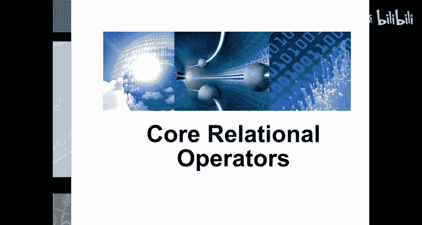
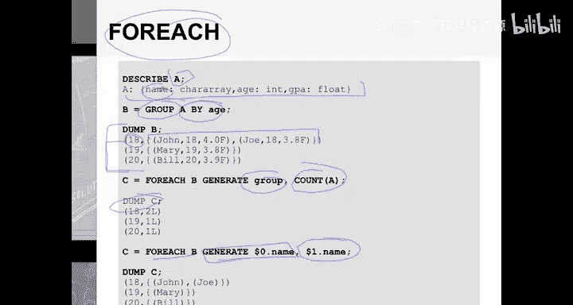
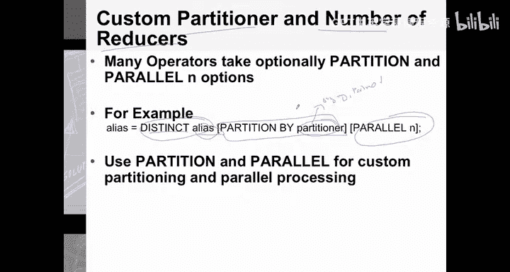

# 约翰霍普金斯大学《Hadoop大数据处理｜Big Data Processing Using Hadoop》中英字幕 - P80：15_核心关系运算符.zh_en - GPT中英字幕课程资源 - BV1g5u6zBExs

Core relational operators in this section， we're going to discuss some of the key core relational operators that allow you to manipulate the data and extract the data that you care about for your application and then generate the output。

Distinct， distinct removes duplicate temples in relation。

It's as simple as saying distinct on a relation name or an alias。

 and what you end up getting as a result is a unique set of records from the original set of records and it gets assigned to the new relation name。

The result does not preserve the original order of contents because it may go through a map reduced layer。

 and it's completely possible that things may be ordered differently。

 You cannot use distinct on a subset of fields。 It has to be used on the entire record。 In other。

 your are uniqueing across the entire record。Show you an example of distinct。

 I'm loading the data into a。As a1 with an integer type。

 a2 with an integer type and a3 is the integer type， A1。

 A2 and A3 are the three fields for this particular data set。And。When I print it， this is what I get。

 I dump it， I get a3，4，12，3，4，3，3，4，3，3 and 1，23 when I do x equals distinct a。

What x is going to see really is a unique set of records from the original set。If you notice 1，2。

3 is being repeated twice，4，3，3 is also being repeated twice， so what you end up getting is 1，2，3，4。

3，3 and 83，4 unique records or distinct records。Filter filterter allows you to select tuples from your relation based on some condition。

 so for example you can say filter alias， which is your relation by expression。

 So what you're saying is you would like to filter out。

The records that you really care about or extract out the records that you really care about。

It's commonly used to select data that you want filtering out。In this example， I've loaded A。

 A contains these records。If I say x equals filter a by a3 equals 3。

 what you're saying is you would like to pull all the records when a3 is 3， this is a3。3， three。

 and three。 so the records that you get is  one，2，3，4，3，3， and 7，2，5， and 8，4，3。

 and that's what we got。You can also filter with a much more complex expression。

 so here I'm saying filter a by a1 equals8， which means the first column has to be 8 or not of a2 plus a3 should be greater than1。

So a1 should be equal to 8。 That would be。This record and this record， so 834 and 843 should be in。

 that's in and that's in。Then for the rest of the records。Not of A2 plus A3 is greater than1。

A2 plus a3 should be lesser than or equal to a1。A2 plus83。 So this record is gone。

 This record is gone。 A2 plus a3， which is 2 plus 35。And。That should not be greater than a1。

Because it says not。So that would not work4 to one。A2 plus a3。Is not greater than a1。

 so that would work， so that'll go through。Let's see if this one would go through4，3，3。

 a2 plus a3 is。5 is 6。And six is greater than four， so that's not going to work， 7，2，5 will work， 8。

4，3， of course will work。Short these records right here。Yes。

Split is another core relational operator。Where it partitions the relation into two or more relationships。

So you can split。A relation into another relation， if this expression is true， another relation。

 if this other expression is true， relation， if another expression is true。

 and then finally there's an else condition。Depending upon the conditions a temple may be assigned to more than one religion。

 it's important for you to understand this。It's possible that you may end up getting the same record in two different locations。

Let's look at the example of split。Here are the records that I have。One， two， three， four， five， six。

 and seven， eight， nine。If I say split a into x if F1 is lesser than 7， so1，4。

7 or the which one of these is lesser than 7 well 1 and4 are。

 so you'll notice that x contains two records， which is 1，2，3 and 4，5，6 because F1 is less than 7。

 also put it into y， which is another relation name， if F2 equals equals 5。

And there is a situation where F2 is equal to phi， so 456 ends up going into y。

And then put the records into Z。If F3 is less than6。Or F3 is greater than6。In this case。

 the first record which is  one，2，3， and second record 78，9。Would match。 That would be Z。

 So split is a really nice way to split。The records or the relations into different portions。

Let's look at another example of split。In this case。

 I would like to split a into classic if the year of birth is lesser than 1960 modern。

 if the year of birth is greater than 1960 and year of birth is lesser than 1980 and U if year of birth is greater or equal to 1980 and unclassified otherwise it's almost like your default condition。

 the important thing here is that I handle anything less than 1960 in classic。

 anything that's starting from 1960 all the way up to 1979， I handle。In the second one。

 which is modern。And then 198 on， I'm going to handle the Utra dataset set。And then if they fit。

 none of them becomes unclassified， and here's the output that you get when you run on the data。

Order by。Order by sort at relation based on one or more fields。

So you can see order and alias by and you can see what field and whether you want it to be asenting or descendsenting。

And it'll go ahead and order it for you。If multiple records are the same order by key。

 the order in which the records are returned is not defined and is not guaranteed guaranteed to be the same from one run to the next run。

 that's because we are using map reduce operators and there's no guarantee that you would end up getting in the same location。

Here's order by， so I have the a data set I say order a by a3 descending。So it's going to be a3。

 which is these columns and will be descending。So as you can see。A three。Is descending at this point。

Here's another example of order by order A by yet of birth。Decending。

So the year of birth descending is right here。That works。

 You've done all these things in relational databases。

 but now you're actually doing this in big data environment using the big programming language。Limit。

It limits the number of output doubles， you can say。

Limit on the relationship N there's no guarantee which end tuples would be returned and also tuples that are return can change from one run to next run because you're doing Hadoop mappro in between。

If n is less than or equal to the number of tuples in the relationship。

 then all the tus in the relationship are returned。

 limit is really controlling the number of output records。

 so when you have a relation name or the relation has close to 1。

5 million records if you say limit aliens five， then it'll make sure that it'll return you the five records。

 it'll try to return you the top five records but there's no guarantee anybody who wrote first it'll take those five records and return to you。

If n is a number of tuples in the relationship， then all the tuples in the relationship are returned。

 of course。Limit is efficient， so use it whenever you can。

 especially when you're developing and debugging your big applications。So let's look at limit。

So here I've loaded data as a1， A2， and A3 as three integers。If I simply say。Limit a to 3。

 That means you're saying that you would like to only pull three records out and。Assign it to X。

Groupgroups the data in one or more relations the way you group is by saying group alias and then you can have expressions。

 you can say which alias is associated with which expression so you're basically organizing the dataset set so basically group groups together tuples that have the same group key that's the key whenever you do a group operation it results in two fields for every Tuple the first field is named group and you shouldn't really confuse this with the group operator the second field takes the name of the original relation and is the type bag。

All right， so the best way to understand this is through an example。

Here I have a where I've loaded the student information， the first field is named。

 the second field is A'， the third field is GPA， so there's my data type， I dump it。

 these are the records that I get。If I say， group A by age。 So I would like to group a by age。

 We have 18，19，2018。 So all the ages that are 18 will be grouped。So，18。

That would become the first field and then all the records that it's grouping will become a bag。

 so what you're seeing is 188， there are two people and so we have a bag and there's record one and there's record2 John Joe for 19 and 20。

 he wasn't able to group。Here's another example of group in this example I'm actually using an expression when you do a group I。

 it's possible for you to do that too。For each。For each basically generates data transformations based on the columns of data。

So you say4 each generate。The best way to understand for each is to actually go through an example。

Let's do that。Here I have a。Which is the following data type， and then I say group A。By age。

 so this is my grouping， this is exactly what we discussed a few minutes ago we have grouped it and now I can use the for each operator to go through every element in that particular group or to go through every record in that particular bag so for each B in other words for each of the values in B。

 generate group and count a。So group will be the first column。

 which will be 18 and the second column we know is really a list of records。

 so in this case you can actually go through the for each statement to actually pull out the fields that you care about in the from the list there's some Ding see right here。

And then I say for each B， generate tall0， which is the first column dot name and then the second column dot name and notice that it actually preserves。

The original type for the newly generated fields。

Many of the operators have the mechanism to have custom partitioners and the number of reduces so for example。

 you can say distinct alias。This is the distinct relational operator。

 and then you can see partition by you want。The as to be partitioned by this particular class。

 you can provide your own custom partitioner class， for example， org dot my dot partitioner。

You can give a class like that。 And then you can also say how many of these things do you want to run in parallel for the producer。

 So that's how you can actually get partitioning and parallelism in your pcopes。

In this section， we looked at various core relational operators。

