# 约翰霍普金斯大学《Hadoop大数据处理｜Big Data Processing Using Hadoop》中英字幕 - P81：16_联结运算符解析.zh_en - GPT中英字幕课程资源 - BV1g5u6zBExs

Relational joint operators。In this section， we will learn how to perform relational joints in P。

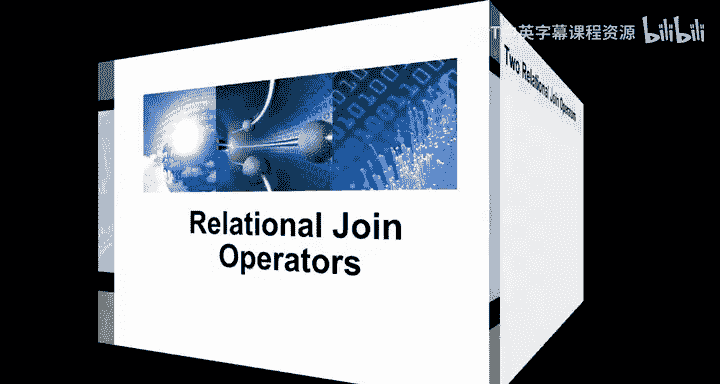

There are two relational joint operators in PG。Join is the traditional relational database join that we have seen before and also the hive join。

Join allows you to join two data sets。You can do an inner join or you can do an other join。

 and there are three variations of other join， left， right， and full out join。

Then there is the second relation operator， which is called cross that allows you to do a cross product between two different data sets。

 you can think of it as matrix product multiplication。

Let's look at joins in PG joins allow you to join multiple data sets we use to refer to them as tables orDBMS systems here we refer to them as data sets joins can be based on single or multiple keys PG supports both the concepts。

Pig joints。Or trivial， compared to Java Mareice joints， we saw that even hive。Was quite trivial。

 pig joints are also equally trivial。Pig supports both inner and outer joints and of course。

 three kinds of out joints。The default join is inner join。

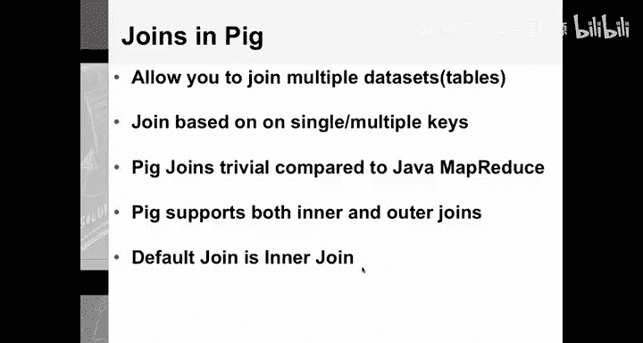

Let's look at a joint scenario， let's say we have two data sets。Posts and likes。I have a file。

In a director called blog data， to be precise， it's in slashpg sB data。

 a file called user dashPo or Txt。

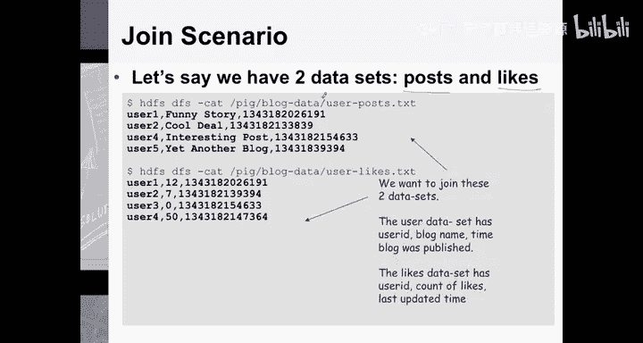

I enter the file under sp sb data， userli。txt。I have four records in user posts。

 four records in user likes， I kept at small data right now so that I can illustrate the join scenario and what we would like to do is join these two dataset sets。

 the user dataset consists of user ID， the blog name and the time the blog was published。

 the likes dataset contains the user ID， the count of likes， and the last updated time for the likes。

What we would like to do is join the two dataset sets。Let's look at inner join。

 inner join is where rows are joined， where the keys match。And that would be this location。

Heros that do not match are not included in the result set。

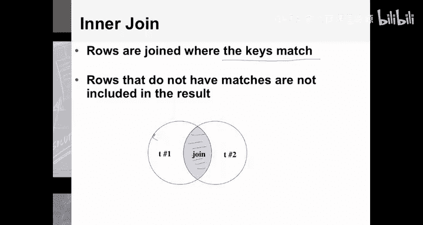

I have a script called innerjoin。Pg。To demonstrate inner join。

Notice I can use the dash dash to represent comments。I say post。

 which is the relation name equals load， I'm loading user dash post or Txt。

 If I have more than one user post， I can even say user dashash post star do Txt if I have user post1 user post2。

 I can have many files I'm loading it using。Pig storage separated by a comma， because if you notice。

 the input file has fields separated by a comma。The first column is user ID。

The second column is the post。And then the third column is the date。Similarly， I also load likes。

Which is under sp sb data， the file user likestar Txc， once again I can use a star。

To load multiple files， you can use file patterns using P storage。

And I'm saying that the first column is user。Wwhichch is a character array。

 the second column is likes， which is an inteageger account， the third column is the date。

 which is a long。Then I want to do a join， this is the magic of join right here。

I say join post by user likes by user， so I'm basically joining posts。And likes the two data sets。

And I'm joining it by user， and that's all I have to do。

User Info relation now is going to have the Jo dataset set and then if I do dump user info。

 it is going to dump the contents of user In， of course I can use D or store， if I use D。

 it dumps it dumps it to the screen for use store， itll store it to a directory。Okay。

 let's try to execute it， I would like to demonstrate to you the contents of the file user post right here I do an HDFSDFSca or Hadoop FS dashcat。

 here's the contents of user posts。Here are the contents of user likes。

And then I would like to execute my Pcr， I placed the Pcr in HDFS itself in a joint dopeg。

 it's located under slash big slash scripts。Of course， the file name is innerjoin。bg。

The way I execute the P script is by typing in P HDFS column s/ local host。

 which is the location of the name node， colon 9000。

 the port where the name node is running and fully qualified path to the file so that's the HDFS fully qualified file name when I execute it。

 this is the results I get this is inner joinin which means the common key will be taken so user one user 2 and user 4 or common across the two dataset sets。

The resultant data would be a union of the first record and the second record。

 so if you notice here I get user one funny story in the timestamp， which is coming from。

The first data set。And then the next one would be using one。12。And 1，3，4，8 into9191。

 that would be the record over here for user one。So this is right here。And that's right here。

We have it， so the two things have been unioned。And we have the results in the output。

 so that's your inner joint。The interesting thing is when you join you have a new data set。

 but before you did the join， you actually loaded posts and likes there's really nice operator called describe that actually describes。

The dataset， it can tell you what the schema is for the dataset in this case I'm going to use the describe posts to show you what are the attributes or columns or the schema associated with posts we have three attributes or three columns。

 user colon ca， post code and ca and date color long， if I do describe on likes， this is what we get。

And the interesting thing is what would happen when we do describe on user info Don't forget user info is a dynamic new relation name which was created。

 If I do a describe on that， you'll notice that it's actually a union of both posts and likes So what you're seeing over here is the columns coming from posts and the columns coming from likes。

 So notice how the new。Field name is called post colon and colon user and each type is CA array。

 post colon and colon and post and each type is CA array。

 post colon and current date and each type is long。

 which is really matching the three columns that we have over here for posts so it's actually prefixing the attribute names or column names with the posts relation name and similar thing is happening in Lce so this kind of gives you an idea as to what is really happening when you're doing join and how the schema is being carried over into the new dataset set。

You can also join by multiple keys。In this case， I'm joining both posts and likes。Using two keys。

 So notice I say join posts by user and date and likes by user and date。

Pots and likes are going to be joined by user and date。

 which means it is going to match all the records where the user ID and the date matches the user ID and the date in the other dataset。

If you look at the data set carefully。We have only one data set between user posts and user likes where the user ID。

And the date matches， that would be user one。With the date as 134318-2026191。In likes。

 we have similar record user one with the same value for the date， that's the only data that matches。

 so when you run the innerjoin with multiple keys， you end up seeing one record in the output。

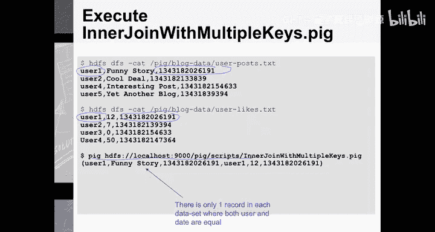

Now let's talk about out join， there are three kinds of order join， we have left out join。

 right out join and full out join。

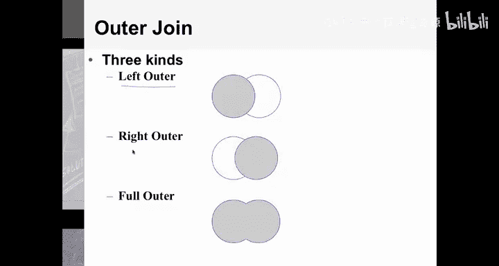

Let's look at each one of them。

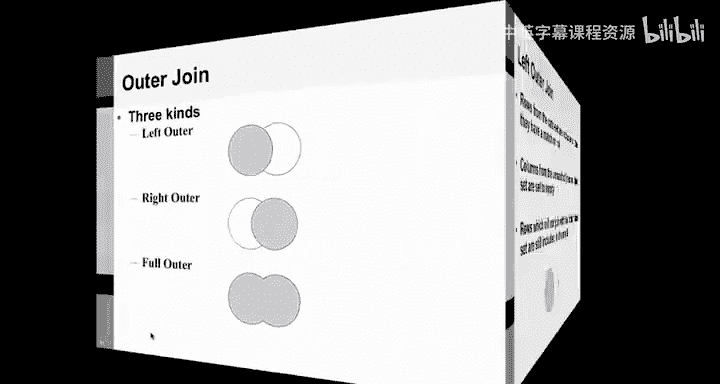

Left out of join。In left outer join， the rows from the first data set are included。

 whether they have a match or not， and so that would be the first data set。

Columns from the unmatched or the second dataset set are set to empty。

 and the rows which will not join with the other dataset sets are still included in the result set。

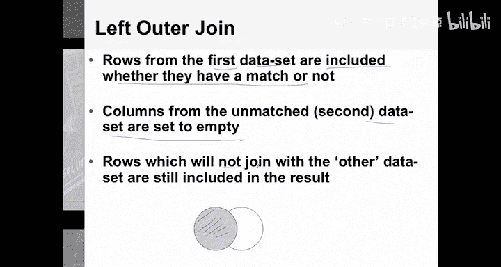

Let's look at the left out join example。Here I'm loading the posts。Relation。From the user post file。

 and I'm loading the likes relation from the user likes file。

 of course I have my schema for both posts and likes。

And then I create a new relation called user Info。Here I'm joining Post。And likes。Based upon a key。

 which is user， and in this case， I'm going to be doing the left outer join。

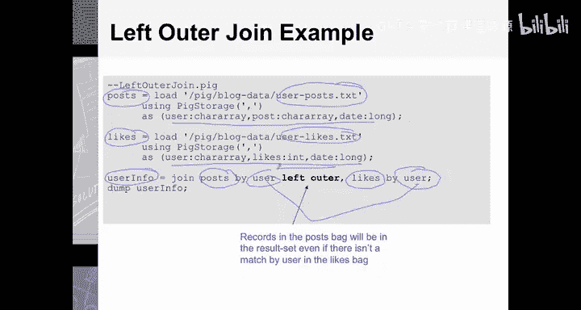

Let's execute left order join。Here's the user post。The contents of the user post file。

These are likes。The contents of user likes file， now I would like to execute left outer join。

When I do the left outer join。All the records from the first dataset set will be displayed。

 so user one， user 2， user 4 and user 5 will appear user one， user 2。

 user4 and user 5 appears in the output。And the entire columns。Will appear。

 you'll notice all the columns are appearing from the first dataset。

And then it matches with the other data set In this case。

 user one matches with user one user 2 matches with user2。

 user 4 matches with user 4 user3 doesn't match at all。

 So user 3 doesn't appear but user 5 will appear in the output in the case of。User one， two and4。

 you're seeing the columns coming from the other data set and being placed over here。

 so that's left out of join。We also have right outer join。

 the right outer join is really the opposite of left outer join。

Where the rows from the other dataset， which is the second dataset set are included no matter what。

 and columns from the unmatched， which is the first dataset set are set to empty and the rows which will not join with the other dataset sets are still included in the result。

Okay。

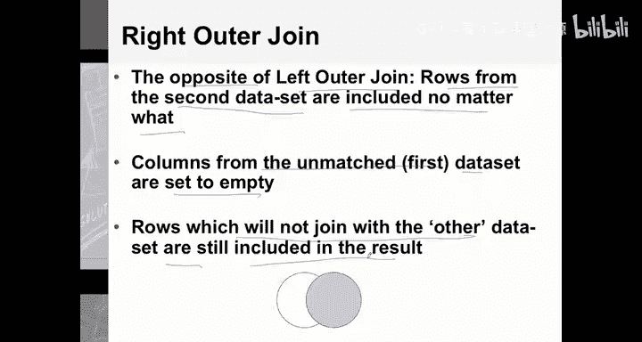

So let's look at right out of join。Once again， I have my posts from user posts。

Likes from user likes file， and then I do anueration called reuser In。

I do a join between posts and likes based upon the user。Id。And of course， in this case。

 it's the right order join， so all the records from the right side or the other data set will appear。

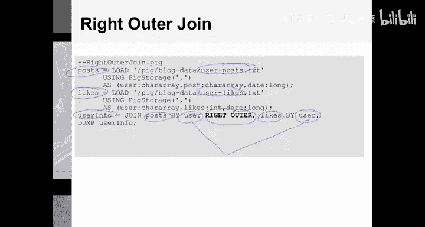

Let's look at this。I have user posts， the first data set。I have user likes， the second data set。

You will notice that user one， user two， user 3 and user4 should appear user one， user2。

 user3 and user4 appears。And this is the second data set， notice the second data set is appearing。

Incomplete。And then it matches or joins with the first dataset set， in this case it's  one，2，3，4。

 what will matches one，2，4， so you'll notice that user one。

 user two and user4 are being joined and their records are coming out or their columns are coming out。

And then we could not match user  three， and so they are left empty。

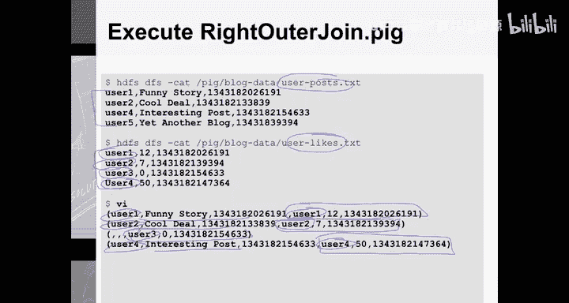

Full order join， full order join is where rows from both the data sets are included。

For unmatched rows， the columns from the other data set are all set to empty。Rs。

 which will not join with the other data set， are still included in the result。

So let's make at full out of join。Posts and likes。Joining posts and likes by user ID full out of join。

Going into the relation user info。

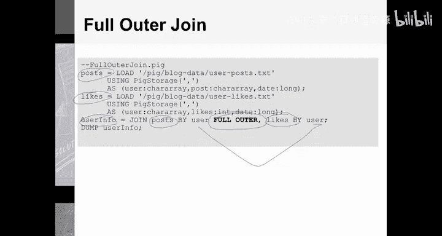

We have。User posts。We have user likes。And at this point I would like to do a full outer join。

 you'll notice we have one，2，4， five and we have three here， so what we'll end up with is one， two。

 three， four，5。As you can see you'll see user one， user two， user3， user4 and user5。

 you're getting all the records， you're getting all the five records and they get joined whenever there is no match it ends up putting as an empty string。

So that works too， by the way， all these examples work。

 you should be able to launch your pig interpreter， the Gr shell。

 and you should be able to type all these different commands and check it out。

We'll be doing the demo of this in just a few more minutes。

Cross productss is the other relational join operator。

 it computes the cross product of two or more relations。

 so you can say cross and then you can give relation name one。

 relation name two as many relations as you want。The important thing to note here is that cross is an expensive operation and should be used sparingly。

 you can use your own custom partitioner if you want to make it more efficient。

 and then you can also use the parallel for controlling the performance by setting more reducers。

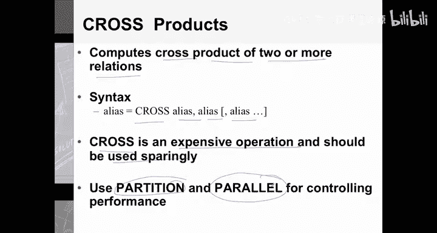

Here's an example of cross。I'm loading data one。As a 1， a2 and a3 as integers into a， and I dump a。

 I get 1，2，3， I I load data 2 into B， I get 2，4，8，9 and 1，3 as the tu when I do cross a comma B。

A cross B， I'm actually doing a cross multiplication， a cross product in this case。

 you'd end up getting one， two， three。2， four，1，2， three，89，1，2， three，1，3， again，4，2，1，2，4，4，21，8，9。

42，1，1，3， and that's exactly what you got when you dump X。That's the cross verors。

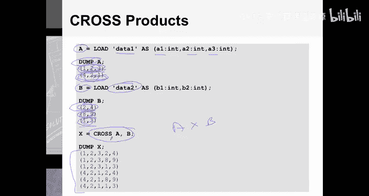

At this point， let's go ahead and do a hands on demo of relational join operators。

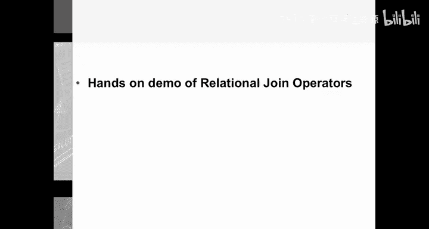

Here I am logged into my HD server VM as HD admin user ID， let's do the join demo。

 let's look at the blog data， Hadoop Fs Ls s pig slash blog dash data contains the blog data there are two files。

 user likes and user posts。And if I do pigs scripts。You can see the five join scripts。

Full out of join。Inner join， inner joint， multiple keys， left out of join and right out of join。

Let's go ahead， and。Do a cat on the data？Well， I like to use the P interpreter， so let's go to pig。

If you go to pig， you can say Ls slash， pig slash。Blog data。Here it is， I can also do cat slash pig。

Slash。Blog。Daタ？Slash user dash likes dot TXt。And then I can go on in and say。User dash post dot Txt。

 so you can see the output of the file， so you can see the contents of the file At this point。

 I would like to do an inner join。I would like to type in the inner join。

 so let's go ahead and say post equals。Load。Slash。Pig slulash。Blog data。Slash user dash。Post dot Txt。

And by the way， you can actually put star if you want， you can put wildcard for the file name。

 in which case it'll take and load all those files。 I only have one file。

 I'm just going to go ahead and name that file using。Pig storage， which is a storage format。

And I'm going to say the delimiter for the five is comma， hit enter， take it to the next line as。

User column。Carlorie。Come up， post。Colon care rate， these are my fields。And then date colon and long。

Ender。Okay， so I've created the post relation I can also describe。Push。There。

 that's the schema right there for posts。Let's go ahead， do the same thing for lights， lights equals。

Load。Single code。Slash pig， slash blog dash data。Slash user。Dash likes。Dot T Xt。Using。Pig storage。

And the diameter is。Coma， hit enter。As user colon。Cary。And lights call an end。

And I can say date code on long。It enter。Okay， so I have。Likes， I can also do describe。Likes。

Shows me the schema。 Now I can say user info is the new relation name。Join。Poush。By user。Likes。

By user， so。Here is an example of an inner join。At this point， I would like to describe user info。

You'll notice that the user info is a combination of both the dataset sets。

 so we have posts colon and colon user， which is the new column name。It's prefixing with the。

Post duration name， which is a character array， and then we have post colon and post。

 which is the post， which is a character array and then post colon date so as you can see the column names or field names are being prefixed by the previous duration name。

 same thing for likes。The magic happens when you do dump， so I'm going to say dump， user the info。

 that's when it's going to go ahead and execute the map produce。

And it should send the output to send out。There's my job running。There it is the program ran。

 and that's my output right there。Look quit this， I would like to run the other demo。

Let me do it clear， so that's my inner join。I can also run interjoin from command line。

 so let's go ahead and try to do that pig。HTFS， Cols slash La， local host。Colon 9000， slash pig。

Slash scripts， slash inner join dot pigg。That should run the innerjo example。

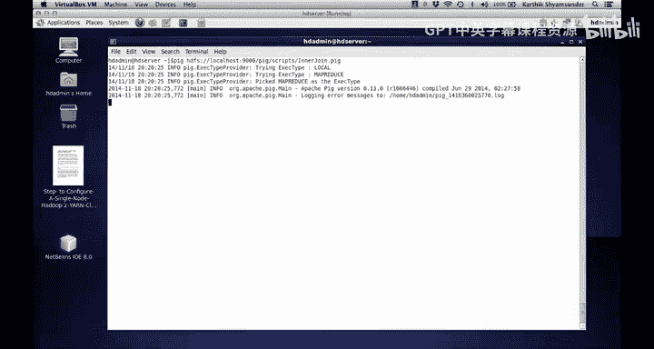

There it is。I can run。Joined multiple keys。Join with。Multiple keys。Dot pig。We had that example too。

 so again， once again， I'm running it on command line。Oh， the file doesn't exist。

Let's go ahead and do a。K do F S dash L slash。Pigslash scripts。Let's look at the files。😔。

It's called inner join with multiple keys。 Okay， so let's change that to inner join with multiple keys。

There it is。And then， we can run the。Left out of join， right out of join and full join。

There's the output。Only one record。I was able to join with。Multiple keys。Let's go ahead and run。

Left out of join。So。That was the wrong。It'Supposed to be uppercase L。

Now I would like to run right out of join。And if you look at the results。

 all these results should match everything that we have in the slides too。

It's important to remember that when you're running a P script。

It may launch multiple mapreduce jobs behind the scene and it actually does a lot of efficiency。

 figures out how many jobs we need to run， how to join different things。

 so it does all those things's what is called directed basicallycycl graph it actually builds a graph。

So that was right out of join， and let's do full out of join。There it is， at this point。

 I would like to get onto to the pig interpreter。And I would like to execute。The same command。

Exec is what I would use to execute the P script， HD FS column slashlash。

Local host cool and 9000 slash pe slash scraps。Slash full orderer。TheJoin dog pig。

That how I can execute it within the Gr shell itself。There it is。So you get the idea。

 it's pretty straightforward。Okay。In this section we learned that there are two relational operators that allow us to join dataset sets。

 one is the join relational operator and the other one is the cross product in terms of joins。

 Pig supports inner join which is also the default join and also supports three kinds of outer joins namely left outer join。

 right outer join and full outer join， Pig also supports join using more than one key。

 which is multiple key joins。

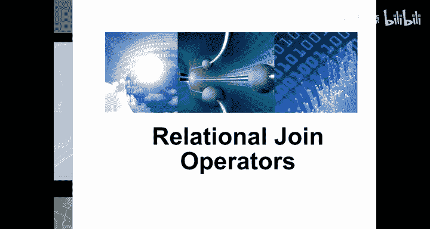

There is also the concept of cross relational join operator。

 which is like the cross product of two matrices。