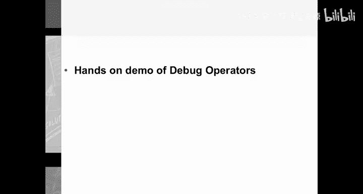
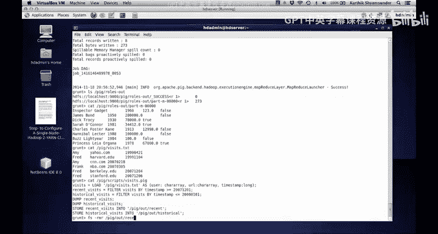

# 约翰霍普金斯大学《Hadoop大数据处理｜Big Data Processing Using Hadoop》中英字幕 - P82：17_调试运算符应用.zh_en - GPT中英字幕课程资源 - BV1g5u6zBExs

Debug operators。In this section， I'm going to show you。

A few debug operators that will help you build and debug your P application。Actually。

 we have been using some debug operators like D and Describe。

 but in this section I am going to formally introduce you to four debug operators， namely describe D。

Illustrate and sample。Describe。Describe returns to the schema of a relation。

So you can simply say describe and then give the name of the relation。

 it'll show you the schema for that particular relation。For example。

 if you say rules equals load slash pick s fails。 dot。

And then you say the schema for field star data is first column is named with catar array as the data type here of birth is the second column with Int。

And salary， the third column is float type。Married the fifth column as Boolean type。

Then when you type in describe rules， it'll actually show you for the rules relation that what the different fields are and their data types are so it's a way to get schema information this is a really nice useful technique to figure out what the data type is for a specific relation Now there is a concept in P where you can actually load datas from a file that can be schema associated with it。

 there are some techniques using Avro that you can do so when you load the data。

 you don't even have to specify what the data types are or what the schema is。

 it automatically loads it from a schema file now this is based upon the Avro project the point I'm trying to make is in such situations you load the data and you don't give it a schema but there's already a schema that's already loaded and this allows you to look at that schema in any event the describe operator allows you to look at the schema of a relation name。

The dump operator。The dump operator simply displays the results to the screen。

 you can simply sayD and alias。It'll go ahead and print the contents of alias out onto the screen。

 so use the dump operator to run or execute big lattice statements and display the results to your screen。

 so it does execute when you use the dump operator， it does execute the map to your code。

 but the results are going to the screen。If word of caution here。

D is meant for interactive mode when you're developing your P script。

 you may want to sit down in the pig interpreter and start writing these different commands and and dumping the content out statementsments are executed immediately and the results are not saved so don't forget that when dump is executed that particular statement will be executed。

 the DAg which is the directed basically graph will be created and the statement will be executed。

It's great for debugging， but don't forget that it doesn't get persistent if you want to persist the output of a relation。

 then you should store it into a directory， which will basically place the output of the job in that directory。

A word of caution about D production scripts that you're writing should not use D because itll actually disable multiquity optimizations and is likely to slow down your execution so if you have a P script。

 let's say you have 109 pig script and you are going through these different filtering logic and eventually you want to print out the output if you end up putting dump in between in after two or three statements again and again and again then because you're dumping the relational operator a mapred job has to be executed and that can actually slow down your system rather than optimizing the entire pig script it has to have several mapreduce jobs in between in order to simply generate the output that you're looking for in your standard output so I strongly recommend that you do not use D in your production scripts。

Just to illustrate what D is doing here， notice that I am actually declaring a new relation called roles。

 loading the data from slashb/cle。t， and I put a sche out together， I say dump roles。

 and that is going to execute a map produced job。Illustrate。Illustrate is pretty cool。

 it actually displays a step by step execution of a sequence of statements。

 so when you say illustrate alias or the relation name。

 then it is going to illustrate exactly how it is going to execute the different steps to get to the output。

You can illustrate on a script also you can say illustrate dash script script file and it would illustrate the execution of the file what I does is it allows you to review how the data is transformed through a sequence of pig lain statements you can actually see step by step what is happening in your code and I'm going to do a demo of this in just a few more minutes。

It allows you to test your programs on small data sets and get faster turnaround times。

What illustrateusrate does is it has an algorithm that actually retrieves a small sample of input data and then propagates that input throughout the pipeline so you can see how the results are coming out。

The best way to understand and illustrate is to look at an example。

 so let's go ahead and look at the example here I have a file called Viix。txt。

 where I have the name of the user， the website that they visit it and the timestamp they visit it。

It's a tab separated file， so there's a tab here， there's a tab here。

What I would like to do is show you the contents of a pig script that I have visit startPg。

Notice here Im saying visits equals loading the file with appropriate schema and then I'm filtering visits by timestamps。

 I'm actually pulling out or extracting any records that's greater than or equal to 20071201 and then I'm saying historical visits is basically any record that's lesser than that。

 which is this time right here， and then I would like to dump recent visits and dump historical visits。

 you know what dump does， D actually dumps it to the screen。

Store is the one that you should be using if you want to persist into a directory。

 so you can say store the name of the relation into the directory that you want to persist。

And then store historical visits into the directory that you want to persist。So that's the script。

Basically， what I'm doing is taking the website visits。And breaking the data into two recent visits。

 recently who is at your website， historical visits， which is the old visits。

Based upon certain timestamp and then printing it up。Now。

 the way you can execute P scripts in your grant is， of course， using the ex。

 so you can say exact and you can get the fully qualified file name or the P script。

He'll execute it and print and send the output。 Now if you look at the output。

 the output goes into two directories， one would be slash pig slash recent that's one directory。

 and then the other one would be slash pig slash historical。

 that's the second directory where the output is going to go to two different directories to which you can send the output。

But you also notice that there are two dumb statements。

 So the first dumb statement is printed over here。 The second dump statement is printed over here。

 That's your normal execution。 What I would like to demonstrate is illustrate。If I say illustrate。

Dash script and I give the fully qualified script name。You'll notice that。 It is showing you。

What visits relation is， it picked up a couple of records。And then it pulled out recent visits。

And then it's storing recent visits here's historical visits and it's storing historical visits。

 If you had millions of records it'll actually take a small sample of it and run it through this logic so you can actually see the flow This is pretty cool because it allows you to debug your input you're dealing with big data and you kind of want to work with a smaller sample set and illustrate actually does that for you it works in a smaller sample set。

There is also another great relation operator called sampleple。

Sample selects a random sample with the standard sample size。So for example， you can say。

Sample alias， which is the ratio name and you can say size and size can be a value between zero and1。

For example， if you say 0。1， then you will get 10% of the result。

So you can lower a data set and then you can say sample a 0。01。

 what you end up getting is a brand new data set， which is 1% of the original a data set and that will be assigned into the variable x。

 so basically X will contain。1% of the original relation A data。

 this is a really nice way to pull sample from the production data set and then work off of that sample。

Let's go ahead and do some hands on demo of debuok operators。

Here I am log into my H server VM as HD admin user ID， I would like to demonstrate describe。

 let me go ahead and log into Pg here I am in P， I would like to do a CA of the file sp s fields。

Here's a file that contains the character name， the year， the character was born。

 the salary the character earned， and of course married or not， those are the four attributes。

What I would like to do is load it up， rolls equals load。Slash pig slash fields。 do。As。

Name colon and care array。Com on year of birth。Coll an endt。And then， salary， colon and float。

And then， married。可能榴量。Close it。If I say describe。Rules。It describes the rules。Like I said。

 sometimes you may want to load a file。Without any duration in that particular case。

 if you do describe。Rules。It says there's no schema here it says no schema that's because I did not associate a schema sometimes you can have a file where the file is associated with an Avro format in that case you can use the Avro loader to load the file and so when you use the Avro project which is another project that's part of a do the schema information can be kept separately and that schema will be loaded up from each catalog or from the local file system you may want to look into the Avro project for that。

Let's go back and set the schema and then do it describe and that works。Okay， so that was described。

 let's also do dump。We just loaded the file。 Let's go ahead and do a dump of the file。

 if I do a dump and say rolls。That's going to dump the output。Don't forget， I can also use the tool。

If I say store rules， and then I can say into slash pig slash out one， or I can call it roll out。

Rolls are in that case， the contents of the ruless will be placed into that folder after the map reduced job。

The mappper job runs。And then if I do slash big slash rules， dash out。I see two files。

 the success file which is the map of success file。And then the output of the mapper， in this case。

 only the mapper around， there was no reducer。I can do cat。Slulash pig， slash rules。Dash out， slash。

Partrk dash M dash 0，0，0，0，0。And there's the output of the program。 Okay， so that was dump。

Let's look at illustrate， so I'm going to do a cat。On slash， big slash。Viizits。Dot T HD。

So this is the list of all the visits。The user ID， the website that they visit and the timestamp as to when they visit it。

I would also like to do a cap on a file that I already created。Whi would be slash big， slash scripts。

Slash ws。Dog pig。There's my script。I can say exact HDFS colon and slashlash。Local host， colon 9000。

Slulash big， slash。Criips。Slash。Visits dot Pg。That's going to execute my script。

And because I have two dump statements， those two dump statements are going to send the output to the standard output。

 but then I've also written two store statements and the output should be going to slash pick slash out slash recent that's where the recent visits go and the historical visits will go into historical folder。

 but before I do that let me go ahead and make sure that the output folders don't exist。

 otherwise I'll get an error So I should say Fs dash Rm。Slash big slash。

 should say auto more achieve should work。Slulash pig。Slulash out。Slash present。

And then historical。 So those fours don't exist。 Now， I would like to execute。HDF first。

 call and slashlash。Local host code 9000。Big scripts。Viizards。Dog P IG。

And that's going to execute the Mare job， it's going to generate two output directorories。

 well my real goal is to show you illustrate， but let's go ahead and run the program。There it is。

 If I do F S， dash L S。Slash pig， slash out， I should see two folders， historical and recent。

If I show you historical， that would have the output for all the historical records and then if I say recent。

 it should have all the recent records。 Okay， so my real goal is to show you illustrate we ran the program。

 but instead of running the program， let's go ahead and illustrate。But before I do that。

 let me go ahead and delete the folders， bottom or historical。And autumn are。Recent。Okay。

 so I'm going to say illustrate。Dash script。H D F S codes s， large local host， Co 9000。Slulash， pig。

 slash。Scrips， in this case， it's going to illustrate the running oh。

 it should be script slash visits do。Okay， so in this case， there it is。 Look at the illustration。

It's actually showing you how it is building the relationships。The visits， the recent visits。

The store， if you have a larger data set you can actually see the sample happening over here。

 So this is the different steps that it's going through。

 it's kind of giving you the sample over there。 This is a pretty cool and useful command to debug or to understand the flow of data of your application in P。

In this section， we looked at food debug operators that help developing and debugging applications describe allows you to get schema information about a relation。

Dump allows you to print the contents of a relation on the screen。

Illustrate allows you to see the progression of data through the Dg。

 which is the directed acyclic graph。

And sample allows you to get a sample dataset set。