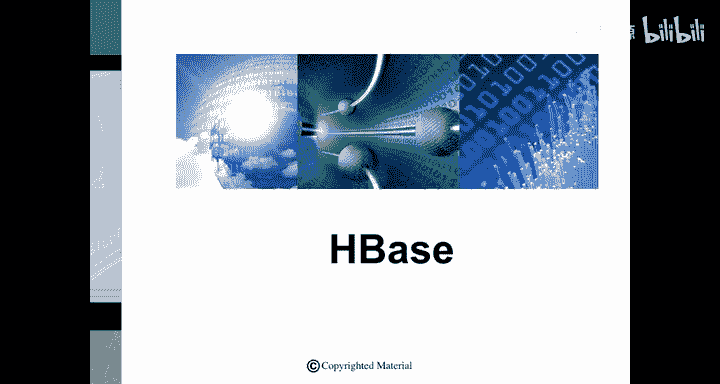
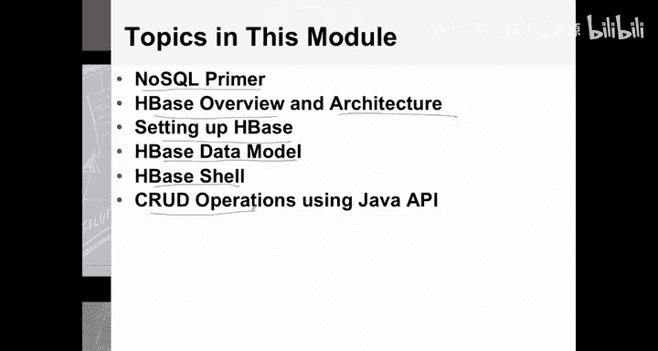
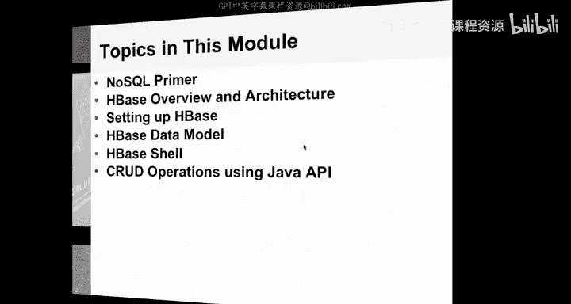
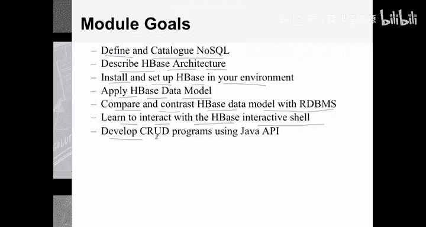

# 约翰霍普金斯大学《Hadoop大数据处理｜Big Data Processing Using Hadoop》中英字幕 - P83：18_HBase导论.zh_en - GPT中英字幕课程资源 - BV1g5u6zBExs

Welcome。Age base。In this module， we will look at another Hadoop ecosystem subproject called HBace。

HBase is the no SQL database also referred to as the Hadoop database。

It is a distributed version controlled open source database that is built on top of Haddoop that gives you real time。

 read and write access to your big data。

So what are the topics in this module？We will first look at the landscape of NosQL databases。

 you can say it'll be NoSQL primer， a bird's eye view of NoSQL。

Then since this is a big data using Hadoop class， we will look at the Hadoop No SQL database。

 which is H based and we will look at the H based overview and architecture。

Then we look at setting up H space in our development environment。

Then we look at the H based data model， which is different from the standard relation data model。

Then we will look at the HBase She， which is an interactive command line tool that allows you to perform CrD operations Finally we will look at the Java API for performing Crd operations on HBase databasease table。

What are the module goals at the end of this module， we should be able to define and catalog no SQL。

We should be able to describe the age based architecture and how it relates to Hadoop。

We should be able to install and set up H space in our development environment。

Apply the H based data model for applications。And then compare and contrast H based data model with RDBMS systems。

We'll also learn to interact with the Hspace interactive shell so that you can perform CRD operations right there at the shell。

 it's almost like the MySQL command line tool or the Oracle command line tool。

 and then finally develop CRD programs using the Java API。

