# 约翰霍普金斯大学《Hadoop大数据处理｜Big Data Processing Using Hadoop》中英字幕 - P84：19_NoSQL基础理论.zh_en - GPT中英字幕课程资源 - BV1g5u6zBExs

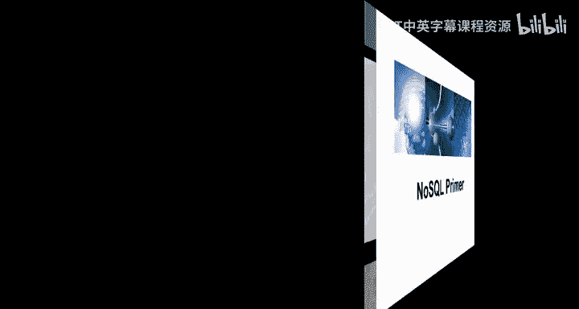

No SQL primer。In this section， Im going to give you an overview of emerging non relational database solutions in the marketplace under the umbrella of No SQL。

As part of this section， we will compare and contrast three popular NoSQL databases。

 which will give you a better understanding of NoSQL databases。

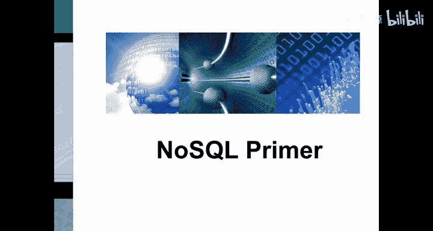

In order to better understand the emergence of NoQ databases。

 it is important to understand how interactive applications have changed between 1975 and today。

And it's important to understand the difference between these applications in terms of users。

Applications。And infrastructure So let's do that in 1975 when they built applications。

 they built applications typically for about 2000 users。

 for example in 1975 when AT&T built their ordering applications where customers can call in and order a telephone line a large company like AT&T- 1975 would have about 2000 to 3。

000 users， but today when you're building applications on the internet。

 2000 users is the starting point。It may start with 2000 users in the East Coast and then it may go into hundreds of thousands of users if you take the entire North America or even millions of users and if you go worldwide it's going to be hundreds of millions of users。

 think Facebook， so today's applications you're going to have a dynamic user population that's going to be growing compared to what you saw in 1970s。

 which is a static user population。In terms of applications。

 of course in the 1970s we did business process automation today also we are doing business process automation。

 but in terms of storing the data， we used to store data in a highly structured format。

 for example we would store data and RDBMS systems in highly structured data records today we are getting structured data。

 semistructured data and even unstructured data and so you need a different mechanism to store this data and process the data and also be able to retrieve the data for realtime access。

In terms of infrastructure， data networking was at its infancy in the 1970s today we see universal high speed data networks all across。

And in terms of computing， we were dealing with centralized computing with many terminals connected to this centralized computer。

 whereas today we are seeing the emergence of distributed computing where we're putting hundreds or even thousands of computers together to solve complex problems。

So if you think about it， in order to support the changes in interactive applications since 1975 application architectures have kept pace modern web and nonweb applications today are built to scale out all you have to do is simply add more commodity servers that's behind a load balancer Think about it you have a load balancer today and there may be many web servers that are there behind the firewall and if you want to scale the system all you end up doing is adding one more web server behind the load balancer。

Or you can even say web server or application server behind the load balancer in terms of system cost and response time。

 they are linear because when more and more users come online。

 you end up adding one more server in this way your system cost is growing linearly and also in terms of response time。

 this is a linear growth in terms of response time back to the user just because you're adding more and more users。

 your response time is not growing exponentially， it's all linear。

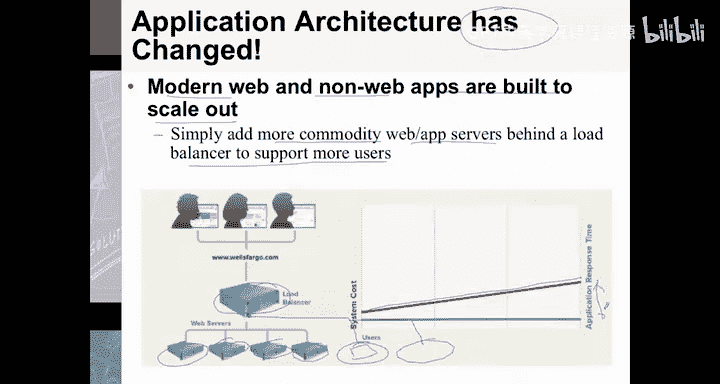

But database architecture have not kept pace。😡，In contrast to the sweeping changes that we have seen in the application architecture。

 the relational database systems have not fundamentally changed in over the 40 years。

 we are still dealing with the monolithic single server。

 which is your RDBMS server and the way you end up scaling your relational database systems is by simply getting bigger servers。

 which means your system cost is going to increase dramatically。

 and also there's only so much you can do in a single server so your application response time also goes up even though you're paying more money。

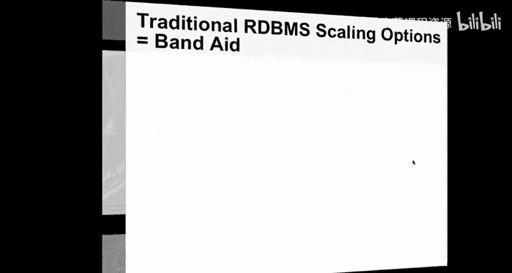

Now people have taken different options in order to scale relational database systems。

 and they all feel like bandai， let's look at all the different solutions that many have taken。

Shorarding is an approach The idea behind sharding is to partition the data so that the data can be spread across multiple servers。

 but the reality is when you fill a shard it is highly disruptive because you have to reshard now also when you do sharding you lose some of the benefits of iterational model also in order to have the sharding concept working。

 you have to have your schema installed in multiple servers and then anytime your schema changes you have to update the schema in all these different servers。

The other approach that many have taken is denormalization。

 the idea is to ease out on strict normal forms like the first normal form or the second normal form or the third normal form。

But then when you do denormalization， you're potentially duplicating the data in the database。

 and so you actually lose some of the more important benefits of the relational data model。

The other approach many have taken is distributed caching。

 which is to employ some kind of a distributed caching technology such as MecashD in front of the database so that you don't really thrash the data this approach accelerates data read but when it comes to rights it's still a problem because rights suffer from what is called the cold cache th。

 which is really it has to go to the database， get the data and load it into the cache and then serve the data back to the client and also depending upon how you implement distributed caching。

 you may end up getting one more tier so now you'll have your load balancer which will talk to the gateway application servers which will talk to the cache servers。

 which will talk to the database servers so now you're having four or five layers rather than your application server talking directly to the database servers If you look carefully many of the RDBMS scaling options feel like a。

And date solution。What we really need is a horizontally scalable solution。

 we need a horizontally scalable database。We have a load balancer and we put a bunch of web servers and application servers and we scale them in the same way we should have database servers that we can scale across multiple machines or multiple servers and really the NosQL databases are kind of filling that void once again。

 the point is scaling databases should be as simple as adding another commodity server just like the way we have been doing it for application servers。

Now， everyone is throwing around this term called no SQL。

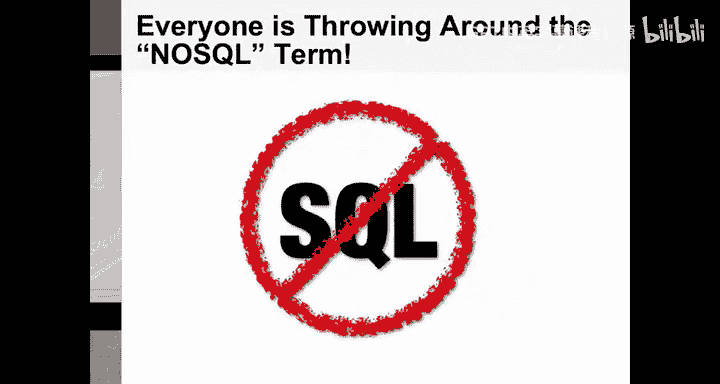

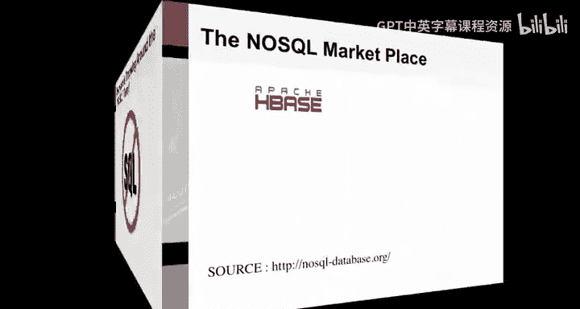

If you look at the NosQL marketplace， of course there's the Apache HB which we' are going to talk about in this module。

 but then there's a whole slew of other NoSQL databases。If you go to this site， NoesQldabase do org。

 you can see a complete list of all the NosQl databases。

 and this list is probably changing as I speak Here I am。 and with the NosQl database do org site。

 And if you look at it， it says here's the list of150 NosQl databases。

It even gives you a small description of all these different databases that are there in the marketplace。

 If you get a chance， I strongly recommend that you scroll through these different noq databases and also the category to which they belong。

When we look at the term no SQL， it almost looks like the no SQL databases are being defined using a concept called via Negativa。

 that is we are saying it's not SQL or maybe something along those lines it's as if it's something beyond SQL or other than SQL so what is this term No SQL and what do they mean by this at this point what I would like to do is I would like to give you a clearer picture of No SQL databases。

So what is no SQL anyway， well， no SQL can mean no SQL， or it can also mean not only SQL。

 I like to use the term not only SQL。The term noQl actually can be tracked toed events of rackspace when you use the term NosQL in one of his conference talks。

 and unfortunately the name got stuck。 but the reality is although many people refer to NosQl as nosQL。

 if you look at NosQL databases like Cassandra， they have a queryri language called CQl。

 which stands for Cassandra  queryri language。 if if you look at Mongodb。

 they have a  queryri language called uncle U andql， which is unstructured  queryie language。

 So it's almost as if well there is some kind of an SQl。

 it's just not really the standard SQl that we are talking about。

 but they they all want to have some kind of a  queryri language in it any way。

 So calling it NosQl sounds kind of a bit odd。 In fact， I would like to say that it's no relations。

 if you look at most of the NoosQl databases。 there is one thing that I feel that's in common is that。

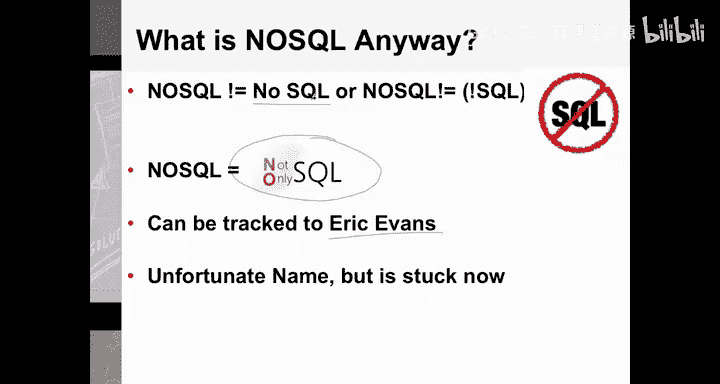

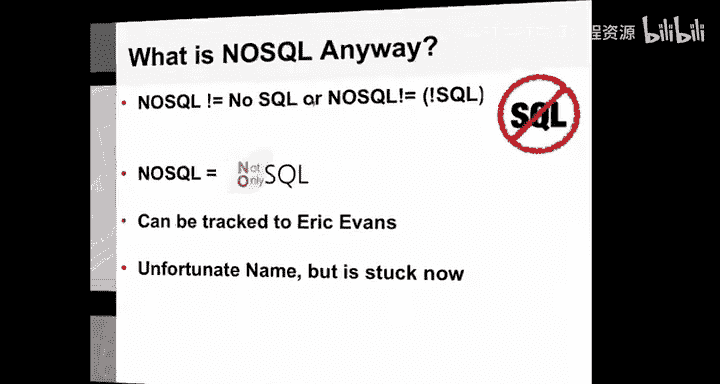

There is no relations， there is no joining， it's all maybe one big table or one big data model。

 so I feel no relations would have been a better term。But anyway。

 what I would like to do is to categorize the NoSQl databases into four major categories。

 key value pair databases， column oriented databases， document oriented databases。

 and graphoriented databases， worldemmart， Redis， Amazon Dynamo。

 all these things are key value pair databases When I say key value pair database。

 when you insert the record there's a key and there's a value。

 you can put whatever you want in the key， whatever you want in the value。

 as long as they can be serialized into bytes。When it comes to columnorient databases。

 Apache HSpase and Cassandra project both fit in the columnorient databasease。

 the reason they are called columnorient databasease is because they have this concept called column families and each column family actually gets placed in a separate physical file in the file system so making changes to one column family does not really affect the other column family this is great for performance we talk more about this when we get into HBase both Apache Hbase and Cassandra come from Google Bigtable and Amazon simpleimple DB and those two databases where columnorient databases and so Hbase and Casandra also fall under the columnorient databasease kind。

Document oriented databases or databases where the data is stored in terms of documents and the most common kind of a document today is a JSON document。

 MongoDV is a classic example of a document oriented database。

Then there is graphoriented database graphoriented databases store data in some kind of a graph so you can navigate through the graph in order to get the various relationships and and associated data for some kind of an entity Neo4j is a very popular graphoriented database So in this slide I've actually listed a few key NoQl databases that are popular in the marketplace and I've also classified them into four major sections if you go to NosQl as database。

org you will see that there are many more different sections under which these databases get qualified but I feel these are the four most important ones。

Let's look at Brew's CA theorem， it's really important to understand this from the perspective of distributed NosQL databases。

 there are three characteristics that make up distributed databases consistency that is all clients will have the same view of the data。

There is availability， that is all clients that are using the system can always read or write within some maximum latency。

 which is a certain amount of time it cannot be waiting forever。And partition tolerance。

 which is no set of failures， less than the total network failure is allowed to cause the system to respond incorrectly。

 that is if a system fails partially it's perfectly fine。

 the system should still work unless the complete system completely went down the entire data center went down。

 then of course the entire system will be down， this is called brewrewers cap theorem。

 because C stands for consistency A for availability and P for partition tolerance。According to Dr。

 Eric Brewer， a distributed system especially a distributed database。

 can only satisfy two of the three properties If you look at traditional databases。

 they satisfy the consistency and the availability aspect of these systems， so if you look at Oracle。

 MySQL and SQL server， they all give you consistency and they'll also give you availability but it's happening only on a single machine。

 you cannot split the system across multiple machines because you only selecting consistency and availability as your characteristics。

If you look at some of the other NoQ databases like HBace and Cassandra。

 they will give you a consistency and partition tolerance， consistency。

 meaning that you will read and write the same data， in other you' are not going to get dirty reads。

 partition tolerance in the sense that the data can be spread across multiple machines that your distributed system。

 but you're not getting availability。If you look at some of the other NoQ databases such as MongoDB and Cassandra。

 they say that they will give you availability and partition tolerance。

 which is this particular region， but you will not be able to get consistency so as you can see there are three regions that can potentially be satisfied you can either get consistency and availability or availability and partition tolerance or partition tolerance and consistency but you can never get all three of them and that's what Dr。

 Eric Bwer said as part of his CA theorem which was later on picked up as a research project by some students and they also give a proof of the Per's CA theorem。

I also want you to notice that Cassandra appears both as a CP and also as an AP。

 that is because Cassandra has something called tuable consistency。

 where if you want availability in partition tolerance you can get that at the cost of some consistency or you can get consistency and partition tolerance at the cost of availability as I mentioned to you。

 the key aspect of brewrewer's cap theorem is that you can have at most two of these properties for any shared data systems。

Let's look at three NoosQ products in particular， Apache H basease。Cassandra and Mongo Db。

 let's look at it from the perspective of what is it。

 its origin and the language in which it's written now。Apache H base， it is a distributed。

 which means multi machine database， sparse， it's almost like a key value system。

 it's also a column oriented database in the sense that there are these column families and each column family is stored in a separate file so you can scale the column families。

HSpace is based upon Google big table paper and it leverages the distributed file system。

 which is the HDFS file system under the hood it's written in Java Now we're going to learn more about HSp in the next section which is about the HB architecture。

 but at this point I wanted to kind of give you a high level view over the HB project。

Then there is Cassandra， Cassandra is also a distributed Sprse database。

 it follows the concept of eventual consistency or cunable consistency as I mentioned to you in the previous slide。

 you can either get C andP which is consistency and partition tolerance or P&A which is partition tolerance and availability and you can actually tune it the way you want it in Cassandra so it's pretty cool from that particular perspective。

Cassandra is a combination of Dynamo， which is the Amazon Dynamo project and the Big T project。

 so it's actually a combination project of the two it got inspired from both the projects。

It was originally created by Facebook for its Facebook inbox concept。

 and then later on the open source that， it's completely written in Java。

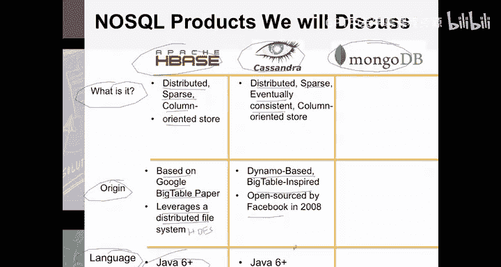

Then there is the MgaDb database， which is also a distributed database， it's a scalable database。

They consider themselves to be high performanceant database。

 but most importantly it's a document store database。

 it stores data in a document format to be precise， it stores data as a JSON format。

It's created by the founders of Doubclick， a very popular ad clickick platform。

 which was later on bought by Google， the creators of Doubclick wanted to build some kind of a distributed computing platform。

 and so after selling their company to Google and working for some time at Google。

 they decided to start their own company called Tengenen and launch Mongo Db out of that Mongo Db is also an open source database。

 MongoDb is written in C++。

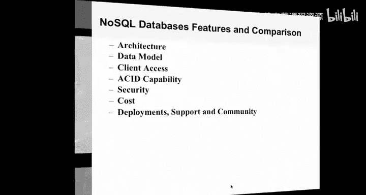

So let's look at these databases from the perspective of。Architecture， data model， client access。

 asset capability， security， cost， deployment， support， and community。

Let's look at the Apache Hpa architecture Apache Hspace is built on top of Hadoop distributed file system。

In Apache Hb， that is something called the H masterster。

 the Hma is the one that is responsible for assigning regions or partitions to what is called region servers and check the health of these region servers。

 So all the partitioning logic is done by H master。

 which is the brains behind the Hpa system and it's talking to various region servers。

 these region servers are the ones that are distributed across multiple machines that are maintaining portions of a table。

 So for example， Reg server1 may maintain a portion of table4 and a portion of table bar and it will maintain the column families that are there for table4 and column families that are there in table bar in mem stores which get written to various files inside HFs。

 Then there is also this concept called zookeeper because H master is the brains behind。H base。

 if H master goes down， the entire system goes down and we want availability so。

The way HBase works is that you can launch multiple Hmas or multiple HBase masters which register themselves with zookeeper。

 which is a coordinator system， very popular zookeeper is a project。

 which is a very popular project that allows for distributor coordination and distributor transactions。

 so H masterster registers itself with zookeeper， and the idea there is that clients that want to insert records into Hadoop Hbase database。

 then the first thing they do is they talk to the zookeeper figure out where the H masterster is。

 and then they eventually talk to H masterster， ask it which region server the client needs to talk to。

 so that it can insert a record or update a record or delete record or read records and then eventually it talks to those different region servers in order for you to perform credit operations on that particular record。

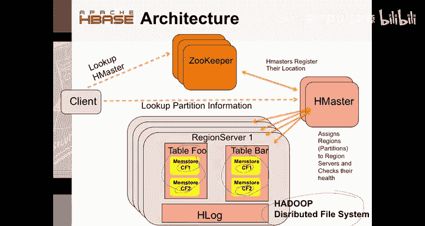

So that's the age based architecture， we will look more into the age based architecture in further sections。

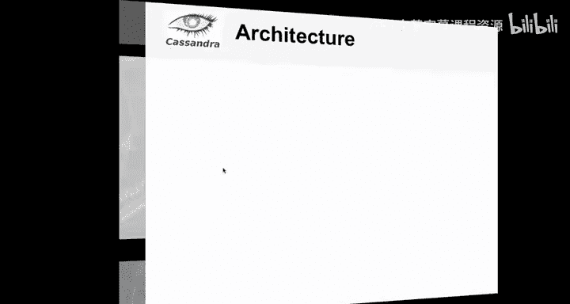

When it comes to Cassandra， Cassandra has what is called the ring based architecture where Cassandra demons are launched on multiple machines and these demons and form a ring。

When a client wants to insert a record， the client basically connects to one of the Cassandra demons and says that it wants to insert the record。

 the Cassandra demon basically says who should be maintaining that particular key。

 and the Cassandra demon knows exactly where this particular record should be inserted so it talks to the appropriate Cassandra demon inserts the record and that particular demon。

 and then that record gets replicated to the next machine。

 which gets replicated to the next machine in the ring architecture so that it's three times replication for that particular data。

That's how you get availability and prediction tolerance in Cassandra。

 Now if you look at HSpase in HSpase， you don't have to worry about three times replication because when you store the data in HDFs。

 it is already getting replicated three times as part of HFS replication So it's the file system that's doing the replication in HPase Also in Cassandra。

 you can have a multi data center solution So when you insert a record in Cassandra。

 it can not only get inserted into one data center。

 it can also be propagated into the second data center and then copies will be placed in the second data center that allows multiple clients to read and write across multiple data centers。

 This is one of the greatest advantages of Cassandra it's a multida center distributor database solution。

Whereas Aspace is a distributed database solution built on top of hertube。

 but it's not a multi datata center solution。Let's look at the MongoDB architecture in MongoDB architecture there are shards each sh is called a replica set and each replica set has a master server。

 which is where the master copy is placed and at least two slave servers in three times replication so that the data is replicated to the two other slaves as you can see this is a shard or a replica set。

 this is the second shard or replica set， this is the third sh of replica set and you can have as many of these shards that you want depending upon how you want to scale the system。

In Mongo Db， theres something called the Mongo Dconfig server。

 the Mongodeconfigx server communicates with the replica set master servers in order to figure out where all the different shards are。

 so that whenever a client wants to do cru operations it simply consults the MongoDconfig server to determine where the different records are and then the client directly talks to the master of these different replica sets in order to read or write records。

 in fact once it figures out which sh it needs to talk to or which replica set it needs to talk to。

 it talks to the master in order to do the create and update and delete operations。

 but it can talk to slaves in order to do read operations also。

If you look at the data model for H base and Cassandra， it is what is called。

A column family data model。For every table there is usually a primary key。

 which is your row key and then there are things called column families you can have as many column families as you want。

 but it's usually somewhere between one and 10 or 15 column families and the cool thing about column families is that each column family can have as many number of columns you want in fact you can have thousands tens of thousands even millions of columns you want。

 so it's a very dynamic concept in terms of columns inside a column family Each column family gets stored in a separate file for scaling purposes we will learn more about the Hbased data model in a further section I just wanted to kind of show you what these different models are notice that this is not a relational data model but some kind of a column family or column oriented data model。

MonggoDb data model is slightly different， MongoDb data model is based upon JSON。

 so you simply create JSON objects and insert into the MongoDb database。If you think about it。

 whether it's the column Family data model or the JSON data model。

 the ability to add columns on the fly is there， so there is a flexible schema which is easier to evolve when it comes to no SQL databases。

Now let's talk about client access， queryting and indexing in terms of Apache Hspacease。

 you can use Java API。To Cr operations， you can also use thrift RPC API。

 there is also Hadop integration， you can also use map produce on top of Apache H space。

In terms of  queryting records， it's all API based queryting。

 so you have to use the kind of a Java API or thrift API， notice that there is no SQL。

 so the client has to do a lot of work in order to query records from the database。

When it comes to indexing， the indexing is done only on primary key， that's it in H space。

In Cassandra， you have different kinds of API， you have Ruby API， Per API， Python， Sca。

 notice you have different languages it supports， there is also Hadoop integration that they have。

You can query based upon indexes because you do have a concept of index。

 primary and secondary index in Cassandra， which you don't have in Apache H space。

And they also have this concept called CQL， which is Cassandra query language in terms of indexing。

 their primary indexing， secondary indexing， and also compound key support。For Mongo Db。

 there is native JavaScriptscript API。 that is also binary drivers for several languages if you want to。

Program in CNC plus plus you can use the binary driver or Python if it's Java it's a little bit tricky。

 so they've actually provided a rest interface。 In fact， I would say today。

 rest is actually available in all three of them， and many engineers tried to go with rest。

 The only problem with rest is that it could be a little bit slower compared to the native API。

There is also an ad hoc query language， which is called Uncle UNQL。

 which is the unstructured query language that is there as part of Mongodb。

And then there's also primary key， secondary key indexes， and also support for compound key。

It's important to understand that when it comes to no SQ databases。

This concept of acid and base exists Ac is of course atomic consistent isolation and durability base is basically available soft state eventual consistency the idea there is that in the asset model you're getting fully acid systems。

 where you're getting your consistency where you're getting your atomicity。

 where you're getting your isolation and durability， whereas in the base model。

 you will get your consistency， but it's actually eventual consistency。

relationlational database systems like Oracle and MysqL are fully acid compliant。

 whereas if you look at systems like Cassandra， they support what is called the base model。

 which is basically available sourcef eventual consistency In other words。

 eventually the records will be consistent but for the time being there might be some delay because they have to maintain everything in terms of timests。

 they don't really update the records， they really insert records。

 even updating records is really an insert， they have to kind of merge and consolidate those records So the point I'm trying to make is Cassandra supports a tunable consistency model where it can give you consistency and partition tolerance whereas Hbase supports a consistency model which is consistency and partition to notice Casandra can do actually C and APp which is availability and partition tolerance All these things are tuable and Mongodb also supports the AP model。

 which is availability and partition tolerance which。

it actually gives you eventual consistency The point I'm trying to make is when it comes to no SQL databases。

 they are actually giving up the acid concept and moving to something called base。

 which is eventual consistency and that's because of Dr。 Eric Bwer's cap theorem。

When it comes to security， security story is practically negligible in almost all the NoAQ databases。

 we know that relational databases have done a great job in terms of DCL。

 which is data control language in order to control access to the data in our relational database systems。

So this is something that's weak in no SQL databases。In terms of cost。

The NosQL databases run on cheap commodity hardware。

 so from that perspective it's really not a big upfront investment like you would do in traditional databases where you may have to start with a fairly mid-sized database and you have to kind of grow and as you grow you may get larger and larger servers and those servers can become more expensive whereas in NosQL databases。

 when you want to scale it， it's just adding all these commodity servers on the fly。

In terms of software too， there is really no cost for practically almost all of the NoSQ databases because they're all open source projects。

When it comes to support， there is support available from the community。

 but if you really want to buy support， it's available for you to buy if you want to， for example。

 if you want to use HSpase， you can always go to Clouder or HortonWorks or even Mar in order to get support license for HSpace。

In terms of deployments， community and support， Apache HBase deployed in Trent Micro。

 Facebook and stumble upon， you can go to the website to see what other companies are using Apache HPase Cassandra at Netflix。

 Facebook and Simple GeO MongoDb is being used by Forquare， Bily， Craigslist， Sourfor， Disney。

In terms of community， I like to figure out how good a community support a specific open source project has based upon the Google search results and also the number of books that are written when it comes to Apache HSpace。

 there are about 750，000 records that come back when you search for HSpace， no SQL。

 and there are about five books on No SQL， when you search in Google for Cassandra on O SQL。

 it gives you 3。1 million results as you can see this is a little bit more popular than HSpace。

 two books are only available。

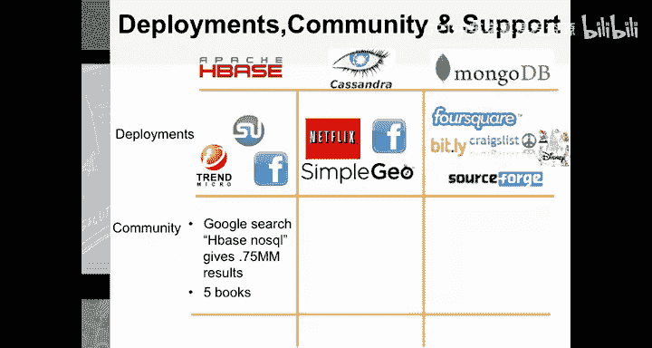

When it comes to Mongo Db， 2。3 million results came out when you searched for Mongo Db No OQ databasease and 14 books are available。

 you know， this kind of gives you an idea as to how much community support you have and how to pick and choose and No SQ database for your solution in terms of support。

You have support from CloudEa for Apache Hbase， you have support from Datataxax for Cassandra and your support from T0gen for MongoDb。

 I would say at this point you even have support from Hortonworks for Apache Hbase and also support from Mar for Apache AgeBase so those companies are also there now。

Hopefully in this section I've given you a fairly good overview of NoSQL databases and kind of remove the Fud around NoAQL databases when I sayFud。

 I mean fear uncertainty and doubt around NoSQL databases as you can see there are so many NoSQL databases available in the marketplace I've kind of compared and contrasted three different NoAQ databases so that you can in your career do similar kind of logic in trying to figure out which NoAQL database you may want to use but of course in this class because this is big data processing using Hadoop we are going to look at the Apache Hbase NoAQL database。

