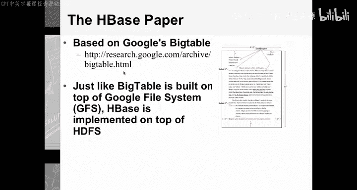
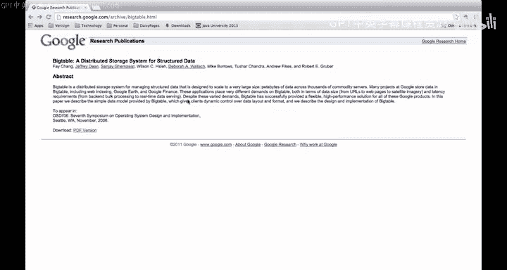
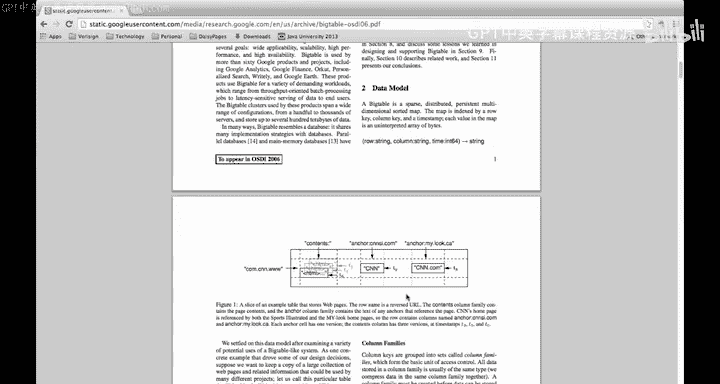
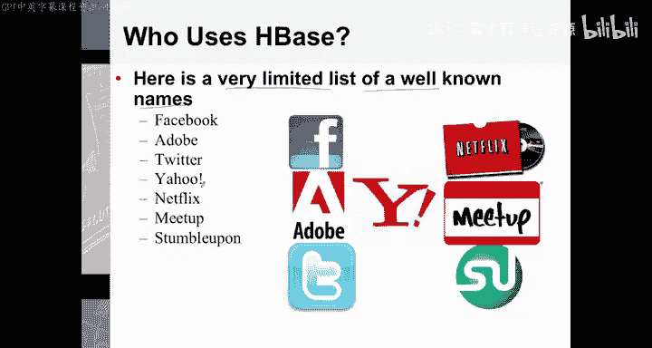
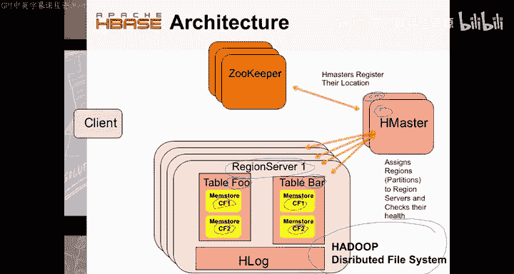
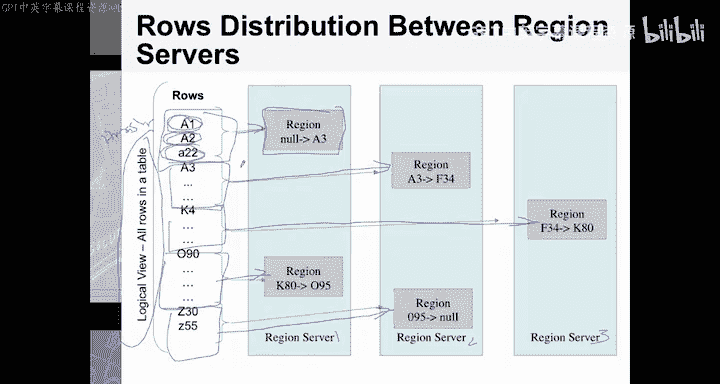
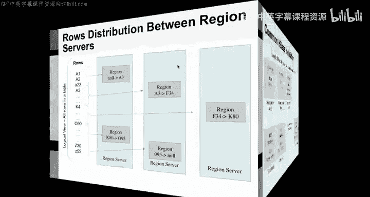
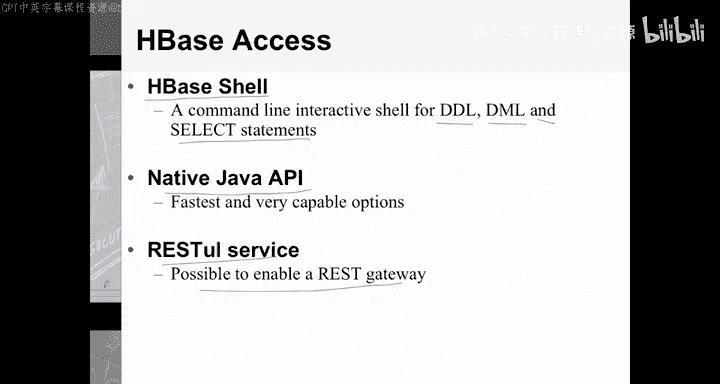

# 约翰霍普金斯大学《Hadoop大数据处理｜Big Data Processing Using Hadoop》中英字幕 - P85：20_HBase架构与核心特性.zh_en - GPT中英字幕课程资源 - BV1g5u6zBExs

H based overview and architecture。In this section， I'll give you an overview of HBase database and get into some of the key details of HBase architecture。

HPase is an open source， no SQ database， It's also called the Hadoop database because it's built on top of Hadoop to be precise。

 it's built on top of HDFS。 Now it can surely work with Hadoop mapre。

 but HDFS is the bare minimum that HPase needs in order for it to run。HBase is distributed。

 which means it can run on multiple servers， which also means that it is designed for large tables。

 tables with billions of rows and even millions of columns HBase supports random real time cru operations。

If you think about HDFS in HDFS you can store files。

 but it was primarily for sequential or streaming read and mapreduce， if you think about HDFS。

 you store data in HDFS and then you use mapre for sequential in streaming read and processing but with Hpaase you get random realtime read operations and write operations so you can perform realtime Cr operations on your data if you go back to HDFS again in HFs you can only append to the file you can really may change to the middle of the file HBase is a version to database。

 this is a pretty nice feature in Hpaase tables when you have columns the columns can have multiple versions of value so you can have a version one value and then a few minutes later you may change the value that's the version2 value so it actually it maintains the versions and you can say how many versions you wanted to maintain for Excel。

あう？Or for a value。Druns on a cluster of commodity hardware now because HPSp is built on top of a tube。

 running on a cluster of commodity hardware is the way to go， of course don't forget。

 it's not laptops and desktops， even though you can run on that， but in production。

 you run on commodity servers， which may be your Dell servers or IBM servers or H servers。

Hpa is horizontally scalable when you insert records into Hpa。

 it does auto sharding if you have multiple instances of Hpa region servers。

 it'll make sure that it shorts the data across multiple region servers。

 so sharding is done automatically rather than you doing something special。

Hpa is strongly consistent， this is the asset properties。

 but the asset properties of Hpa only happen at the row level。

 you can update all the columns within a row in a transactional way。

 but you cannot do this across rows， if you want to update records across rows and be consistent。

 strongly consistent to be precise， then you may have to use zookeeper distributor transactions。

HSpase has automatic failure， which means when one machine crashes and machine picks up that particular data because all the data is in HPase integration with Mareduce framework exists。

 although HPase runs on HFS， we also know that on top of HFS as yarn on top of yarn is Mareduce。

 you can actually run Mareduce programs that run on HPase tables which means they take HPase table as the input and then the output can potentially go into HPase tables back。

 or it can also go into the file system。The interface into HSpace is Java API from a programming perspective。

 also rest API from a programming perspective， there is also an HB command line shell。

 which we'll talk about。Each base is based upon Google's big table paper。

Here's the link for the Google's Big table paper。Just like HDFS was based upon the GFS paper。

 Mareduce was based upon the Google's Mareduce paper。

 the H based project is based upon the big table paper， so let's take a look at that。

Here I am at research。google。com/archive/btable。html， let's go ahead and click the PDFf version。

Here's the Big table paper which was written in 2006 it's a fairly good read。

 I would like you to take a few minutes and look at this paper。

 especially it talks about how they have internally built the big table database。

And what the data structures are for that， but more importantly what I like about this particular paper is how they have organized that data for a specific crawl If you think about it。

 Google became popular because of its search engine in this paper they talk about how they crawl the Internet download the content and store the data in the big table database。

 how they stored contents in one column family anchors in another column family and so on and so forth。

 so you may want to take a look at this paper that'll give you a pretty good idea as to how Google uses big table and also and also some insights into how to create data models which we will talk about later on Hpa history。

In 2006， Google publishes the Big table paperper， there's a small company called PowerSe。

 where the developers at Power set， read the big table paper and get quite impressed by it。

 and so they want to start a new project that is built on top of herdo called HBace。In 2007。

Each space becomes a Hadoop contra module。If you go back and look at Hadoop installationsulation。

 you'll notice that there is actually a folder contra。

 which is where third body contributions into Hadoop goes in hive pig both actually started as a contra module and then became a top level project in the same way in 2007 Hp started as a contra module with the Hadoop 0。

15。0 release In 2008 Hpa becomes a subproject of Hadoop， so it would be under Hadoop。 apache。

org slash Hpa and then it became what is called the top level project and so it became H pace dot。

Apache。org project。In 2009， H pay 0。19 and 0。20 are released。

 which are considered to be two major stable releases of Hadoop。By 2010。

They actually changed the version number to 0。89 to kind of separate themselves with the Hadoop。

 Hadoop started with version numbers 0。110。120。13 and so on and so forth and then at some point the HB developers were thinking it's too low a number so they wanted to kind of moved towards Hpa very quickly and it hasn't happened yet started at 2010 now 2014 when it's going to go into 1。

0 but anyway they moved the number out to 0。89， and so that's how the numbering actually shifts from Hadoop to its own numbering scheme。

And then in 2011 Hp 0。90 and then 0。92 get released， which are quite stable releases。

 lots of things happened between 2011 and 2014。 Now we have Hp 0。99。

 x which is going to soon become 1。00 and then eventually they're going to have the 20 release the 2。

 release is going to be the more compatible version of Hadoop 2 release the 1。

 release is a release where there is a package that works with Hadoop 1 and there's a package that works with Hadoop 2。

 the2 do release is going to only work with Hadoop 2 so that's the plan for Hpa at this point The other thing I wanted to mention in terms of releases is that if you see a release number which is an even release number like 0。

 98 or 0。92 and that means it's a stable release the odd release numbers are kind of ins stable release or in development Well right now we are going to be。

Working with the 0。99 we have the opportunity to work with 0。98， but I decided to work with 0。

99 for this class。So who uses HSpace here's a very limited list of wellknown names that use HBase。

 Facebook， Adobe， Twitter， Yahoo， Netflix， Meetup， stumbleumbon or some of the companies that are using HBase now these companies are also using lots of other projects so for example Facebook started Cassandra project and some projects are using Oracle too so there's a mixture of technologies in all these different companies but here's a list of some of the big names that are using HBase。

When to use HB， there are two well known use cases as to when to use HB。

 you have lots and lots of data or rows， it's not millions of rows， you have billions of rows。

 hundreds of billions of rows or even trillions of rows， that's when H space is great。Also。

 large amount of client requests if you have。Millions of requests per second and you need to scale that or millions of updates per second or inserts per second。

 which is basically more data coming in every time a user logs in you may want to log it into assist system rather than writing a file in HFS。

 you may want to write a log event in an Hbase table so that you can scan through you can do backs processing on it and things like that。

 so whenever you have lots of data that's coming in and you want to insert those records or lots of client requests for read access。

 you can actually use Hbase。The reason HBase is great for large amount of client requests is because HBase is a distributed system。

 which means if seven machines are not good enough， then double the hardware。

 make it 14 machines and now you've actually automatically partition the database tables so it's great for large amounts of data or row billions of records。

 also lots of requests coming in。It great for single random selects。

 It's really great for you saying， here's the key。Please give me this particular record for example。

 if you have 1 billion users， you cannot put 1 billion users in a MySQl database。

 What you can do is you take your 1 billion users store that in Hp。

 you may have 100 servers and then every time a user logs in， you take the user ID which is the key。

 you go to Hb and say retrieve this record that gives you the username and the password hash that you may have stored in Hase and then you match it with what the user entereds。

 so you can use it for authentication purposes。 It's a great place for using HB。

Great for range scans， you can also scan a set of records so you can say give me all the records between this key and this key。

 that's also possible。Another great thing about HSp is variable schema in relational databases you have to define the schema and you have to stick to that particular schema these are the 17 columns you got for this table and those are the 17 columns that's it and the data types are also fixed whereas in H space they have this concept called column families。

And which are fixed and then within that column family you can have columns and those columns can be even added dynamically in fact。

 they are added dynamically when you insert a record and as part of the record you have columns。

 those columns belong to a column family and those column names can be dynamic and you can have millions of columns and you can have whatever data you want in it。

 doesn't matter what data type you have as long it's serializable into bytes。When not to use H space。

HPace is bad for traditional orDBM systems where you want to do transactional applications。

 you have multiple tables you need to update all the different tables and keep it part of single transaction。

 you cannot do that with Hpa transactions can happen only within a single row Also relational analytics for example。

 you may want to do a bunch of group buys， you may want to do a join where clause。

 It doesn't have those kind of features It's primarily credit operations and a little bit of scan operation possible to get a group of records。

Hbase is great for storing large amount of rows， doing crud operations。

 but then if you want to search across this data typically in a relation database。

 you would use a select statement， maybe use wildcard or even use text searching in it with Hbase。

 those things don't work really well because first of all。

 you don't have this text processing and things like that。

 And in relation databases you can have select statements where you can use the like operator。

 you can even do some text searches but when it comes to real search engines like solar and Lucine you cannot do those kind of things in Hbases privately for crud operations of a record。

 there are some projects where they are mixing Hbase and Lucine here's a project by aK Kumar which is called Hb scene which mixes Hbase and lus of an inserter record in Hbase。

 it will also insert a record in the index。And also there's another project called the Lily project which takes solar。

 which is built on top of Lucne and mixes it up with Hpa。 This is called a Lily project。

 These are all some of the open source projects that's available that are trying to do this。

 I think this is one of the places where you're going to see a lot of activity in the next two to three years。

Let's look at the Hpa architecture in Hpa you have an H base table which is made up of regions。

 you can think of regions as partitions in a relational database。

 so a region is like a range of rows stored together which is what I mean by a partition or you can say a single shard it's really used for scaling you will have one shard stored in one machine。

 another sh stored in another machine， another shard stored in a third machine。

 and so this allows you to scale your system。This idea of sharding the table is done dynamically and it's done automatically for you。

 so the splitting of the table into various shorts is done automatically by the Hp system when it finds that there are lots of other machines that are in the system it'll basically try to shard it across these different machines a region server is a service or a demon that serves one or more regions at one time。

What is a region again， it's a shard， it's a partition。

 so a region server serves one of these partitions。

A master server is a demon that is responsible for managing HBase cluster。

 so master server or the H master is the master of the HD is the master of the HPase system HBase stores its data into HDFS。

 typically in a relation database it stores the data in a file system。In Hpa。

 it stores the data in HFS。 and so if you think about it。

 since HFS has three times application and fall torant， all these things built into it。

 Hpa automatically inherits all those features， so it actually relies upon the HDFS's high availability and fall tolerant features。

In order to maintain durability for H based database。Hbase utilizes something called zookeeper。

 Zookeeper is another project as part of Apache that is used for distributed coordination。

 and Hbase uses zookeeper to make sure the eight masters are up and that one of them is elected as the leader。

 We'll talk about this in a slide or two。 These are some of the high level Hb architecture terms that you should be familiar with。

 Now let's go ahead and look at the H base architecture。At the lowest level。

 you have the Hadoop distributed file system。 Hpa is built on top of HFS in H space。

 you have a special demon called the H master demon。

 Notice I have actually launched two H master demons。 you can actually have two，3，4。

5 as many H master demons as you want， but only one of them can be active at one time。

There is also these demons called the Regent server demon Reg server demons or demons that are responsible for serving a shard。

 and they are responsible for serving a shd for a table so one region server will be responsible for serving let's say two tables we have a table called F and a table called bar and it's basically storing portion of the Fo table portion of the bar table and internally it stores all the data in HFS and in H log。

 so these are all some of the internal things that it does with HFS also these things called CF1 and CF2 or column families as part of that particular table this mem store is in memorymory map so the point I'm trying to make is the region server has an inmemory map of the shard there is also rest of the data which is in the database so this is your in memorymory memory store or inmemory cache that you have and you can have as many region servers as you want。

ZookeeperZookeeper is a demon that is responsible in saying where the H master is。

 If you have two H masters， they both registers themselves with the zookeeper and the zookeeper basically elects one of the master master。

 So let's say this H master was elector as the master the second master or the second master is kept as the secondary master and it will become the master。

 only if the first master fails and why would it become the master because zookeeper elects the second H master to be the master。

 that particular point if the primary master crashes that's really the primary work of zookeeper Okay。

 so the client wants to do some operations it wants to do some crowd operations。 Well。

 the first thing the client has to do is talk to H master。 Well。

 if it has to talk to H master it needs to know where H master is That's when the client actually first does。

A lookup so the client does a lookup into zookeeper and asks where is the Hmaster the zookeeper says the Hmaster that you should talk to is this one right here so go ahead and send the information to the Hmaster so the client goes to the Hmaster and says I'm looking to retrieve this record and here's the ID for that particular record Hmaster says oh information about that particular record is in Reg server1 and so the client then goes to Reg server one and basically retrieves information about that record and returns it back to the client。

The point I'm trying to make is。The client always goes to H master to figure out where a record is and it ends up going to the appropriate region server to retrieve that particular record。

 that's because the H master has a complete track of where the different key ranges are placed and so based upon the key that came to it。

 it can tell you which region server has that information。

I also want to tell you that the client doesn't always go back to Hma and get that information。

 The client goes there from time to time。 It actually gets the information and cachees the information as to where the different regions are and where the different range keys are。

 And so that way doesn't really have to go to Hma all the time。

 It will talk to Hmaster from time to time to make sure that its cash information is up to date over here。

 but it doesn't really have to go to Hmaster all the time。 Itll definitely go for the first time。

 Also， when the client recognizes that the H master the zookeeper gave is this H masterster。

 then the client will always go to Hmaster it doesn't have to go back to zookeeper again and say， oh。

 where is the H master， the subsequent requests from client to H master are going directly to H masterster For some reason。

 if H master died， then the client would go to zookeeper and say。

 where is the H master in the meantime， zookeeper elected。

The secondary H masterster to be the H master， then the client would end up going to the secondary H masterster。

So in summary， zookeeper's primary job is to manage the H master demons if there are more than one H master demons running。

 make sure that one of them is elected as the leader。

The client is the one that is responsible for talking to zookeeper to figure out where the H master is so it can get information on the partitions。

 Regent servers are the demons that are serving a shard portion of a table Reg servers maintain multiple tables but they maintain portions of records or multiple tables。

 notice I have region server one Reg server two in the back34 these region servers may be running on different machines。

 So on one machine youll run H master on the other machine you will run H master。

 which is the secondary H master and then zookeepers youll run on three machines So that's five machines right there。

 and then you have region server one region server2 and region server 3。

 So there are four region servers those are four machines。 So in order for you to run your。

A space system you at least need at this point。😡，F machines over here for region servers and three machines for the zookeeper that's 7 plus two machines。

9 machines， So you really need nine machines to have a bare minimum system for Hpa。

 and then you can keep on scaling it by adding more and more region server machines into Hp system。

 The point is that Hpa is much much more complicated。 Of course。

 all these things required Hadoop also installed in them。

But the number of machines that the starting point is much， much more complicated in each space。

For what we are going to be doing in this class， we're going to be running all the demons。

 both the Hadoop demons and the H based demons all in the same machine。

 but typically they are distributed。Here's another look at the H base components， we have H master。

 which is the brains behind H base that keeps track of where all the shards are。

 we have the region servers which maintains a shard for a table。

 it may have multiple shards across multiple tables。

There is also an inmemory me store where it's maintaining some kind of an inmemory map that's almost like the cache The rest of the information is in a file called H file which is an HDFS There is also something called WAL which stands for right ahead log when you're inserting records into region servers it first writes everything into the right ahead log and then replace them into the H file and merges them into H file because H file is the underlying storage file where the information about the records are kept and that information is actually kept in a sorted fashion we'll see this when we go through the Hbased data model and H based shell。

Because the information is sorted in the H file， the information is actually written first to WAL file。

 which is the Write headlock file for speed， and then back from time to time it gets sorted and placed into H file。

Zookeeper is keeping track of where the name node， it is also keeping track of where the various region server are。

Here's another view of HP from a data perspective。Let's say we have three regions servers。

 we have regions over1， Reg over two， and Reg over three。And here are the rows to be precise。

 here are the row keys， it's a key value system， so a1 is the key， A2 is the key。

 A22 is the key right these are all the keys that we have。Notice the keys are in sorted order。

 always all the keys are stored in sorted order。This group of keys right here is stored in a shard in region over 1。

 this group of keys is stored in another shard in region over 2。

 this group of keys is stored in another shard in region over 3。

This group of keys is sh in a shard in region server1。

 as you can see the partitioning or the sharding is taking place and this information is of course maintained by the H master as to where the different ranges of shards are placed and that's why whenever a client comes in and says I want to update this record or I want to delete this record with this particular key。

 it knows exactly which region server which shard has that and so it directs the client to go to that particular one to do the current operations。

I did some hand waving before in terms of the H space installation。

 here's a little bit more detailed slide on how H space installation can take place You can have one machine whether you're running zookeeper。

Under the machine where you're running zookeeper， a third machine where you're running zookeeper。

 by the way you always run zookeeper in oddd numbers。

 you run 1357 because zookeeper is what is used for election purposes and you want to make sure that there is an odd number of them if three zookeepers are that if two of them agree that one of them should be elected as the master then that would be the one that would be elected as the master if there is an even number of zookeepers then things don't work right that's why you keep 357 zookeeper demons。

If you get a chance you may want to look into the zookeeper project。

 it's got nothing to do with big data， Zookeeper is more about distributed computing and distributed transaction management。

 it so happens that HPace uses zookeeper for its higher availability feature。

In one of the machines where you're running zookeeper， you may want to run the H based master。

 which is the H master in one of the demons where you're running zookeeper you may want to run the name node and in one of the demons you may want to run the secondary name node and then。

You have a bunch of data nodes or slave nodes in this data nodes or slave nodes。

 you would run HFS data node， that's the data node demon。

 and then you would also run the H based region server， which is the region server demon。

So as you can see。These data node demons or the slave demon nodes， each one of these things is a box。

 each one of these things is a machines， so these are all machines。

 and what I'm showing you here is how H base is built on top of Hadoop and how you can install Hadoop and you can also install H base components and run these components across these different machines。

The other thing to note here is that I have not launched any of the yarn demons。

 if you launched the yarn demons， then you may want to put the resource master over here。

You may also want to put the node manager running over in each one of these machines。

 so node manager will also run over here， node manager will run over here。

History server may run over here。So now we have everything working。History server goes over here。

So now you have a distributed environment， you don't have to have yarn running for Hpa。

 you want to use yarn for Hpa only if you're going to be using mapreduce processing on Hpa tables。

 otherwise you really don't have to have yan it only relies upon HDFs when I say yarn。

 I mean mapreduce because mapreduce framework is built on top of yarn。In terms of accessing HSp。

 there is something called HSp She， which is a command line interpreter。

 an interactive shell that allows you to enter DDL commands to create a table。

 da or commands to update tables and also scan or select statements。There is also a native Java API。

 which I'm going to go through in this class。And there is also a restful service that you can enable。

 This is something new in H space。 I'm not going to cover restful service。

 It's pretty straightforward to turn one of these things on。

 We're going to be talking about the Java API in this class， which is very fast。

In this section， we looked at the H pace overview and architecture。

 and we saw how for Hpa we have the zookeeper demon that keeps track of where the H master is。

 the H master demon， which is the brains behind H pace and also the regionsgenents of demon。

 which is basically serving a shard。