# 约翰霍普金斯大学《Hadoop大数据处理｜Big Data Processing Using Hadoop》中英字幕 - P86：21_HBase环境部署.zh_en - GPT中英字幕课程资源 - BV1g5u6zBExs

Age based installation。In this section， we will look at how to download， install， configure。

 and run HBase in our development environment。

Downloading Hbase Hbase is an Apache open source project， so the official website is Hbase。appache。

org。

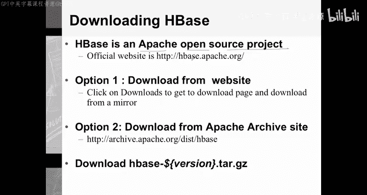

In order to download Hspace。Option one would be to go to Hpa。appache。org。

 click on the downloads link， which will take you to a download from a mirror page。

 go to the mirror page and download the latest version of Hpaase。

The other way to download HSpase would be to go to archive。aache。org。

 this is the option to/ disk/hSpase， so once you get there。

 then you will see a list of HBase distributions， pick the latest one。

 and then you can download the latest distribution。

The distributions for H base are in the form H base dash version number。

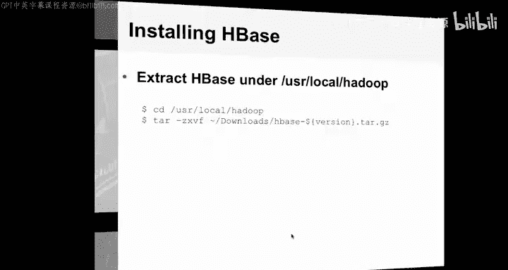

Installing Hpa installstalling Hpa is as simple as going to slash users slash local slash Hadoop and then extracting the tar file by typing in T Z XV F and the fully qualified path to the downloaded Hpa Tr G Z file。

Now that you have installed HSp， let's explore the H space installed directory to see what the different directories are and what information is placed in these different directories。

Under HP installationulation directory， you have a folder called B。

This is where the H space star script exists， and there is also a She script that allows you to launch the H space shell。

The config directory or the conctory contains the Hpa configuration。

 There's a very important configuration file called Hpa dashs dot Xml。

 which contains information that allows you to connect to the Hadoop HDFS so this is a file will will be changing in order for us to connect HBase to Hadoop。

The Docs folder contains age based documentation。The Hspace web apps folder contains templates for H master admin console and the restful web service。

 There is an admin console that comes with Hpa， the template for the web application is available in this folder and also the restful web service that Hspace offers for restful API。

 That template is also available in the Hpa web apps。

 you typically don't have to worry too much about this folder because its internals of Hpa。

The Lib folder contains the H based J files， you would need to include the H based J files if you are interested in writing H based client programs so that you can do current operations。

The logs folder contains the log files for all the H based demons。

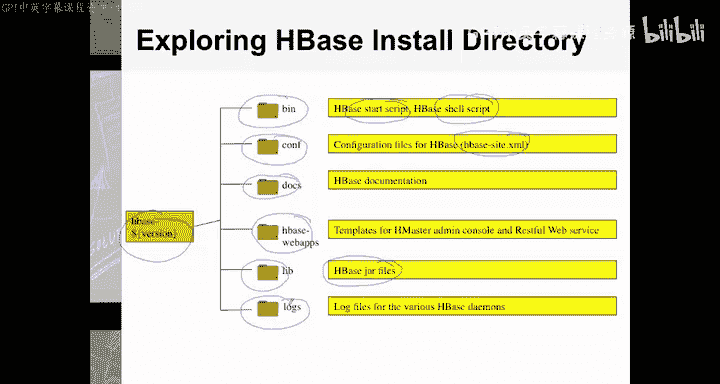

。

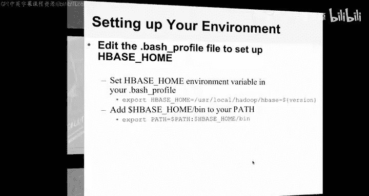

Once we have installed HSpace， it's time to set up our environment。

 especially our dot dash profile environment so that we can point to HP home and the HP home bin directory so we can execute the HP commands。

So edit the dot Bash profile file。And add a couple of lines。

 Add a line that says where H space is installed。 In our case。

 it will be installed under user local Hadoop， Hpa， dash， whatever the version number is。

And then we should also change the path environment variable to include HBase home bin。

 because that's where the start and stop commands for HBase demons exist and also the command to launch the Hbase shell。

 which is an interactive shell so that we can create tables insert records and update records just like a regular interactive shell that we have for MySQ database。

Because we are going to configure HP to communicate to HDFS。

 we need to make sure that HDFS is running。You can make sure HDFs is running by going to the web browser and looking at the name node console to make sure that HDF is running。

 you can also execute Hadoop FS Ls to make sure that the HDFs file system is available or the GPS command to check to see if all the demons are running The important thing is you need to make sure that the Hadoop demons are running。

 especially the three demons are related to HDFs， which is name node secondary name node and data node。

Each base can be configured to run in one of three modes。Local mode or standalone mode。

 This is the mode that comes out of the box。 easyy to get started here。

 it does not use the HDFs file system。 Instead， it uses the local file system to run Hpa and also it runs Hpa and zookeeper in the same JVM。

 So Hp H master region server， zookeeper， all the different demons are running within the same JVM。

 This is what we call the local mode or the standalone mode。 They should not be used for production。

 It's for just quick test。 I recommend not to run on this mode。 We will not be running on this mode。

 We want to see all the different demons in action。The second mode is the pseudo distributeded mode。

 which is the development mode here it requires HDFs。

 This requires that we connect our H base to the HDFS system。 It mimics the fully distributed mode。

 the only difference is that all the demons are actually running in one host。

 This is great for testing debugging and prototyping your application because here all the different demons are separate rather than in the same machine。

 so all the concurrency issues and all those things can be resolvedd with this model and also it's a great model for learning。

 as we have been doing all along， we'll be running Hb in pseudo distributed mode once again。

 this is not something that you would do in production because it's all running within the same box in production you'll be running in a fully distributed mode where the different demons are running on different machines。

The fully distributed mode is when Hspace is running on many machines。

 it's great for production and of course， development clusters if you want to create a cluster of H base。

Since we want Hbase to talk to Hadoop HDFs because we want to run Hbase in pseudo distributeded mode。

 we need to make some changes in Hbase dashite。xml file。

In this file we need to say where the HDFS file system is and also the directory where HBase is supposed to write its metadata information and data information。

 so for that you need to set this property right here which is HBase。

 rootD notice that it's being set to HDFs colon s/ local host colon 9000 that's where the HDFs is running and also slash HBase。

 that's where the metadata information is going to be stored。

The second property that we need to set is this property called Hpa。cluster。dibuted。

 we need to set that to true。So that the system can run in so distributed mode。In other words。

Every demon will be running separately rather than all the demons running together in a single mode。

 in a standalone mode。Then the third property that we need to set is this property right here。

 which is Hb dounsafe dot stream。t capability do enforce force。

 we need to set that property to false。Well。If you recall there is the Hadoop main project and there are all these other sub projectsjects and HBase is a subpro。

 we are working with the latest version of Hadoop which has HDFs with erassure coding and the HPase project doesn't quite support that very well and so for its writerhead log。

 it expects the property which is HB。unsafe。stream。 capability。 enforce to be set to false。

That's the way it is right now for Hspace， maybe it will change in the future。

 so for the time being you need to set this property also。

 so these are the three properties that we need to set in Hpa dashside dot Xm in order for us to launch Hpa on top of Hado 3 dotx。

All right， it's time to start H based now。You've already added in your dot dash profile。

The location of Hpa bin。 and so we should be able to execute start Hpa start S in order to launch Hpa notice it starts zookeeper。

 then it starts the Hpa master， which is the H master， and then it starts a region server。

 which is the first sh or the first partition for your Hpa。

 So there'll be three demons that'll be running once you start Hpa。

You can verify that HBase is running by simply going into HB shell that launches the HB interpreter and then you can type in list when you do that it'll show you zero tables that are there。

 but if it returns to you something along these lines。

 that means H base is running and the client is able to talk to HB。

You can also verify if HPase is running successfully by doing Hadoopfsls/hpase。

 if you recall when we configured Hpaase in Hpaasestxml prepoint it to htfs colon// localhost colon 9000/ Hpaase which is the location where the name notice and the directory under the name node which is s Hpaase。

 you'll notice that once your Hpase is running successfully。

 there will be a bunch of directories that will be created under s hpaase。

 this is where Hbase is storing its internal information and also the data structure for the data and all the metadata information and everything。

There is an H based management console， which is a web based management console that allows you to look at the status of your H base servers。

 especially the status of your H master and。H region servers， right。

 So we have your H master and the H region servers。 we want to look at the status of those。

And there is actually a management console， the H master。Management console is。

rununning right here on 16010 that's the port number in local hosts and the Regent server management console is running on port 16030 on local hosts so using your browser if you navigate to HttP colon/lash local host colon 16010 you'll be able to get to H master admin console and then you can directly go to the Regent servers admin console or once you're in the H masterster management console it'll list you the list of Regent servers and when you click on the Regent server it'll take you directly to the Regent server admin console I'll demo this to you when I actually go through the installation process。

Stopping H base is as simple as。Typing in stop Hspace dotsh， and that would stop the zookeeper。

 demon， H， master demon， and the Reg server demon。Let's do a hands on demo of setting up H base。

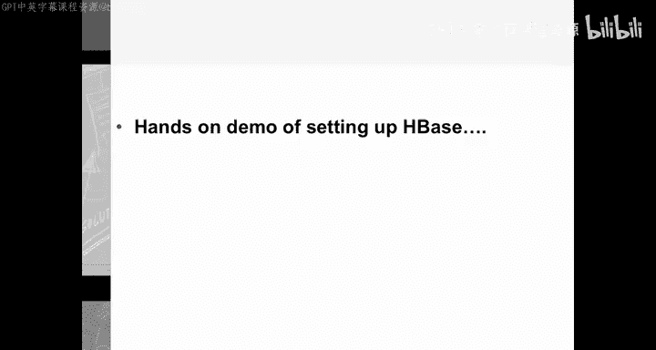

Here I am logged into my HD server。As HD admin user ID， So now I want to install H basease。

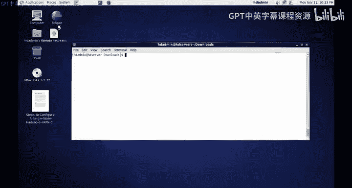

Let me go ahead and launch the browser。So that we can download each space。We can go to agepaase。

appache。org。And click on download here。To get the latest version of H base， which happens to be 2。2。

2。The other way by which we can do this is also by going into the menu over here and then clicking on downloads in the H based。

 apache。org website， you can click on the bin。Which is the binary and download it。

The other option would be to go to archive。taty。org s dis slash h base here they have all the archived versions of H base。

You can see that there are many， many releases and the latest release is 2。2。2。

 you can go here and download it too。And the version that we want to download。

And the file that we want to download is H based2。2。2bind。tard。gz。

That's what we're going to be installing Anyway， I have already downloaded it。

 so let's go ahead and install it。

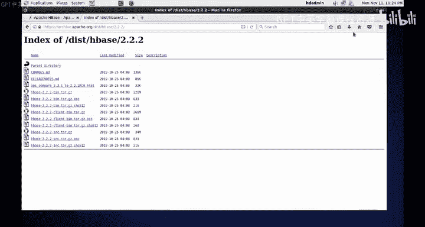

Here I am in my download folder， if I do。L is minus L over here。

 you see that I've already downloaded Hbase 2。2。2。Now， I would like to install it。

 Let's do that for that， I should go to。User。Local。Haadoop。we do an LS minus L there。

 there is no h space， we installed Hadoop， then we installed hi， then we installed peg， right。

 so we have those。Different projects installed。 Now we want to install H base。 So tar Z。

X V F tda slash downloads because that's where I've downloaded。H base。

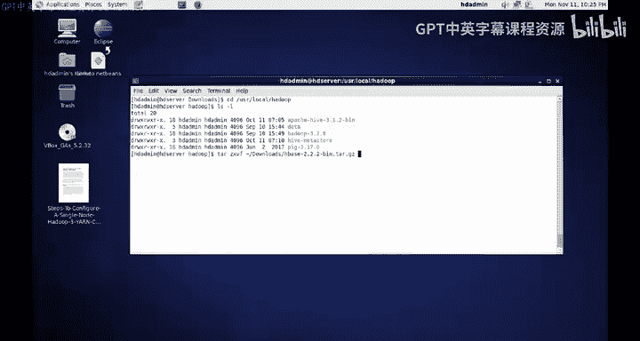

Extract it。There it is， it's being extracted right now。At is minus L。

 So now I have my H base extracted。 Now， at this point， what I need to do is configure H base。 So C。

 D to H base。Do an LS minus Sl， notice there's the con folder。

 which is where I need to configure H base， the H base side dot xml file has to be configured as we discussed in the slides。

And then there's Docs， there's also library， there's bin。

 that's where the start H based command is available。

 that's where the start H based command is available。Right， so let's go to con folder。

There are many files here。 The file that we want to look at is H based on。Side dot Xml。

 So let's edit that file。And if you look at the file， it's pretty much empty。I would like to edit it。

 I have a copy。Of H page dash site dot Xml， the way it's supposed to be。

 we discussed this in the slides。Paste it。So there's H based star side dot XMl。This property Hbase。

 router tells you where HFS is located because HBase runs on top of HFS and slash HBase is where the HBase is going to write all its H basedase configuration files。

 metadata， data， and all that information。Hspace。t cluster。 distributeded。

 that set it true because we're running in pseudo distributed mode。Hbase dot unsafe dot stream。

t capability do enforce is set to false because Hb is not really totally compatible with the latest version of Hadoop that has era ratio coding and so we need to set this value to false we talked about all these things in the slides a few minutes ago。

All right， so we are all set， let's do Xml， W F。H base dash side dot Xml to make sure that we don't have any Xml letters that's looking good。

Right so we have no errors。 Now all we have to do is set our path and the way we can do that is。

S u to root。And we can execute this command that says E， single code export H space home。Slash user。

 local Hadoop， s H based dash2。2。2 that is in single codes。Send it to s etc/profile。 d/hpa。sh。

That basically sets the H space underscore home environment variable。

And then we can say export path equals door path， colon H base。

 underscore home slash bin greater than greater than which means append to the file sedsy/profile。

d/ hbase。sh。Now， if I do CA slash Esy， slash profile。Dot D。H base。sh。

 you'll see the contents of the file。Basically， this file gets executed when you launch a shell so that the environment variables are set。

 So what I'm going to do is close my terminal。And then start the terminal again。

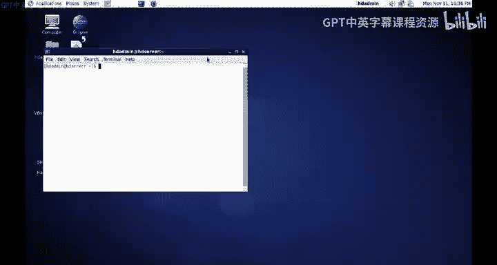

So if I say echo dollar H base underscore scroll home。You see that。It is set to slash user。

 local Hadoop H based dash2。2。2， which is where H base is installed if I to E dollar path。

You should see H base。Ben folder。In the path， there it is user local Hadoop Hb 2。2。2 slash pin。

 so were all set。At this point， what we need to do is start。HSp， but before we start HSp。

 we need to make sure that Hadoop， especially HDFS is up and I've already started Hadoop if I do JPS。

 you will see that I have the name node， secondary name node， data node。

 and then I have the resource manager and node manager。

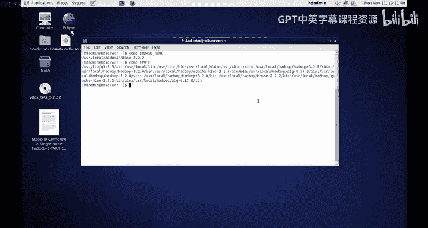

And of course， the job history is over at the end。Now all I need to do is start each base。

Start dash H base。 And the reason I'm able to do this is because we set up our。

Esy profile dot dHb dot S En variable。 So I was able to type in start dash Hb dot S。

 and that should start。The H base demons， which would be zookeeper。H master and H Region server。

So now let's go ahead and do GPS。And you'll notice that we have zookeeper， which is H code Pi。

 that's what they call as a demon name， that's the zookeeper H code Pi demon。

 and then we have the H master， which is the H based master， and then we have the H region server。

 which is the H based region server。Okay， were all set。 Now we need to make sure that。

All the services are running by going into the console， so let's go to the console。

If I type in local host。可能。9，8，7， zero。That would be by HDFS， my HDFs is running perfect。

 we need to make sure that's running。If I type in local hosts。colin。1，6，0，1，0。

That would be where my eight master is running。Age master。

Is the H based master and it has a list of region servers that it runs and connects with。

We have one region server。 There it is。 We click on that， and that should take me to the。

Console for the region server is right here， and that's also working。

 this is where the shards are placed。So we are all set that means H base is installed successfully。

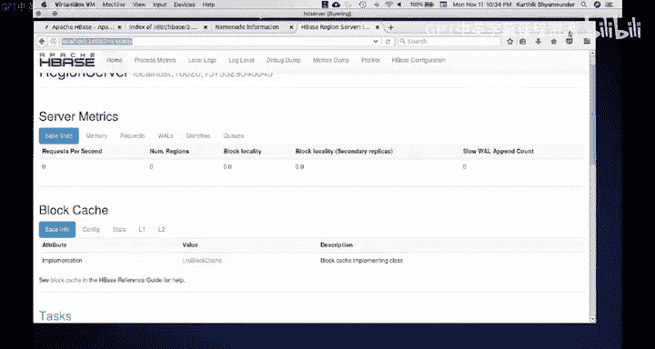

Okay， at this point， I would like to start the H base shell。

 which is a command line tool that allows you to interact with HB。Each base shell。Okay。

 so now at this point， I would like to launch the HB shell， which is a command line tool that。

There for you to interact with H base。It's very similar to SQL+， except it has its own syntax。

 but the idea is that you can create tables， you can drop tables。

 you can insert records using a space shellll。We are going to learn about HB shellll in the next section。

 but at this point all I want to do is launch HB shellll。

Because if I'm able to run the command line tool。

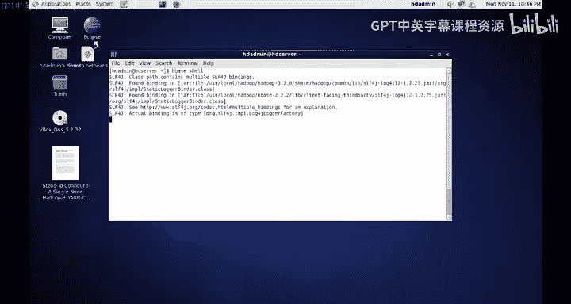

That means my。Installation is successful。HB shellll is coming up。

 it's connecting to H master and H regionion servers and zookeeper。If I type in list。

It should say there are no tables。Yes， there are no tables， I can create tables over here。

 which we'll talk about in the next section。I can then quit。There it is， I quit my H pay shell。Now。

 if I want to shut down H base， I simply say stop H base。

And that should shut down the H region servers and then the H master and then the zookeeper。

If I do a JPS now， you will notice that now the H based servers are running。In this section。

 we learned how to download， install， configure， and run HBase in pseudo distributed mode in our development environment。

