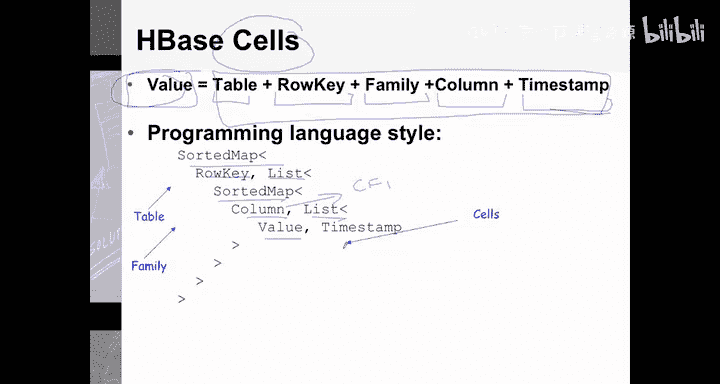
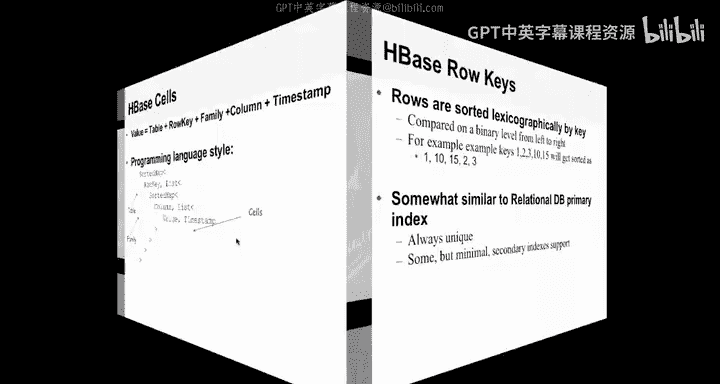

# 约翰霍普金斯大学《Hadoop大数据处理｜Big Data Processing Using Hadoop》中英字幕 - P87：22_HBase数据模型解析.zh_en - GPT中英字幕课程资源 - BV1g5u6zBExs

Hb data model。In this section， we will look at the H based data model。

 which is a flexible column oriented key value pair， column family based data model。

This is different from the traditional RDBMS data model that we are used to。

 so let's take a look at it。

In H based data model， data is stored in tables， so that is very similar to relational databases。

But under the hood， the data is really stored in HDFS if you think about in relational databases。

 we have tables， but under the hood it's stored in regular file systems， here it's stored in HDFS。

Tables contain rows， very similar to what we have in relational database systems。

 The rows are referenced by a unique key。Very similar to relational database systems again。

 the difference is the key is really an array of bytes。It cannot be a string。

 it cannot be an integer。 it is only an array of bytes。

 which is in a way good news because anything can be a key。As long as it can be serialized。

 so from that perspective， a string， a long or any of your custom data types can be a key as long as it's serializable and can be stored in terms of bytes。

Rs are made up of columns very similar to what we have in relational databases。

 but the difference here is that the columns are grouped into what is called column families so within a row you have a column family and within a column family you have columns so that's where it starts separating from relational database systems what that means is a data which is a cell is really a combination of a row and a column family and a column these three things together make a cell or make a row and that's where you put your value。

Let's look at age based families。Rs are grouped into families。Labeled as family column column。

 that's where the cell comes in， so user can be the column family and first name can be the column name。

This is a way to organize your data， it just so happens that this is a flexible way from the perspective that the column families are actually static。

 predefined， and then the column names can be dynamic and added on the fly during the code execution。

There are various features that are available to column families， for example。

 you may want to compress a column family， also you may want to control the in memorym option for a column family。

 you may want this column family to be loaded into memory or get mode memory。

And all the values that are there in a column family are stored together in one file。

 which is the H file， the stored file in HDFS so if you have a table that contains three column families。

 then they'll be stored in three different files within a column family。

 all the columns and their values are stored within a file。

 so basically what it means is a file contains a column family and of course all the columns and their corresponding values。

As I mentioned to you， the family definitions are study when you create a table。

 you basically say I want these three or four or five or 80 different column families。

 typically column families or in the single digits or maybe in the teens that's about it I've never seen column family in the teens it's either four or five different column families or maybe a couple of column families。

 but it can be in the tents if you want to， it cannot go in the millions。

 you don't create column families in the millions。But in terms of columns。

 you can have millions of columns within a column family。A little bit more about。

H based families family name must be composed of printable characters。

 which means they need to be printable strings。No weird characters。

 no binary characters in the family name。And if you think of a table as a spreadsheet and columns as the columns and the spreadsheet。

 then you can think of the family name as a tag for a cell and not really as a separate spreadsheet。

So the way I want you to think about H based table is that you have a table。And then you have rows。

 there's your row 1， there's your C1， C2， C3。Think of these three columns belonging to a column family called F1 and really in that from that perspective think of this C1 having a tag called F1。

 C2 having a tag called F1 and C3 having a tag called F1 you can also have another column called C4 you even be called C1 and those two columns belong to another column family called F2 so think of C4 and C1 as having tags called F2。

Columns on the other hand， are not static， as I mentioned to you。

 you can create new column names at runtime on the fly and they can scale two millions of column names for a family。

 but as the column family you have to know beforehand and created at the time of table creation you can always alter a table to add a column family that's not a problem but it has to be created as part of the schema When we get into H basease shell。

 I'll show you how you create a table with a column families in it。

So rows are really composed of cells。Which are stored in family colon colon combination。

If you have a row ID of row1。If it has a column name called column 1 which is pointing to a value called value 1。

 it may belong to a column family called family 1 In this case I have a row called row 10。

 which contains a column called column 1 with a value value 1 in column family 1。

 but it also has another column called column 1 with a value1 in column family 2。

 So the point here is that you can have the same column name for a row in two different column families。

 not a problem at all， So this cell right here is really a combination of row 10 family 1 column 1 this cell over here or this value over here Val 1 is really a combination of row 10。

Family too。Column 1。H based timests。H based cells are actually versioned and they are versioned to three by default。

 which means when you insert a value for a cell， it by default will maintain three different values。

 including the current value。So this gives you another dimension to identify your data。

 which means you can not only say for this particular row for this particular column family。

 for this particular column， give me a value you can say for this particular row for this particular column family。

 for this particular column for this particular timestamp or between this particular timestamp or something lesser than this particular timestamp。

 give me the value， so you can also，Identify your data based upon the timestamps in other words you can get the older version of a cell if you choose to have multiple versions and three is by default。

 you may decide to have five as default， you may decide to have none as default in other which you only want the current value it all depends upon what your application needs are the timestamps are either implic timestamped by region server or explicitly provided by the client so clients also when they insert a record into the H based table cell can say that they want this particular timestamp for this particular cell。

When you read a record， when you read a cell， you're going to get the current value。

 which is the latest value， but you can always ask for older values if you want。And as I mentioned。

 you can specify how many versions are kept that you define in your table definition to be precise in your column family definition。

So it looks like everything is revolving around this concept called H based cell。

And so what is an Hp cell value， it is really a combination of a table for that particular table。

 the R key or the R ID， for that R ID， the family name， and for that family， the column name。

 and for that family， the timestamp， if you have this as the combination。

 you can get to a specific value。And so if you really think about it。

 an H based table is really a sorted map。Of rookie， which is maintaining a sorted map of columns。

With a list of values， and of course， these columns are tagged by a column family and of course。

 every value is tagged by a timestamp。

Let's look at the H space row keys When you insert a record into an H space table。

 all the rules are sorted lexxiographically by key and they are actually compared on a binary level from left to right so whenever you insert a record you have a key for that particular record that key is translated into bytes and then they are lexiographically sorted based upon the bytes For example。

 if you have keys 1，2，3，1015， itll get sorted as1，10，15。

2 and 3 notice it's not getting sorted in numeric fashion。It's not a numeric sort。

 it's a lexxiographic sort it's a string like sort。 So when you have110。

 it's like dictionary order so you can almost think of when you insert a record into an h based table。

 it is similar to the relational database， primary index if you think about it a relational database primary index。

 it always stores things in a sorted order and it's always unique and also there may be some secondary indexes support it's very similar to that and you can think of secondary index as column family and timest。

Here's an example that kind of puts all the different concepts together in a single table What you're seeing over here are two rows。

 row1 and row two。You're also seeing。The timestamp that is being maintained internally by HDFS。

Then you're seeing two families。 You're seeing the。Name family。

 and then you're also seeing the address family， these are the two families。

 we know that each family gets stored in a separate file。

What you're seeing here is that row1 for the name column families column name first name has a value of Bob row 1 for the name column family last name column name。

 the value is Smith， row 1 for the address column family number which is the house number is 10 row 1 for the address column family street is first name。

 you'll see the timests at which those cells were created and then at T 10。

 the street number were updated and at time T15， they were also updated again。 So if you ask Hpa。

 give me the value for row 1， give me everything about row 1。

 you'll say that row 1 name column first name is Bob name column last name is Smith。

Add dresss colon and number is 7 because that's the latest value。

 Address Coin street is last street because that's the latest value。

 Notice it's also maintaining the older versions and it will maintain three order versions totally which includes the current one So current one。

 the previous one and the one before that three versions totally it's maintaining the three versions at this point。

 but when you ask for it to give you the contents of row 1， itll give you the latest one。

 you can always ask it to give you the order content the previous version itll give you that too and by the way。

 if you end up updating the street number again at maybe time 31 to8 and gone Street then the first set of values will be deleted and the reason it will be deleted is because it can only maintain three values total by default Of course you can change that number when you create the table you can say how many versions you want and similar thing is true for row2 I know it feels a little complicated but when we get。

Get intoto the eight space shell， you'll see how all these things actually。Work。

So when it comes to H based cells， you can ask for the most recent value， which is the default。

 you can ask for value based upon a specific timest。

 or you can get multiple values such as ranges of timestamps。

 you can say I want all the values for this particular cell from this time to this timet。

In this section we looked at the HBase data model and we saw how HBase stores data in HDFS。

 HBase tables have column families， each column family is stored in a separate HDFS file。

 column family can have columns， columns can have values and columns can be added on the fly dynamically。

 column families or static， column names can be dynamic as you're running through the program。

 you can run column names on the fly。We also saw that HPase stores values based upon timestamp by default it stores three versions。

 including the current one， you can always change that value when you create the table you can say how many versions you wanted to store。

 or you may want to only want to store only one version。

 you can also ask for a value based upon the timestamp， also ranges of timestamps。

 and if you simply ask for a value for a cell， it'll give you the latest one。

