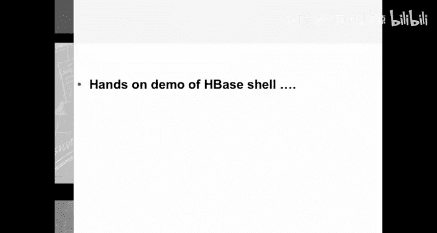
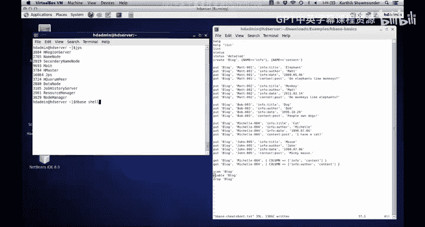

# 约翰霍普金斯大学《Hadoop大数据处理｜Big Data Processing Using Hadoop》中英字幕 - P88：23_HBase终端操作.zh_en - GPT中英字幕课程资源 - BV1g5u6zBExs

8 space shell。In this section， we will look at the interactive H base shell。

The HBase shell is a J Ruby interactive shell， it's a Jruby IRB which is the interactive Ruby shell。

 in other words it's the J RuB shell with HBase commands that have been added to it so that you can execute many of the HBase commands。

 to create a table， to put records into the table to delete records from the table to scan the entire table and also to perform other DML at select and also to perform administrative operations。

In order to run the H space shell， all you have to do is type in Hspace space shell on command line provided that you have the HB bin in your path。

 you should be able to execute this and that would bring you into the interactive Ruby shell。

 so here we are at the interactive Ruby shell。And it's saying that it's ready to take your first command and execute the first command。

If you type in Help， you will get a list of all the commands that are available in the IRB。

If you type in help followed by a command name， for example， help followed by get。

 which is a command， you need to make sure that you put the word get。

 which is the command within double codes， then it'll give you information about that particular command。

 examples of how to use that particular command。Please note that when you say help followed by the command name。

 the command name should be quoted。The codes can be single code or double code。

A bit more about codes， you must quote all the names， table names and column names must be quoted。

 it can be single quotes or double codes。Here I'm saying get T1， which is the table name R ID。

 which is my R ID， once again， it's in single codes。

You can you must use double quotes for binary here I'm saying I would like to get table T1s this rh ID notice in this particular case。

 the rh ID key is actually binary value， in such cases you must use double codes don't forget in H space the key can be binary。

 everything can be binary， In fact everything is binary， whether it's a key or it's a value。

You can also use Ruby hashes to specify parameters to commands。Here's the Ruy hash。

 the Ruy hash is within braces， here's the key key1 with the value value 1。

 key key2 and the value value 2， you can have as many key value pair combinations in Ruy hash and many times the H based Ruy shell commands take a hash as an argument so for example here I'm saying I would like to get user tables。

 user ID rows and I'm giving some more information and I'm passing a Ruby hash as the rest of the parameters。

A bit more about the HB shell， H page She supports various commands。

 it supports a bunch of general commands， for example。

 status and version give you information about your HP。You also have DDL commands。

 which is the data definition language commands that allow you to create a table， describe a table。

 disable a table， drop a table， enable a table， even alter a table。There's also DML commands。

 which are data manipulation language commands that allow you to put records。

 allow you to delete records。Put is also used to update records， scan and get to retrieve records。

 truncator table， even count all the。Records in a table。

 So there's a bunch of DL and select commands over here。

And then there's a whole bunch of cluster administration commands don't forget HSpase is a database it's a no SQL database and databases typically have some kind of a DBA so it's possible that one of you may want to become an HB DBA in that case there's a whole bunch of cluster administration commands that are available that are commands associated with balancing the cluster flushing the contents from the cluster zookeeper related commands。

 replication associated commands， there's a whole bunch of commands that are associated with cluster we're not going to be talking about the cluster administration commands in this class。

Once again， if you want to get more information about a command， all you have to say is help。

And then the command name within double quotes， it could be any one of these commands。

 and it's going to give you information on how to use that command。

HBase shell check status command Once you're in the HB shell。

 you can type in status to get status information about your HB server。

 you can also type in status detailed that'll give you detailed status information about your HB server。

The information that is returned in status detail is very similar to the information that is found on the HBase web Management console that I demonstrated to you when we installed HBase。

Here's the Hspace check status command in action， you go to the interactive shell。

 you type in status， it's saying to you that there is one server running there are zero dead servers。

Also when you type in status detailed， it's telling you it's using version number 0。99。1。

 it's telling you this one life server， it's telling you that there is no server that is coming up at this point transitioning。

 and then it's giving you information over that one instance which is running on 16201。

 which is your region server and's telling you what region it's serving and what table it's serving and all the other related information。

 it's a pretty good command when you have a big cluster you want to get information about your H based cluster。

The HSpase shell DDL and DL commands can be used to create a table。

 populate the table with data records， access data， edit data， delete records and drop the table。

 which is exactly what we are going to do， we' are going to walk through an example where we' are going to be executing all these different types of commands so we can see how HSpase She can be used。

Creating a table in order to create a table calledB with the following schema and the schema here is that there is a family called Info family and a content column family for the blog table。

 the info， family contains title， author and date。The content Q family contains only one column called Post。

So we would like to create a table called blog。With two column families， info and content。

 the infofo column family contains three columns， title， author and date。

 the content column family contains one column called post。

The way we create a table is by typing in create command。

You can say create T1 which is the table name and then you can pass the Ruby hash map here you're saying that the column family name is F1 and you want the column family to maintain five versions of all the columns if you recall we talked about how versions of a cell can be maintained here you're saying that。

Here I'm saying I would like to create a table called T1。With a column family F1。

I want to maintain only one version and also I have a TTL。

 the TTl here says that when you create a cell， it should live only that longer time once the cell is created and that time has expired。

 the cell should be automatically deleted This is pretty cool feature in H space。

 you can create a record in H base you can create a cell in H space and you can say how long that particular cell should live how long that particular record should live in this particular case。

 how long that particular column family should live which means all the cells within that particular column here I'm creating a table called T1。

The first column family is called F1， where I'm taking the default versions of three and no TTL。

 I'm creating a second column family called F2 and a third column family called F3。

 all with default versions and TTL， which is live foreverL default TTL is live forever。

Here I'm saying create a table called T1 with F1， F2 and F3。

 it's very similar to what I did in the previous these two statements are equivalent。

So let's go ahead and create the blog table。I say create blog and I'm saying it's got a column family called infofo and another column family called content。

It'll maintain three versions of each cell， and the TTL is basically live forever。

Now I would like to populate the table with data。Here is some example of the data that I would like to populate。

 in fact I would like to populate it with five records MA 001 is the RI for the first row， MA 002。

 Bob 003， Michelle 004， John 005 or the five R IDs。And then I have for the first row Matt 001。

 the title as elephantleant， the author is Matt， the date when the blog was published as 200956。

 and then the contents of the post is two elephants like monkeykeys。Similarly。

 I have five of the records which I would like to add into HB。

The way I add records into H base is by using the put command， I say put。Table name， R ID。

 that would be this row ID right here。Family colon。Colum name。

 so you have to say what the family name is， which is the column family name is call the column name。

 and then you can say what the value is， that's what gets inserted。

 that's how you insert a single cell into H base。So I would like to insert records into HBase。

 the five different records that we talked about， the way I would insert the records is by typing in my HBase shell。

 put into the blog table， mat 001， infofo called title。

 the title of the blog as elephant put into blog table， row ID， here's another cell。

 which is infofo call author， the column Familys info author is the column name with the value mat。

 and here's the third put， again， insert into the blog table for the row mat 001 infofo column date as 200956。

 put blog mat 001， same row ID post to be two elephants like posts。

So that's how I inserted the first row， Similarlyly， I can go ahead and insert the rest of the rows。

Once you have inserted the records into the H based table。

 you can use the count command to get a list of the number of records that are there。

 the get command to retrieve a single row and the scan command to retrieve a range of rows Let's look at the count command。

 you can type in count table name this will scan the entire table it may be slow for a large table because a table can have millions of cells and it can have billion of rows。

 so you can specify count to display every end rows。Defa is 1000 if you say count T1 Interwell 10。

 which means what you're saying is that you would like table T1 to be counted and you want to print out how many records are there in table T1。

 but as it scans through the table， every 10th record you want to print saying 10。

203040 is 167 records， so you'll go 1020， 30， 40， 50， 60， 70， 80，90，100， 110， 120。

130140160 and then 167 if you have 167 records。Okay， so let's see the count in action。You say count。

Blog。Interval2， in this case， I'm saying I would like to count the blog table and every second record it needs to print out。

So notice it says count two， count4， it's actually printing every second rocket。

If I say count blog interval1， every record is going to be printed out as it goes through。

 it's just a way to see that it is making progress if you have 140 million records。

 you may want to see that it is actually making progress so you might want to say count blog。

Interval 10，000， which means every 10，000 records， it' going to say that it has reached that particular account。

So that's a nice way to figure out what's happening when you do account。

You can use the get command to access the contents of a row。

 the way you use the get command is you say get， the table name， you say the row ID。

 and that should give you all the cells that are associated with that particular row ID。

You can also optionally pass a timestamp or a time range and even the versions that you want to retrieve。

 you can say I want the latest。Or you can say I want the last two versions or you can give a timestamp and given the timestamp。

 it'll return you all the versions within that particular timestamp。

 You can also select specific columns here I'm saying get T1 row 1 and I'm saying what columns I want in this case I'm saying what columns I want I want C1 C2 and C3 here I'm saying I would like to retrieve the contents of a row based upon a timestamp or a time range Don't forget that every cell has timestamp associated with it So now you can actually say you want the contents of。

T 1 or1。Wwhichch is table1， row 1， and you want the cells that are between these two times times yet I'm saying I would like to retrieve the contents of R1。

 which is in table T1。I want to get column C1， and I would like it to be of this particular timetamp。

You can also select more than one version， so in this case I'm saying I would like to get。

Row1 from table T1， and I want the previous four versions by default。

 it gives you the latest version。Here's the get command in action， you say get blog unknown ID。

 which is the unknown row ID， in that case it says zero rows found。You can say get blog Michelle 004。

 we know that exists， so notice it's actually giving you all the cells。

Here I'm calling the get operation on Michelle 004 row ID here I'm saying I would like only the author。

Column and the post column， and that's all you get。

Here I'm saying I would like to get for Michel 004， the author post column。

 but it has to be something that is that matches。This specific timestamp。

There is also a scan command available to access data the difference between get command and scan command is get command works on a row。

 the scan command works on a range， so the scan command can be used to scan the entire table or portion of a table using the scan command you can get the entire row or explicitly retrieve column families columns or even specific cells if you say scan table name that is going to basically go through the entire table and list out every cell if you say scan table name limit one but is only going to give you one row。

If you say scan blog， in this case， you're scanning the block table。

 but notice here you're passing the start row and and， which means it is going to start。

From a row ID with this particular row ID and it is going to stop at this row ID。

 notice the start row ID is inclusive， so it's going to start from this row and then it is going to stop at this particular row。

 but stop row is not inclusive， it's exclusive， it means it stops right before the stop row。

You can say scan table and select the columns that you want to select。

 you can also say scan table and then the time range。

 which means it's only going to give you cells that match that particular time range。

 it's quite flexible as you can see。Here I'm saying scan。Blog。

 that's going to scan the entire table and grab all the columns。

 so you'll see that it's actually printing out all the columns for all the different rows。

That's like saying select star from blog。You can say scan the blog table， stop row John。

 which means it's going to start from the first row， and then it is going to stop at John。

 notice it prints Bob and John was the next one and it actually stops at John it doesn't include John it will not include John。

 it will print everything before that。Here I'm saying scan。The blog table。Print out。

The info call and title。And also saying that it should start from the row John。

 and it should stop at Michelle。So what you'll see is that it starts with John。And then goes into MA。

But then it does not print Michelle。That's the idea here。

You use the put command to insert a new value if the row ID does not exist。

 but you also use the put to update the value if the row does exist。

 so the point I'm trying to make is the put command is used to add or perform create operation and is also used to perform an update operation that's because the put command will insert a new value if it doesn't exist or update a value and the way it updates a value is by doing a new insert with a new timestamp that is the fundamental principle behind H base。

 there is no concept of updating an existing cell or updating an existing column it's all about adding things in。

 you're constantly adding things in with new timestamp。

That's the architecture so the question here is does it really update when you're doing a put you're really inserting a new cell and so when you're saying that you have seven versions of a table with the Colin family family。

 then what you're really saying is that as you do the update but as you do the put operations to do the update。

 it is going to maintain the last seven copies for that particular cell。Don't forget。

 three was the default。So here I am ready to make some changes， edit the data， put blog Michelle 004。

 I would like to change Michelle's information。The date of the blog to this particular date。

 which I'm changing to 19976， and then I change it to 19977， and then I change it to 19978。

Basically what I have done right now is ended up putting three more cells， I had the original value。

 but now I've put in three more values into the cell。When you do the get operation on blog。

 you're going to get。The latest value， but here I'm saying I would like to get the last three versions。

 notice the last three versions where6，7 and 8， and it's actually showing you the last three versions。

It's showing you the latest one at the top， the second latest one。

 and then the third latest one in that order。Because that's the order I inserted the records。

When you do get blog on Michelle and you say。You want the last two versions。

 it'll show you the last two versions。If you simply say getB on Michelle4 and ask for the cell。

 it shows you the latest version。It's also possible to delete records。

 you can delete a cell by providing a table， a R ID and column coordinates， for example。

 you can say delete table the R ID and then the column name。Optionally。

 you can also put the timet so you can say you want to specifically delete this particular cell with this particular timetamp。

And that would be their last。Pva。Let's look at delete operation。To a get blog boB 003 info date。

 I found out that Bob 003's blog date is 1995，1020。

I delete that cell now when I do a get operation notice it says it cannot find anything。

 no information is found。Zero rows， basically I have deleted that particular value。

Using the delete operation here。Here's another example of delete here I'm going to show you how deletion based upon a timestamp works。

I say get blog， Michelle 0，0，4。Get me the date column and I want the last three versions。

So notice it's showing me the last three versions， the latest version。

The second latest version and then the third latest version， this is the latest timet。

 this is the second latest timetamp。And this is the third latest time stamp if you notice this number is higher。

This number is higher than this number， which is higher than this number。

When I say delete blog Michelle 004 which is the OID info column date which is the column family column column name。

 and then I say here's the timestamp， this timestamp is actually one millisecond after the second version。

 which is it's one milliseconds of 791 is right here， it's one millisecond after that。When I do that。

 it is going to delete the last two old records would be deleted。

Now when I do get blog Michelle 004 column info column date， versions 3。

 well there is only one version left， which is the 19970708 version and that's the only one version record that is shown right now。

 even though I'm asking for three versions， it's not available anymore。

It is also possible to drop a table if you create the table， you should be able to drop a table。

But you cannot drop a table just like that， you have to disable a table before you drop the table。

 so you disable a table by saying disable a table name and basically what you're doing is you're taking the table offline and then you can go ahead and drop the table。

For a large table， it may take a long time to actually drop the table。

The way you can figure out the list of tables that's out there is by executing the list command。

 they'll tell you all the different tables that are there here I only have one table in my schema。

 which is the blog table。I disabled the blog table。And then I dropped the block table。

And then I list the block table， notice there are no tables left anymore。

Let's do a hands on demo of the8 page shell。

Here I am logged into my HD server VM as HD admin user ID。

 I would like to demonstrate HB Shell well first let me make sure that HSpase is running。

Type in GPS Yes， all the Hadoop demons are running and the H base demons are running the way you launch H base shell is by typing an H base space shell if you have added H base underscore home slash pin to your path。

 this should not be a problem at all。

There it is， it's launched， at this point I would like to execute some of the H base commands to show you how the H base shell can be used。

The first command that I would like to execute is the help command。

 but if you look at the screen on the right hand side。

 I have an editor here and I have my cheat sheet of all the commands that I'm going to execute so you can see what I'm doing The first command I would like to execute is help type in help that is going to give me a list of all the commands that's available in Hpay She。

It's telling me all the commands that are available in each space She。

 nor does it's telling me about the DML commands， the tools， the namespace commands。

 snapshots commands， all kinds of administrative commands。

And then I can also do help list list is actually a command that lists all the tables that are there near Hspace。

So type in help list。It'll give me information on how to use the list command。

So it's telling me how I can use the list command。I'm going to say list。

In this case it's going to tell me all the tables that are there and there's only one table which is called the H base samples that is the only table that's there in my H base Now I would like to execute the status command。

Type in status。Gives you information about your server， says there's one server。

 it's one region server。If you say status detailed。I status。Detailed。

They'll give you detailed information about your H based server。In this case。

 it's telling me that there is。One live server， it's also telling me that the version of Hbase we are using is 0。

99。1。 It's telling me that there is node servers that have come down and is transitioning up。

 It's also telling me where the Hbase， the region server is running， which is put 16201。

 and then it's also telling me that there's a table called Hbase samples。Also。

 there's an internal table called H based metadata that maintains a metadata of all the tables that are there in H space。

Right so it's pretty much giving me all the information that I can find in the H based admin console。

 the web console。Now let's go ahead and create a table called blog。

 I would like to create a table called blog with a column family called Info and a column family called content。

 So I'm going to copy that。Paste it。There is a creator to the table called blog。

Now I would like to say。Scan blog that will show me all the records that are then in blog。

 and there are no records that are then blog。 Don't forget， when you add a record。

 you're actually adding cells。 So I'm going to add the first cell。I would like to add。

The R ID map 001。The info title。Which is the infofo called and title column Family In。

 title column name has a value of elephant， copy that。Paste it。Now I can see scan。

Youll show me that one cell。Copy， don't forget， scan allows you to scan the entire table here there's only one cell。

I to the second one。Scan， now I see two cells。I want to make it a little bit faster here。

 copy both the lines。Copy and paste it。You done。Now I'm going to execute the scan。

There is it showing me all the four cells。So I got Matt。I can also do。Get。Blog。Mat。

So there's a one that's going to give me the match record。Which is all the cells。

Let's go ahead and add all these guys， the four of the rows。copy。Taste。Not it all of them。

Now when I do a scan。On blog， it's going to give me all the records， all the cells you enter。Yep。

 it's giving me all the records and all the cells。Notice when I added the five rows。

It's in the lexxiographic order， the way it stores all the cells。It's st them in lexxiographic order。

 it shows Bob first， then John， then Matt 001， then Matt 002， then Michelle 004。

 Michelle 004 is their last record， even though it was added before John。Okay。

 so now what I would like to do。I say， get。Blog。I'm going say， Michelle。0，0，4。There would be only。

Michelle's record。I see only her record here。I can also。Do a scan， which gives me all of them。Right。

 we saw that scan。blog。And I also have the start row and concept， you can also try that。Okay。

 so that works。So we saw how to create a table， how to put records into the table， how to get。

A specific row under a specific cell， we can even get a specific cell。

Now I would like to demonstrate the drop table option， I want to drop the table。

Let me go ahead and try to drop the table， drop。Blog。

Notice it says table can be dropped because it has to be disabled first。

so let's go ahead and disable it。Disable blog。Alright， that's disabled。 Now， I'm going to say。

Draw blog。That you， that you drop it。Theyre a dead。 If I say less now。Cos。No， semi Collon。

There it is only one table， which is the H based samples table。

That gives you a pretty good idea as to how you can use the J Ruby interactive shell to interact with H base。

In this section， we learn how to launch the HPase J2B interactive shell so that we can interact with HPase server to create tables to insert records。

 delete records， update records， and even scan the entire table and print it out。

