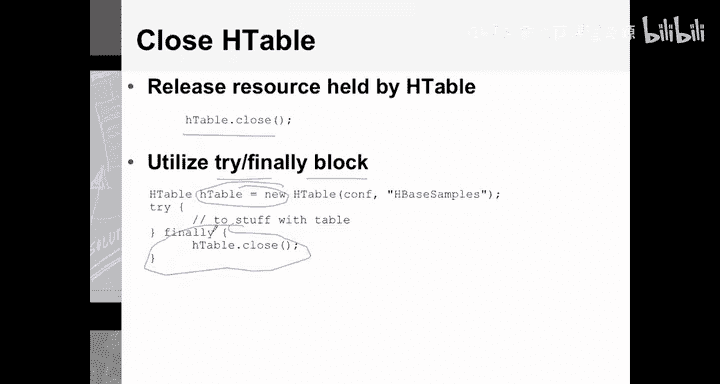
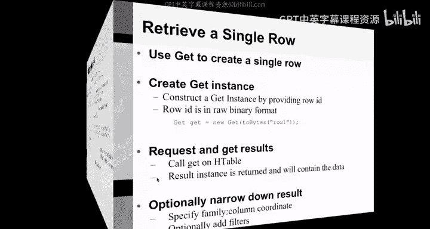
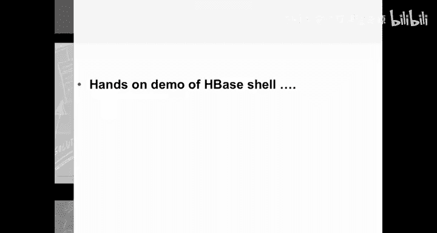
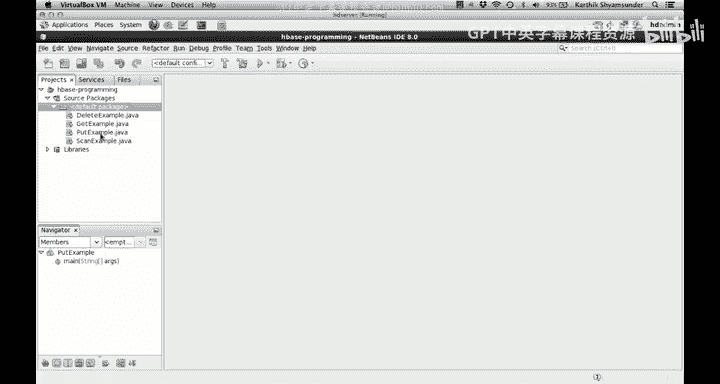
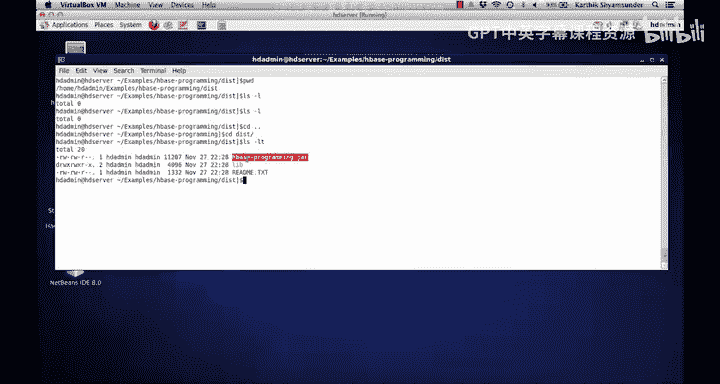
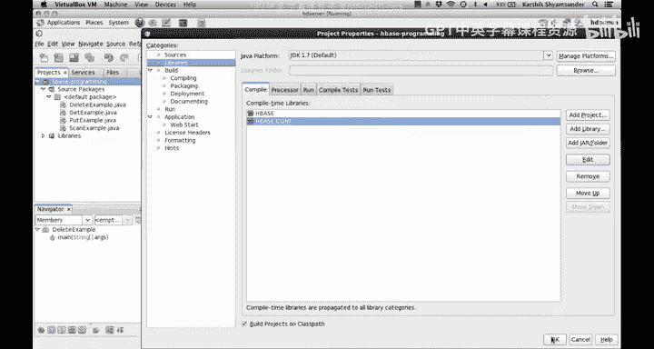
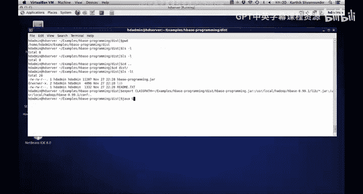

# 约翰霍普金斯大学《Hadoop大数据处理｜Big Data Processing Using Hadoop》中英字幕 - P89：24_Java API实现增删改查.zh_en - GPT中英字幕课程资源 - BV1g5u6zBExs

HP Ch using Java API。In this section， I'm going to show you how you can use HBase Java Chrod API for manipulating and querying HB tables。

HBase is written in Java， so it's no surprise that it has a Java nativeative API。

The jaative API supports programmatic access to manipulating data in age based tables。

 and that's primarily the operations。Everything that you can do。

With HPPce Shell can be done using the Java API， including D operations and more operations like administrative operations can also be performed using the Java API。

But in this section， I'm going to show you how to perform DL operations。

And some select and scan operations using the Java API。

The Javava nativeative API is the fastest way to access the records in HP table。

 of course there are other mechanisms available to manipulate and access the records in HP table。

 which include the H based shell， which we already saw and also a full service。

Here are the steps for general client API usage first you create H based configuration object if you recall from Hadoop HDFS there is a configuration object that is an H based configuration object that is built on top of the regular Hadoop configuration object which contains H based specific properties。

 so you have to build this H based configuration object first。Then you build the H table object。

 the H table object represents the H based table This is constructed by passing the configuration object。

 which is the H based configuration object as an argument and also the table name which that you want to manipulate as an argument。

 then you perform operations， you can perform scan operation to scan an entire table。

 put operation to put new records and new cells into a table。

 get to retrieve a or a cell from the table， and delete to delete a row or a cell from the table。

Once you're done you close the H table instance， which actually internally flushes all the internal buffers and releases all the resources This is the general idea throughout this particular section we will be looking at these four major functions。

One of the first things we have to do before using the Cr API is to create an H based configuration object。

 the H based configuration object represents the H based client code configuration。

The H based configuration object is located under org Apache， Hadoop H based package。

 so you need to make sure that you include the H based libraries as part of your class path。

You create an H based configuration object by simply going to H based configuration class and calling the create method。

 and that would return you back a configuration object。

The configuration objects create method actually loads the Hbase dashD4 dotxm from the package to jar file。

 and that's the jar file that you need to add to your class path。

 you need to make sure that all your H basedase jar files which is located under Hbase home/lib directory is added into your program class path and also you need to make sure that the Hbase home/ conf directory which is the configuration directory where Hbase dash side dotxm exists you have that also in your class path because the Hbase dash side doxm contains information as to where the name notice so when you do C operations。

 Hbase can go in and write records into the right location。

The next thing we need to do is construct an H table object once again， the H table object。

 which is the H based table object， is under H based package。

 so you'll need to include the H base package。And the H table object is the client interface to a single H based table。

 All operations that you do on your H base table has to go through this H table object。

As we mentioned， this H based table object exposes all the ChD operations and the operations that change data are atomic on a per row basis。

 so if you're going to be changing three cells on the specific row that would be atomic。

 but if you change three cells in one row and two cells in the other row。

 then the changes in one row will be atomic， the changes in the other row will be atomic。

 but the whole thing may not be atomic。So you have to be a little bit careful about that there is no built in concept of a transaction for multiple rowsor tables。

 that's what I just mentioned， and so there is only 100% consistency per row。

 it's not a problem when you have one writer and multiple readers。

 but it becomes a problem when you have an application。

 when multiple writers or writing to the same age based table。

 especially when they are writing to the same age based record。

And it doesn't really matter on the number of columns written per request that， you know， it is。

 we know that in each space。There are like we know that in each space。

 there can be millions of columns， so it doesn't really matter how many columns you're going to be writing to。

Everything that you do to a column， everything that you do to a row is atomic。

The way you construct an H table is by instantiating an H table object。

 passing to it the H based configuration object that we just learn how to instantiate。

 and also passing the name or the table which the H table should represent。

Creating an H table instance is not free， it's a pretty expensive operation because when you create an H table instance。

 it scans the catalog， the dot Me table， it has to talk to the H master。

 get information as to where the shards are。It checks that the table does exist with the H master。

 you should really create one H table per thread and reuse it as long as possible if you find yourself constructing a whole bunch of these H table。

 then you can use the H table pool class， which is a utility class available for you as part of HB。

H table is not threads safefe， so if you have in your client five or six different threads that are going to be using the H table object。

 you cannot do that， you have to have every thread have its own H table object。

Let's look at the create or put operation that allows you to pull a record。

Or put a cell or update a cell in H based table Put is a save operation for the single row。

It must provide a row ID to the constructor because when you are putting you're putting values into a specific row。

 So when you instant a put object， you pass to it the row that you want it to work on but everything in H base is stored in bytes。

 including the key and the values and so you are responsible for converting the IDs into bytes。

 there is a utility class called the bytes class that is a method called two bytes that can take your string。

 which is your rh ID and convert it into bytes， because that's what the put constructor requires。

 you'll see this continuously throughout the Hb API you have to convert all your strings into bytes because that's what。

The internals of age base really handles。 You can optionally。

Instiate a put object by passing a timestamp， if you remember when we looked at Hpa shell。

 we talked about how you can put an entry in HB table row based upon a timestamp。

 you can pass a timestamp as an argument。Once you have the put object in your hand。

 you can add columns to the put object so that you can save it into the H based table。

You can go to the put object and call the add method passing to it， the column family。

 the column name and the value， or you can go to the put object and pass the family， the column name。

 the timestamp and the value。So there are these different options available for you don't forget that the value has got to be binary。

 so you need to make sure that you convert it， so here I am going to the put object calling the add method。

callling the two Btes method， which is the Btes do2 Btes method， the bytes classes， the Uary class。

 calling the two Btes method， passing to it， the column family name， once again。

 converting the column name to two Btes， and then passing to it the value and converting it to two bytes before I send it to the add method。

The bytes class is the class that's the utility class that's got the two Btes method that I'm taking advantage of over here。

 and I'm doing an import static of the bytes class and that's the reason why I'm not really prefixing the two Btes method with an object or a class name。

I'll show you this in the code。Once you instantiate the put object and you've added all the values。

 then all you have to do is go to the H table object， invoke the put method on it。

 and pass the put object that he just created。Whenever you do an Hbased C operation on an H table。

 you should close the H table so that all the resources are released back。

 you should also utilize the tryfin block so that you instantiate the H table object and in the finally object you do the cleanup。

 of course in Java7， you have try with resources， you should probably take advantage of Tri with resources concept。

Here's for example in this example， I'm going to show you how you can insert a record into an H based table。

Here I am instant sharing the H configuration object， which is the H based configuration object。

And then I'm creating the H table object， passing to it。

 the configuration object and the name of the table， which is H based samples。

I'm instantiating a put object， passing to it， the key， which is the rh ID。

And then I'm going to the put object， which is put one， adding the column family， the column。

And the value。So this is the column family name， this is the column name。

 and is the value right test is the column family name。

 column one is the column name and value one is the value。

I'm adding one more column family name is test。Coollumn 2。

Is the column name and then its value2 is the value of the cell。

 notice how I'm converting all these things to bytes， that's important。And then eventually。

 I go to the H table object。Call the put method on it and then pass the put object to it。

And I'm done eventually I close the H table。So this example shows you how you can create a record in H based table。

Now that we have learned how to create a record in H table。

 let's look at how we can retrieve a single row from an H based table。

You use the get object to retrieve a single row， all you have to do is create an instance of the get object and the way you do that is say new get and you pass the R ID don't forget you need to convert the R ID into bytes now you have a get object in your hand。

Now all you have to do is go to the H table object and invoke the get method passing the get object。

 what it returns you back is a result object。The result object is。

Really an implementation of an interface called Re。And once you have the result object。

 then you can go ahead and get all the contents in front the contents out。Optionally。

 you can also narrow down the results。So let's see how we can narrow down the results。

You can only retrieve the data that you need。If you simply go and call the get method on the H table object。

 it is going to return everything around that particular row If you want。

 you can explicitly narrow down what you want， you can narrow down by family。

 saying that I only want this family， you can narrow down by the columns。

 you can also narrow down by time range and the version。

You can do that too if you have seen all these things in Hspace shell now we are really seeing this using the Java crowd operation you can also provide more than one narrow down criteria it doesn't have to be only you can narrow down by family only or by column only or by time range or only or max version only you can narrow down by a combination of these things。

Here I'm showing you how you can add a family saying that you only want this family。

 you can add a column， saying that you only want that column。

Here I'm showing you how you can narrow down by time range and also by max versions。Of course。

 by default 1， we'll show you the latest version。And here I'm showing you how you can go to the get object and you can narrow down by a combination of these things。

How do you use the get object？Well once you instantiate the get object。

 then you go to the H table object。 you call the get method passing to it the get object with the criteria。

 It returns you back a result that represents the。Specific row and the specific columns that you've requested。

You go to the result object， you say get row that gives you the row ID which is the key。

 and then you can go to the result object， and simply invoke the get value method， passing to it。

 the column family name， the column name which will give you the values。

 which is really a byte array and then you have to convert it to appropriate strings or whatever you want。

 and then you can turn it out。So here I'm showing you how you can retrieve the different cells from the result。

So everything relies around the result class， which is the result object。

And the result object allows you to access everything that is returned by the get call。

The one method that we just looked at was get row， they'll give you the row ID。

 but we also looked at get value， but there is a few other methods available you have is empty to check to see if the result is empty。

 you also have size returns the number of cells that you got back。

 and also contains column you can also say does this contain this particular column where you can pass the family column column name as an argument。

So there's a whole bunch of methods that are available in the result class that may be of use to you。

Here is the get example。Notice how I instantiate the H based configuration object。

And then I instant the H table object passing to it the configuration and the table name and I want to retrieve a specific row in this case row 1。

 so instant she a get object， passing to it， the row ID， I get a get object。

 then I go to the H table object， and move the get with it passing to it。

 the get object that returns me the result object， now I need to print the result object。

And I've written a method called print result that is going to print the result object。So。

 let's take a look at the。Print result method。 Here's the print result method that takes a result object。

It takes the result， in workss the getro method on it， which returns the row ID。

 notice the bys class also has a method called two string。

 just like the bys class takes a string and converts it to bytes in the same way it also takes bytes and converts it to string。

So now we have the R ID。In the same way， we can go ahead and get the value for a column family name and column name。

 which returns to you the byte array， and then you can surely use the bytes to string with it to convert it and print it out what I'm really showing you here how the result object can be used to retrieve the cells and of course the cells are in bytes and those bytes will have to be converted to strings。

There is also a scan class。A scan class is used to iterate through the entire table。

 if you want to list all the items in the H table or the H page table。

 then you can use the scan instance。It's pretty straightforward。 You construct a scan instance。

Once you construct a scan instance， you go to the H table object。

And you get a results scanner object。By invoking the get scanner method。

 once you get the results scanner object， you can iterate through the resultsult scanner object so that you can get the results and then you can print the results。

Let's look at the example。Here's an example that allows you to scan a table。

Here I am creating the H based configuration object， and I'm creating the H table object。

I have the H table object right here， then I instantiate a scan object。

Then I go to the H table object， invoke the get scanner method， passing to it the scan object。

 saying that I want to scan the entire table that gives me a scanner object。

 which is the result scanner object and notice how I go through a for loop。

Using an iterator and iterating through every result and every result is really a row。

 Then you can go ahead and print a row。 The print method is exactly the same print method that we saw in the previous。

Get example。Now I would like to show you how to do deletes。

There's a delete class that allows you to delete。A row， the led are on a row basis。

So if you have to delete10 rows， you have to delete each of the rows separately。

It's very similar to get or put。P allows you to put a row to be precise。

 put a cell in the same way delete allows you to delete a cell or delete a row。

 So the way you use the delete object is similar to get or put。

 you instantiate a delete object and then you use it in conjunction with the H table object。

Here's an example， you instantiate the delete object， passing through it， the row ID。

 you can go ahead and optionally narrow down the deletes。

Let's look at a little bit more about narrowing down the deletes if you instant a delete object and you do not narrow down the delete entire row is delete。

It is possible for you to narrow down the deletes by saying I would like to delete a specific family or a specific column。

Or even a method called delete columns， so notice that there are two methods over here。

 delete column and delete columns， delete columns deletes all the versions of the cell。

So if you have seven versions of the same cell， it will delete all the versions of the cell。

 whereas the delete column only deletes the latest version of that particular cell。

 if you have older versions， it will still be available。

Most of the methods are overloaded methods and they take timestamp as an argument because if you think about it。

 just like when you put cells， you can actually pass a timestamp and the same way when you delete。

 you can actually delete by timestamp。Here is the delete example。In this case， once again。

 H based configuration object using that and passing the table name。

 I get an H table object and stand sheet a delete object passing to it the R ID that gives me a delete object。

 then I go to the H table object。Invoke the delete operation passing through the delete object。

If I do not give any kind of criteria， it deletes the entire row， but if I want。

 I can simply say I want to delete specific cells， so I have the example right here。

 you can go in and a delete object passing to it a row。

 and then you can say I would like to delete only the metrics。Column Family loan column。

 and then you can go ahead and pass delete one to that and in that case。

 for this particular row called another row， it'll only delete the metrics column family with loan as the column name。

 only that particular cell will be deleted。So let's do a quick hands on demo。

Here I am logged into my HD Ser VM as HD admin user ID。I'm in my net beanss IDE I have a。

Project called H based programming In my default package， I have four examples。

 I have put example that allows me to put a record in notice。

I'm importing the J IO exception package， I'm also importing the configuration object。

 the base configuration object from Hadoop and H based configuration object。Also， H table and put。

That' are part of H base package。And this is the import static of the bytes so that I can do the two bytes operation。

Here I'm in sharing the H based configuration object。I'm instantiating the H table object。

 passing to it， the configuration object， passing to it， the table name， instantiate。

It put objects saying I would like to put row 1 in and then I'm saying I would like the column family to be test。

 column name to be column， the value to be V 1， and another cell with the column family test。

Val and the value Val 22， and then and I go ahead and put it。Say H table dot close。

 that'll close the table。If I right mouse click here。And run。E the example。So that works。

 you can go ahead and go to H page shell and take a look at the records。

 or you can actually call the get。Example right from here and see that the value has been inserted。

So let's look at the get example。Here's the get example。I want to get to the primary thing。

 which is instant a get object。I would like to get the row1， I get a result object。

 and then I go ahead and print the result object， here's the printing of the result object。

And then I also have a scan example that allows me to scan through the entire table。

It allows me to scan through the entire table right here， so notice how I instant a scan object。

 I go to the H table object get a scanner and then itray through and then print each one of the records by invoking the print method。

 passing toward the result。So that works too。And then there is also a delete example that allows me to deletearrow。

 so here I'm staiating a delete object。I didn't pass any filters to it when I say H table to delete passing the delete object。

 it basically deletes all the cells， so it deletes the entire row for you。Okay。

 so this is my project called age based programming。

 which is a foundation project that allows you to。Do the basic crowd operations。

My H based programming example is under my home directory examples H based programming。

And when you build。In your I E。Right most click。Clean and build。When you're building in your IDE。

There is a disk folder that's created and that's where the jar file is placed。

 so let's look at the jar file。You need to go back。Alright， so C D disk。

 because I was alreadying the disk folder and。The Uni system got a little confused， okay。

 there it is。Hpa programming do jar。 That's the jar file。

That I just created。For a project called age based programming that contains these four classes。

But I wanted to make sure that you understand that the reason my program is compiling in the IDE is because I've added H base to my path。

 so if you right most click and go to project properties。And look at the libraries。

 you'll notice that I have added H base as a library， if you look at。The library。

Here's all the jar files that I've added。For H space， it's important that you add this。Otherwise。

 your。Program is not going to compile。And notice that when you look at the H based library。

You'll see that it's got even some of the Hadoop classes。It's got some of the Hadoop cluster。

 in fact， it uses Hadoop 2 photo0。That's because the H based package or the H base project has already integrated with Hadoop 2。

4。0。So you don't really have to add the Hadoop packages into your class path。

 It's already there as part of H base。 So as long as you import the H base jar files。

That is the jar files that are located under Hspace home slashlib， then you're good to go。

It's also a good idea to add HB conf directory， which is the location of where the H base configuration is。

Once you've done that， you're good to go， that's why I was able to build it and I was able to run it。

But I also want to show you how you can run it from command line。Here I am。In my command line。

If you look at my class bat。Which is right here。I've set my glass part to。Include the jar file。

 the fully qualified。Paed to the jar file， which is H based programming or jar。 I've also added。

All the J files from Hadoop H based directory。And。I've added of the。

H based configuration directory and then adoptedtted the end indicating the current directory。

 Once you have set a class path like this， you should be able to run your command line program。

 which command line program， the program that's available over here。

 these full classes that I've written over here， I should be able to run。

 So I should be able to do scan example， I say Java。

Scan example。And it runs， there it is， it showed me row 1 and row two。

 those are the two rows that I had added in the system， so it works。

 so I showed you how you can work on the IDE and I also showed you how you can run command line programs also now。

In this section， we learned how we can use the H based Java Crd API for manipulating and creating H based tables。

We use the put。Object to create or update a record， get to retrieve a record。

 delete to delete a record and scan to iterate through the table。

We perform all these crud operations on the H table object。

 and we also learned that the H table object is constructed by passing an H based configuration object to it。

And finally， we should close the H table object explicitly。

