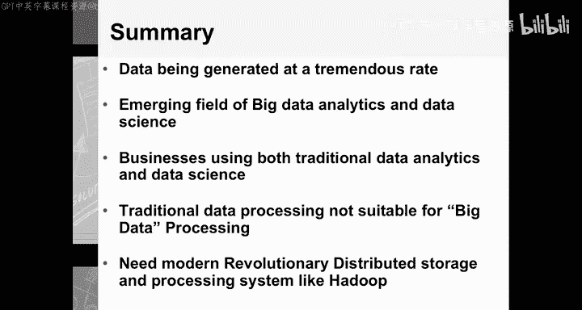

# 约翰霍普金斯大学《Hadoop大数据处理｜Big Data Processing Using Hadoop》中英字幕 - P8：7_大数据革命总结.zh_en - GPT中英字幕课程资源 - BV1g5u6zBExs

The big data， revolution summary。In this module， we looked at the trends and concepts behind the recent big data revolution that is taking place in the information technology marketplace。

We got a 20，000 foot bird's eye view of the world of big data。In summary。

 we learned that data is being generated at a tremendous rate， which is why it's called big data。

There is this new emerging field of big data analyticstics and data science。

We also learned that businesses are using both traditional data analytics and the new data science to improve their business and find new opportunities。

We saw that traditional data processing technologies have been good。

 but are not really suitable for big data processing。What we really need is modern， revolutionary。

 distributed storage processing system like Hadoop。

 and that is exactly what we will be talking about in the next module。

