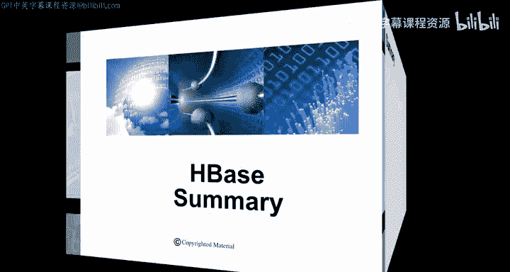
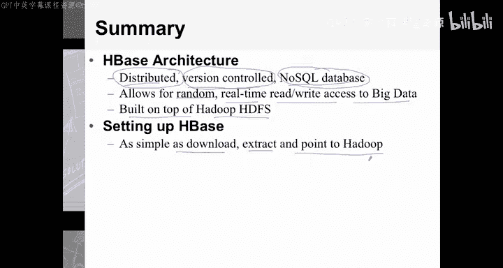

# 约翰霍普金斯大学《Hadoop大数据处理｜Big Data Processing Using Hadoop》中英字幕 - P90：25_HBase模块总结.zh_en - GPT中英字幕课程资源 - BV1g5u6zBExs

H base summary。

In summary， in terms of the H based architecture， we learned that HBase is a distributed version controlled no SQO database。

Distribute it from the perspective that multiple machines can work together to form a single unified database that's distribute a database version control from the perspective that you can store multiple versions of a value。

It's a no SQL database from the perspective that it's not a relational database。

It also allows for random， realtime readwrite access to big data。

 which wasn't really quite possible when it came to plain regular HDFS。

 although HBix is really built on top of the Hadoop HDFS file system。

We also learned that setting up HSpase was as simple as downloading the HSpace TR GZ file。

 extracting it， and pointing it to Hadoop， but pointing it to the HDFs name node in the HSpaseite。

xml。

In terms of the H based data model， we learned that HSpase has the concept of a column family and columns rather than fixed columns in relational databases。

We learned that within a column family， there can be many columns and that's where the flexibility comes in。

 it's a flexible schema。And in terms of columns， you can store any value that you want inside the column。

 So really the internal data structure is R ID。Plus。

 column family plus column plus a timestamp is what leads to a value。

 that's what gets stored internally in terms of the age based internal data model。

We also learned that HBace has an interactive shell where you can use DDL statements to create tables。

 you can use DL statements to put and delete records that' you update and delete operations。

 and you can also use get and scan statements to select records from a table。And finally。

 we also looked at the Java Chro API where we could use the put method to insert records into the table or update records in the table。

 get to retrieve records from the table， and delete to delete entries in a table using the Java API。

