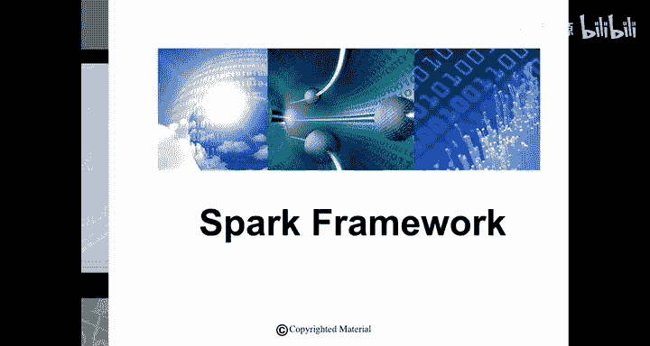
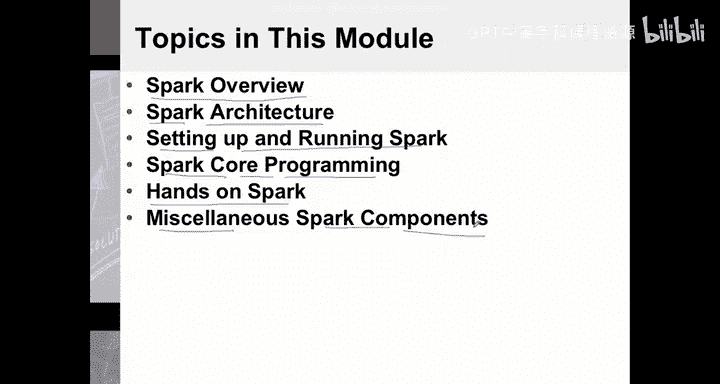
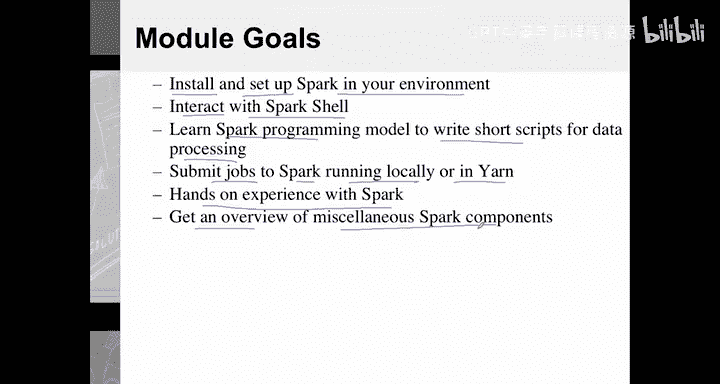

# 约翰霍普金斯大学《Hadoop大数据处理｜Big Data Processing Using Hadoop》中英字幕 - P91：26_Spark导论.zh_en - GPT中英字幕课程资源 - BV1g5u6zBExs

Welcome to the next module Spark framework。As the title suggests， in this module。

 we will look at the Spark framework， how it works， and also how it relates to the Hadoop platform。

So what are the topics in this module？We'll begin with a section on the Spk overview how Spark began。

 what are the benefits and features of Spark and how it is different from Mareuce。

Then we'll look at the sparkk architecture。 There are many ways by which Spark can be run。

 It can be run on a local mode， It can be run in conjunction with Apache mesos。

 which is a distributed computing platform it can be run on top of Hadoop。 It can be run down alone。

 It also can be run interactively it can be run as a batch process there are many ways by which Spark can be run。

 So in this section we'll look at the various ways and we'll primarily concentrate on the Hadoop platform integration in the section on setting up and running Spar。

 we're going to show you how to install Spark and how to set it up so that it can run on top of the Hadoop platform。

In the section on Spark code programming， we're going to go through what does it take to write a Spark application。

 how to interactively work with Spark in terms of RDDs。

 how to use the Spark Bill tool and then how to launch Spark applications We're not going to talk too much about the Spark API I willll just kind of give you an overview of the Spark API。

 because by this time after having done Mareduce programming and having done hive and pick programming。

 you have enough of an idea that you should be able to look at the documentation and be able to write your applications using the Spark API。

And then in the section on hands on Spark， we're going to actually interact with the Sp system and show you how to write Spark applications。

And then finally in the section on miscellaneous spark components。

 Spk does not only have the spark core。 It also have several other components that are added。

 such as the Mlib for machine learning。 It has a sparksQL for SQL like interface into Sp theres also graphics and there is also stream processing So'll kind of give you an introduction to all those topics So in the future if you want to do more work as a data scientist。

 you can actually experiment with some of the features that's out there。

 these are competing features that are part of Hadoop ecosystem also just want to compare in contrast between the two So I just want to kind of cover them and just kind tell you that spark is beyond just a spark engine So what are the module goals you should be able to install and set of Sp in your environment you should be able to interact with the spark shell which is a command line tool available as part of spark installation you should be able to write spark programs using the spark programming model。

rite short scripts for data processing， you should also be able to submit jobs to Spark running locally or running in the yan environment and then of course。

 know get your hands on experience with Spark because Spark allows you to work with Spark interactively or in a batch mode。

And also get an overview of the various Spark components that are there built on top of Spark corere。

