# 约翰霍普金斯大学《Hadoop大数据处理｜Big Data Processing Using Hadoop》中英字幕 - P92：27_Spark核心概述.zh_en - GPT中英字幕课程资源 - BV1g5u6zBExs

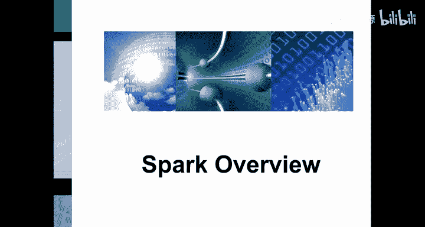

Spark overview So what are the objectives of this section in this section we'll learn what is Spark and what is the background behind Spark。

 how did it come about， Why was Spk created， What are some of the key features of Spar compare the Hadoop ecosystem versus the Spark ecosystem We'll also look at how Spark can run on top of Hadoop just quickly talk about it。

 but there's an entire section they to that， and we look at the various sparkk research papers give you a high level view of the different research papers that's out there。

 and then we look at the Sp distributions， the various companies that are offering Spk as part of its big data platform。

 We look at Spk thirdpart packages where you can find them， and then we look at Spark documentation。

 this is important because when you're looking at the Spark API depending upon the language that you're going to be programming in。

 there's the API available for the various languages so you need to know how to look at that and then well look at wki the blogs and the various books。

there we look at Spark conferences， there's only one conference we'll see which conference it is。

 if you want， you can go to that conference。And then there is the companies that are powered by Spark。

 a few companies that use Spark so what is Spark to be precise Apache Spark because it is an open source Apache project right now Spark is a cluster computing platform which means it has its own scheduling demons that is a master demon there is also worker demons that you can use to launch different processes。

 launch different tasks across multiple machines， so it's very similar yarn from that particular perspective but it's very special purpose for Spark It's also a data processing platform。

 it has its own engine called the Spark engine or the Spar code engine that allows you to process data it's a competitor to Hadoop from the perspective that it has its own engine called the Spark engine whereas in Hadoop we have the mapre engine and it has its own cluster computing framework where we have yarn in terms of Apache Hadoop so it's a competition from that perspective it has its own。

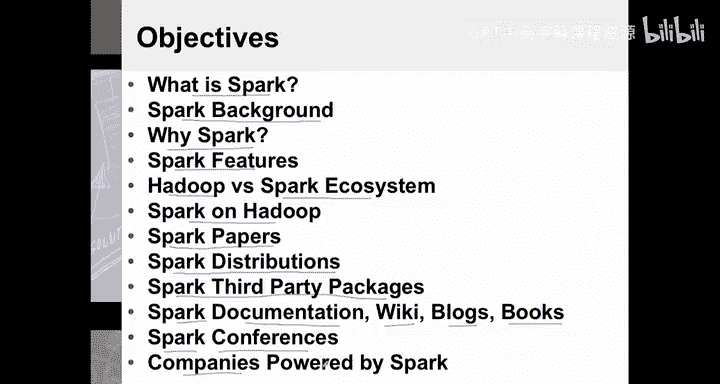

Ecosystem it's also complementary to Hadoop from the perspective that many companies have already invested a lot of time and money on Hadoop and a lot of processes built on top of Hadoop and Hadoop is not just a Mareduce framework it has the Hadoop HDFS and then it has the yarn distributed computing engine and then it has Mareduce as one of the engines what you could do is you could potentially bring in these spark engine and so have both spark and Mareduce work within the Hadoop platform so it's complementary from that particular perspective it is a unified platform that supports multiple workloads now when it comes to Hadoop there is the core Hadoop project which is primarily for batch processing。

 but when you're doing things like stream processing or machine learning or SQL like interface。

 you have to bring in these other subprojects whereas with Apache Spar all those things are rolled into one spark project So it's a unified platform。

From that perspective， the project itself is written in Scala， Hadoop is written in Java。

 this is written in Scala Scala is actually built on top of the JVM it's built on top of the Java virtual machine Spark was developed at UC Berkeley Amp Lab Amp Lab stands for the Alriths Mach and People's labb and then later on it was donated to Apache So Foundation in 2010。

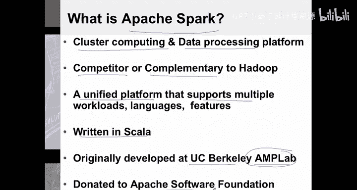

So let's look at the Spark background if you recall when we started talking about Hadoop。

 we said that there was a paper that was released in 2004 by Google on Mareuce。

 which kind of started the B of Hadoop by Yahoo in 2006 and then kind of Hadoop took a off of its own and became very popular and was actually getting into mainstream。

 in the meantime around 2009， a guy named Mattahhaya。

 created Spark at UC Berkeley as part of a PhD project， Mattya in 2010。

 released a paper called Spark cluster computing with working sets which became quite popular and started gaining ground。

 so around 2011， the Amp lab which is the algorithms machines and People Lab at Berkeley launched something called BDAS。

 which is the Berkeley data analytics stack and。That stack they actually included the Spar engine and the Sp project Mattya and a whole bunch of other contributors who were working with Matttaya in terms of the Spk project founded a company called databs around 2013 and then Spark basically took off So at this point we have the Spark ecosystem and of course we also have the Hadoop ecosystem they both are there they both are competitive in nature and also complementary in nature will see how that is as we go through this entire module so that's really the background behind Spark So that's the background of Sp The official site for Spark is sparkk Apache org because it is an Apache open source project and if you look at the Spk website they'll say it's a lightning fast cluster computing platform it's hundred times faster than Hadoop to be precise they say it's 10 to 100 times faster than Hadoop mapred to be the mapreduce engine not really Hadoop because when you look at Hadoop it's the HDFS。

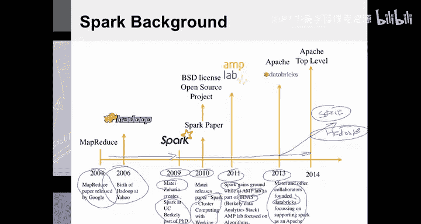

Is the yarn is the mapreuce and also all these other sub projectss so this is more in terms of mapre because they not only have the map reduceuce functionality。

 they also have other functionalities other relational operators built on top of Spark it's easy to use runs everywhere because of Java there's also a highle engine such as machine library and graphics and spark streaming So there's a lot of stuff that is there as part of the spark architecture or the sparkar ecosystem which we'll talk about as we go through So why Spar Hadoop mapreduce works only with HDFS what do I mean by this whenever you want to do any mapreuce processing。

 you'll have to bring in the data into HDFS and then you run your mapre processing there is no way you can have the data sitting in a relational database or you can have the data sitting in a regular file system you have to copy the data into HDFS because mapreuce works on top。

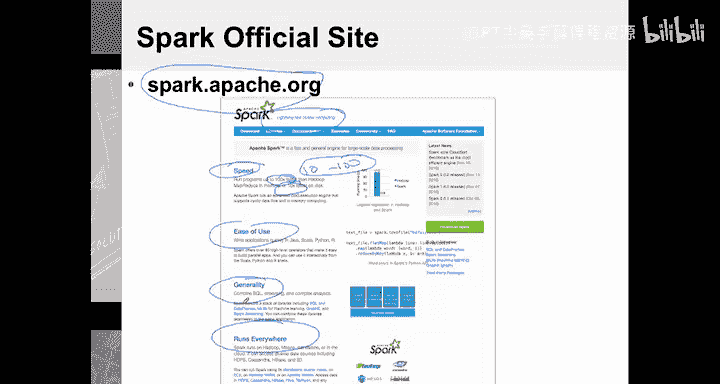

HFS and then you process the data and then the results go on HDFS right so you read in from HDFS and then the results also go into HDFS Now it is possible to extend Hadoop so that it can read data from external systems theres APIs available that you can extend but it was never part of the core in fact we end up getting a lot of subprojects like the flume project or the sc project which is sQL to Hadoop。

 which we'll talk about next week these projects allowed you to bring in data into Hadoop HDFS and then you did the processing so it's kind of a pain in the neck from the perspective that if my data is already there in MongoDb which is a NoA secure database or if my data is already there in a database what if I want to do distributed processing on that particular data you have to bring it in into Hadoop iter radioative processing and Mareduce is slow since that every step it writes the data to disk Now there are certain algorithms especially。

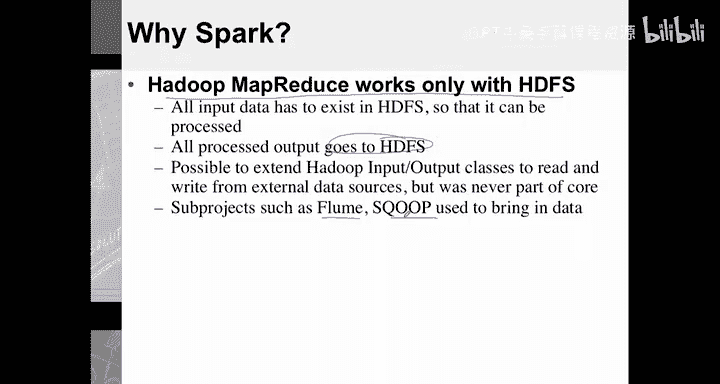

In machine learning， when you take a data， you process the data， so you're reading in the data。

 you process the data and then you have to take the results and then you process the data again in an iterative fashion and you may have to go through multiple iterations to generate your final output now when it came to Hadoop we did this thing using a project calledoozy which was a project allow you to spawn multiple mapre jobs in chains Now it works。

 but the reality is that you have to read the data， process it and write it to disk， read the data。

 process it and write it to disk and so this process of reading and writing to disk was taking a long time now it's great for distributed processing when you have lots of machines and you have lots of computation。

 it works well but the reality is that if you can keep the data and memory it's much much better and that's really what was found when people started working with Spk or at least。

That's the foundation for Spark So this is one of one of the issues that we have with Mareuce interactive operations are slow Now we know that with mapreuce。

 you can write batch programs， batch applications you can submit the job we also know that there is a lot of sub projectsjects like hive and P that we looked at that allows you to interactively work with Hadoop but when you work with hive every select statement that you write is a mapre job when you work with P if you write a pig query that that action can result in multiple mapre jobs and those mapred jobs again read and write to disk and so yes we can interactively work with Hadoop but it's a little bit slow so speed is definitely an issue that we have with Hadoop in terms of subproject explosion if you look at Hadoop in the Hadoop ecosystem of course you have the Hadoop code project but then you have all these other projects like hive for SQL processing P for a Declarative programming language you have Apache。

Drill， which is another query language。 you're guarding another query language。 you have Mahal。

 which is really machine learning language， storm， which is really a stream processing project。

 and then you have Apache giraffe， which allows you to graph processing Now these are all other sub projects that are working in conjunction with Hadtube to give you what you really want。

 but there are sub projects。 So there is this subproject explosion that we have you have to install all these different projects before you can make it work。

 Now of course， there is all these different distributions thats out there that give you all these things。

 But the reality is it's these different projects whereas with。Spark。

 they have tried to put everything together into one project。

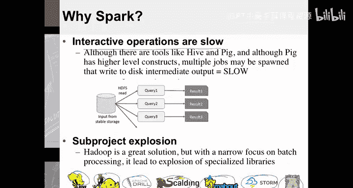

Another issue that we have with mapreuce is that every problem in mapreduce has to be broken down as key value pair。

 It works as key value pair。 If you look at map input， it takes in a key value pair。

 it writes out a key value pair， which can be picked up by combiners and partitions。

 which is then picked up by the reducer as a key value pair and then writes out as a key value pair。

 Now it works well， but the realities that it makes programming model a bit complex and not very intuitive。

 So these are some of the reasons why Spar was developed to overcome some of these limitations that we have with mapreduce engine。

 So what are these spark features。 One of the first features of Spar is that it says let's use memory to speed of processing。

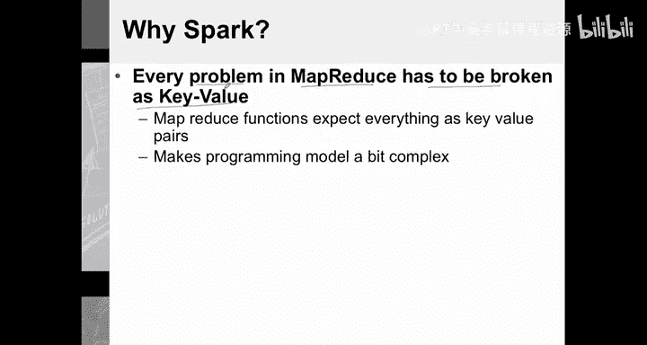

If you think about it， reading and writing from memory is the fastest。

 it's about 10 gigabytes per second。

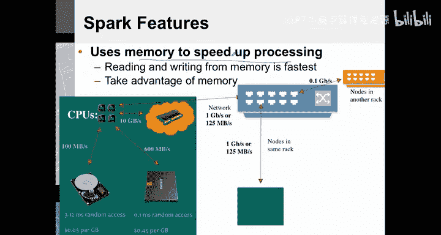

next is reading and writing from SSD， the local hard drive SSD drives， solidity devices。

 which is about 600 mebytes per second and then reading and writing from local hard drive which is about 100 megabytes per second but then it slows down when you have to read some data from another machine within the same rack versus reading from another machine which may be located in a different rack So the important thing to understand here is that reading from memory is the fastest so why can't we take advantage of keeping the data in memory as much as we can and then spill it to the local disk to be more appropriate。

 let's spill it to local SSD drives if the data cannot fit in memory and that's one of the biggest features of these spark architecture they use this thing called RDD。

 they have this term called RDD which is resilient distributor data which will talk more about later on that takes advantage of this concept of keeping the data in memory。

Pross multiple machines。Another feature of Sp is iterative processing using the distributed memory and the idea here is that you can take some data that's in disk。

 load it up across multiple machines and then keep the data in memory again。

 you're doing mapred processing but then the results are not being written to disk they're being kept in memory and then spilled to local disk just in case it cannot fit in memory and then you can again apply mode processing。

 map and reduce processing and then write it again to memory and then you can do the same thing and so on and so forth and finally you write the results to disk so you try to keep the data as much as in memory as possible in that way you can actually do these iterative processing in memory I'm not saying everything has to fit in memory you can spill to disk also In it spills to disk but if the data can fit in memory。

 go take advantage of that interactive processing using distributed memory the other advantage of Sp is that you can take the data。

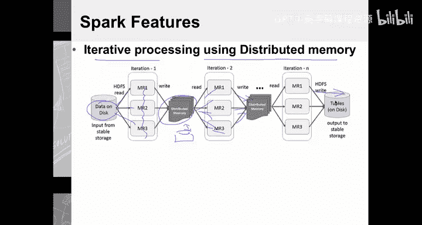

On load it up across multiple machines in what is called RDD。

 which is the distributed data structure， distributed collection。

 and then you can start queryting this distributed collection to get the results because the data is mostly kept in memory and spilled to disk。

 especially only to local disk， you get better performance and you can actually interactively work。

 you can work truly interactively with the sparkar engine。When it comes to functions with map Red。

 we only have two functions map and Red， whereas Spark supports other functions。

 they have not only functional programming functions like map and Red。

 but they also have lots of relational programming functions such as count and filter and join and group by and also there is the SQL interface also built on top of it there is the builtin SQL queryding。

 they have something called Spark SQL that allows you to execute data across the RDD。

 which is the resil and distributed data which is the collection of data across multiple machines using a SQL like interface and it's also integrated with DSL languages well what languages DSL by the way is domainspec language and basically what Spark says is that you can program in Scala or Java or Python and R and they have an API in fact a unified API that allows you to access the data。

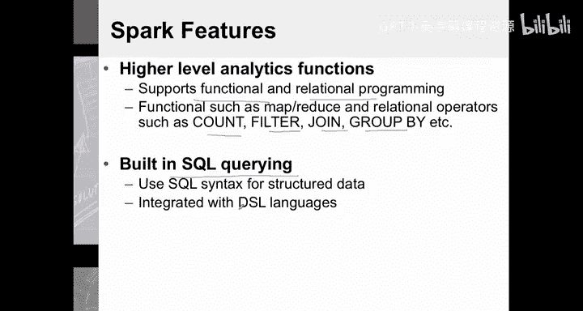

Process the data across these different languages There is also real time processing。

 Many companies are looking for systems where they can process the data in real time as the data comes in。

 they want to do analytics on it and Spark has something called Sp streaming that allows you to do real time processing as part as Spk architecture。

There is also built in machine learning， Spark comes up with a library called MLlib。

 which is the machine learning library that allows you to do machine learning。

 that is also built in graph processing。

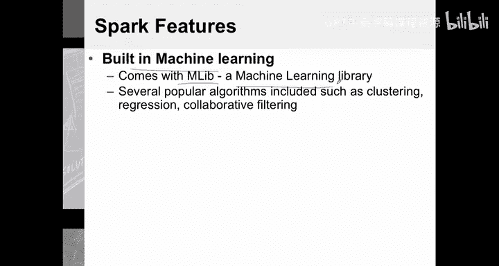

Sometimes you want to take data and represent the data as a graph in terms of vertices and edges and so there is a graph API available that allows you to process the data and there are several builtin algorithms like page rank and triangle counting that's available as part of the graph processing engine There' is also a cluster manager so Spark not only has these sparkark core and all these different components or modules on top of Spark it also has a cluster manager that allows you to create a cluster and Spar and run it across multiple machines with a master and worker nodes and so you can launch machines and can and so you can launch these different tasks across these different machines it's very similar to yarn。

 which is a cluster computing engine or cluster computing framework which is part of Hadoop。

There is the unification of big data frameworks so one of the things that Spark does really well is actually it has unified a bunch of different projects if you look at Hadoop like I mentioned it's a great solution There's a lot of sub projectsjects that's available that kind of work together you have to download all these different projects and install it like I said you can download a platform like the Horton data platform that gives you all these things but they are different projects whereas with Spark you get one project and within that one project you have this one cohesive unit to handle the big data needs so that's one of the features that they have。

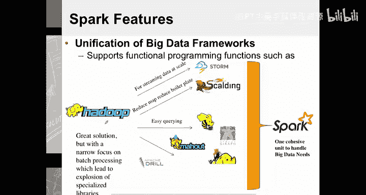

Another feature of Spark is this Unified Data frame API。Now， remember。

 I said to you that Spark has the Spk core， and that's where the RDDs are。

 which is the resilient distributor datas。And then on top of it there's the Spar SQels， Sp streaming。

 Spark MLB， and also graphics， these are the modules that are built on top of Spark and when you download Spark you get all these things。

NowOf course there's all these different languages that it supports， for example， it supports Python。

 it supports Sca， it supports Java and now it also supports R。

Now all these different languages need to access this RDD。

 so what happens is they've actually created this new data frames API that is an API that's built on top of RDD that actually remembers the data types also。

It remembers the data types what that means is that it not only knows about the data。

 which is a collection of data， it also knows what type the data is。

 so when you take RDD and bring in type information because RDD has type eras it doesn't remember the data types。

 which is the field or column types whereas data frames does that so this new data frames。

 the API which is available as part of Spark allows you to work across multiple languages and so it kind of unifies this entire ecosystem。

 so this is something new there。

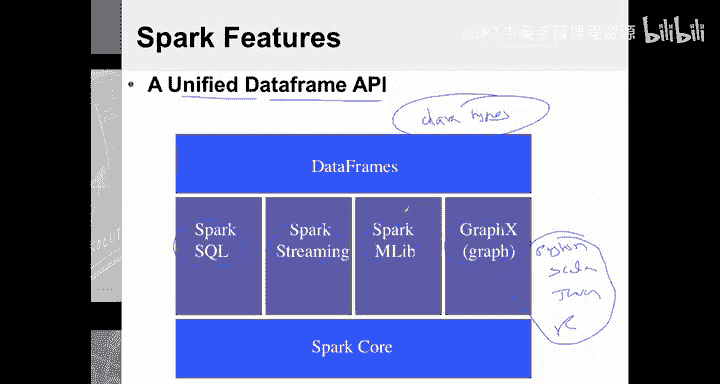

Now， let's compare Hadoop versus the Spark ecosystem。In Hadoop we have HDFS。

 which is the distributed file system， we also have yarn。

 which is really your cluster computing framework， and then you have mapre。

 which is a data processing engine so if you think about Hadoop it's really three projects rolled into one。

Now， if you look at Spark in Spark， you have the sparkk core， which is the。

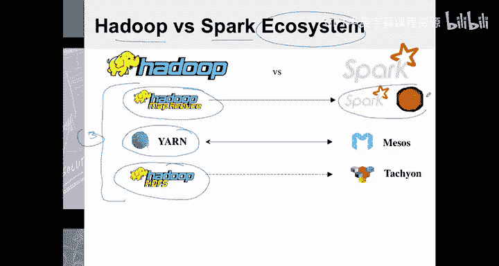

RDD and its core APIpis。 And then if you look at Spar。

 it actually worked with a few other sub projectsjects， for example， there is Apache Mesos。

 which is really a cluster computing engine。 Now Spark does have its own cluster computing engine。

 It's called the standalone mode of Spark。It also works with Apache meos。

 and that's what many people that are using Spar and that are not using Hadoop end up using because it's an advanced cluster computing engine for scheduling your job。

There is also another project called Ton， which is really a distributed fault system project that many of these sparkk natives are the people who love Spark use。

 which is similar to HDFS Now these are external projects。

 please mind that these are external projects so when it comes to Spark you have the Spark core。

 but then they have other components that are part of Spark itself。

 for example there is the Spark SQL， which is similar to the Apache hive subproject which is a separate subproject from Hadoop。

And then you have Spark Mlibib， which is similar to Mahat， and there is the spark streaming。

 which is similar to storm。 So when you download Hadoop， you get HDFS yan and Mareduce。

And you have to bring in these other guys as part of external projects。

 whereas when you download Spark， you get the Spk core engine with SQL Mble and Spk streaming。

As one package so I just wanted to kind of compare the two things in Hadoop we have the Hadoop project with several sub projects in Spark you have many of the Spk subproject functionality enroll into Spark code itself。

 but then it also works with other projects or other sub projectsjects。

That's preferred by Spark users。I do want to tell you that Spark does run on Hadoop。

What that means is that you would end up using HDFS。

 you would end up using the Yn Dis computing engine， and then instead of using the map Reduce engine。

 in fact you can still have the map Red engine， but you'll also bring in the Spark engine and the Spark ecosystem projects and run it all on top of the existing distributor computing platform。

What I'm trying to say here is that many companies have already have a cloud that they have set up with lots of machines in the cloud。

 which is running Hadoop and now if their data scientists are saying they would like to use Spk to。

 not a problem， let them use the Hadoop distribution and then let's bring in the Spar engine so we can also use the Spar engine to do over processing so many companies are actually doing that as part of migrating or using Spk or ruling Sp into their ecosystem Now let's look at Spark from a big picture perspective。

 if you look at Spar， there' is the Spar core。

And Sparco basically says I am going to use memory and I am going to use the local drive。

 especially the SSD drive for doing my processing and this is where the RDDs are right so there's the RDD and the results of the data frames API which is new。

And Spark says you can program in Scala， you can program in Python or or even in Java。

 and then Spark says， look， not only can you use the Spark core。

 there is the Spark SQL that allows you to do SQL like interface。

 there is also sparkark streaming so that you can read data from some kind of a queue and process data of the queue or data that is coming in real time。

There is also Mlib which is the machine learning library and graphics for graph processing right There is also another project called Blink Db。

 which I'll kind of mention towards the end in miscellaneous topics that allows you to do queries and spark SQL but you can say I would like you to get me the answer within5 seconds or 15 seconds with some confidence level so there's this new project called the blink Db project that's out there blink DB there's also Taon which is a distributed file system project that spark users love and then in terms of cluster computing Spark has its own cluster computing which is called standalone mode so that you can just download and install Sp and turn it across multiple machines but Spk also interfaces with Apache meos so you can run spark on top of another cluster computing or scheduling framework and then there is also Hadoop yarn Sp and also run on top of yarn so these are your distributor。

engines or distributor computing frameworks standalone as part of Sp Apache Mesos or Hadoop yarn。

 I'm representing yarn as a yarn。 It's actually the Hadoop project。 And then you can also run。

Spark in what is called a standalone mode and one of the cool things about Spark is that you don't have to have all the data in in HDFS。

 you can have the data in HDFS， you can have the data in the regular file system。

 you can have the data in a distributed database， you can have the data in even an S3 and you can read all the data into Spark and process the data and you can write out the data into any one of those locations Like I said。

 you can read the data from distributed file systems。

 you can also read data from distributed database。

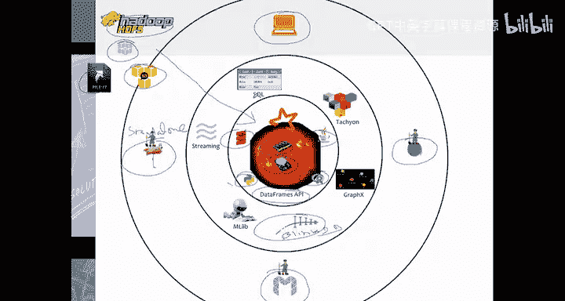

Like Neo4j， RDBMS systems， Mongo Db， Apache Hb， Cassandra and so on and so forth。 Once again。

 you can read and write data back into it So read the data from these distributed databases。

 process it and write the data back out Spark also supports。The Hadoop input and output format。

 If you go back and look at Hadoop， Hadoop has these wonderful formats like sequence file format。

 there's also these other sub projectsjects like the Avro subpro。

 these projects are all projects that kind of allow you to store data in Hadoop in HFS with metadata information associated with it and all those data formaters are still applicable and Spark works with them and then finally when it comes to streaming。

 we talked about streaming， there are these sub projectsjects that's out there like the flume projects that brings in data from external systems。

 there's also the distributed queue which is the CAfka project。

 so these are other projects which are bringing data in real time and Spark streaming can read all this data process it。

 they use what is called micro batching lots of small batches spark batches that run in order to process the data we'll talk a little bit more about it towards the end。

Okay。Right， so just wanted to kind of give you a big tour of the spark ecosystem in terms of distribution。

 there's a lot of distribution that's out there again， we have a slide on distributions。

 which we'll talk about for a long time Hadoop map produce healthy。

Title for the fastest 100terabyte sword recently Spark has won that Today's Spark claims that it can be 10 to 100 times faster than Mareduce engine。

 Once again， you can keep your Hadoop platform and then you can just replace the engine with a sparkark engine and all your Hadoop projects will still work the way it does and that's really the idea if you want to move towards Spark。

 There is actually a paper that is associated with Spark As I mentioned to you earlier。

 it's called Spark cluster computing with working sets。

 It was written by Matt Zharia and here's the link to that particular paper。

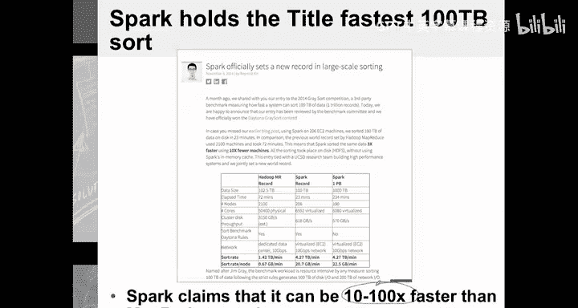

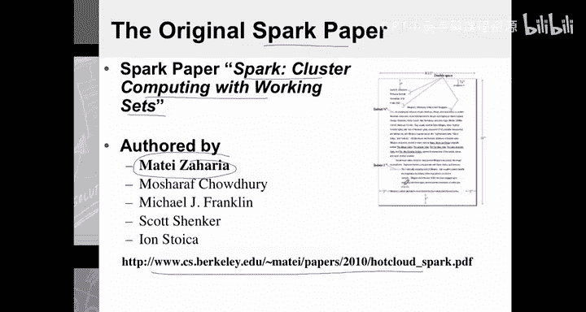

There are lots of other research papers that's part of Spk as you noticed this is the 2010 paper here。

 which is the first paper and then over time several papers have been published including much newer version of RDD and then Sha which is sparkk on hive。

 which later on became SpsQL to be precise and then discretized streams which is really spark streaming。

 this is sparksQL and more on Sp streaming graphics more on Sp streaming more on Spk SQl and then machine learning library and then Spark on Rs。

 there's a bunch of papers that have been published and those papers are basically the foundation for the Spk architecture in terms of spark versions there is the spark 1x series which has the resilient distributed datas it also has the spark SQl and Spk machine learning library。

 Spk streaming and sparkk graphics， the 1 X version is quite stable I think 1。

is the latest version of 1 X。 There is also the 2。0 version that has come about， which is new。

 It has a unified data frame API。 So going forward， they want us to use the unified data frame API。

 There's also Spk SQL to support SQL 2003 standard as part of Sp SQL。 So as much of SQL。

 you want to use it If you're really good at SQL， you can start using Sp SQL。

 They're supporting the SQL 2003 standard， and they also are upgrading many of the libraries to use the data framebased API。

 I do want to tell you that Spk 2 do X is new， there's not too much documentation out there at this point but but it's available for you if you want to use it in this class we're going to be using the 1 X。

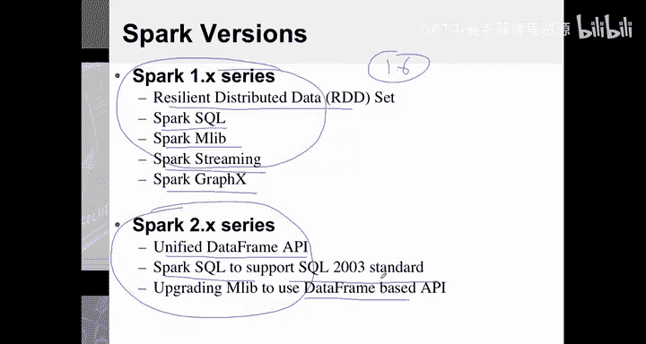

In terms of Spark distributions now Spark is an open source project。

 which means you can download the open source project and you can use it。

 but you can also download a distribution there is a company called Databricks again Marya Zgaria and many of its colleagues launched this company called Databricks。

 this company gives you a supported Spark distribution， you can use that Clouderra。

 which has a platform called the CDH， which is Clouder distribution for Hadoop also brings in the Spark distribution as part of its CDH platform Amazon EMR which is the cloud computing engine which which is the cloud platform in AWS also brings in Spark and they have their own distribution the point I'm trying to make is that these are the three guys that are distributing Spark as part of the platform Of course other guys are distributing Spark too。

 but these are the guys that are actually taking the open source projects。

They're building it as their own and then they are distributing it but then there are lots of other companies that are partnering with databricks remember Databricks is where all the major engineers that are working on Spark or the key engineers that are working on Spark are sitting now this company not only has their own distribution they're also working with companies like Hortonworks and Mar which are classic Hadoop distribution platforms and so these guys are actually licensing the sparkark distribution from them and then distributing it as part of the platform so that's what these guys are doing again lots of other companies like Oracle。

 they have their own data platform Strio then there is Datats which is really Cassandra they also are distributing Spar so really what's happening is Spark has become an engine that many of the other companies are also integrating with so your classic Hadoop vendors like Clouderra Hortonworks Mar and Amazon AWS EMmar。

They are all distributing Spark as part of their Hadoop or big data platform。

 and then there are all these other companies that are doing distributed processing or specialized software that is for analytics or also integrating with Spark。

Now there is a vibrant sparkk community， in fact， like I said to you。

 this Spark and all these different projects that are out there that you can integrate with。

 there is a nice site called Spk packages。org， which is really a community for thirdparty packages。

 there's a lot of people that have written sparkark integration with maybe Taon Spark integration with maybe Mongodb or Spark integration with some other database。

 so there's all these people that have written all these different packages typically in Scala because Spark is very easy to work with when it comes to Scala。

 and so before you start writing your own integration with some other project or subproject or some other platform。

 you might want to look at sparkkpacks。org and see if somebody has already done some work and you can download that package。

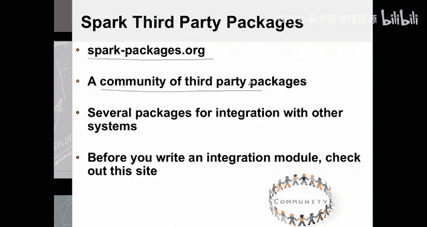

Now in terms of sparkk documentation， surely sparkappache。

org doc's latest will give you the latest sparkk documentation and of course。

 depending upon the version of spark you're using， you can also put the version number and you get the sparkk documentation for that particular version number spark documentation is really great it's important to understand that primarily you're going to be using the sparkk documentation for the API references and remember you can program in Scala。

 Java or Python and this R language So when you use the documentation online。

 you may want to click on the language in which you're working on and depending upon the language that you're working on the entire documentation changes for all the examples to be in that particular language so it's pretty cool it's worth looking at the documentation it's worth learning to look at the documentation and work with it Sometimes it may be worth to go to code and look at the code right I mean。

oppen source projects and the documentation may not be up to speed so it may be worth it and of course the spark project is written in Scala so you have to kind of go through these scholar source code for that there is a wiki page here's the link to the Wiki URL remember Wikiis are basically locations where people contribute their experiences so that's the Wiiki page right here Yeah when it comes to sparkk blog there are several good sites that can be found on Google but the notable blog is from databs because many of the key softwareengs are really working for databs databggs do co s blogs category slasheng has a lot of technical blogs there it concentrates on sparkk core。

 the ecosystem machine learning streaming you can also search on these blogs in terms of books Spk1 do X is the most popular in the market you'll see a lot of examples that are related to1。

x version of Spk and all these books such as the learning Spbook which is a great book by。

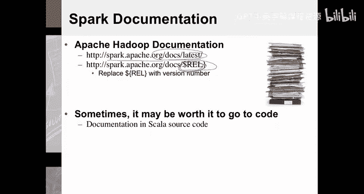

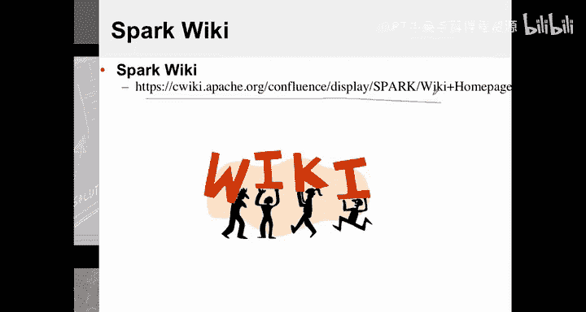

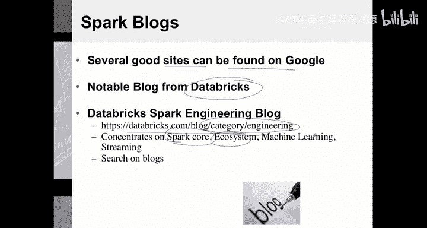

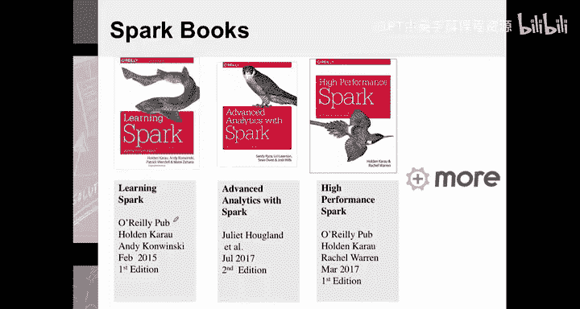

Hden Carau and Andy， it's a great book It was released in 2015' the first edition deals with1 dot X version of Spark So if you're going to be using the1DtX version。

 this is a great book， but as we go through the 2 dot X version these books are not going to be that valuable again this is another book Here's another it's a bunch of other books that have come about but most of the books today are 1 X version of the book and the 2 doX version is going to be released I think many of these books around April May of next year so you may want to be able look out for that。

 don't buy any of these books right now and by the way we are going to be working with 1 do X for this class so it'll be fine to use one of these books if you want to buy a book on Spark once again the 2。

0 is primarily about using the data frames API the unification API but otherwise all the engine all the sparkark core all the RdDs are exactly the same。

 It's that the underlying data frame is slightly different。In terms of Spar conferences。

 there's something called Spark sumummit that's the only conference that they have the first conference was held in San Francisco every year they hold one in San Francisco。

 one in New York for the East Coast folks， and then they also hold one in Europe so there are about three conferences that are held every year。

In terms of Spark certifications， several companies are offering Spark certifications， Databricks。

 Clouder， hardorenworks Mar， and of course there's the IBM certifiedified Spark developer as part of the IBM big data platform。

 so if you're interested you can also get Spar certification。

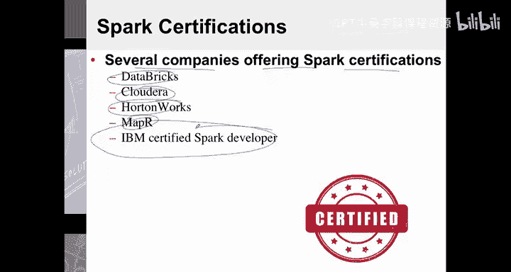

In terms of the Apache Spark community stack overflow。

 you can search for Apachepark tag there's a lot of Q&As that's available out there。

 there's also a spark mailing list you can send your questions to user at Spk to Apache。

 org you can subscribe to this mailing list and you can see what's going on there's a lot of people that answer almost within a couple of Rs they answer your question make sure that you write your questions clearly in terms of the meetups there are several meetups available that are related to Spk so here's the URL for the Spar Meup There are several companies that are powered by Spark here's a list of some of those companies。

 companies like Amazon creditit Karma， ebay Groupon Triadvisor。

 these are all American companies that we have there's also Oalla Opentable but then there's also companies outside United States for example Baidu Tencent Alibaba these are companies in China。

 big Internet companies in China that are also using Spar。

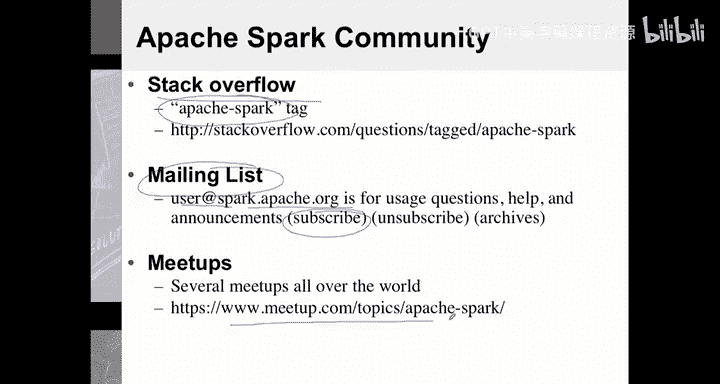

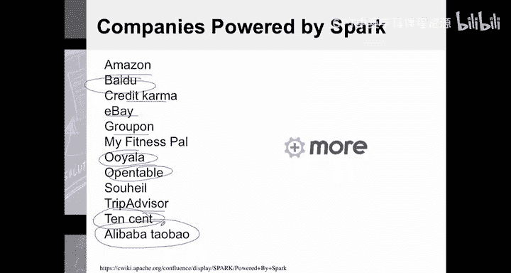

So in summary， Spark is a fast cluster computing platform， it has its own cluster computing。

A platformform that allows you to distribute your workload across multiple machines。

 It also has a data processing framework， which is the spark core and several modules built on top of Spar thatll allow you to process data in terms of spark features it is iterative processing。

 which means you can read the data process it， keep the results in memory。

 again apply mode processing， keep the results in memory， apply mode processing。

 keep the results in memory and so on and so forth。

 it's interactive processing from the perspective that you can use a spark shell to interact with Sp there is also higher level analyticstics functions besides map and there are functions that are like relational operator functions。

 core to the platform this built in SQL quoting so you can actually interface so you can actually interface with the RDD which is the resilient distributor data which is this collection of data across multiple machines using SQL X syntax it also has a DSL which is domain specific language interface through multiple languages。

such as Python， R， Scala and Java， there's also real-time processing using Spark streaming。

 graph processing using Gs and machine learning using MlibB。

 all these are components built on top of Spark and is part of these Spk distribution itself It also extends Hadoop from the perspective that you can run Spark on Hadoop so that you can use the Hadoop ecosystem and also use the Spark engine。

 you can also run Spark on its own if you don't want to use Hadoop。

 you can use Spark on its own in standalone mode or in a distributor computing environment you can also use Apache Mesos in terms of Spar distributions。

 all the classic Hadoop distributions， distribute Spark as part of its platform， Cloud data。

 Htonworks， Mar and EMR， I consider them as the classic standard Hadoop distribution platforms they all distribute Spark and databricks。

 of course， distribute Spark and also IBM and a few other companies also distribute Spar as part of their big data platform solutions。

of Spark communityity， there is Spkpackages。com， which is where you should go to look at any thirdpart integration for Spark in terms of modules。

 there is also the standard Spark documentation that you get on the site or when you download the project there is Wiiki pages。

 there's blogs， there's books don't forget that the blogs in the books especially the books are really the order version you may want to wait for getting the newer version there's also the Spark summit conference that you can go if you're interested more in learning about Spark There are several companies around the world that are using Spark。

