# 约翰霍普金斯大学《Hadoop大数据处理｜Big Data Processing Using Hadoop》中英字幕 - P93：28_Spark架构解析.zh_en - GPT中英字幕课程资源 - BV1g5u6zBExs

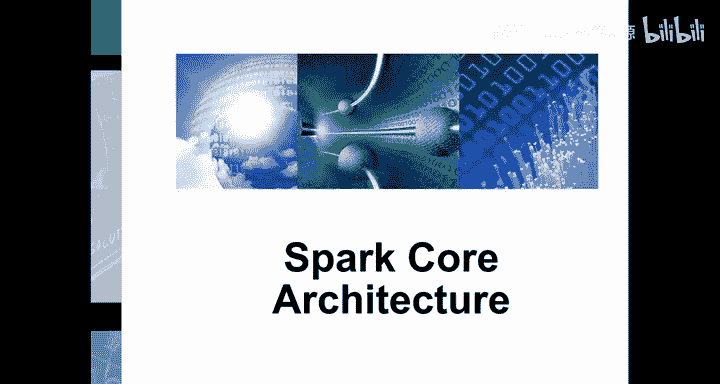

Spark core architecture。So what are the objectives of this section？In this section。

 we are going to look at the Sp core architectural components。

Basically the various components just the RDD， the driver， the core， the tasks， the partitions。

 the executor that make up the spark architectural components。

 especially the spark core architecture components。

 I'm specifically saying sparkk core over here because you can also have these spark SQL architecture you can have the spark streaming architecture which are all architectures built on top of the sparkk core So here we are talking about the sparkar core architecture Then we look at these spark core application modes。

 the modes by which these spark core applications can run。And then also the Spk master modes。

 the various modes by which the master slave demon architecture would be run in Spark。

 this is a pretty complicated section because there are four different modes that we'd have to look at。

 but there are two modes that we especially care about。

 one is the local mode and the other one is the mode where the master is running。And on yarn。

 so we'll privately concentrate on those two modes， but there are many modes available。

 and then the spark processing， which is the programming engine that we have。

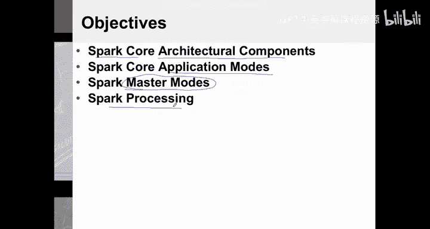

Before we get into these spark core architectural components， I wanted to iterate what Alllan Ka。

 a great American computer scientist said simpleimple things should be simple and complex things should be possible。

 This is really the spirit of this spark architecture。The architecture may look complicated to you。

 but that's the internals， but the idea that is that as a user of a big data processing framework。

 it allows you to do simple things easily and it also makes it possible for you to do complex things and that's why the architecture may feel a little complicated only because there are so many different options available。

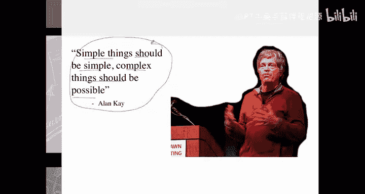

Okay so what are the core architectural components， they are RDD， partition， driver。

 executator tasks and course， and then of course how the distributor processing in Spar is done based upon the various components so that's what we're going to be talking about and these are the terms that you need to know。

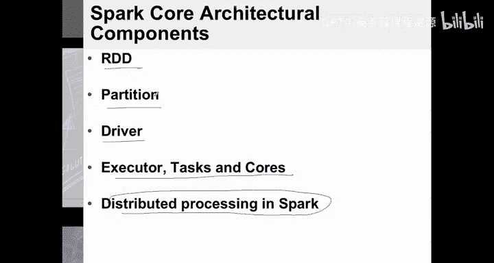

In 2010， Matya Zhaya and his coworkers wrote the RDD paper。

 the paper was called Spark cluster computing with working sets。

 and in this paper they basically introduce this concept called RDD which is resilient distributed dataset sets It's a distributed data set。

 because its data that is being distributed across multiple machines。

 and one of the things that they talk about in this architecture is how keeping the data in memory which is what they call working sets speeds up iterative processing and that is really the foundation behind this paper the reason they call it resilient is because when one of the machine that is holding a partition。

 a piece of the distributed data crashes， it can actually rebuild it from the source。

 and that's why it's resilient。Okay， so that's really the idea behind this paper。

 It's about a six page paper， not too many details here， but it's worth reading。

 The next paper that they introduced was in 2012 it was gave you more details on the RDD and the cluster computing framework with the concept of a driver and they also talk about workers which are really your executors well again we'll see more of this as we go through this particular section and of course they talk about how recovery is done from failure。

 This is a much longer paper more details after they implemented the spark framework and what they learned from it。

 that's what they written in this paper。 It's a much bigger paper about 12 pages。 again。

 I recommend that you read both of these papers at least once kind of glance through at least and so that you get an idea as to what Sp is based on。

So what is an RDD and RDD is really a collection of objects in memory across multiple machines now you may have your data set in some kind of a relational database or a flat file or even an HDFS what you really want to do is load the data into memory across multiple machines。

And when you load it across multiple machines， of course， it's broken down。 So here you're seeing1，2。

3，4，5 different partitions， five different pieces that are loaded across multiple machines。

So one piece may go to machine one， which is right here， so this is machine one。

 this is machine  two and this is machine3， another piece might go to machine two。

 another piece might go to machine three and some to machine one again machine two and so on and so forth because we only have three machines。

 it's being loaded across these three different machines， these five different data sets。

so that's the RDD， It's resilient because if one of the machine crashes， if this machine crashes。

 it can go back to the source to build that particular RDD。

 So a few more terms a term called partition and RDD is split into multiple partitions。

 you're seeing these partitions right here， it's P1 P2 P3 P4 and P5。

 So it's just a term that we need to know it's partitions very similar to maperse partitions。

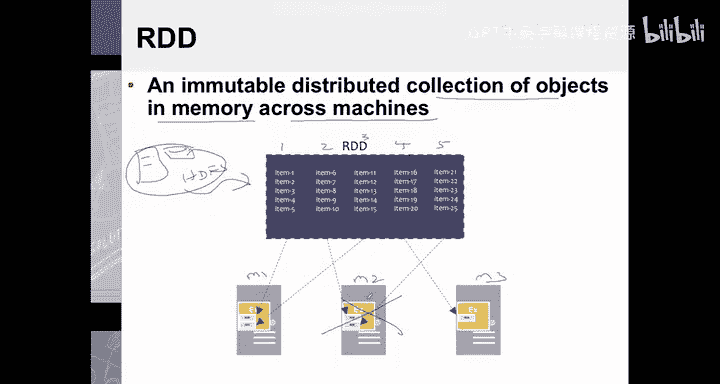

And of course they are being loaded across multiple machines The reason I wanted to bring this term called partition is because when you have data in HDFS。

 the data is broken down into multiple partitions because it is multiple blocks these multiple blocks or multiple partitions so when you're loading data from HFS each block will become a partition and that's how it integrates with HDFS if you're loading data from a relational database or from a distributor database then you can actually say how many records would make one partition or you can say how many partitions you want and you would actually split the records across these multiple partitions。

So that's how you're actually building this resilient distributed data okay。

 the important thing to remember is that the more partitions you have。

 the more parallelism that you have， because each partition is going to be worked upon by a single thread also called a task。

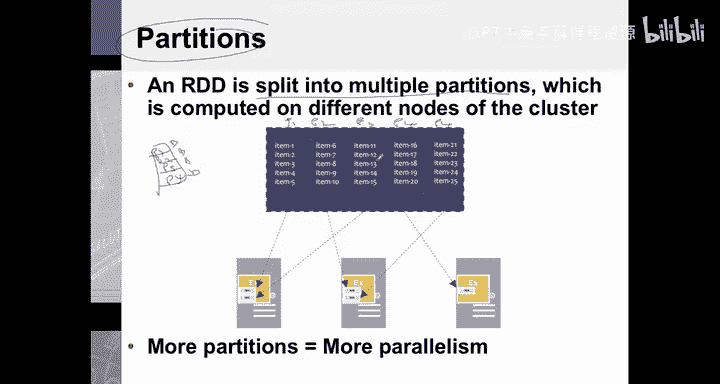

There is also this term calledD a driver is really the main controller This is the one that controls the flow of your program This is almost like when you wrote your map or program you had a main class which instantiate the Hadoop context object。

 the Hadoop configuration object and launch the job so that's really what this main driver is all about Now depending upon whether you're running in interactive mode or a batch mode the driver has different rules and also as to where it will run which will talk about as we go through。

 but there is something called a driver and it's the driver that is responsible for allocating the system resources so it is going to be talking with the scheduler with the resource manager to identify the various resources。

 the various machines where it can run the executor process。

 the worker process so that it can process the work。

So really the driver is the one that is not only getting the resources。

 it's also breaking the data on the program into tasks and these tasks are scheduled to run on something called executors which I'll talk about in the next slide to execute in parallel across multiple machines you can see the similarity between Spark and Hadoop in this case。

 and it accesses the sparkk environment through this thing called the spark context when we start getting into spark programming。

 you'll see the spark context object。

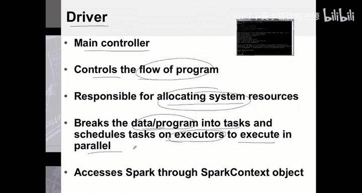

Very similar to the Hadoop context object。An executor。

 an executor basically that holds the RDD partitions in memory， it's really a process。

 but this process depending upon in what master mode you may run made run at different locations。

 but I want you to understand what an executor is an executor is really the one that is holding the RDD or portion of the RDD。

And it may hold multiple RDDs， so for example， for one blue RDD。

 it's holding partition 1 and partition 2， and for a purple RDD it's holding partition 1。

 partition 2 and partition 3。And it has these things called tasks。

These are individual tasks that run in course in threads in a multithreaded environment。

 so an executor is really a process that is holding these RDDs and they have these threads these internal threads each thread is associated to a task and these task each task is working on a single partition and that's the relationship the important thing I want you to make sure you understand is that in Hadoop we launched multiple JVMs each task was actually running in a JVM and there will be a brand new JVM that will be executed for every task if you have an HFS data file that contains 50 partitions then you would go through 50 different map tasks which means there'll be 50 different JVMs launched unless you turn speculative execution on so in Hadoop you have this concept of every task running in a JVM whereas here。

You have tasks running as threads inside an executor。

 so typically in a single machine there will be one executor。

 you can have more than one executor if you want， but then they will be running threads within them so this is the point I'm saying that you can have more than one executor within the same machine or you can have more than one executor across multiple machines。

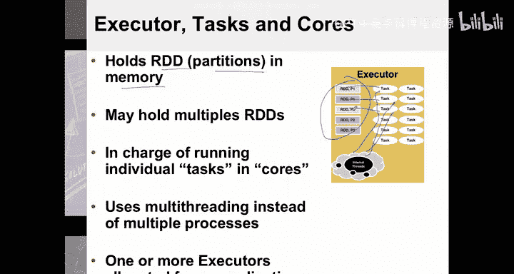

RightThe key thing to remember here is that here tasks are threads that are running inside an executor and this is where the real work is being done so in terms of distributed processing you have a driver program which controls the flow of the program and it communicates with the scheduler or the resource manager to allocate executors across multiple machines and these executors have threads in them and these executors also have the different RDDs in them and these executors will be working on the various RDDs as threads right and the driver is actually controlling that that's really how Spar B works。

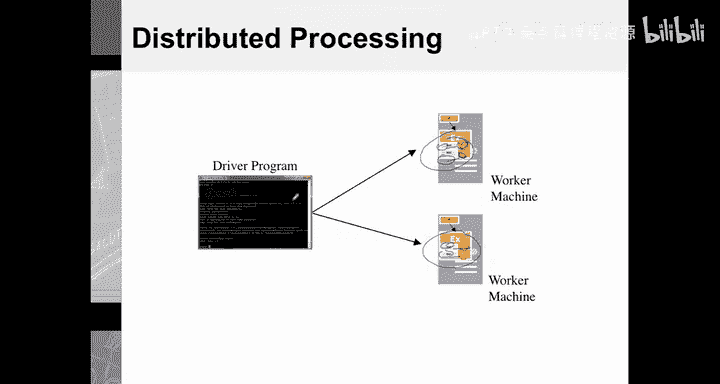

Okay， so let's look at these spark code application modes。

There are two application modes in which Spar can work， One is an interactive mode。

Where you launch a driver and then you just work with Spark in an interactive shell。

 and the other one is the batch mode。

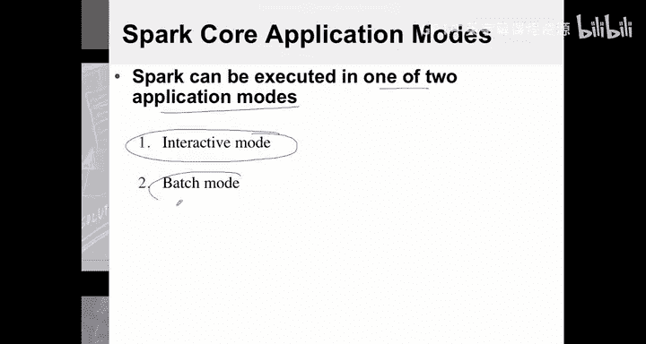

Let's look at interactive mode it is achieved using what is called a spark shell once you install Spark you will see that Spark has several shells。

 in fact there are three language specific interactive shells that is the scholar language based shell called the Spk shell Spk dash shell。

That's the tool there is also the Python language page shell called Pipark and there is also an R language pagehe called Spark R so these are interactive shells that launch the driver and then you can start interacting with Spk now the cool thing about these Spark shell are when you launch the Spar shell。

 they have these spark context built into it and so you can start interacting with the Spk environment。

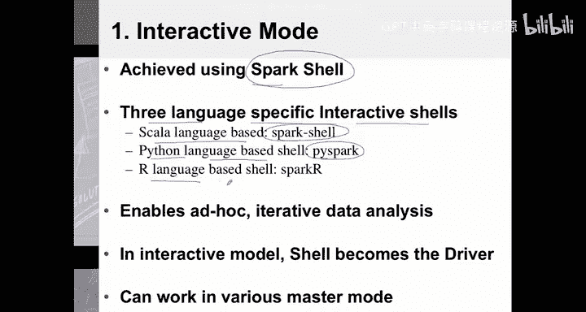

And these spark shell enable for ad hoc iterative data analysis so you can in your Sp shell say hey。

 load this data， then you can say go ahead and apply this particular filter then you can say go and apply this map function then you can say go apply this reduce function then you can say write the results down over here so it's almost like what you have done with P is a very similar idea。

 this mode similarity between P and Sp then with hive and Spar well when it comes to hive it's more along the lines of Spar SQL in this interactive mode or the interactive model the shell becomes the driver and in this model the shell which is the spark shell so it becomes the driver where is the executor run well that depends upon what kind of master mode you're in are you in the local master mode or in a distributed master mode such as yarn or meos or standalone mode。

A little bit more complication that's associated with which I'll talk about in the next few slides。

 the important thing I want you to understand with interactive mode is that you can launch a spark shell and you can interact with the Spar system by using the spark context object which is built into it。

 this is great for ad hoc queries and adc data analysis。

The other mode by which Spark code can operate is called the batch mode。

 it's achieved using the Spark tool that allows you to submit a job and the name of the Spark tool is called Spark dash Sububmit。

 once the Spark project is installed， then you'll notice that there's a command line tool available called Spark dashash summit。

 which is the tool that you use to submit your J programs or Python scripts into Spark system so that it can execute the batch program。

The batch application itself can be written in ScalA， Java， Python or R。

 of course if it's ScalA or Java， they are JVM based so they will be dotr files if it's Python or R itll be scripts in terms of application processing what does an application do。

 what does a batch application do it typically reads data from some kind of an external data source could be HDFS。

It could be a regular file system， it could be MongoDb database or Cassandra， NosQl database。

And then build an RDD。😡，Across multiple machines。It could be within the same machine itself。

 if it's an interactive local mode， don't forget that the new name for RDD is data frame。

And then it processes the data， you can process the data by applying multiple functions。

 and then finally writes out the results。That's really what a typical application does。

 very similar to what you've seen with Hadoop my produceuce。

 and don't forget that in batch mode also it can work in various master modes and there is something called deploy mode。

 which can be either client mode or cluster mode。I know it seems a little complicated。

 but hopefully as we go through this section and as I do some demos。

 it'll become a little bit more clear。

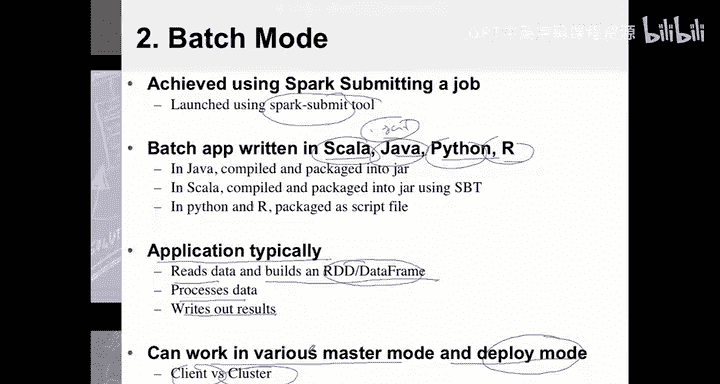

Master modes when you're launching these Spar commands。

 whether it is the Spar shell for interactive processing or Sp summit for batch processing。

 you have the option of specifying what the master mode is the master mode can be either local or standalone or yarn or meos。

Okay， now I'm going to draw a line right through this。

 basically saying that when you're running on local mode， it's not doing distributor processing。

 In other words， everything is running within the same machine。

 So if you set the master mode to local， everything is running within the same machine， the driver。

 the executor。All the threads， which are tax codes。

 are all running within the same machine within one JVM within one process in the client machine itself。

But when you set the master mode to be on a standalone mode。

 which is really sparse cluster schedule manager。Or when you set it to a yarn mode。

 which is the Hadoop yarn cluster Sch manager， or when you set it to a meos mode。

 which is really the Apache Meos Sch manager， then you're working on a distributed computing environment and when you're working in this distributed computing environment。

 you will have your driver and then you'll have your executor as different processes running across multiple machines。

That's really the big difference between the various master modes once again。

 the master modes can be either local， which is nondibuted， or it could be distributed。

 which means it could be either standalone spark mode， again it's distributed there。

 yarn S mode distributed there and meso spark mode。

So what does it mean to run Spark on local master mode， if you recall I said to you。

 there are two ways by which we can run Spk applications。

 one would be using the Spark shell such as the ScA Spark shell。

Or the Spar submit for batch processing， in either case， you can pass the D dash master option。

Where you can say that the mode is local。That's when you're saying that you're running in local modes so what does it really mean what that means is there will be one JVM process that will be launched and that JVM process will run the driver as well as the executor which contains the various threads for the various tasks to be executed so all the processing is being done in one machine This is great for prototyping it's great for data exploration。

 it's great from that particular perspective Everything is being done within the same machine within a single process。

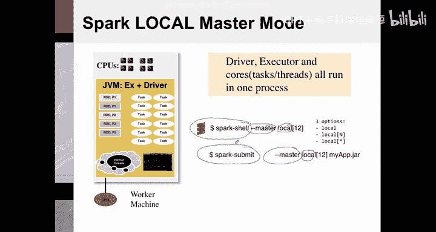

So it's a non distributed processing and this is how you execute it by passing the dash dashma local as an argument Now if you say dashma local of 12。

 that means you want 12 threads， if you say dash dashma local and you don't pass anything。

That means you're saying you want it to be the default setup。

If you say start means you're saying I want all the threads that is possible as part of the setup。

Let's look at Spark standalone master mode， it's standalone from the perspective that it is going to use Sparks cluster schedule manager for distributed processing just for fun's sake I decided to use a fllamingo to represent a Spar mode。

 so it is using Spark's own distributed computing engine called the Spark master worker distributed computing engine in this mode you have the driver that runs on one machine so notice that I have a driver running on a single machine。

And then the worker demons， these worker demons are demons that will be running all these different machines。

 they are JVM demons， that're running all these different machines。

 there is also a sparkk master which is based upon zookeeper so if the master triess。

 the zookeeper process will basically bring another master in one of the other machines。

The driver will communicate with Sparkma to figure out where the various workers are and where it can launch its executor and then it communicates with the various workers to launch the executors you can see that this is very similar to what we see in Hadoop yarn because in Hadoop yarn this is very similar to the node manager and this is very similar to the resource manager The client communicates with the resource manager。

 identifies the machines where it needs to launch its tasks and then communicates with the node manager to get the work done very similarly in the standalone mode that is part of Spark you have these worker demons which are analogous to node managers and the Spark master which is analogous to resource manager the driver communicates with these guys to launch executor processes and these executor processes are the ones where the RDs are kept in memory。

And it's the threads that actually do the processing， it's not the JVM process。But remember。

 the big difference we have between yarn mapreuce and spark is that in yarn map produceduce。

 every partition is processed by a separate JVM。Whereas here， every partition。

Or every RdiD partition is going to be processed by a single thread。 that's one big difference。

So how do we run Spk standalone remember there are two commands available Spark shell。

 which is the Sch shell， there's also Spark Sub to submit batch applications。

 you pass the dash dash master option with the URL of where the Spk master is located and the protocol here is Spk。

You can also pass the number of executors you want。

 how many executors you want to be launched in the distributor environment。

 you can also pass the amount of memory that you need to launch the executors with。

 how much memory that each executor should have against PARC is very memory greedy so you may have to change these memory values。

 and also how many course you want， how many threads that you want。Within that particular executor。

 same thing for the Sp Subit command， but one thing you'll notice is that when you run the Sp Subit command。

 there is also something called the deploy mode which can be client or cluster。

 and the difference is when you run the deploy mode to be client， the driver runs in Spk Submit JVM。

 the driver is running inside the Sp Submit JVM。In cluster mode， the driver is run in the cluster。

 and then the Sp sum can walk away， the difference is that when you do Spk Sub in the cluster mode。

 you can simply submit your job and walk away， whereas in the client mode。

 your client has to be connected to the network。Now let's look at running Spark in Yn mode now before we look at running Spk and Yonn mode。

 let's do a quick review of yan mode in Yn we have things called resource manager。

 which is the master。And then we have node managers that run across these different machines。

The client that wants to submit a job communicates with the resource manager。

It also launches what is called an application master， which is the master controller。

 which is where the application runs， which negotiates with the resource manager。

 the various system resources， and these containers are launched。

 each container is launched for each partition。So that's how mapreuce works。Now let's look at yarn。

Client master mode。 So we are running the master mode as yarn。

 but we are also running in the deploy mode as client。Here the client comes up。

 which could be Sp submit or Sp shell it communicates with the resource manager。

 The resource manager will launch an application master， and then it also launches。These containers。

 these containers is where the executors run， which is where the RDDs will be placed。

 the program will run and will finish off Now this is the client mode in the client mode。

 the driver is running as part of Sp submit or spark shell so the driver has to be around while this process is running。

So。Let's look at Spark yarn master mode。But with the client to mode。Remember there are two shell。

 there's the Spark She， which is the Sch She and Spark Submit。

 which is for submitting a Spark program。You say dash master yarn in both cases so that you can use the yarn resource manager to。

Alloccate resources for running your application and the rest of the other arguments are the same in terms of the number of exccuts。

 the memory that you want， and then the number of core you want。

 the one big difference between Spark shellll and Sp submit is that when you do Sp submit with the master yarn mode。

 you also have the option to do what is called dash deploy mode。

 which is either client or cluster and when you say client。

 the driver will be running throughout the time the batch process was running in the cluster。

In Spark yan cluster mode， what happens is your client program comes up。

 communicates with the resource manager， it launches the application master。

 and then there might be multiple executors launched， which are really multiple containers。

 each running its own executors。And the process will be done。

 The big difference between yaon cluster master mode。And yarn。

Pient Master Mo is where the driver runs。 Not here the driver is running inside the application master。

Which means the client can go away。And the job will still be running。

 So go back and look at the previous one。If you look at the yan client mode。

 the driver cannot go away， the driver has to be present throughout this entire execution。

 and whereas in Sp yarnCustom mode， the driver can actually go away because the driver is actually running inside the application master。

So in terms of command line tools， once again， we have Spark shell and Spark Sub。

 you say dash dashashmaster yarn， but then now you say deploy mode Dis。

 and I' will be doing demos of all these things once we install Spark it will make more sense to you when we do that right now I just want you to understand that these are the various mode of which you can run Spark。

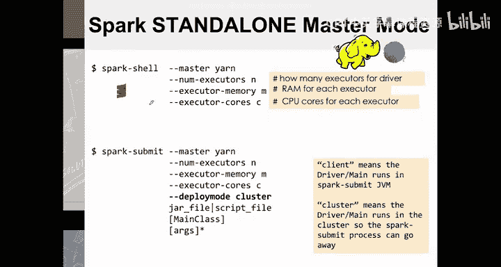

Spark meos mode here the idea that is that rather than using the standalone。

 which is the Sp scheduler or the yarn scheduler， you use the meos scheduler。

 So for that you're expected to install meos and configure meos Now let's look at processing So what is the processing or programming model in Spark。

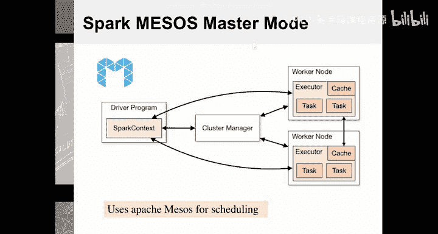

In mapreduce， we had。Map introduce us two different functions。In Spk。

 there are things called transformation operators， which is a group of operators available for us。

 more than one function， more than just map， there a whole series of functions available such as map and filter that you can apply。

And then there are these actions there are many different actions that can be done， including Reduse。

 count， first take， a whole bunch of those functions available and the main difference between transformation and action operations is that transformation usually transforms the data from one to the other to the other to the other allows you to do filtering by applying various map functions and then the action is where the real work gets done that's when the real work gets done that's when the actual computation gets done we'll see this in action when we look at the section on spark programming。

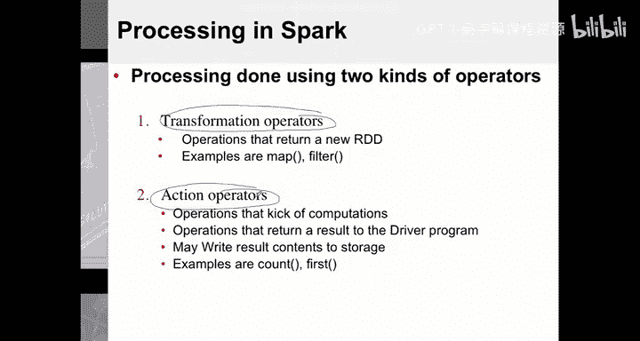

So in summary， we learned that in terms of these spark architectural components。

 there is something called RDD， which is the resilient distributor data sets。

 which is really a collection of data that's across multiple machines kept in memory and if it cannot fit in memory it'll spill to the local disk。

 preferably solid state device drives。Theres also something called the driver。

This is the process that controls。The application flow。

 this is where the main runs when you're running the Spk shell。

 that's the driver when you're running S Subit。That could be the driver depending upon what mode you're running in。

There is the executor， which is the real worker process where the tasks run in terms of threads and they're also called tasks or Co inside the executor。

In terms of the spark core application modes， we saw that there are two modes。

 one is the interactive mode， and the other one is the batch mode。In terms of interactive mode。

 there is Sp shell that launches the interactive mode for Scala Bay shellll。

 Pipark for the Python based shell and Spar or for R Bay shellll。

 for batchs processing you have Spark Subm。With S Submit。

 you can launch J programs which are scholar based or job based jar programs。

 or you can also launch Python scripts and or scripts。In terms of these spark master modes。

There is the local standalone yarn and mesos， standalone yan and mesos or distributed computing environment。

 whereas local is not distributed computing environment， it's not distributed。

 right everything runs within one process， great for prototyping。And then in terms of processing。

 we have transformations and actions that we have。So that gives you an overview of the Spark core architecture there's a lot of different topics that I've discussed over here。

 it may be a little bit confusing to you， but as you go through installing and running Spark。

 hopefully this will become a little bit more clear。

