# 约翰霍普金斯大学《Hadoop大数据处理｜Big Data Processing Using Hadoop》中英字幕 - P94：29_Spark环境配置与运行.zh_en - GPT中英字幕课程资源 - BV1g5u6zBExs

Setting up and running Sp。In this section we will learn how to download， install and run Spark。

 but we are going to be running Spar in conjunction with the Hadoop yarn architecture。

 so we're going to be running Spark on yarn and also we are going to be running Spark locally so these are the two modes in which we are going to be operating。

And so in this section， we're going to learn how to make Spar work in conjunction with Hadoop yarn。

So what are the objectives？We're going to be learning to download Spk， install Spk。

 and then we'll also explore these Sp installationulation director so you understand where the various components are。

 where the different configuration files are， where the different executables are。

Then we'll configure Spark for Hadoop the environment variables and everything and we also configure Hadoop for Spark Spark needs to know where Hadoop is and Hadoop also needs to know where Spar is in order to integrate Spark and run Spark on Hadoop then we'll download and install Scala The reason we need to do that is because we're going to be writing Scalabased applications Now this is a class on big data processing using Hadoop and its ecosystems。

 this is not a class on Scala， So I'm not going to be teaching U Scala。

 but I'm going to kind of give you how you can install Scala and how you can kind of write some basics of Scala here there are lots of tutorials available on the internet where you can learn Scala and then I'm also going to show you how to download and install SBT which stands for the Scala Bill2 that allows you to build applications to be run under Spark。

Then I'm going to show you how to run the Spark shell， we talked about Spark shell。

 we also talked about Spark sum， so we're going to show you how to run Spark shellll and Spark sum in various modes。

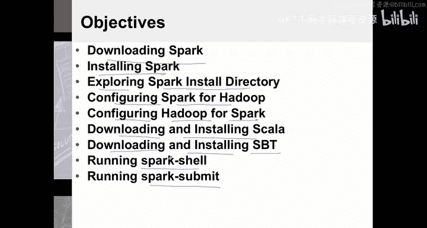

Okay， downloading Spark， Spark is of course an Apache open source project。

 and so you can go to sparkk。appache。org to download Spark。There are two。

Pages where you can download Spark from one is you can go to Spark page and then click on download to get to a page to get to download or you can go directly to archive or apache。

org s s disk spark to get to the sparkk distributions and then towards the end of this particular section I'm going to show you what version of Spk we should be working with。

When you download Spark， you have two options， you can download Spk with Hadoop or you can download Spk with No Hadoop。

We will be using Spark with No Hadoop because we are going to be using Spark with an already installed version of Hadoop。

Al right， now that you have downloaded Spark， you can go ahead and install Spark by cding to user local Hadoop folderer。

 the same folder where you' have installed Hadoop， hive PG， Hspace。

 the same directory you can extract the Spark without Hadoop download so here Do word stands for the version number。

 whatever the version number that you're going to be using for this class。

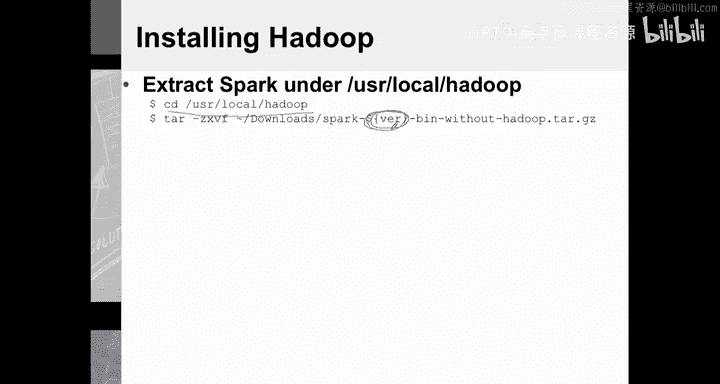

Once you have extracted Hadoop， let's look at the director structure， there's a bin folder。

 which is where the two important Spark commandline tools are available。

 the Spar shell to launch Spark in interactive mode and also Spark Sub to launch batch applications。

 there's also Spark SQL so you can execute the Spark in SQL mode。

The con folder is where the configuration files are， there is a file called spark Ev。

age that we need to set up over here based upon our template， it is also sparkdefault。

con as a configuration file。And there are some other files like slaves。

 if you're going to be running Spark on a standalone cluster mode。In the data folder。

 there's a bunch of data examples。In EC2 folder， it shows you it has some scripts that allow you to install Spark on EC2。

 There's also lots of examples， Spk examples。 this would be a good folder。

 there are examples in Java Python R and Sca， Of course。

 in the Lib folder is the Spark library and then in the Python folder is where the Python Spark related files R for Ppark the R folder the R supported files R which is the sparkark R related files。

 There's also folder called S bin， which is different from the bin folder。

 The S bin folder consists of commands that can be used to launch the Spar demons we are not going to be using anything from the S bin folder only because we are not going to be launching any of the Sp demons。

You need to launch the spark demons only when you have to run Spar on a standalone mode。

 we're going to be running Spk in conjunction with Hadoop， yarn。

 so we don't need to do that all we need is really the bin folder。

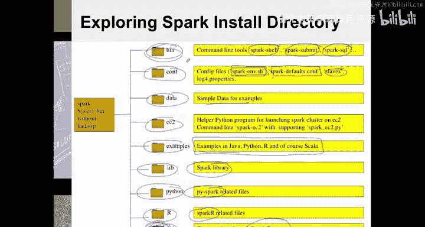

In terms of setting up the Spk environment， you'd have to edit the bash profile and set up Spark control score home I'm setting the Spark control score home to the fully qualified directory where Spark is installed。

 of course dollar War has to be replaced by the appropriate version number and then you should also add Spar to your path you can execute the Spark submit and the Spark shell commands。

 you can also add Spark home s S bin to your path if you want if you're going to be launchingparark in standalone mode which we are not going to be doing so technically speaking。

 we don't really need to add the S bin folder， but that bin folder definitely must be added。

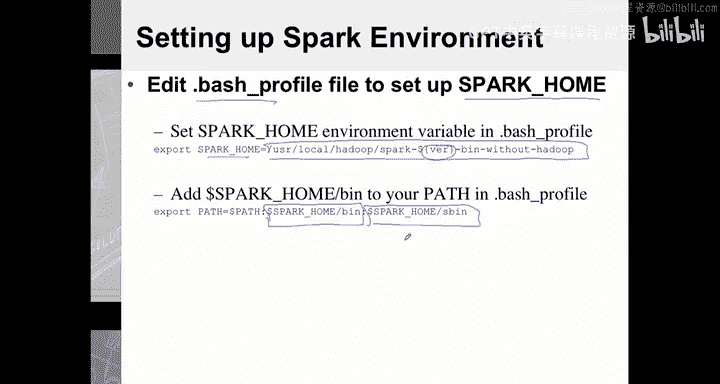

In terms of configuring Spk for Hadoop， this is where you're going to tell Spar to say where Hadoop is located for that CDd2 Sp home con directory。

 this is the cony and in that directory there is already a file called Spk Ev。sh。

 template copy this file。Into a file called S Ev。 so you're really copying the template file into a file which is called S E V。

This template file has some configuration parameters that we want to change。

So what is it that we want to change， well edit this S dash EV。Dot S H file。

 which we copied from the template file。 And at the end of the file。

 you can add these two statements。 The first statement says what is the class path for Hadoop classes。

 Because it's important needs to know where the Hadoop classes are， Hadoop class path。

Command will tell you all the different classes， so if you hit the back code。

Wwhichch means execute this command， Hadoop class path， if you set that up to that particular value。

 if you set the apar class path to backcode， Hadoop class path back code。

 you'll actually execute the Hadoop class path command and whatever the return values are will be placed in Sar class path。

 a very easy way to set upparar class path for Hadoop。

We also want to set the Hadoop configuration directory。

 this is where you're saying where Hadoop configuration files are the con files are。

 which is really user， local Hadoop， Hadoop dash version number。

 whatever the version number we are using s et/ Hadoop I'll be actually going through this installation process after the slides so you can actually see what exactly I'm doing for a specific installation of Hadoop and Spark。

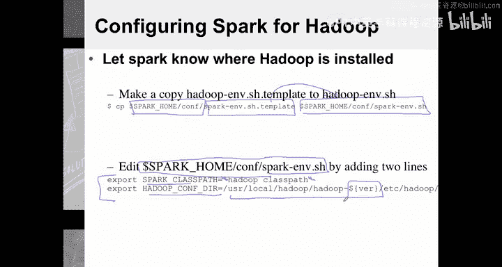

Now that we have downloaded and installed。Spark and configured Spark to run on Hadoop and Hadoop to support Spark。

Let's download Sca。Sala is a language built on top of the JVM， plus the Scala logo。

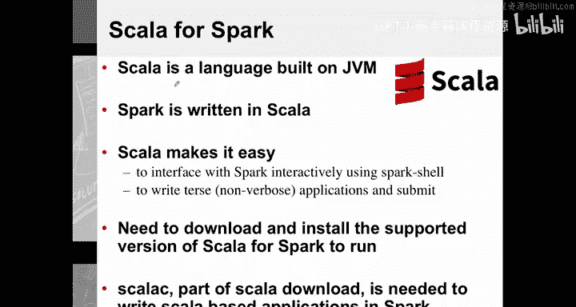

Spark itself is written in Java， it doesn't really need ScalA to run applications because it runs on the JVM。

 but we need ScalA so that we can build ScA based applications and compile them。

So let's go ahead and download Sca and install ScalA。

Scalala makes it easy to interface with Spark interactively using this Spark shell。

 it also allows us to write Terse nonverbo applications and submit that。

 so working with ScalA is quite common for many of the Spk developers makes it easy to build applications。

 big data applications。We need to download and install the supported version of Scala for Spark to run and when I say this as the supported version because when you actually download Spark。

 if you look at the Spark page， they will tell you what version of Scala it works with and Scala also has different versions and we need to make sure that we match the version number。

When you download ScalA， you're going to have something called a ScalA C which is a ScalA compiler tool。

 that's what is used to compile ScalA applications to generate the dotR files。Okay。

 so how do you download and install Scala， just go to Sclar。lang。pog website。

Download the appropriate version of Scar， then CDd2 user local Hadtoop and extract it。

So now we have Scala installed， and then we need to set up the environment variables for Scala。

 so you set the Scala underscore home to appropriate ScalA directory and export Scala home and you also add Scala home/lash bin into your path so that Scala C is available for you to compile。

Not only do you need the Scala development kit， you also need SBT。

SPT stands for the Scala build tool， which is a tool very similar to maven or Gradle for building applications in this case it is used to build Scala based applications if you're going to be writing an application and generating a jar file out of that。

 SPT would be a tool that you could use。You can also use maven， but you're going to use SPT。

SBC is used to take your dot Scala files in a project and build your J file so that you can create ScA applications and then you can use Spark dash Submit to submit these ScA applications。

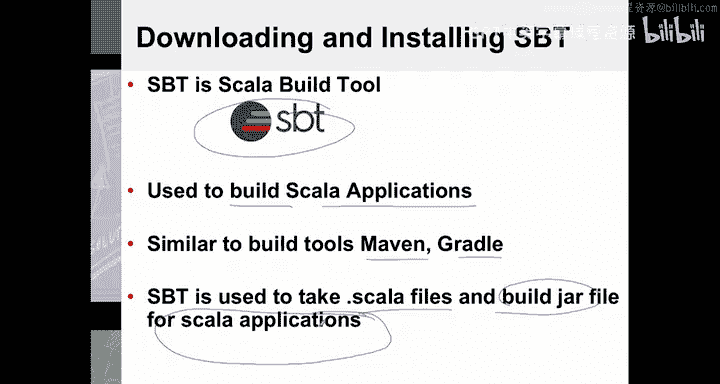

How do you download and install SBT， you go to scholar。sbt。org。

Download the appropriate version of SBT， and then you Cd to user a local Hadoop。

 you extract it right there， so you have SBT installed。

 and then there are a couple of environment variables that you need to set， which is ST home。

 export it， and then ST home slash bin should be added to your path。

 Now you have SBT so that you can run the ST command line tool， which is a tool available。

That you run on command line。SBT that allows you to package。

 you actually say SBT space package to package your application。

 I'll be doing demos of that later on。Okay， so how do you run Spark now Well you got your six demons running。

 which are your six demons for Hadoop yarn for Spar， you don't really have to run a demon。

 you run the Spar She tool or the Spk Sub tool to launch your Spk applications。

Both locally or in a distributed fashion， so we'll see that。

You can run Spark shellll to run Spark interactively and the reason you can just type in Spark shellll is because you have installed Spark and you have added Spark home slash bin into your path and so you should be able to type in Spk dash shellll。

In your command line that launches the Spark interactive tool。

 you can also execute Spark dash Subit to run Sp in in a batch mode。

 and that's when you say Spk dash submitit and you can see dash dash master。

 local yarn cluster or yarn client， these are some of the arguments that you can pass when you're running Sp in a submit mode。

Okay， so it's time for live demo， so at this point I'm going to show you how you can download install Spark。

 ScA， SVT， and how you can set up the environment variables and also how you can interactively work with Spark to do data processing interactively and also submit an application to Spark。

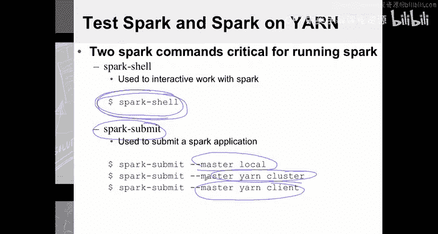

Here I am logged into my HD server VM as HD admin user ID and the goal now is to set up Spark。

 so on the left hand side I have over here instructions for setting up Spark that's about 16 such steps of instructions that we are going to be executing。

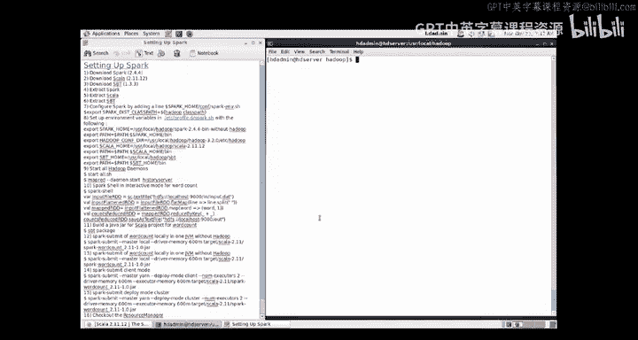

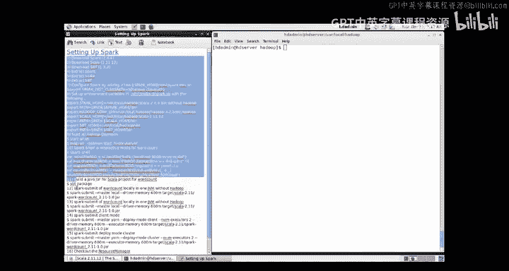

Don't forget that spark。Can run by itself， and it can also run on top of Hadoop。

 So we are going to in this case， set up Sp to run on top of Hadoop and also Spk depends upon Scala。

 it also depends upon ST and it of course depends upon Hadoop So we need to make sure that that our Hadoop 3。

2。0 or whatever the version of Hadoop that we have installed is compatible with the version of Spark。

 which is compatible with the version of Scala which is compatible with the version of ST。So。

That's what I have done here。 We are going to be as part of this setup。

 We're going to download Spark 2。4。4， download Scala 2。11。12， download SBT。

 which is the ScalA build tool 1。3。3 extract it， install it。

 configure it and make sure that everything is set up and then kind of demonstrate the Spk shell so that we can interactively work with Spark using the sparkark shellll tool just like you could do in hive and Pg and then I'm also going to show you how you can write applications that can generate jar files that can be used to work with Spark that can work on top of Hadoop or without Hadoop in a standalone mode so we're going be doing all those things and so stay tuned let's go ahead and do it so the first thing we need to do is download Spark 2。

4。4。Download ScalA 2。11。12 and download SBT 1。3。3。 Let's go ahead and do that。

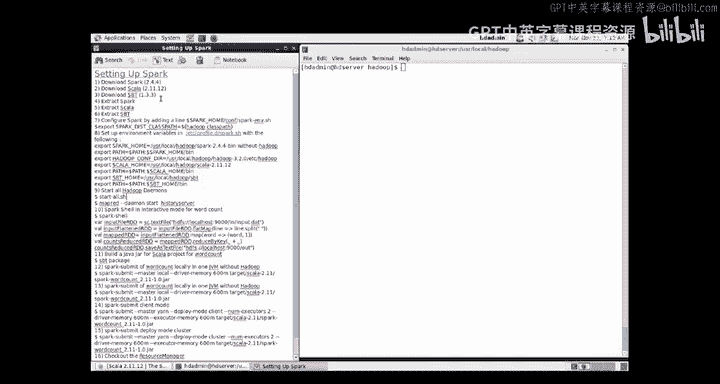

So here Im in my browser。Let's go to Spark， so Spartappache。org is the website。

 I go there and I want to download， so go to downloads and then the latest version is 3。0。0。

 but that's preview and we don't want to be working with that now。So let's click on 2。4。4。

 that's the version we want， and we want 2。4。4 with user provided Apache Hadoop because we already have our own Apache Hadoop。

 we don't want Spk to bring its own Apache Hadoop。So that's what this is， so Spar 2。4。

4 bin without Hadoop。tgc， you click on it and then you download it。

 so I've already done that and it's already placed in my downloads folder。

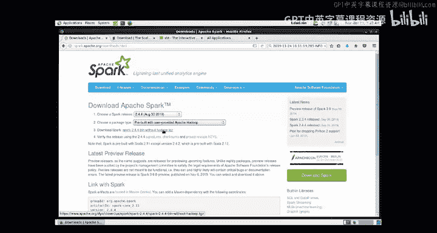

We also need Scala so I went to scalalang。org， this is the homep page for Scalalang。

org Now it so happens that Scala we need 2。11。12 because that's what is compatible with 2。4。

4 so we need to get the right version of it so let's click on download here in Scala。

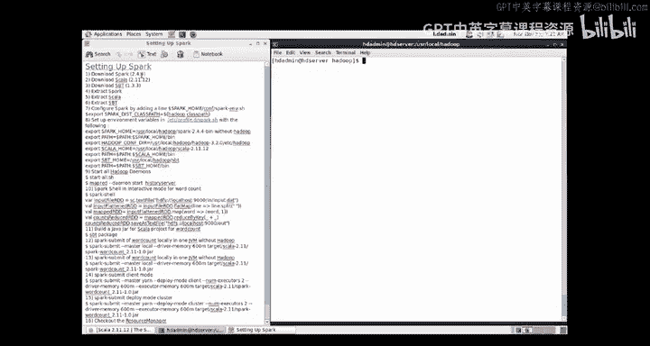

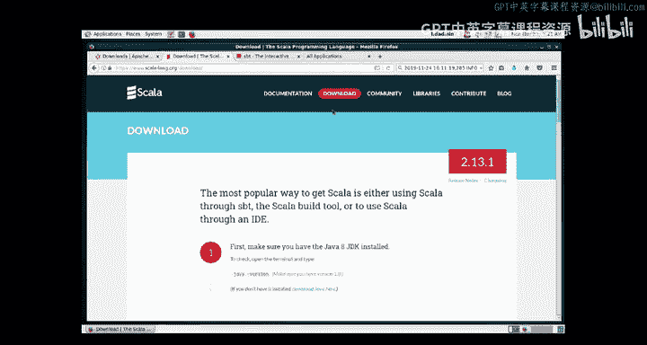

And see if we can get the right version。SoIf you scroll down a little bit after clicking on downloads。

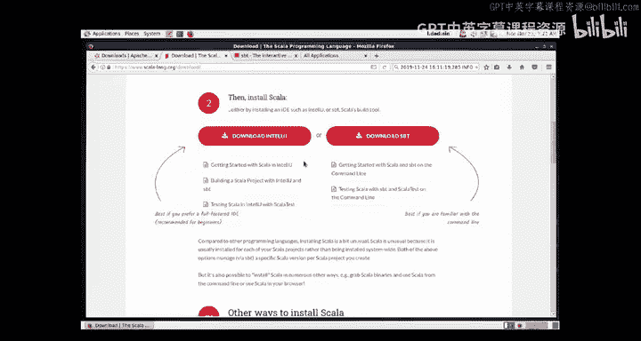

You will see that 2。11。12 is available。Right here。

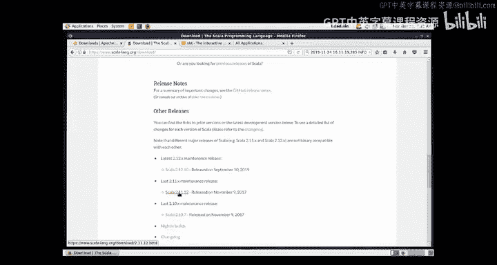

That's the 2。11。12 version。So you go over there。And then you can download。The binaries for that。2。11。

12。 tgz。 I already downloaded that too。 it's in my downloads folder。

The next thing that we need to download is SBT， which is the Scla build tool。

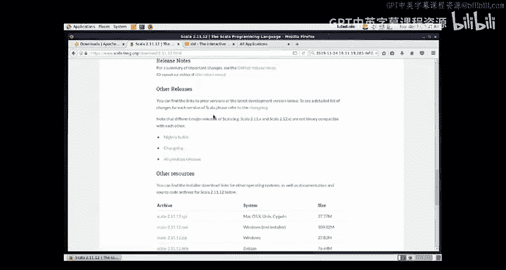

So here's caliber tool。

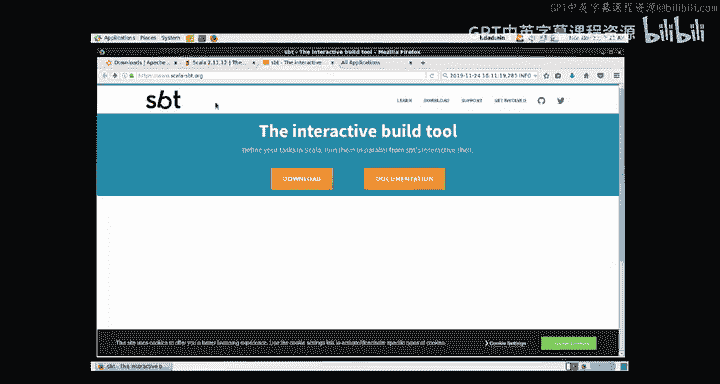

Which is callsb。org， I click on downloads and when you go there。

 you see all these different versions。

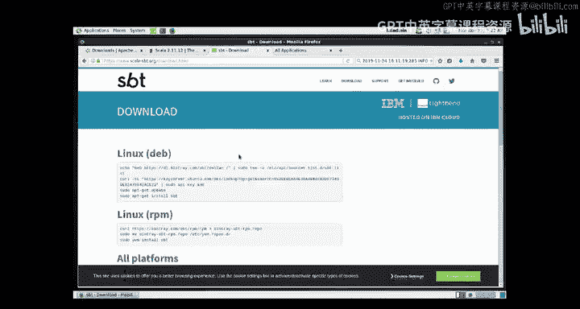

SBT 1。3。3 is the version that we are going to be using actually 1。3。4 should also work。

 but I'm just going to work with 1。3。3 because 1。3。4 was released just a few weeks ago。Okay。

 so I've also downloaded that。

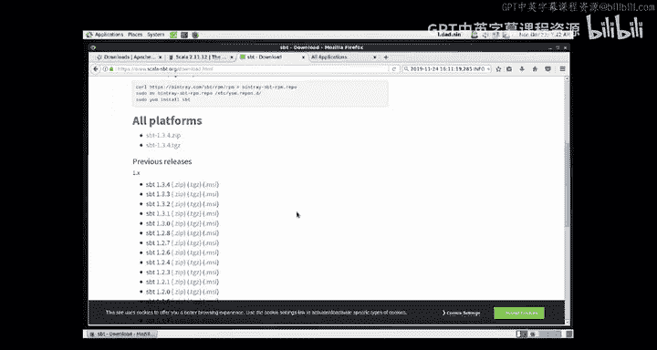

So I'm going to prove to you that I've downloaded Sp 2。4。4 and downloaded Scala 2。11。

12 and downloaded SPT 1。3。3， so Ls minus L tilda slash downloads。Spark 2。4。4 without Hadoop。

 that's what we wanted， I've downloaded that。So， this is done。Download at Scala。 Let's see。

 Ls minus L tilde slash Scala。Downloads。Scholar。2。11。or， that's the version we want。

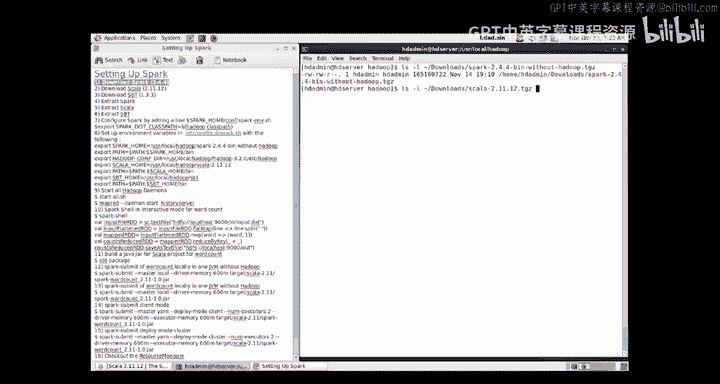

And I have downloaded that also。Great。And we want。

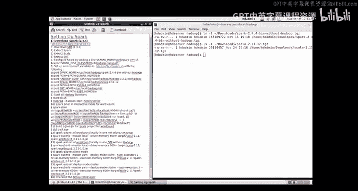

S， B T 1 dot 3 dot 3， L minus L。Tillda slash downloads。SB T1。3。3， and that's being downloaded also。

So we have downloaded。Spark scholar and SBT at this point。Let me clear the screen。

Now we need to extract Spark， scholar and SBT。So Cd2 slash user， local Hadoop。

Do an LS minus L over there， notice that we have our Hadoop 320， we have our H base。

 we have our hive， we have our PEG and we have the data folder。

 which is where HFS configuration and HFS file system information is stored。For the name note。

 now what we need to do is extract Sp， So let's do that tarR， Z， X， V F， tilda slash downloads。Spark。

So we have extracted spark right now， it's downloaded。It's extracted。Now， let's go ahead and extract。

Scaa， that would be tar。Z， X， V， F。Tilda slash， downloads。Scholar。All right， Mr。 that。

 so that I've extracted。Slar。That's done， too。And now we need to extract SBT。Alright， tarr Z， X， V。

 F， tuda s。Downloads S， BT。There it is。 We've extracted that， too。 I want to clear the screen。

To an LS minus L。 And there you can see that Sp has been extracted， scala has been extracted。

 NSPT has been extracted。Now Spark does come with its own Scala。

 the only reason we have downloaded ScalA and SVT so that we can actually write applications in Scala that can run inside Hadoop as a Jaify you can also work with Spark in an interactive mode。

Okay， so we have done step six。Which is extract S BT。 Now， what we need to do is configure our。Spark。

 so we are going to configure the Sp E and V。 So let's go to Spark folder。And there's a file there。

If you look at the firstpar footer， there's all these different directories bin is where the spark commands are placed and then confi the directory that we want to go to。

So here I am under user Local Hadoops part 244 bin with Hadoop slash conf。And over there。

 if you do an LS minus cell， there's a file called Spark Ev do H。

 let's copy sparkk Ev do H do template to spark。Dash。E， N， V dot S， H。Without the word template。

Open that file up。The file is practically empty， We're going to add a line in there。

 We're going to add a line。It's this line right here that basically says exports spark disk class bath to Hadoop class bath。

So， basically。If you type in the command Hadoop classB。

 it'll give you the list of all the J files that's necessary for running Hadoop。

When you say export sparkk disk underscore classpath equals dollar within parentheses。

 Hadoop class path。 What it does is that it executes this command and whatever the output of the command is。

 which is really a classas bath， it gets set into this variable called Spark disk classas path。

 which is needed for Sp to run because we are going to run Spar on top of Hadoop。

 This is how we are actually saying how。Spark will be connected to Hadoop。All。

 so let's go ahead and save that。You you have that file right there， so we are done with that。

So we are done with that step7 Now we need to set up our environment variables。

 we need to create a file called s etsyprofile。dpark。

h so we can actually have our spark environment variables done So what I'm going to do now。

Is go ahead and set that up Cd2 become， let me become rude SU dash root。Roude， rude。C， D， E C。

 slash profile。Dot D。And there we have like Hadoop dotage that we created。

 H based datatage that we created。 Let's go ahead and create spark do H VI。Spark dot S， H。

And what I'm going to do is copy。This set of。Lines。And paste it over here。All right。

 so what is this saying， It's saying。Let Sp home be set to user local， Hadoop。

 Spk 244 bin without Hadoop。And we're going to add it to the Pat do4 home slash bin。

Then we also set up Hadoop conf directory。To user a local Hadoop Hadoop 320 s Esy Hadoop。

 this is where the configuration for Hadoop is， and so we also need to set that up because we want to make sure that our spark knows where the Hadoop configurations are。

Then we have the scholar home set up。Then we added scholar home to path。

 Then we have our ST home set up。 Then we added ST home to path。 Alright， so let's go ahead and。

Close this file。Save it， exit now in order to。Take this into effect。

 What I have to do is launch the terminal again。 So let me close the window。

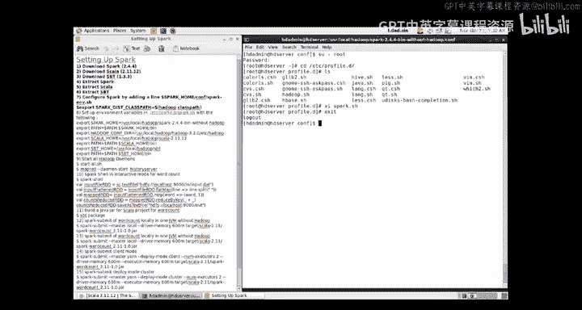

Start the terminal again。Make it bigger。

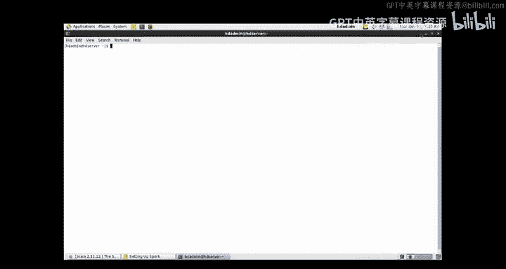

I'm also going to go in， and。Zoom in a little bit。So that。You can see the text。All right， so if I do。

E and V， I'm going to see a bunch of environment variables。If I do E and we grab Spar。

I see the Sparcom setup。If I do ENV Scala。Grab scholar。

I'm going to see the Scala environment variable set。 if I do E and V。5 grab S BT。

 I'm going to see the SBT setup， if I do echo。Dollar pass。That is going to show me the fact that。My。

Spark bin is in my path。 My scala bin is in my path， and my SBT bin is in my path。 So were all good。

Alright， so we have done step 8。Which is setting up。The environment variables。Now。

It's time to start all the Hadoop demons。So let me do a JPS notice that there are no demons。

By the way， let me also C D to user。Local Hadoop。And doing L minus cell， you'll notice that I have。

Spark， Scala and SPT installed SPT apparently doesn't put a version number。Okay。

 so let's start all the demons and the way we start all the demons is start dash all do age。

This is a nice way to start all the Hadoop demons。It could start。The name node。

 the secondary name node， the data node。It'll also start the resource manager and node manager。

 but it does not start。The history server， so we have to start the history server also。

All the demons are coming up right now。Okay， so if I do a JPS。Yep， I got my name node， data node。

I have my secondary name No， and of course， I also have resource manager and node manager。

We're good there， but we also need to start the map read。History server。

So let me go ahead and do that。There're starting the。History server demon。Do a J。 All right。

 so we got all over six demons now running for Hado。

 We don't have any Hadoop demon we don't have any yarn demons because the yarn is going to run standalone or inside Hadoop。

Okay。So we are done with that。We had done with step  nine。Now， we have seven more steps to go。

 Now it's all about。Working with Spark。So let's work with Sk at this point。

So what I would like to do is show you how to work with Spark in an interactive way。

We want to do the word count kind of operation。But we want to do this in an interactive mode using Spark。

 which Spark allows you to do。So for that， I have a file already in HDFS。Haadoop， F S dash。

 L S slash。Input。Slulash in， slash input。Dot DAT。There's a file there and let me do a CA on that file。

There it is。 You can see that it' a file that contains a bunch of lines。

 the word word is appearing once， twice and thrice。Okay， and then the word is， is up getting once。

 twice and thrice。The word beautiful is appearing twice。 right。

 So we have to do a word contact type operation on this one。 We know how to do this thing in。

Haop Mareuce， we know how to do this thing in hive， we know how to do this。Pig。

 now let's see if we can do this thing in Sp in an interactive mode。Right。

 so let's go ahead and run Spar shellll。Spark shell is a command that is available as part of your spark installation。

 so I'm going to start the sparkark shell。Okay， I'm launching Spk shells。

 Spk shell is actually written in Scala， and it uses Scala。2。11。12。

 And that's the reason why we had to install 2。11。12 for。Building scholar based applications。

All right， so I'm in an interactive mode， the first thing I'm going to do is execute this one command。

To make it easy just。Pasted it on the left hand side。To make it easy。

Kept all the commands on the left hand side so that I can just paste it。 So this line says。

 let me create a variable called input file RDD， and that variable should refer to a file that is an HDFs。

 And this is the file that I showed you。 The file that said the world is beautiful and so on and so forth。

 So we have this file。 its。Line that I'm going to execute。Executed that line。

 Now it didn't do anything just like in P where you can execute these commands。

 but they don't really do anything until you have taken action。 So it's like， okay， fine。

 I have a variable that points to this file。The next line basically says。Let's。

Create another variable called input flat and RDD， which is going to take the input file。

And it's going to flatm it。 in other words， it's going to take every line and it's going to split the line by a space。

 Now this can be a regular expression so that it can split by space and tab。

 but I'm going to split by space right now right so I did that。Okay， that's perfect。

Then I'm going to execute the third line in my interactive mode。Let's paste that in。

And then that says， let me create a new variable called mapped RtD。

 which basically takes the input file， which basically takes the。Input flat and RDD。

And then maps every word。😡，To a tuple， that's the word and the count， which is one。ok。Oh。

 I forgot to put。A parenthesesis there。One more parentheesis is needed。All right， so that's done too。

Now I'm going to create one more variable。Paste。Which basically says。

 let me create a variable called counts or reduced RDD。 Now it's going to reduce。

 it's going to reduce by the key。And the underscore here indicates the key， which is really the word。

 and then it's basically saying that I'm going to add anything that is the same word。

 like I'm going to add all the words together and have the count and that's the count。

So it's going to reduce it。So the word word will probably appear three times beautiful two times or three times。

 and so on and so forth。So I'm just going to do that。Okay， so that's the reduced functionality。

 but the interesting thing is that it hasn't really done anything yet we only set up the code。

The only time when it's going to execute。The Spk functionality is when you take an action。

 for example， I'm going to take counts Red RDD， and I'm going to say that I'm going to save it as a text file in the HDFS s out folderer。

This is the action command that is going to basically execute the Sp functionality。

 so let me go ahead and copy that line。Right here。Notice up to this point。

 all I have done is created variables。Now this is where I'm going to do an action。

 and so hopefully when I run this， it is going to take my input file。Which was in。

This line that basically is input file RDD。Which is my input dot thatt file。 It represents that。

 Then the next line says that flattennet。Which is basically splited。 Then the next line says。

 go ahead。And map every word to and。Count associated with it。 And then this one says。Reduce it。

 We'll learn more about these things later on in the next section。

 you're going to learn about all the different functionalities available in Spk。 But right now。

 I just want to going to show you this。Okay， so let me go ahead and execute。And it failed。 Well。

 why did it fail， It failed because it says the output directory。Already exists。

 the out directory already exists。 Okay， that makes sense， not a problem。

 Let me go ahead and launch a terminal here。Po F， S dash L S， s out。Yeah。

 the output directory already exists。 Let me go ahead and remove it。

 This is very similar to mapreuce。 Remember， when you're running mapreuce。

 the output directory cannot exist or M dash or slash out。Okay。All right， so I've removed it。

Let me go ahead and run that command again。Saving it as a text file。

 So I'm saying take the reduced RDD， which is。All these functionalities that need to be executed just like pigg and go ahead and generate the output。

So there it is。It's executing and it's done。It's done， look how fast it is。All right。

 so I'm going to quit Sca。For my Sp shell， I'm going to do that by typing in Cr D。

Clear my screen if I do Hadoop Fs Ls。Slash out。I should see an output folder， there it is。

And if I do Hadoop。F， S， dash， cat。Slash in slash input dot dot。

I'm going to see the contents of my input file。If I do Hadoop F CA。Slash。Out。Slash part dash 00，00。

 That's the two reducers that kicked in to generate the two output again， when you're running Sp。

 you're also is still running some concept of map and。

 That's why I spend a lot of time in mapre concepts。 It this is the mapre of Sp。

Let's look at the contents of the file。 there it is this appears one time， is appears three times。

 this appears one time and word appears three times one word appears once in the file twice in this file and thrice in this file。

 okay， is appears once。And then twice。 And then。Trice， and then the word disappears only once。

Right here。Still there are a few words that's missing， that's because there are two reducers。

 so let's go ahead and look at the other one that would have the rest of the word count keys。

So here's the rest of them and their count right there。

Notice beautiful appeared once here and once here， beautiful appeared twice。So there you go。

 we are able to execute Spark in an interactive mode。

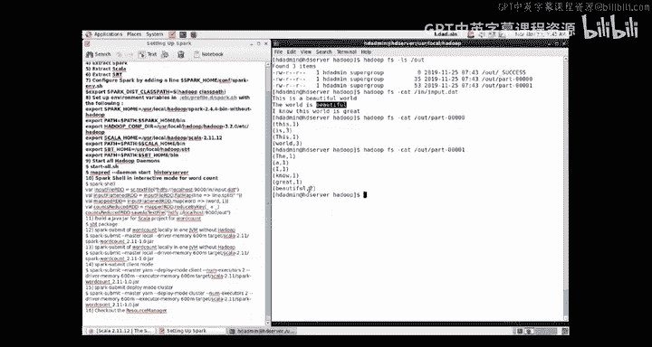

So that was interacting with Spar shellll。 Now I'm going to do something different。

 Now I'm going to say， I don't want to interact with Spar shell。You know。

In an interactive shell mode， I won't actually write Scala based applications。

 so if I want to do something like that， what can I do Well I need Scala。I also need the SBT。

 which is the Sca bill2。And I've actually done that。So in my home directory。

 I have created a folder called word count。And inside it。There is a file called。Build。sBT。

 which is the ScalA build tool configuration， very similar to what you have with Gradle and Maven。

 it basically says the name of the web application。

 it basically says that the name of the application is sparkark word count。

 the version of the application is 1。0 and we are using ScA version 2。11。

12 and the library dependencies are Spark and Spark or 2。4。4。2。4。4 version。Okay。

 and then if you source。Main scholar。In that folder， I have a file called simple app dot Sca。

 which is basically doing something very similar to what we just did for word count。嗯。

And it's going to write into the output folder。 So this is an application that I'm writing that will generate a jar file。

 And then I would basically go in and execute that using Spark submit。

 So that's what we're going to do。 Again， don't worry about the syntax of this。

 That's in the next few sections。 So I just wanted to show you。Let's go ahead and get back to our。

Scholar application。Clear the screen。Here I am。 So in order to build the package。

 I have to type in SBT package。S， B T package。That's going to build my ScA application。

This is very similar to maven。Grale。And。It's building my application and it built it if I doing an LS minus L now。

There's these folders called project and Ta。 If I go to target。I see a file。Actually。

 I see a directory called Sch 211。We go there and if I do an Ls minus L。

 I see if I call spark dash word count underscore 211 dash1 dot0 dot jar。 Now spark dash word count。

Came from the fact that in my SBT file， which I let me show you。

It said it's spark word count created spark dash word count as the file name。

 and then I said that I'm using scholar version 2。11， so it says_ 2。11 and then dash 1。

0 which is the version of my application， that's why I generated this kind file。Okay。

 so I have a jar file at this point。I would like to execute this jar file。

I would like to execute this jar file。Using Spark submit。So we are in step 2 at this point。

 so what I'm going to do is。Execute this command right here。Which basically says。

I would like to run Spark Sub command， which is another command available in Spark Home directory。

And I'm going to run it in the local mode， which means I'm not going to run with Hadoop or with any of the spark demons。

In fact， we don't have any spark demons learning。And the driver memory。

 which is the command that is going to execute， that is going to do this map reduced needs 600 megabytes of RAM。

And the target。Jar file is this jar file right here， which is in the。Target folder。

 but you know what， I think the file is right here。

I am right there in the current folder so I can simply say 600 megabyte spark word conduct charge。

 so let's go ahead and execute that。I was right here in that directory。

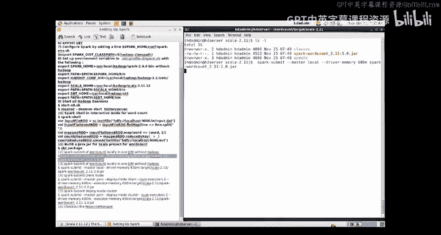

Okay， so there it is。Now it's going and executing。And it failed and the reason it failed。

I'm sure you could have guessed it because the program is supposed to write into the out folderer。

Which already exists because we already ran it。 So Hado， F， S， dash R M。Dash or slash out。

Let's remove that。And let's execute it again。 and I'm going to execute the jar command。

 which is really written in Scala。 You can write。Spark applications in Python in Scala。

 in Java there， it's done， it's done running。 So now if I do Hadoop F S dash L S slash out。

I should see my output folder。And I should see， mine。哦。

You should do a cat on the contents of the file。Slash out， slash。Pork dash。0，0，0， zero。And。

You see that it did do the map produceuce kind of functionality inside Spar。 Now。

 the thing is when I ran this sparkar submit command over here in step 12。

What happened was we were running Spark locally。In1 JVM， it came up。 It ran the Sp commands。

order all the data from HDF as a main memory。Ran the map reduced functionality。

And then put the output into the。Slash out forer in HFS， So you're basically using HFS。

 you're not really using Hadoop yet。Okay， so that's 12。Now let's see what we can do。Okay。

 so now let's look at step 13。 Step 13 says let's run spark in yarn mode。

 So now we're going to start using Hadoop。And we want to run a client。

So the driver is going to be running in a JVM， but then the actual map reduce processing is going to be running inside Hadoop。

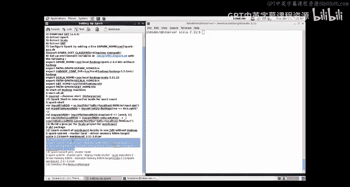

So let's go ahead and look at the。

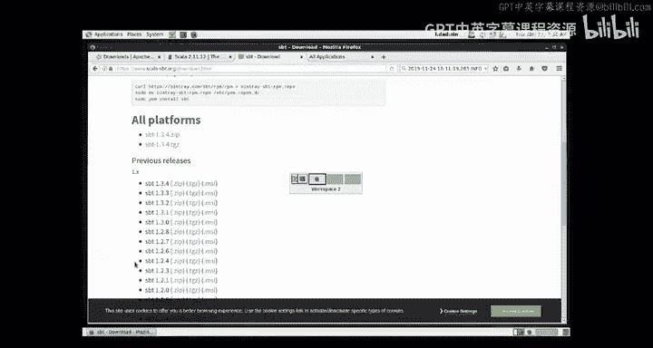

Resource manager， reload the resource manager， notice that there is no mapre jobs that have run up to this point。

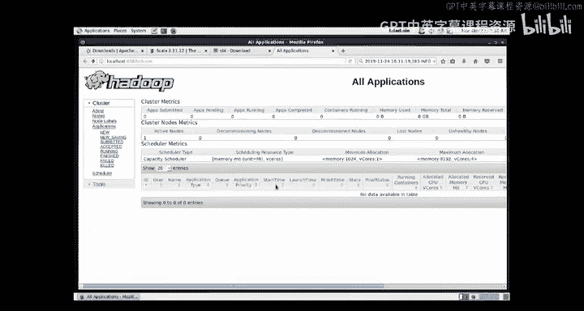

Now let me go ahead and execute this command right here。

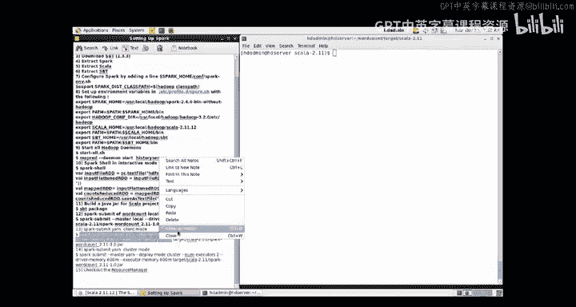

I have my drawer file。Based。And then， spark。Okay， so this is saying。Submit the。Spark application。

And the master is yarn， it's not blind anymore。The masters yarn。So it's going to run inside the yarn。

 the deploy mode is client， which basically means that there's going to be a client that is going to execute all the spa context and everything。

And then the number of executors is2， the driver is 600 megabytes。

 and the executors are going to be running at 600 megabytes。 So let's go and run this command。

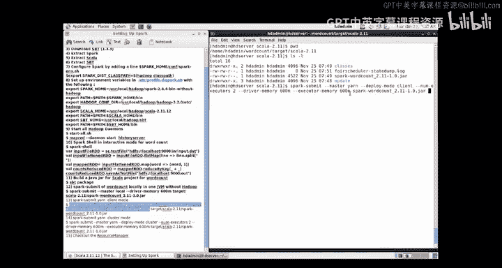

So， this。We're hoping we'll take advantage of mapreuce。Well。

 I think I forgot to delete the output folder， so it may fail because of that reason， let's see。

So it's working with Mapperdues。Yeah， it failed and the reason it failed is the classic reason probably because the output folder exists。

 okay？Alright， so。I'll do Hadoop FS dash orM。Dash or slash out so I can delete it。Clear my screen。

And by the way， let me just quickly show you。That， yeah， it actually did run in the。

In the Hadoop environment， so notice there was a resource manager。It succeeded， but actually。

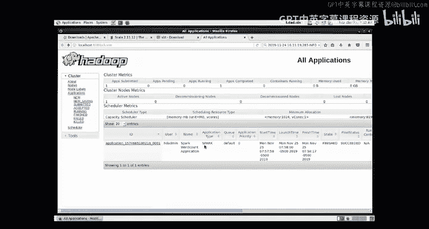

It failed from the perspective that the output could not be written out。Okay。

 so let me run the command again。Hopefully this time it would run successfully and we'll get the output in the out folder。

It's good to make these mistakes because then you can see how things are working。

 all the foundations that we learned about how Hadoop， HDFS Mareduce works。

 as you can see gets applied everywhere else。Okay， so it run successfully。

 if I do a Hadoop F S dash L S。I do F S dash Alicelash out。I should actually see。The output， yep。

 there were two reduces。And if I do Hadoop F S slash out， slash。Part dash0，0，0，0。

I should see part of the output。Yep， if I do part one， I should see the second part of the output。

Perfect， it working。All right， so we are done with that， so we were able to run tube。

So we were able to run Sp。Inside。Haop yarn。Notice in one of the architecture diagrams。

 I said that you can actually have yarn。As the foundation technology。

 and then you can run different kinds of technologies on top of it like hive， Pg and Spark。

 so Spark is running on top of a do。The last one I want to show you here。Is。Submitting Sp。

In cluster mode。And also not in the client mode。 So in other words。

 what it's going to do is it's going to。Run Sp， but the driver itself is going to run inside Hadoop。

 the driver itself is going to run inside Hadoop rather than as a separate one。All right， so。co比。

Gasste。Alright。

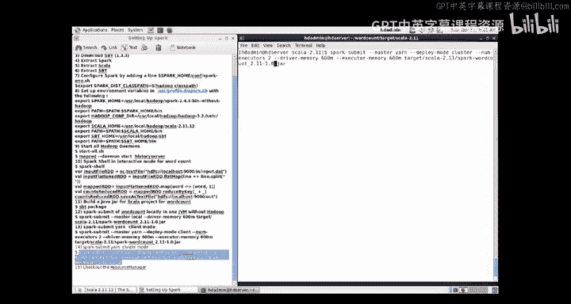

By the way， before I run this thing， I wanted to show you that。

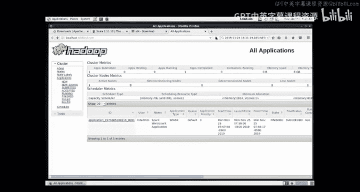

When I run it the second time。It was successful。It was an resource manager。And then。

Let me go ahead and run this and see what happens。It says it cannot load the main class。

 That's because I。Put the wrong path。It's submitting the job。I hope I deleted my。Output folder。

I got my file already exists exception。How do F， S dash， R M。Dashboard。Slash out。All right。

 let's do this again， guys。All right， let's run this thing。

So now we are running everything inside the cluster。The client is pretty dumb。

It's kind of waiting for the process to complete， but really there's spark contacts and everything is being run inside Hado。

So you can have a pretty thin lightweight client so it's done。Let's go ahead。And do a reload。

So remember， this was the first part where the output。Diry already existed， so we ran it again。

And then again， the output directory already existed and we ran it again and it was successful now。

So。All right， that's the resource manager， let's do Hadoop。F S dash L。Slash out。

And then we can do out slash。Partt。Dash0，0，0，0， but it should be a cat。There's the output。Part zero。

 part one。And it works。Okay。So we are done。

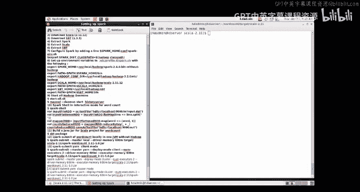

So， we are done。 So there were about。15 steps that we executed。

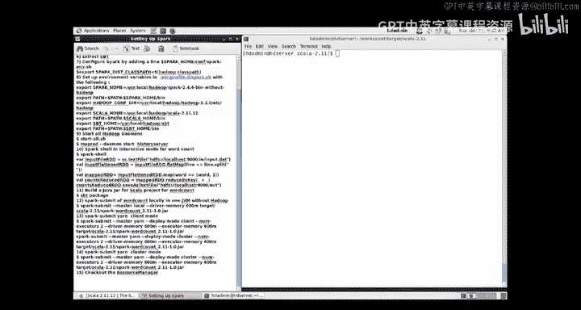

To get our spark。Installed。Configured。And run in multiple modes， right， Run Spar， standalone。

As an interactive mode， runs Sp， standalone as a program， runs Sp。Inside Hadoop。

 where the client is kind of doing the spark context and runs spark inside Hadoop。

That is yarn where the client is pretty much dumb， but it's running everything inside yarn。

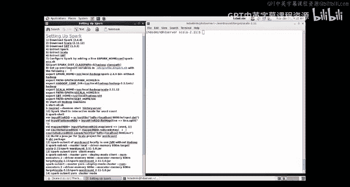

So there it is， so hopefully you'll also be able to install。Spark and。

Get it going so that you can do your assignment。

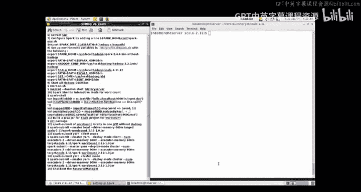

So in summary， in this section， we learned how to download Spark， how to install Spark。

 we also explored this Spk installation directory， we configured Spark so that it knows where Hadoop is。

 we also configured Hadoop， so it knows where Spark is。

We downloaded an installed ScalA and SPT two tools that we need for development。

And then we run the Spar shell and the Spark submit commands so that we can test out our environment。

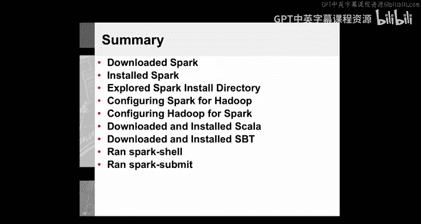

