# 约翰霍普金斯大学《Hadoop大数据处理｜Big Data Processing Using Hadoop》中英字幕 - P95：30_Spark Core编程模型.zh_en - GPT中英字幕课程资源 - BV1g5u6zBExs

Spark cold programming。As the title suggests， we are going to look at the programming aspects of Spark。

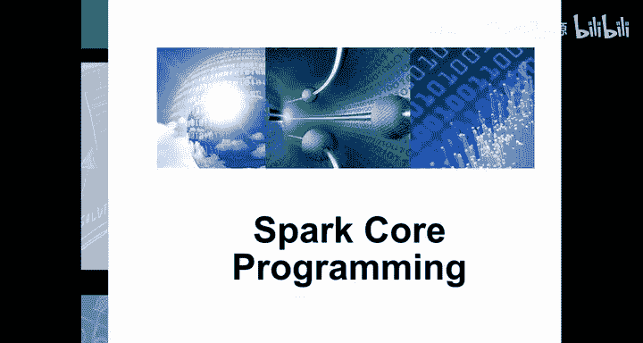

So what are the objectives of this section， we will first look at the Spk configuration object。

 then we look at the Sp context object， then we will see how we can use the Spark context object to create an RDD primarily from an HDFS file。

Then we will look at the RDD transformation and actions functions。

 we will see how the transformations work and how the actions work in conjunction with transformation。

Then we will look at passing functions in Java and ScalA。

 when you look at the transformation functions and action functions。

 you'll realize that many of those functions take a function as an argument。

 so you'll have to learn how to pass functions in Java or Scala。

 then we look at these lifecycle of a Spark application。

 then we will see how we can build aPAark application using SPT for the ScalA environment。

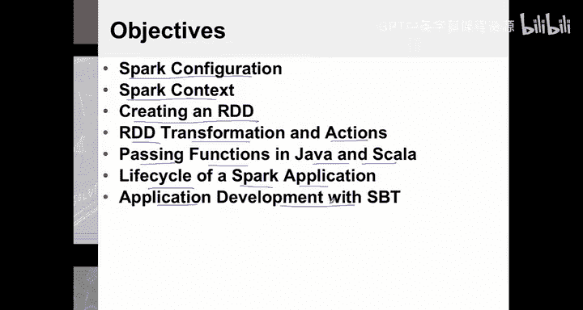

The Sp configuration object actually represents the Spk environment configuration。

 If you recall when we installed Spk in the configuration folder， the conf folder。

 there was a file called Spk dash E and V dos There was also a file called Spk dash defaults。 co。

 These files contain these spark configuration parameters。

 All these configuration parameters are loaded as part of these Spk configuration object when you instantiate a spark configuration object So it basically represents the Sp configuration。

It's very similar to the Hadoop configuration object。

 which loaded all the Hadoop configuration files when you installed a Hadoop conf object。

So it actually internally represents a key value pair combination of all the environment variables for Spk。

You can surely make changes to the environment variable by invoking the set method。

 which takes a key and a value， you can also call the get method to get the current value of a key。

This Sp configuration object has also a couple of very specialized methods。

 one called set app name that takes an application name that would be the application name that would appear in the resource manager when you launch a job。

Of this particular application， there's also a method called set master that's the same thing as the master modes。

 the various master modes that we learned about like local yarn， mesos and standalone。

 that master mode can also be set using the set master method。

 The important thing to remember is that the spark configuration object is the basic object with which you can create a spark context object。

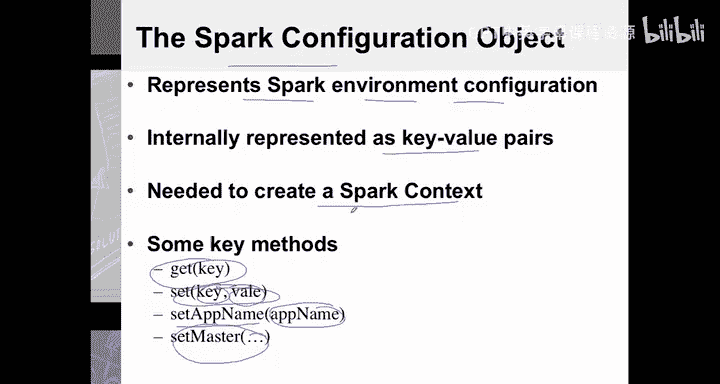

The Sp context object represents the connection to a sparkk cluster。

 This is the main object that you use to access the spark functionality。

 anything that you do in Spar pretty much requires this sparkk context object。

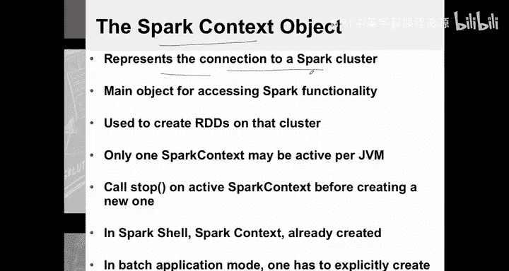

One of the key things that we do in a Sp application is to create an RDD。

 so we use the Sp context object to create this particular RDD on the cluster。

 we end up calling a method called a text file maybe that allows you to read a text file from an HDFS file system and then build an RDD or of that there can only be one spark context object that may be active per JVM so if you want to have multiple spark context object。

 you need to go ahead and stop the existing one by invoking the stop method on the Sp context object。

When you instantiate a spark shell， a spark configuration object and a spark context object is already created and is available for you as part of the spark shell。

 so you can readily use it， but when you're writing batch applications in batch application you have to explicitly instantiate the spark context object。

So how do you create an RDD using the Spar context object？OrDDs can be created in Java， Scala。

 Python， or R。Depending upon whatever programming language you choose。

 the syntax is slightly different。Basically， at a high level。

 the RDDs are created in one of two ways。The first way would be to load an external data。

If you have a file in HDFS file system or maybe in a local file system or even a relational database like MySQL or NoSQL database like Cassandra or MongoTb。

 you can load the file or you can load the contents from these distributed database systems or distributed file systems。

By invoking a method on the spa context object that will create an RDD。

 this is the most common way to create an RDD production way to create an RDD because typically you may have a lot of data and these data sets may be available in some of these distributed systems。

 The other way to create an RDD would be to create a collection of objects in memory in the driver program and take this existing inmemory collection and pass it to spark context Paralyzed method which basically takes the collection and paralyzes across multiple machines that would be another way to create an RDD but the second way of creating an RDD is primarily used for prototyping purposes So it's not very useful in production systems。

 if you want to play on with an RDD you can do that by using the second approach。

 but the first approach is the most popular approach for creating an RDD。

So here is an example of creating RDD from a file， let's say that you have a file called loglines。t。

 which is located in some path。How do you create an RDD， Well， like I said to you。

Based upon the different languages， the slightly different syntax in Python。

 you can create one by going to the spa context object and invoking the text file method。

 passing to it the name of the file When you do that the file will be loaded and RDD。

 which is distributed dataset set will be created across multiple machines in various executor which your machines the other way to create an RDD would be to create one in Scala here I'm calling the text file method again on the spa context object passing the name of the file and that returns me a log lines RDD log lines is the name of the variable here I'm showing you how to do it in Java you once again go take the spa context object andvo the text file method passing the name of the file and what it's turning you back is an RDD In this case it's returning you where it's called a Java RDD in Java it's always typed So in this case it's turning you a Java RDD type Now in languages like Scala。

 there is typing in and RDD does have。type associated with it。

 but you don't have to declare the type when you declare the variable， so you don't really have to。

 that's the reason why I made it into a v variable Valal means it's a read only variable。

What I'm showing you over here is a logline RD， which is really a file that's been loaded into memory as four different partitions。

 partition 1， partition 2 and partition 3 and partition 4 right here。

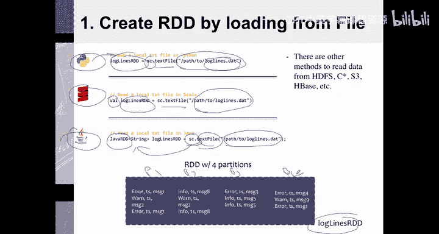

Across multiple machines， possibly。The other way to create an RDD is by distributing a collection of objects in the driver。

 so in Python here I have a collection right here of fish， cats and dogs， a collection of strings。

 I'm taking this collection and passing to paralyzed method on this spa context object and that would create an RDD object。

So I can apply auditity transformation functions or action functions。

Here what I'm showing you is how you do that in Scala。

You take the spark context object compile called the Paralyzed method once again I'm passing a list here。

And in Java， again， I'm taking an array， convert it into a list。

 and then passing that to the paralyzed method， like I said， this approach is for prototype purposes。

 the first approach which we discussed in the previous slide is primarily the way by which you create an RDD。

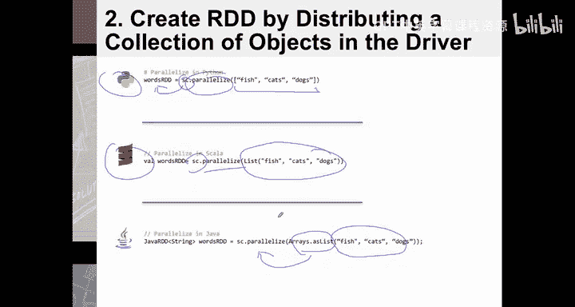

Once you create an RDD。What can you do with it， Well there are two types of operations that you can apply on an RDD。

 one is called the transformation operation and the other one is called the action operation。

Transformation operations are operations that typically return a new RDD。

 and so when you look at the API when you see methods that return another RDD。

 you know it's pretty much a transformation operation。

Transformation operations transform the RDD from one form to another form。

 so it takes from one form RDD to another form RDD by applying functions on each and every record。

 the action RDD on the other hand， kicks off some kind of computation。

 The difference is that transformations are lazy， it doesn't really do any work until you take an action。

 so the idea that is that you take a data， maybe an RDD， you apply some transformation。

 you get a new RDD， you apply some transformation， you get another RDD。

 you apply some transformation， you get another RDD， and then finally you apply an action。

 and that action would return to you some kind of a result set。

Now none of these transformations will take place until the action happens。

 so action is where the real action takes place， which actually creates the DG。

 which is the directed basically graph to create all the calculations that's necessary and then actually dust the calculation map and filter or classic examples of transformations。

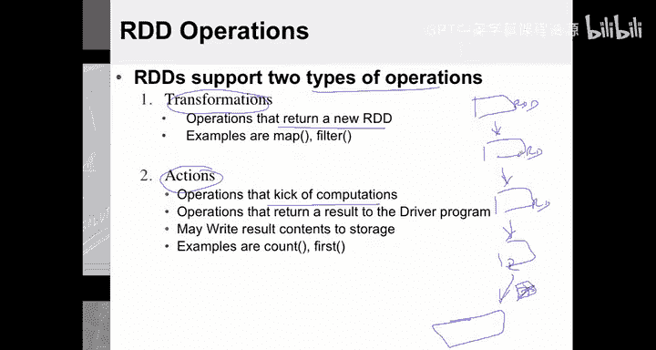

And then count and first or classic examples of actions。

 we'll see more about this in the next few slides。So let's say that you have a file in the Hadoop distributed file system。

 the file is a file called loglines。text maybe， which is a file that contains log information from maybe a server。

 let's say the file has four blocks， what you're seeing here in HDFS a file that has four blocks。

When you load a file from HDFS。What happens is the file gets loaded into an RDD using the SC。

t textex file method， but when it gets loaded into RDD， it'll be broken down into various partitions。

What you're seeing here is partition 1， partition 2， Partition3 and partition4。

 Notice each partition has a few lines that makes up that particular partition。

 So every partition here has three lines of kind of kept it simple in real life。

 each partition would be many more lines。 but here I'm keeping it simple to demonstrate the concept for you。

 Each line is a string that contains a type of message whether it's an error message or a warning message。

 and then the actual timet followed by the actual message。 So the message type。

 timestamp and the actual message。 That's what we are seeing as record。

 Its basically a string that's comma separated feels like this。

 Now what I can do is I can apply some transformation。

 I'm going to apply a transformation called the filter transformation。

 I take this already apply the filter transformation。

 notice that the filter transformation method takes a function as an argument。 By the way。

 I have a little。Over here to demonstrate that this is a transformation function This function that you pass to the filter method is supposed to be a method that works on an RDD record。

 on a single record。And well execute some logic on it and may return true or false if it returns true。

 that means this particular record will be carried forward to the next RDD， if it returns false。

 then this particular record may not be carried forward to the next RDD。

So when I applied the filter function， which basically says pull out all the error lines。

 what you're seeing is the resultant RDD， notice in the resultant RDD。

 all you're seeing are records that are pure error records or error lines from the log lines text file。

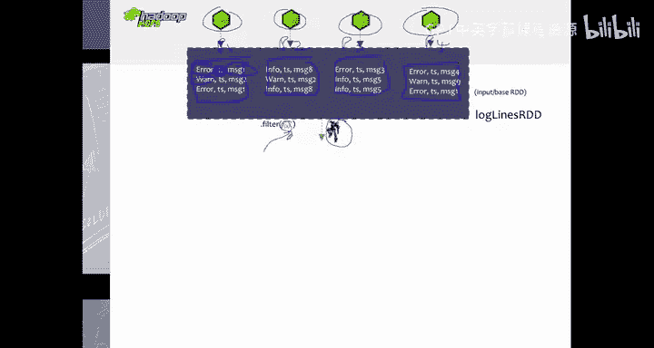

Now what I would like to do is apply another transformation once again。

 you know it's a transformation because I have a little transformer image over here I'm invoking a method called cois。

 which basically says go ahead reduce it down two partitions Now you may have noticed that when it went from the original RDD to the next level RDD from log lines RDD to errors RDD there were some partitions that did not end up getting any data at all and so those are actually empty blocks that's sitting out there that's the reason why we are doing the cois operation and that brings in our new cleaned RDD which is really all the error messages that's coales together But the reality is none of these things have actually taken place up to this point although I have applied two transformation methods。

 none of them has actually executed until I invoke a method which is an action method or an action function。

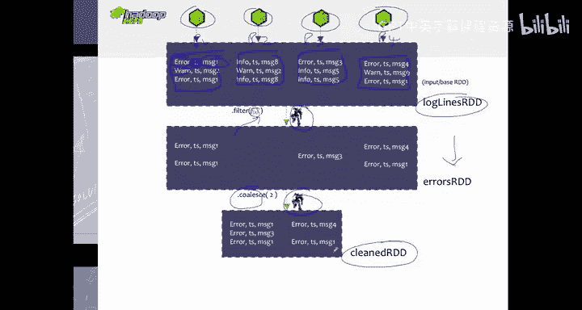

callled on the RDD So from the driver I'm invoking a method called collect which basically says go get the cleaned RDD and collect all the data sets and return the data back to the driver Now this collect is an action So when I call the collect action it says oh my God I need to get the data set for the cleaned RDD and so it backracks builds a dag graph。

 which is the directed acyclic graph， builds a tree of what needs to be executed and then goes ahead and executes the plan across multiple machines to get the resultant data and return it back to the driver That's what I mean by saying that transformations such as the filter transformation or the map transformation method or the cos method all these methods are lazy operations。

Now let's look at what else we can do with these transformations and actions。

 If you recall we loaded the RDD from the HDFS file system， we created the log lines RDD。

 then from that we created errors RDD from that we created cleaned RDD which contains all the error message records What else can I do Well surely we can apply action In this case I'm applying an action called count which is going to return me the number of records it's not going to bring in all the records It's only going to return me the number of records back to the driver It's going to return me5。

I could also apply another action in this case I'm applying an action called save to Cassandra。

 which is going to save to the Cassandra database。 I can also apply other transformations here I'm applying another transformation which is a filter transformation we already applied a filter transformation before now I'm applying another filter transformation this is probably saying go ahead filtered out any records that are old records In other words。

 I'm only pulling out some log error messages which are maybe in the last two hours timestamp。

So some kind of timetime that I care about。Okay what else can I do Well now I can go ahead and apply another action on top of that now I'm applying the collect action which is going to return me the list of three records。

 so you get the basic idea， you take this big data set that you may have in a distributed file system that may be multiple blocks you load it in memory across multiple machines and then you apply these transformations on it and eventually you get it to what you want it to be and then you collect it back into the driver or save it into a persistent store that is really the idea behind S analytics。

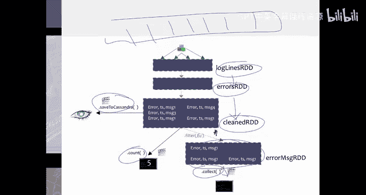

Now let's look at the transformation functions Now I'm not going to go through every transformation function because having done mapreuce programming and understanding how mapreuce works and having done hive and P you have enough experience in working with big data and analyticss and you have enough experience to look at the documentation so I'm going to ask you to look at the documentation but I'll kind of point out some the important transformation functions available there's a few of them there's the map function right there。

 the map transformation function takes a function object and will' apply that function on every record within that particular RDD and will return you a new RDD。

So you can map from one record to another record the filter function we saw takes a function。

 the function returns a boolean true or a boolean falls， if it returns a true。

 then that particular record will be carried forward to the next RDD。

 otherwise it will be removed from the next RDD。Flatmap is a function that basically takes another function which will basically take your record。

 do whatever you want to do with that record and whatever you return back。

 it should be a collection and every entry within that particular collection will be made into an entry in the resultant PartDD。

And then there are a few other functions like map partitions， like I said。

 if you look at the documentation on these PARC website。

 you will see a lot of examples of how to use these functions。

 that's the best way to understand this Other functions include map partitions with index sample which return to a sample。

 union and intersection or set functions is also distinct group by key， reduced by key。

 this is different from reduce the plane reduced function is an action。

 this is reduced by key which is more of a transformation。

You'll see this later on in a word count example。And then aggregate by key。Soword by key， join。

 all these are transformation functions available， co group again， partition， pipe， Coalis。

 we saw Coalas and reition repartition and sort within partitions。

All these are transformation functions you as a data scientist you will be working with these functions。

 there are only a handful of them that are often used。

 but these are other functions that are available， you can look at the documentation for that。

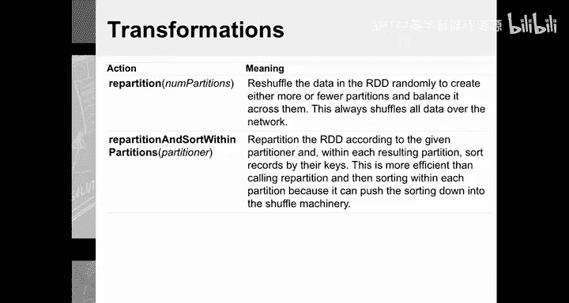

So how do you pass functions to Sp Now， you'll notice that most of the transformation functions take。

Another function is an argument because this function has to apply on every record。

So how do you pass a function in Spk Don't forget Spark is DSL based。

 which means every language is a slightly different syntax。

 What I'm going to show you is a couple of different languages， primarily Java and Scala。

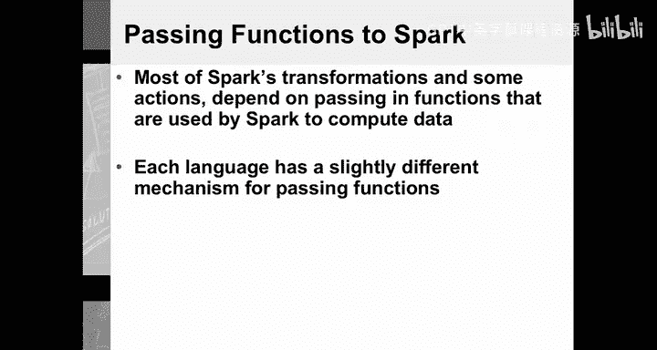

In Java， there is a package。In Spark itself called org apache。par orAPpi。jo function， this package。

 which is a sparkark library package， contains three interfaces， a function interface。

 a function2 interface and a flat map function interface。

 This function interface takes an argument and returns an argument。

 The second function function 2 takes two argument and returns an argument and flat map function takes an argument and returns a collection back。

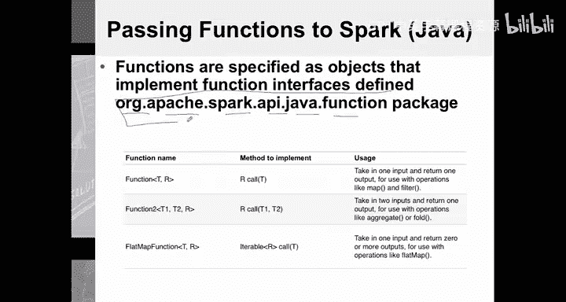

These are three interfaces。 So if you're going to be doing Java based function argument passing。

 then you will have to implement one of these three different interfaces。

Okay so let me show you an example here I'm showing you a Java function passing with anonymous inner class。

 What I'm showing you here is that I'm invoking on the lines RDD a method called filter but what I'm passing to it notice what I'm passing to it is a brand new function object。

 that function object is a function object that takes an argument and returns an argument that function object is an interface that I'm implementing which has one method called call that takes a parameter and does something with it and returns a value right so this is the anonymous inner class example So really what I'm passing to the filter method is an anonymous inner class function。

It's a little bit complicated in order to understand this you need to understand anonymous in our classes and the idea of passing a function。

 this is part of functional programming。In the second example here， I'm invoking on the lines RDD。

 the filter method， but here I'm instantiating a function object called containstains error。

 here's the containss error class which implements the function interface， which has the call method。

 so that's another way to do it。What I'm showing you here in the third example is that if you decide to have a separate class for your function because you're implementing a function interface。

 then surely you can have constructors， we know that we can have constructors for a class。

 the advantage of this is that when you pass a function。

 you're actually passing an object so you can instantiate the object and even populate the constructor so here you're instantiating the contains object which is really a function object and you're passing an argument which is going to be stored as an instance variable and is's going to be later on used to do an contains query。

Now， all these things seem a little bit complicated because you're actually writing a class by implementing an interface。

 a much nicer approach is when you have functional programming language when you have something like Lambda operations。

In Java 8， you have Lambda operations or Lambda expressions。Here I'm taking lines， which is an R DD。

 invoking the filter method on it。 But notice what I'm doing here is that I'm saying。

 let's call every record S。And for every record， we are saying apply by putting this dash rate than sign。

 apply this piece of code， this logic right here， the logic here is only one line。

 That's why I don't know how to put it within braces。

 which says S dot contains S is going to be a string。

Because we know that the RDD is in collection of strings， let's say。

 and so I'm invoking the containss method and I'm checking to see if that string contains error。

 assuming that S is aligned from the log lines file， and if it contains the word error。

 then we are saying it's a candidate to be taken to the next level to the next RDD。

 so that's how we are actually applying the transformation logic using the Spark and Java syntax。

Let's look at passing functions to Spk in Scala SalA is a little bit easier because ScalA supports Lambda functions or Lambda operations。

Surely you can create functions and objects and pass static functions in Scala just like Java。

 but Lambda operations or Lambda functions are much easier so let me show you Sca example here I have input file RDD I'm invoking a method called flatmap let's say you have a file that contains lines。

 this is line1， this is line2， this is line 3， these are three different lines in a file。

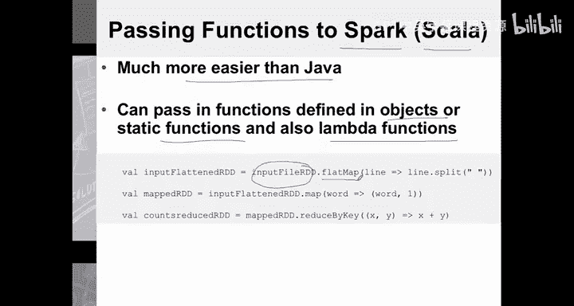

Every line will become a record。In an RDD， if you do word count and every line we have will have to be tokenized and we'll have to create a record for every word。

 right， That's how mapreuce works。 That's exactly what we're trying to do with this function called flatmap。

 What Flm is doing is saying， let's take every。Line record， which is an input file RDD。

Treat every record with the name line that's going to be the name of the variable and for every line。

 which is every record， apply this function。Called split on the line object。

 which is the line string object。 The split method takes a string。

 So if the line was this is line1 what it's going to return is a collection。

 This is line 1 would be the three records in that particular collection When it returns that collection what the flatmap does is it makes this into a record in the resulting RDD is as a record in the resulting RDD line 1 as a record in the resulting RDD。

 So in this case this is line1 will result in three records in the resulting RDD This is line 2 will result in three records in the resulting RDD this is line 3 will become three records in the resulting RDD So basically the resulting RDD will be this is line 1。

 this is line2 and so on and so forth。 This is line 39 different records。

 That's what I'm doing there。And then what I'm doing is taking the input flated RDD。

 which is the RDD that I got， applying a method called map， which is another transformation function。

 I'm saying map every word which means every record which is every word map it to a tuple which is word comma1 a tuple you know is something like this。

 so it'll map this to the word this followed by one， it'll map is to the word is followed by one。

 it'll map line1 to be line1 followed by one with a comma separated so that's what it does So it's almost like key value per combination where the key value is where the key is the word and value is one。

And then finally， what I'm saying here is that invoking a method called reduce by key。

 which is basically saying reduce your keys to a single key and take all the values and apply another function。

 which is the aggregate function， and this ends up adding all the different values。

By the time you have done you'll end up with this with a value of three because there are three。

 this is with the value of three line 1 with the value of 1， line2 with the value of 1 and line 3。

 the value of 1， So that's what you end up getting What I'm really trying to demonstrate here is how you can apply Lambda functions in Sp using the sc line width makes it really easy to do data analytics operations。

In terms of actions， there are a few actions that are available。 Here's the reduce action。

 which takes a function。 It applies the function on every record。 There's the collect method。

 the collect method collects all the data from the RDD and brings it back to the driver we also saw count counts returns you。

 the number of records that are there in the RDD。 First returns you the first record of the RDD take that takes an n n could be an integer。

 If you say take one， itll return you one record。 If you say take 17。

 itll return you the first 17 records back to the driver from the RDD。 and then there's take sample。

 take ordered， which returns an ordered collection and so on and so forth。

 So there's a bunch of different methods available for you that you can experiment with。

 Here's another really good one。 The for each action will apply a function on every record。

 Sometimes I like to do this， I like to take the RDD。And say RDD dot4 each。 And within parentheses。

 I would literally pass the word print line。 print line means print the record。 So for every record。

 it actually prints the record into the output。 It's a great way to debug your Sp application。

So what is the lifecycl of a Sp program or a Sp application Basically you create some input RDDs from an external data source or maybe paralyze a collection in your driver program which is only for prototype purposes this is what you typically do then you lazily transform them to define new RDDs and you may want to apply multiple transformations using methods like filter or map combinations of filters and combinations of maps and then once you get to the RDD to the level that you want。

 then you can apply some kind of an action such as count or collect and then finally take the result and write the results back into some kind of an external data source that's really the idea behind writing a Sp application。

So how do you write a scalab based application here are the five steps to write a scab based application and I recommend that you do your exercises using ScalA because it's much easier to program in ScalA than in Java and if you're going to be a data scientist it makes more sense to learn ScalA there are a lot of tutorials available again I'm not going to be teaching you Scala here。

 but I'll give you some basic ideas so that you can actually write your application。

So the basic idea here is to create a ScalA project first， then you create an SPT file。

 which is the ScalA Bill tool file， then you write one or more ScalA classes with an extension of dot ScalA。

 there should be at least one that is the main class。

 and then you build the jar file and then you run the application。

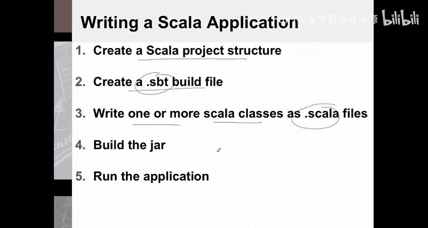

So how do you create a scholar project structure？Typically for your project you may have your project directory。

 let's say for word count， you have it called Word count inside it you'll create a folder called SRC。

 you'll have a file called build。sBT the SRC folder would have a main folder and a ScalA folder this is where you end up writing your main code Now if it wasnt a package then you can put subdirectories to create the package you can also have Java directory so you can have other Java files because ScalA can call upon Java you can also have your resources folder with resources inside them such as reference files。

You can also have your test hierarchy directly structure so you can write test cases if you want。

Now let's look at the build dot SbT file， which I wrote over here。

 what should be the content of buildt SBT。

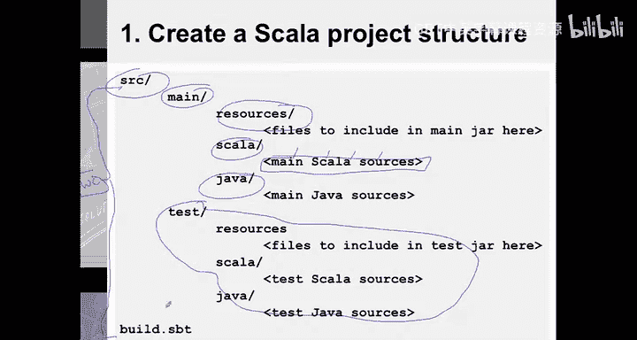

Build AutoPT at a bare minimum， you should have the name of the application。

 you should also have the version number for your application， which in this case is 1。0。

 you should also have the ScalA version that you are going to be targeting towards don't forget Spark works on top of Scala and it specifically expect certain version of ScalA。

 so you should be using the right version of ScalA when you're actually building your jar file。

In this case， we've decided to go with 2。10。6， and then you write your library dependencies right now for this Scala based application。

 we depend upon only one library， which is the Spar core library。

 we have to put down the Spk version which is 1。6。3， so we are working with 1。6。

3 version of Spark and 2。10。6。 version of Scala。

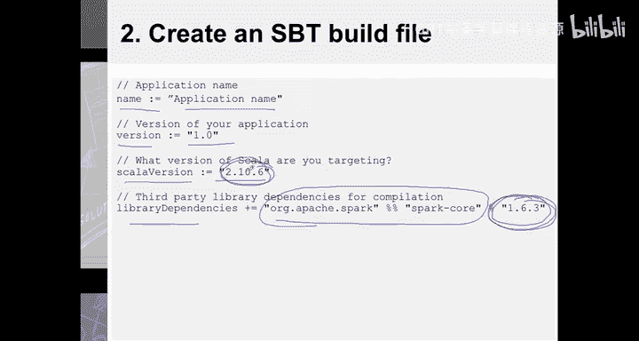

Okay， so we have the build file。Let's go ahead and look at the word count ScA application。

 I'm importing the appropriate spark packages and classes。I'm saying objectject simple app。

 that's my main class。And then inside the class， I have a main method。 This is the main open brace。

 close brace。 It the end of the main。 This is the arguments that the main method takes， which is ags。

This is where the main body is， that's what we should be concentrating on。First。

 I'm instanting a brand new pork configuration object。

I chain the object by invoking the set app name method passing to the name of the application。

 which returns me back as Sp configuration object， and that's what I' have stored in a variable called Kf。

I take the conf object， pass it to the constructor for the newspar context object。

Get a brand new park context object Now， I also declared a variable called input file that refers to a file in HDFs called input dot dot。

 and here's the content of the file。 The file contains two lines。 This is line 1， This is line 2。

I use the four context object to invoke text file method， passing to it， the input file。

Which basically takes the input file that contains two lines。

 treats it as two records and creates an R DD of two records。 And that's what input file R DD is。

 An R DD that contains two records。 I take the input file R DD and apply the flat map method。

 The flat map method takes a function as an argument。 and what it does is it takes every record。

 Every record is treated with the variable name line。 And for every line or every record。

 I invoke the line of split method that splits the line by space。

 And so what it returns me back is a collection of words。So the first line。

 this is line 1 will be broken down into this， is line 1 as a collection of three records。

 that's what is returned back to Flmap， which writes in the resultant RDD。

 which is input flat and RDD as this is line 1 as three different records。

And so when you apply this flatmap on the two input records， what you end up getting。

As you go from two records to six records now， and the six records would be this is line 1。

 this is line2。So input flattened RDD will be six records。 I take the input flattened RDD。

 which contains six records and will the map method on it passing to it， this function。

 which takes every word and maps it to a tuple， which is。Pentheses word comma 1。

 So we go from this is line 1。 This is line 2 to a mapped RDD， which will be this one。Is one line 1。

1。 This one is one line 21。 So we have six records where the key value pair combination is really the word followed by the number one。

 That's what mapped RDD is。 I take the mapped RDD and invor method called reduce by key。

 the method reduced by key will basically transform by grouping all the keys into one。

 and then applying addition method on it。 So basically the accumulation。

 and that's what I'm doing over here Ac。 So that ends up giving me four records。

 This two is to line 11 line21。 because the word disappear two times the word is two times line 1 appeared one time and line2 appear at one time。

 And that's what the。Counts reduced RDD would contain。By the way。

 reduced by key is actually a transformation operation。 It's not an action operation。

 Nothing has taken place up to this point until you invoke the method， save as text file。

 When you do that on the count reduced RD。 That's when it actually executes all these things by building a graph。

 and then the result is placed right here。 That's the output。

 So that's the word count application in Scala。How do you build it。

 you simply type an SBT space package and that would create the jar file so you can execute the jar file。

 so how do you go about run the application that you just created which is the jar file。

 there are three ways to run it， one would be to run it in local mode。

 the second would be to run in yan client mode， then the third way would be to run in the yan cluster mode。

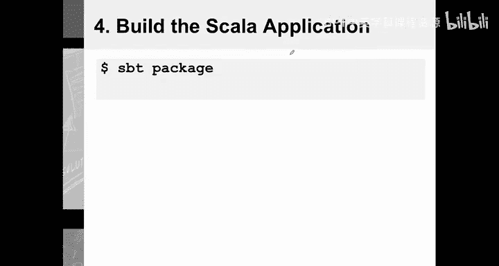

Now， if you recall the second and the third way are distributed computing environment where you're using yarn for distributed computing。

The first method is basically running in local mode。

 which is primarily used for prototype testing where the Sp summit becomes the driver。

 its memory is set to 600 megabytes， This is the jar file we are going to run What that means is theres going to be1 JVM that will be created which will be the Sp sum driver JVM and the executors and the RDD will be all within this one JVM。

The second approach is yarn clientmore， where you're saying Spark submit D dashmaster yarn。

 you're saying I would like it to run under yarn。 When you say deploy more client。

 what you're saying is that the driver will run as Spark submit application。

 And so the Spar submit application cannot go away。

 but the executor will run separately in a different VM。In this case。

 we are saying that we would like to see two executors and each executor will have 600 MBgabyte of RAM。

The driver， which is your Sp summit， will also have 600 mebytes of Ram。

So in this case there' will be three JVMs， the driver spark image JVM and two executer JVMs。

 The important thing to realize in the yarn client mode is that the client。

 which is the spark sum client cannot go away， whereas when you run Spar sum with master yarn deploy mode as cluster。

 what you're saying is that you would like the driver to run in the cluster itself。In fact。

 it runs inside the application master in the yarn environment。 So in this case。

 you're going to see application master， which will be the driver。

Followed by two executors because you wanted two executors。

Each executor would be 600 mebytes of RamM。And of course， the driver。

 which is the application master， will also be 600 megabytes of RAM usage。And yet。

 this is the jar file that you're running。So these are the three ways by which you can run the application。

So in summary。We learned about sparkk configuration object。

 which represents the configuration of a spark system。We also learned about Spk context。

 which is built using the Spk configuration object。

 which is the main entry for Spk application or Spk functionality。

 and it's the sparkk context object that we use to create an RDD。

We can create an RDD by loading from disk or distributor database。

Or you can take a collection in memory inside the driver and parallellyze it by invoking the SC。

 which is this power context paralyze method。We learned that once we have an RDD created。

 we can do transformations or actions， transformations are lazy， transformations return other RDD。

 transformations take a function as an argument and apply that function to return new RDDs。

Transformations are lazy and so they don't really do anything unless an action is called upon when an action is called upon。

 it goes and evaluates the transformation， builds a dietary， executes the functionality。

 and then gives you the result。In terms of application development。

 we learned the ways by which we can build applications and pass functions as arguments in Spark Java and Spark Sc application。

 we also learned how to build a project structure， create an SBT file。

 we also learn how to build an application in Scala， how to create a directory structure。

 how to write the SBT file， how to write a main class and how to build the Ja file using the SPBT package command。

 and then execute the J file under yarn or under local mode。

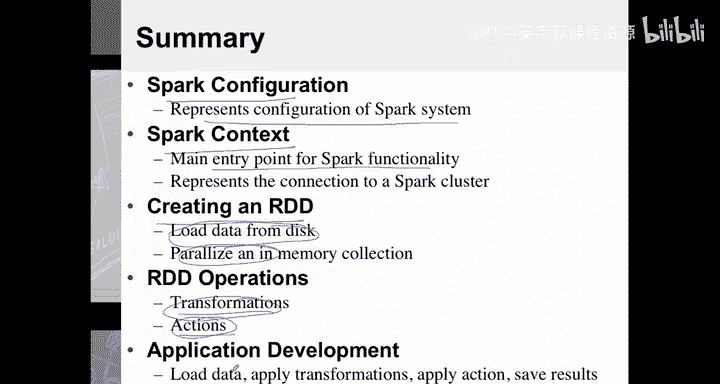