# 约翰霍普金斯大学《Hadoop大数据处理｜Big Data Processing Using Hadoop》中英字幕 - P96：31_Spark实践操作.zh_en - GPT中英字幕课程资源 - BV1g5u6zBExs

Hands on Sp as the title suggests in this section， I'm going to show you how to solve a problem and how to interactively work with the spark shell in order to build an application。

 So what are the objectives of this section， we're going to learn to solve a problem I'm going to kind of describe a problem。

 solve it。

And then as part of solving this problem， you'll begin to understand these park syntax。

There are lots of methods available， which are transformation methods and action methods that are available。

 but there are some key methods that you should know to solve the classic problems so I'm going to show you a classic problem solve that。

We'll also learn to interact with a Spar shell， that's what I'm going to primarily use to solve the problem。

 and then we are going to build a Spark application using Scala andPT， build the package。

 which is the jar file and then execute the application in various modes in local mode followed by yan mode。

 which is the yaon deploy mode client yan deploy mode cluster。

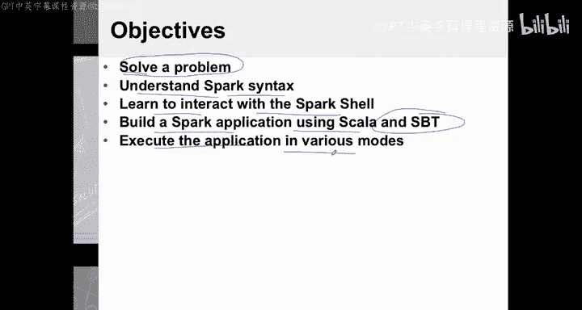

So， here's the problem。I have two sets of input records， student dot dot and score do dot。

 These two files are in HFS。The student or data file contains the student information such as the student ID。

 first name， last name， their level， and their age， the file is separated by a pipe。

And then I have another file called score。t for every student that you have in student。

 there are some tests that they have taken， so I have the test course against student ID followed by the date when they took the test。

 followed by score on the test。In this case， I have for the student 1111。

 three test scores taken on three different dates。What I would like you to do is calculate the average once you calculate the average。

 I would like you to join the student record with the average and send it out to the output。

 Please understand that the score dot dot file contains。The score， which is comma separated。

so these separators here are different。 You process that。 and finally， the results come out。

The first set of fields is really coming from the original st dot dot。

 and then we have the second set of fields coming from the score， which is averaged。

That's really the problem that we need to solve。

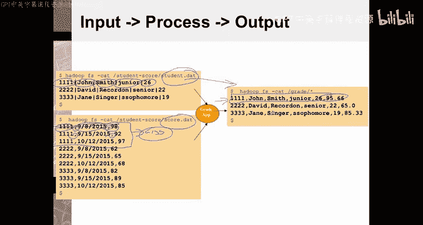

In order to solve this problem， we can write a scala based application， which is what I have here。

 and then I'm going to demonstrate to you interactively how to do this。So at a high level。

 really in my application， I'm importing。A bunch of spark packages。 And in my main method。

 I'm doing some work related to my environment， instantiating a spark configuration object。

 setting the application name。And then using the spark configuration object。

 creating a spark context object and also setting the log level on the spark context object so that the logging is not extensive。

 it's at the error level rather than the default info full level。

Then I do some student record processing， so here I'm reading the student record。

Using these par context text file method into an RDD。

And then I'm basically transforming that particular student record using the map method。Basically。

 for every line， splitting the file。To be precise splitting the record into different pieces。

 so I end up getting a student coupleple RDD。Once I have a tuple RDD it basically a tuple is within parentheses。

 I comm separate list of all the fields， so itll have the student ID such as 1111 followed by John。

 followed by Smith， followed by junior， followed by their age like 26。

 so that's what I'll end up getting so I have the student。Toule RD。I do similar thing right here。

For the score， I'm reading the score file。And then I'm basically building a tuple for that notice that the split is using a comma here because the score file is separated by a comma。

 whereas the student file is separated by a pipe and pipe is a regular expression character。

 so I have to do a s s pipe there。Okay， so I have a score tuple RDD again。

 I'll have this score as a tuple， which will become comma separated。So I have a list of student。

Tple RDD， a list of score doubleple RDDs。 What can I do， Well。

 I'm going to do some more processing on the score tuple。 This is called grouped score doubleple RDD。

 Basically， what I'm doing is， if you recall。I will end up getting in score Tple RDD。

 a list of nine records because there are nine scores that are there。

 but what I want to do is join them。By grouping them on the key， which would be 1111 in this case。

or 2222 for the second record or 3333 for the third record。

 so I'm going to group them by key and then map the values you'll notice that the score topple RD is really a key value pair combination of two fields。

 which is the student ID and then their scores so I'm really combining all the scores together。

And then I have defined a function called the average function。

 the average function basically takes an iterable and calculates the average。

 so now I'm applying another map transformation on the grouped score topple RDD。

Calculating the average， so by the time I'm done with this， I'm going to get three records。

 which will be the student ID and the average student ID average。

 student ID and average for the three different students。

And then I go ahead and join the student T RDD with the average group score double RDD finally。

Take the results。And then write the results out to。HDFS。By invoking the saveS text file concept。Okay。

 so that's really the idea behind this particular program and we'll go ahead and execute this interactively and at every stage what I will do is show you what each one of the RDDs look like so that you can see how I I transforming the original source to the destination。

Here's the grade dot SBT file assuming that I'm going to be building an application I have my SBT file。

With four lines。The name of the application， the version of my application。

 the scholar version and the library dependencies， which is really the Sp library dependencies。

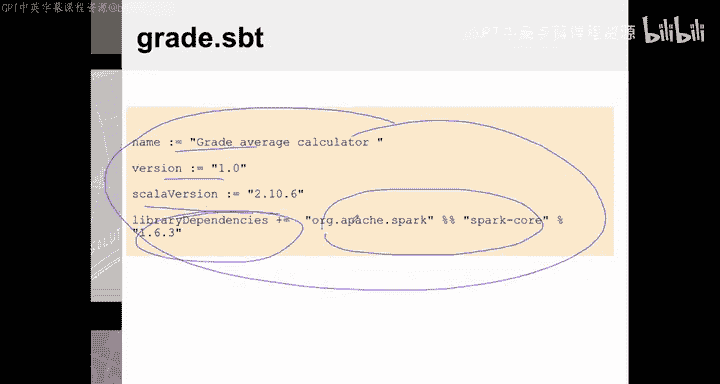

Then I'm going to run the application， going to run the application in three modes。

 one is the local mode， then is the yarn mode， which is the yarn mode deploy mode client and yarn mode deploy mode cluster again the differences in the local mode everything runs within the driver。

 the executor， the RDDs， everything is within the driver， whereas in yan mode deploy mode client。

 the driver runs as Spar submit。And then the application RDDs run in the executor in the cluster。

Whereas in the Spark Subit master yarn deploy more cluster。

 thepararks submitmit basically walks away after submitting the code and the actual main method runs inside application master。

 which is running in the cluster。

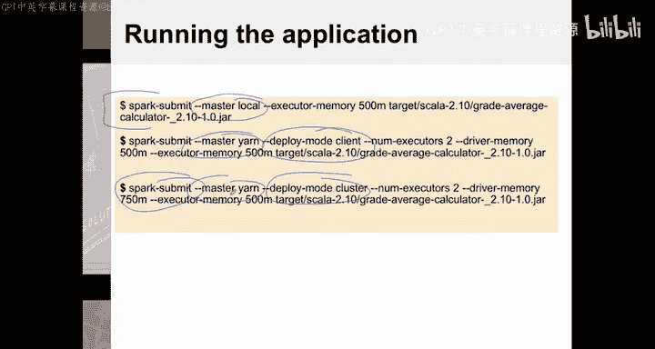

So let's go ahead and do the live demo。

Here I am logged into my HD server VM as HD admin。This is my first workspace。

I have another workspace， but I'm showing you all the different demons that are running。

 We have our classic five demons running name node， secondary name node。Data node。

 node manager and resource manager， so I have my Hadoop running。And I also have my。

Application master， there are no applications。That have run this point。

I would like to at this point demonstrate Spark shell and build the application before I do that。

 I would like to show you the input files。If I say Hadoop， F Els。

There are two files under s student s score folder in HDFS。

Let me go ahead and cut each one of those files。Your scored up。Thatt。So let's de score。

And here's the student do that。That's this。So， we got the。Two different files。

Now I would like to write my application。Spark the show。Dash， dash， master， local。

 I would like to run the local。

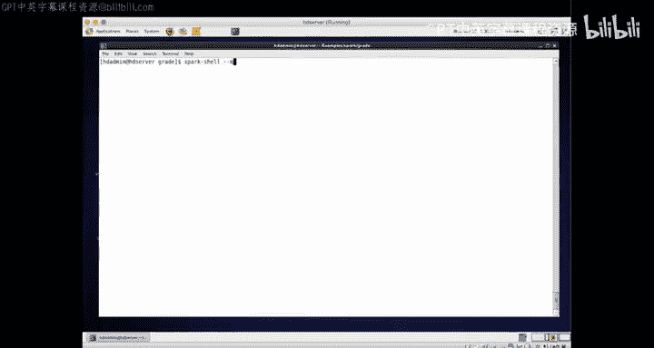

Now， when you run far， youll notice that it gives you a lot of messages。

You can minimize the messages by setting the log level， so I'm going to say SC。

 which is a spa context object that's already available for us as far as Sp shell。Set log level。

I would like to set the log level to error。So in this way。

 I'm going to get less messages in my output。All， I've set the log level to error in this point。

So let's go ahead and execute some code。The first thing I want to do。Is load the。Student records。

So there's a line right there that basically says。Load the file student。

Dt that's available in H DFS into an RDD called student orDD。Right， it's been loaded。

 Now I can say student。RDD。Dot for each。And then I can see print line。

 I'm passing the print line function that。That is actually an action When I execute this action it'll say。

 oh， let's go ahead and print all the records in student RDD。 Student RDD is going to say， oh。

 I need to build the actual RDD， so it's going to go to the disk。 load the file。

 So the point I'm trying to make is by saying student RDD equals Se dot text file。

 It hasn't really done anything unless you do an action。 That was a transformation。

 This is going to be an action。 So this is the one that is going to go and load the file from Hfs。

 build an RDD and then iterate through the RDD to print it out。Oops the for each。Was Miss Beld。

Here's for each。 Okay， so there it is it。Work now， I was able to print the student records。

 Now I'm going to do some。Processing。So what I've done in this line。

Is I have taken the student RDD and I'm applying a function on the student RDD。

 This is a line that basically says， let's take the student RDD， apply a map function on it。

Where I'm going to call every line as line， That's every record， every line。

 And I'm going to apply a function on it。 This is the function。

 which is going to split the line by a pipe。And then I'm going to pull out。

The fields that I want are of that so that I can create a tuple。 I've executed the statement。

 Let me show you what the result is going to look like。Student。Tle， and by the way。

 I typed in student T。 And if I hit the tab， it should fill it in for me because it's interactive and it kind of recognizes all the various variables you have created or D DC have created。

 So now I'm going to go in and say。For each。This is a nice function that allows me to demonstrate my tuple。

There it is。 So I've created。The tuple， which is called student Tple R DD。

 It's a tuple where the first field is really the key。Wwhichch is the student IDd。

 and then the second field is a tuple。 so this is a tuple insider tuple。

 that's what I have done over here。 You can almost think of this as key value pair combination。

 So 1111 is mapping to a record1111 John Smith Jur。 and 26。

 So only two fields in the outside tuple with the second tuple having several fields inside them。

Okay， so I've done that。

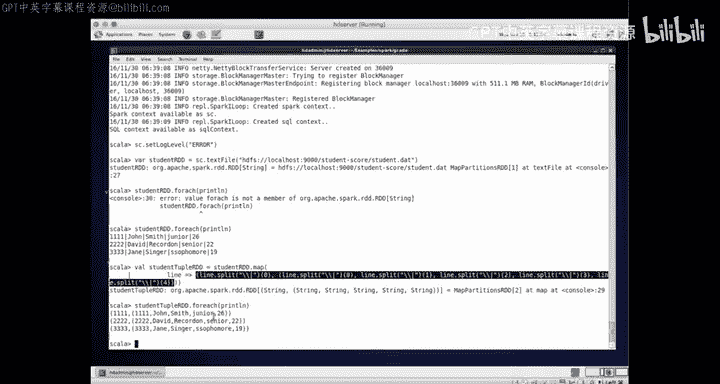

Now I would like to load the score file。I've loaded the score file now。I could do score RDD dot。

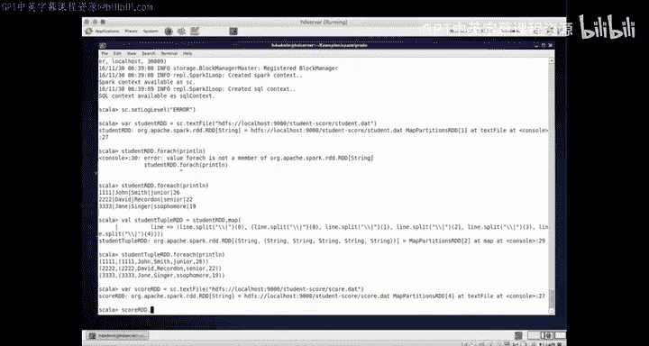

For each。Pasion to it。 print line。There it is， here's my score。Once again。

 only when you execute the for each method， is it actually going and loading the file。

 building the RDD and then。Printing out the results So if I did not do a for each。

 it would not load the RDD。So for each is an expensive command that that's something you don't want to do in your application。

 It is something that you can do when you are working interactively with these spark shell。 Okay。

 so now I have a line that basically says， let's take the score R DD。Pse said。

 the only fields that I really care about in the resultant is really the first field。

 which is going to be the student I D followed by the last field， which is the score。

 but then I would like to convert the score from a string to a float。

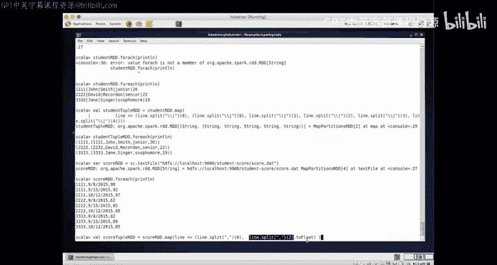

I did that， then I'm want to say score， notice in this case， when I type in score and the tab。

 it gives me score RDD and score a couple RDD and I'll hit T and then hit the tab button。

That gives me score of Rd。Dot for each。Print line。That should give me。

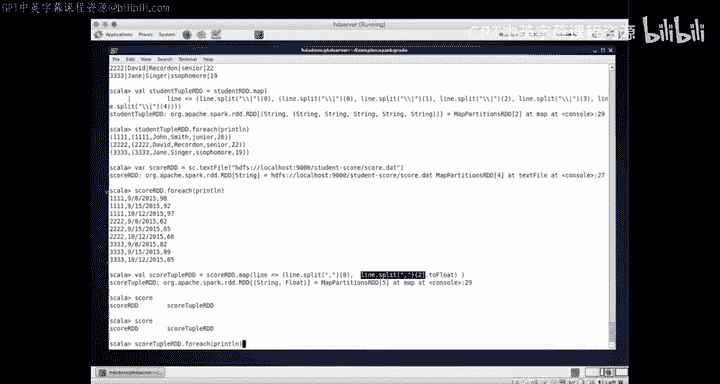

All the records that's out there， so it's giving you all the records。By the way。

 it' is a few of the commands that's available， for example， score。

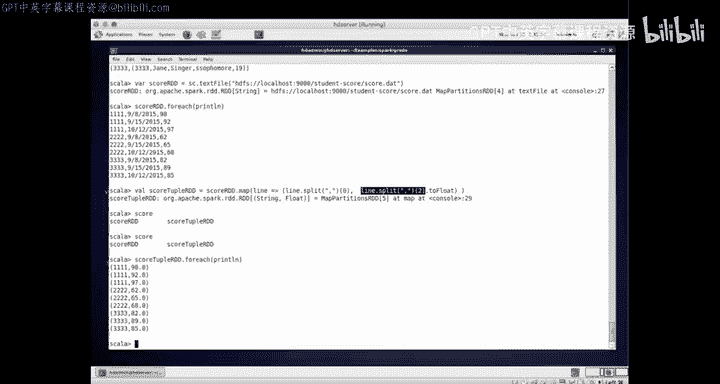

Tuple， RDD dot。Takeake。Two， they'll give me two records。

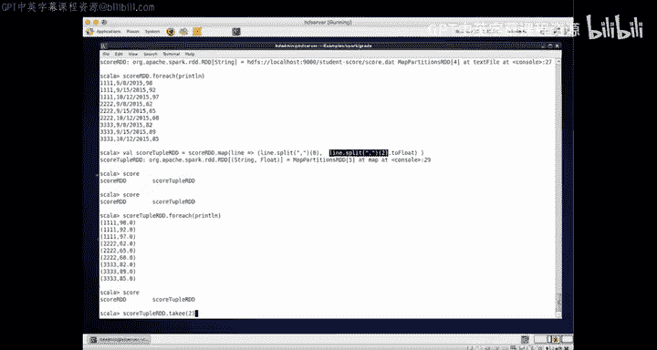

So notice it's giving me an array of two records right here， take5 will give me five records。

 so these are some other commands again take is an action command for each is an action command also okay so I have my score T RDD。

 which is really student ID followed by their score which is a floating point number。

Now what I have is a line that basically says， let's go out and take these core topple RDD。

Group by key， which would be these keys right here。 The first column is the key。

 which means it'll be grouped by 1，1，1，1，2，2，2，2，3，3，3，3。 And for each one of them。

 map the values into a list。 The underscore represents the current record。 So map it into a list。

 So see what happens now。When I do that and when I type in group。Once again。

 I would like to see what my results look like。For each。

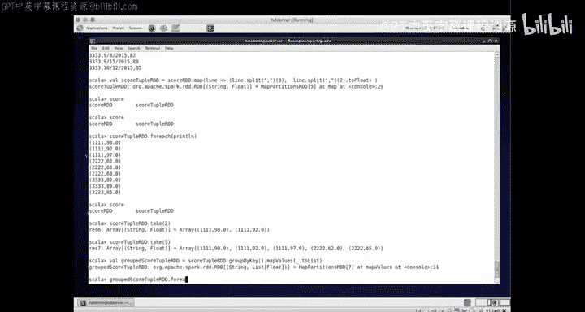

Print line。So that's what it looks like Now now I have a key value pair combination。

So for every record。For every key。I have the key followed by a list of all the values。Now。

 all I need to do is apply another map function so that I can。Take every one of these records。

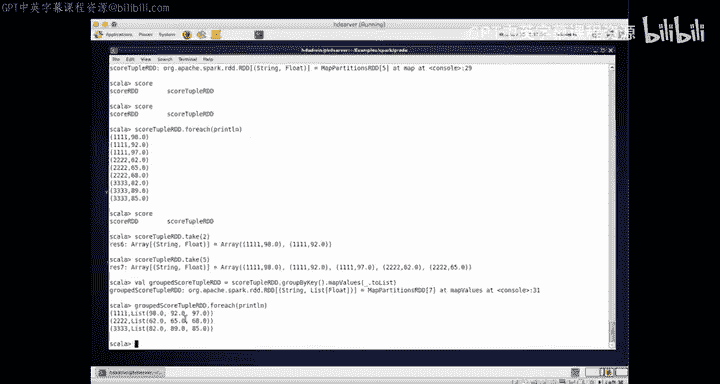

And calculate the average and replace it with the average。

What I've written over here is a function called average。

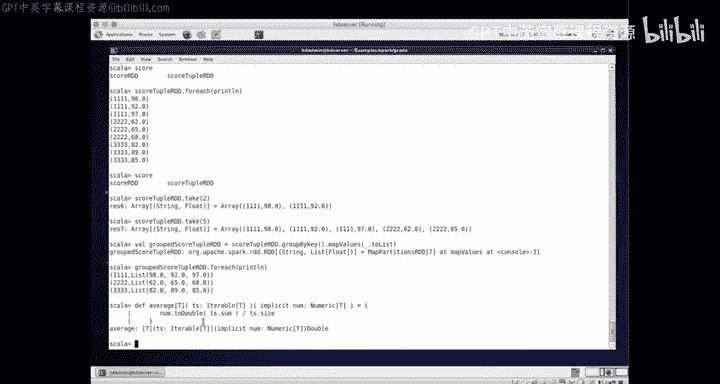

Which is taking an iterable list of values。 And then what it's going to do is convert the values into an average by summing up by iterating through and then returning the average back。

 So this is the average function that I've written。 and I put it right here。

 I can invoke the average method by passing a list to it。 And we already have a list right here。

 So let me do this。 Let me call the average function。Passing to it。A list。哦。97。0，98。0。And 99。5。

And it gave me the answer， which is a double of 98。1666。

 So the average function takes a list and gives me the average。

So what I would like to do is apply a map function on my grouped score Tple RDD。

Which will take this list， call the average function for every record。

 and the result and RDD will have the average， so it'll have the student I followed by the average in the result。

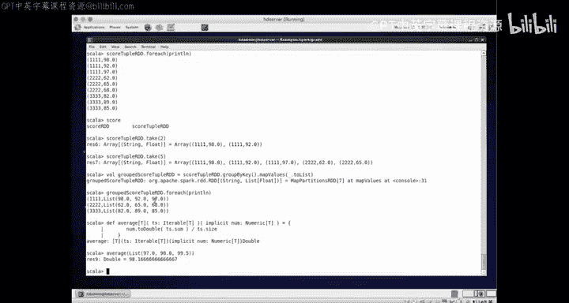

So I just did that。Average group score double RDD equals group score double RDD dot map。

 map it with every record， take the first field Re represents every record and Re dot underscore  one represents the first field。

Re dot underscore 2 represents the second field， which is really a list and a' passing the list of the average function。

 This is all functional programming guys， so you need to understand how to pass functions around。

And working in Spark is great because you can write these functions very easily and explore your data。

 That's the advantage of it。Okay， so let's go ahead and try to。

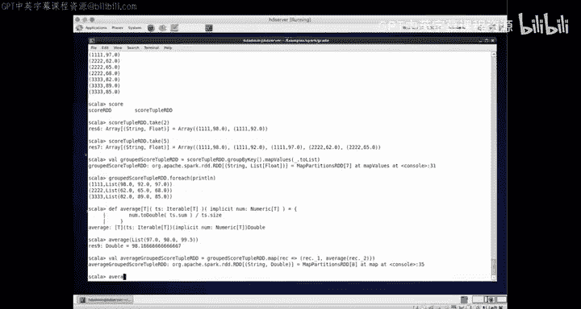

Demonstrate what is in this average group。School double RDD， dot4 each。

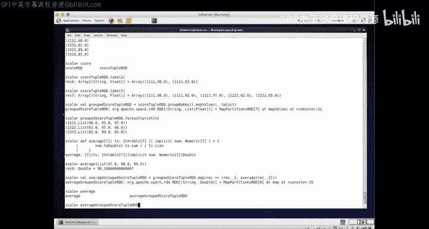

Ptline。There it is perfect， so I have my three student IDs with our corresponding task scores。

 which is averaged。Okay， so if you think about it， I have two sets of records right now as key value pair combinations。

 I have my average group score topple RDD。

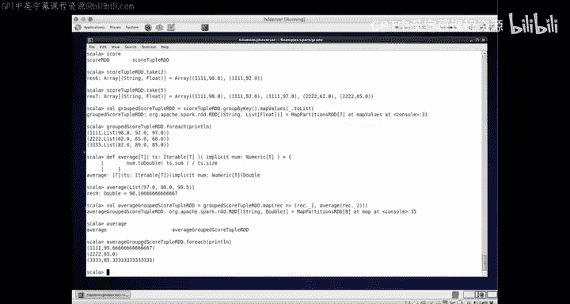

I also have my student。Tuble。RDD。Let me go ahead and do it。For each。And the front line on that。

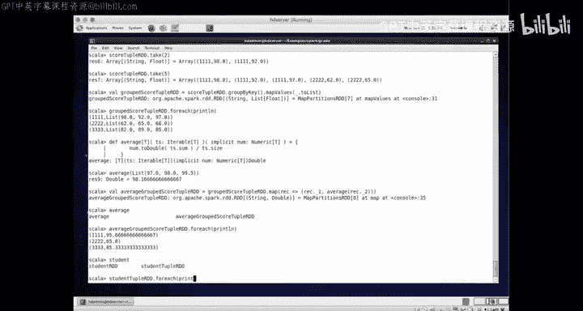

So I have key value， key value， key value for the student RDD， I have key value， key value。

 key value for the average core RDD， so all I need to do is join these two records。

When you have a pair RDD or mapped RDD like this， you can go ahead and do a join。

 so we would like to do a join of the student with the average。Here it is， I'm doing a join。

 student Tple RDD or join average group score double RDD。

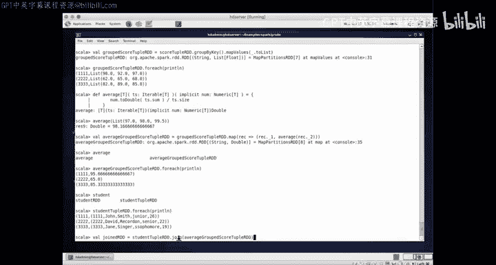

And putting it back into joint RDD。There it is， it's joint。

 so let's go ahead and see what the joint RDD looks like。

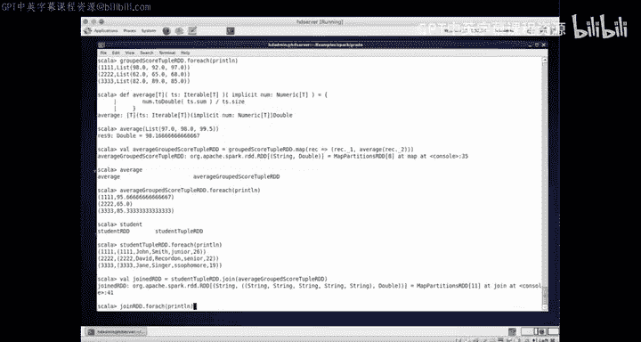

Oh，4 each。Perfect， so now the joint RDD looks like this， it's the key。Fer by a value。

 key forward by value， key4 by value， except the value is a little bit。Interesting。

 because it's taking two different。Record types enjoying them。 So it's creating a new tuple。

 which is really a combination of the two records。So the first field of the new tuple。

Is really coming from the student， the second field is coming from the second RDD。

 which is your average RDD。So I have now a tuple which contains the key followed by the value。

 and the value is really a tuple that contains two fields。

 the first field is a tuple and the second field is the float value。Okay。

 so now what I would like to do is print it out in such a way that all I want to see is 1111 John Smith junior 26 95。

6666 or whatever the average value is going to be but that's what I want to see I don't want to see any of the other stuff So for that I have to kind of iterate through this。

And only pull out the fear that I care about in the format that I want。Which is really stored ID。

 first name， last name， the status， age and the average。

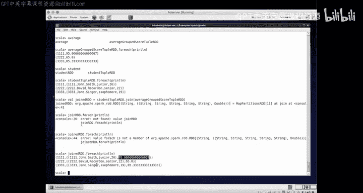

So I just finished writing the syntax for that。Which is， well， final result RDD is joint RDD。

Final result RDD is what is going to contain the result that I want。Go to the Jo RDD and map。

Take the record， which is this entire record。Now， wreck dot。Undersco 2。Will represent the second。

Field， which is a topple itself。And within the second field， I have another field。

Which is the actual student record。So you'll see that I'm doing rec dot underscore 2。

 dot underscore 1， dot underscore 1 that would represent 1，1，1，1 right here， this 1，1，1 right here。

And then Re dot underscore 2， dot underscore 1 dot underscore 2 would represent John。

So I'm really going through the fields within fields within fields。

In order to pull the various fields that I want and putting that into a final result。

 So let's go ahead and execute that。

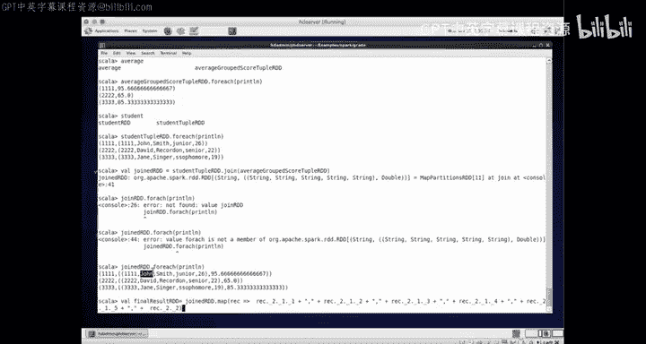

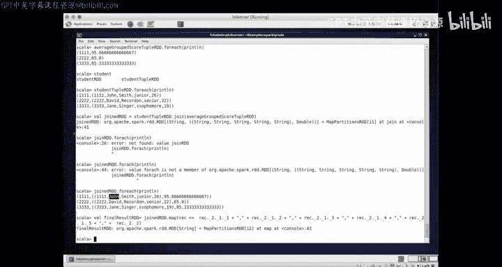

Now， I'm gonna say final。Result， RDD。Dot for each。Tritline。

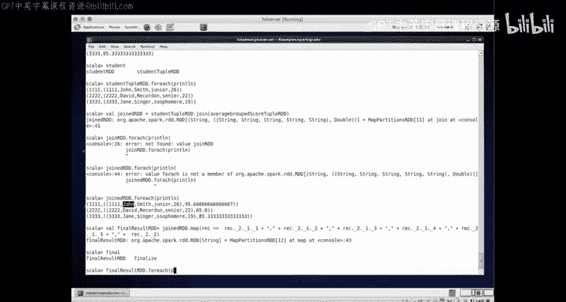

To see if I get what I wanted。 Yep， that's exactly what I wanted。

I did not put the parentheses within the second argument because I didn't put the parentheses。

 I didn't get it as level， I just ended up getting it as a bunch of comm separated values。Now， okay。

 now all I need to do is write this out into the output。

So I'm saying let's go ahead and take the final result or DD。Save it as a text file。

In HFs into this folder。 And this is when it's going to。Go ahead。

 go through the execution of the entire graph and write the output。

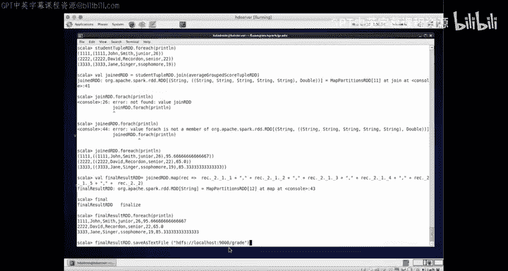

Okay， so the output has been written。If I quit。

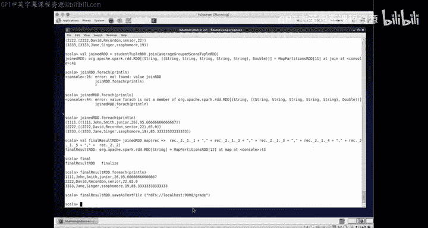

Sorry， exit。

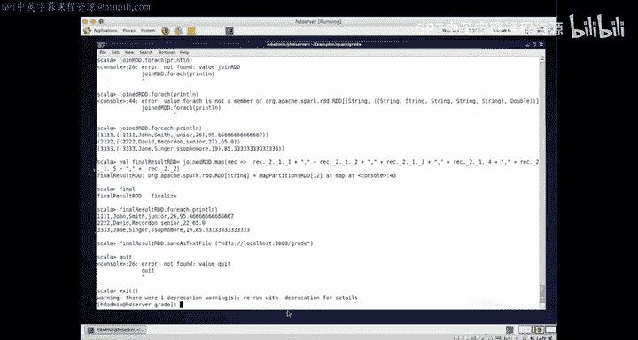

And I do Hadoop FS dash LS s grade。

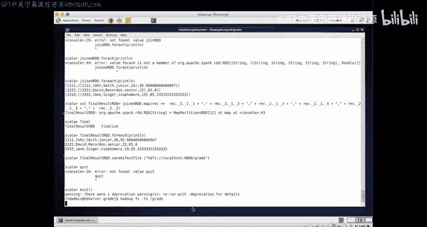

There it is， I have my grade， which is my output folder， and they are part 000。So we if a cat。

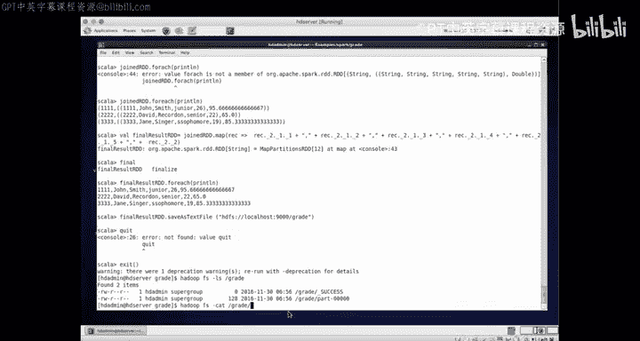

Deport file。And you should see。The output right there。

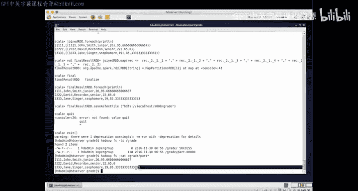

Perfect， the words。

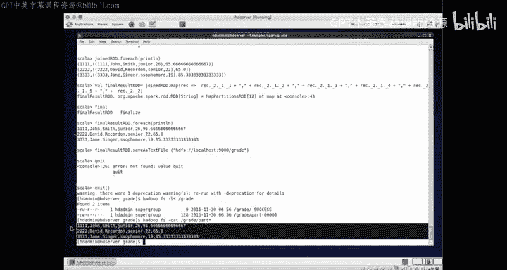

So。While demonstrating this program， I showed you how you can kind of interactively work。

It took me about 30 minutes to actually do this assignment because。

I had to figure out how to do the parsing and things like that。But。Now that you know how this works。

 you should be able to solve other problems and kind of get an idea as to how this syntax works in Spark and Scala。

OkayWhat I would like to do at this point is demonstrate the ST。

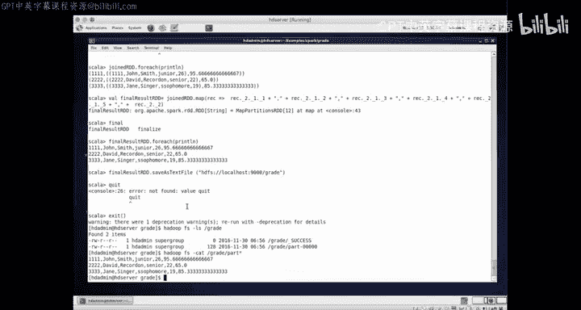

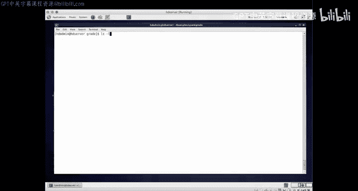

I'm in a folderer right now。Home admin examples spark great。Here I have a file called grade dotsBT。

 so let me go ahead and show you grade dot SBT。Which is this Sc build tool file。Name of the。

Application is grade average calculator， version is 1。0， scholar version is 2。1。6。

 and these are the library dependencies that I have。Whi is spark core。

 let's go ahead and build the package If you do Ls minusl。

 you'll notice that all I have is grey dot S。And a readme ourt text file。

 which is really instructions for myself as to what I need to do。

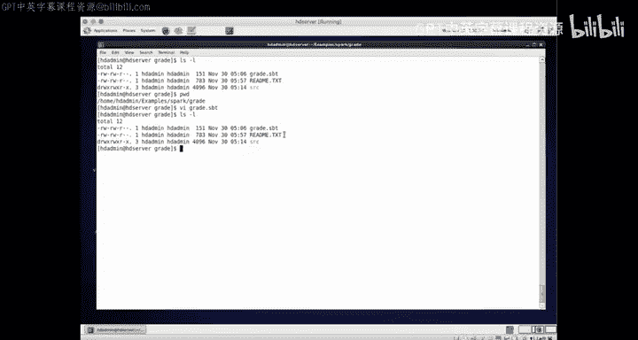

I'll show you what that file contains。The file contains the student dot information。

 score dot information， and the ways by which we can run spark。

If you look at the source folder。Let me do an L minus L S or C， main。Scarlar。

Source main Scala has a file called great dot Scala。

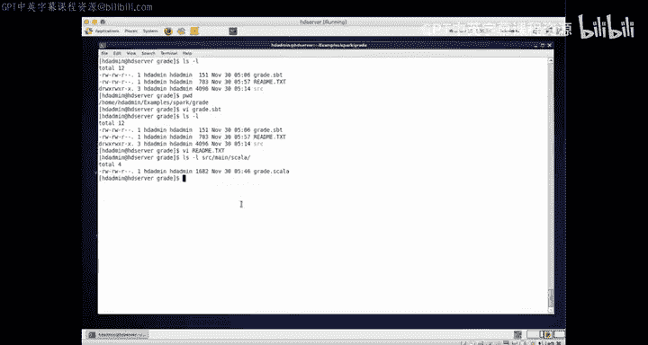

Let me go ahead and open the file for dots scholar。You can see that in this application。

I've imported the appropriate。Packages on the top。Here's my object grid app with the main method。

 here's all my context objects at the log level。

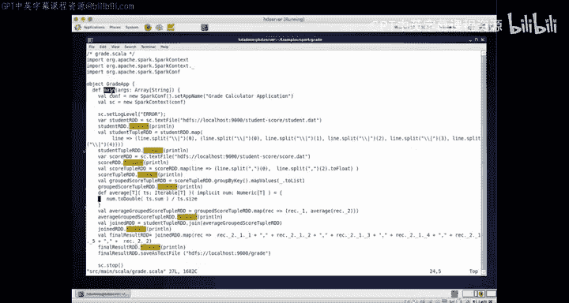

Loading the student RDD。 And then I have a bunch of four each methods。 Now。

 for each is kind of inefficient because at every level。

 you're kind of building the graph and executing it because it's an action method。In real life。

 you don't want to have this， but let's go ahead and keep it in for the time being。

so I would like to build the package ST。Package。It's going to build my application。There is。

 built my application。By doing LS minusl， you'll notice that there's a target folder。

 LS minus L target。

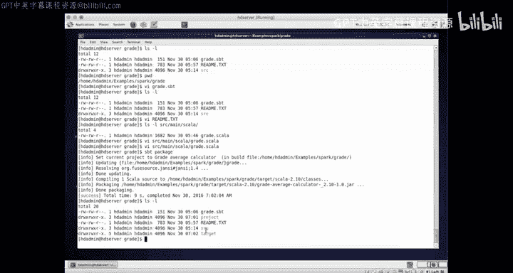

And then inside it there's a protocol Scala 2。10 inside it there's a file called grade average calculator 2。

10 $1 chart， that's the file that we want to execute。

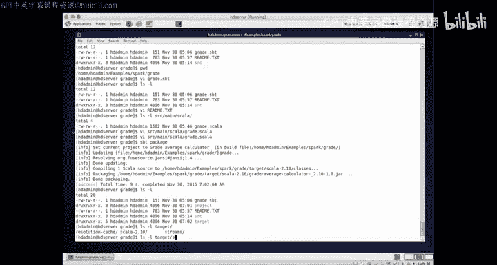

So let's go ahead and execute this in the。

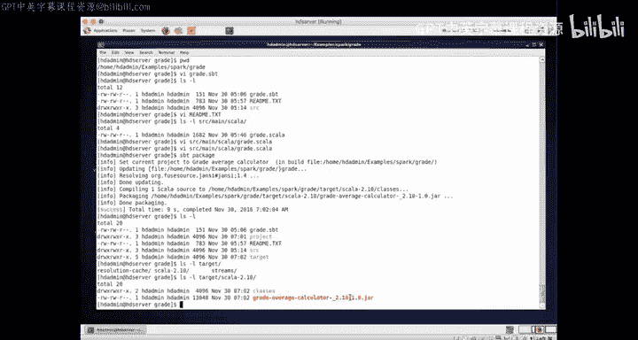

Terminal。I'm going to execute it。 So let's go ahead and look at the read me file。

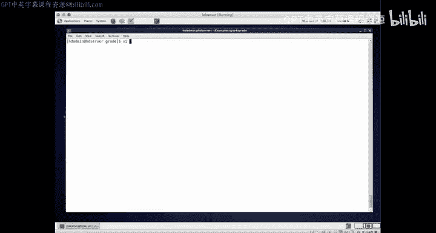

Read me file out the three different ways by which I can execute。

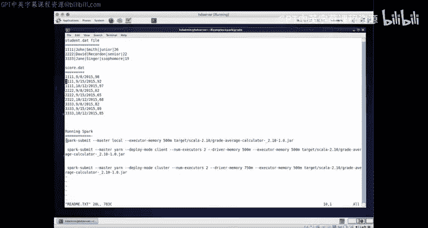

So this is the first way by which I can execute。

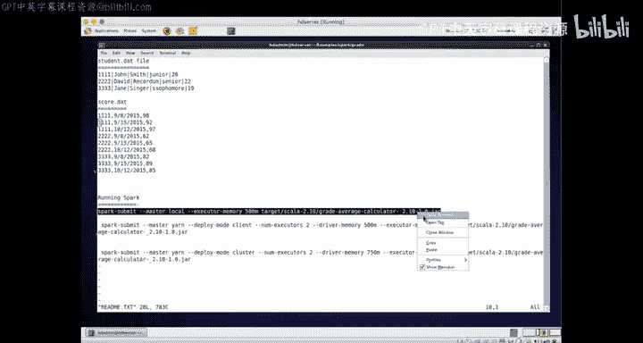

Pular。based it。So I'm saying I would like to execute these sparks of Me command， local mode。

 executor memory， which is the memory for the driver， which will be the sparks of command。

Should have 500 megabytes Ram， it'll execute。Inside the subtractory target。

Scard to out10 folder inside it。Contains a file called grade average calculator 2。210。1。0。 jarr。

 execute the jar file。

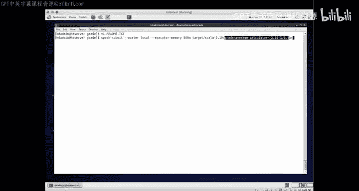

So that is going to execute my program。Let's see what happens。It failed and the reason it failed。

Let's go back and look at it is file already exists。

 that's because we already run it once and the grade directory already exists。So Hadoop， F S。

 dash Or， or slash gray， let's remove that。And let's go ahead and execute it now。So this time。

 it should execute it properly。And notice all the four each outputs are appearing right here。

 in this case， in the local mode appears right in the terminal。Right， my output should be there。

So let's go ahead and do a Hadoop FS A slash grade。You should be。There's the part file。So。

Caap the farm。And yes， my airport is there。Okay， perfect， so I was able to run sparkk and local mode。

 let's go ahead and run it in the yarn mode。

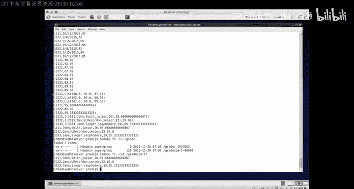

For that， I need to first delete。The grade folder。

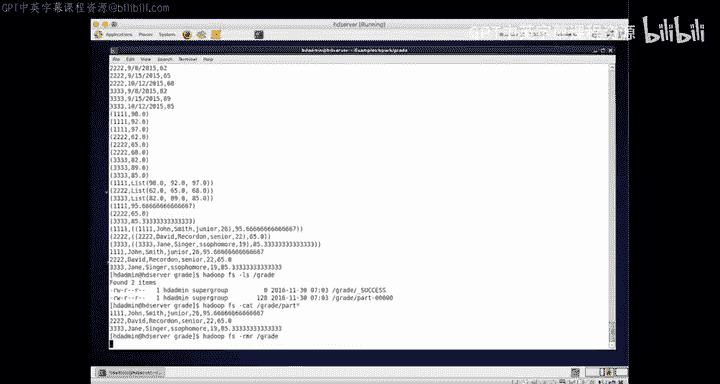

We go ahead and execute the。Let me go， let me go， let me go ahead and look at my cheat sheet right here。

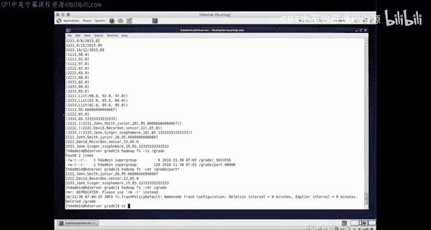

I would like to execute。Spark submit in the yarn board。

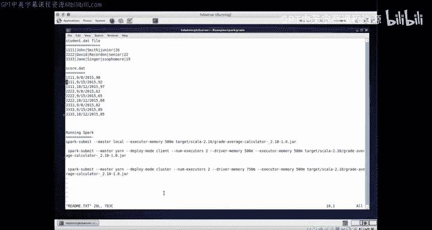

Clear the screen。So here I'm saying I would like to execute Spark Submit in Y yarn mode。

 deploy mode is client， which means the Spark submitm。Application itself is going to be the client。

 there' will be two executors that will be created。

Driver memory for each another will be further MBbytes。Executor。Memory will be5 and megabytes。

 so technically it' will be three different process， the driver， which is the spark sum。

 which is declined， and then two of the executors will be created。

 and it's going to run the jar file。

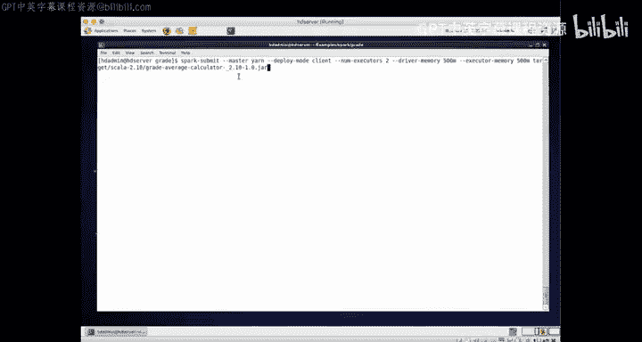

It's running the application。And if I actually go to mine there it is。

 you can see sparks of it is running。And。There's the coursearse grained。Back in process。

 That's running。We wanted two executators， some two executors that are running。Soon。

 they should be done。Yep， we're all done。Let's go back。So the program ran。No。

Notice it says tracking the order list right here。So if I go back to mine。Resource manager。

 you'll notice that my application did run right here。So my application did run。

 this is my application now when I ran in a local mode， he did not use yarn。

 he did not use the cluster。So in that case， it was all running locally here， I have my application。

 I had my history。I can click on the application， I can look at the log files if I want。

 there are the various log files， so if you click on the log files。

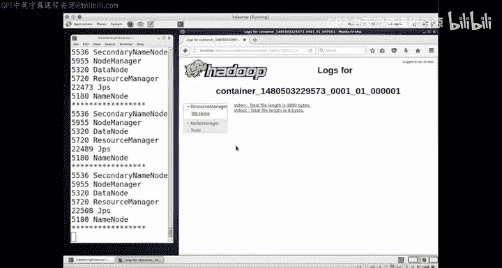

Here's my standard error， and here's my standard out。If you put any messages in the output file。

 it would appear right there。There it is。Now， let's go ahead and clear the screen and run it in the。

Yarn mode， but in the cluster mode。So for that。I can simply before I do that， I should。我 do。

the fish帮么啊。Slash greater。Outper。Now what I would like to do is run this。And。

Thely more to be cluster。

In this case。It submits。I should have an application master running。

 that's where the driver is going to run。I should also get a couple of。Executors。

 which is the post screen executors。Getting accepted hasn't runni yet， so I've submitted it。

It failed。Something failed。Let's look at the resource Ni of UI。The application failed。你讲啦。

There it is， just an exception。Let me go ahead and try doing it again。This time。

 I'm going to run it with the number of executators to be。Just one。It failed again。So。

 let's go to user。Local Purdue。I do。老子。And let's go to user logs。Here's mine。Third application。

Let's go back and look at the。Application Id， which is 5，7，3。Unders0，0，2。Actually， it should be 5，7。

3，0，03， let's reload it。 doesn't matter。Because there are two times it failed。

Let's go to this folder right here。These are the containers。Let's look at the first container。

And see what the messages are。啊。Systemary must be at least4。

So it looks to me like it needs more memory。Okay， so。Alright。

 so it wasn't enough memory for it to run the executor and the application master。

So what I'm going to do。Is execute the command。Soite me differently。

This is what I mean by saying that Spark is memory intensive。Okay， so go to grade。

And run the program。But this time， I'm going to run。With 600 MB。Yeah。

And see what happens。Got accepted， it's running now。Let's see if it fails。

M it looks like I was successful。我 do。F， S， dash N S， slash grade。Okay。

 so there's some output right there。

Date。有。So let's go and do a cat on that。

Yep， the algorithm was created。Let's go back and look at our manager。Yes， it was successful。So。

It was good that it failed because you can actually see how the logging。

It actually helps in this case it failed two times， so I looked at the log files。

When I looked at the log files from here it didn't give me enough details。

 I needed to look at the details of the files so what I did was I went to the application and inside the user logs。

 notice it's all running under yarn， so I have to go to user local Hadop。

 Hadoop 272 or 273 over the folder is logs， figure out what is the application ID inside the application ID。

For every container that was launched， applicationplication master is a container and there will be executors for every executor。

 there will be a container that will be created。So we have to go back and look at those things and see what failed。

 and there was primarily a memory error。Now let me go ahead and try to delete this file。

And run it again。

This time， what I would like to do is run it。With two executors。

So I have the driver which is going to be the application master and then I'm going to have two executors to execute it now it's kind of an overkill。

 but let me see if I have enough memory I should be able to run two executors right let's go ahead and run that。

So right it wondering， let's see what happens here。So I have my application master running。

 which is where the driver is going to run， my main is going to run。

And then I have a course traineded executor that has come about。I have two core grain executors。

 that's great， I got two core grain executors。The program finished。And yes， it was successful。

 so if I do a Hadoop a cat。You should be able to see my uncle。Yes， I do。 I do Hadoop F S。Alas。

Slash grade。I will actually see two part files， the second part did not have anything。

 it just the RDD was not big enough to be loaded into two different executors。

So only one executor did all the work for me。Okay， so that kind of shows you how to use the interactive mode and also how to build the application。

 how to debug your application。It was good that it failed because we are able to figure out what was happening in our system if it is able to run in the local mode and is' not able to run on the yarn mode。

 it's possibly because something about the system memory or something about the resource is not working that's the reason why you want to interactively develop。

 then you want to run it in the local mode， make sure the application is working fine and then you want to go in and then build the application and run it in the yarn mode。

So in summary in this section， we learned how to solve a problem by looking at the input data and then figuring out what kind of processing we want to do and kind of working the different processing by interactively working through it and then building the application。

We also understood some of these Spar syntax， at least some of the key spark syntax。

 everything else is reading the manual and looking at the syntax and looking at the API。

We learn to interact with the Sphell， how we can use the tap commands， how we can set the context。

 set the log level， how we can set the log level， how we can debug。

We built a SparR application using ScalA and SPT， and then we also learned to execute the application in various modes。

