# 约翰霍普金斯大学《Hadoop大数据处理｜Big Data Processing Using Hadoop》中英字幕 - P97：32_Spark附加组件详解.zh_en - GPT中英字幕课程资源 - BV1g5u6zBExs

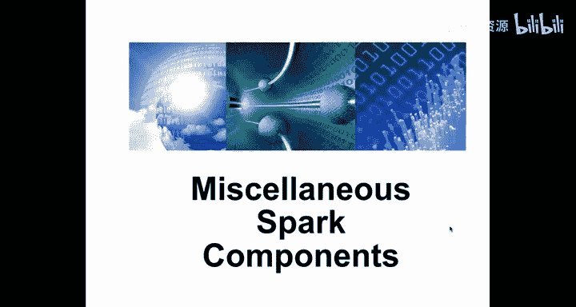

Miscellaneous spark components。

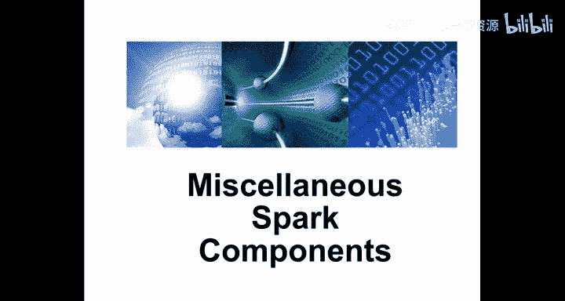

In this section。I'm going to talk about some of the addon components or components that are part of this spark distribution that are used for data science activities。

 we are going to go through these components from a high-lel perspective so when you take some of the data science classes hopefully you can start experimenting with some of these different functionalities that's available as part of SpRC in this class we are more about data engineering。

 we want to understand how big data processing works and how to engineer applications using big data。

 but in terms of the data analytics and data processing。

 some of these functionalities would be more useful for that。

So let me give you an idea as to what some of these functions are that are available for Spark and the equience of those functionalities that are available as part of the Hadoop ecosystem。

So as part of the section， we'll look at Spark SQL， Spark streaming， graphics， and Spark ML。

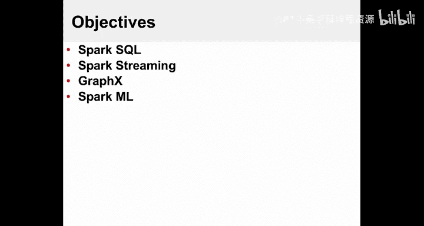

So what is Spk SQL， Spark SQL is a module that brings in a relational processing kind of functionality on top of the Spars functional programming API that we have with the RDDs。

The idea here is that the programmers will be able to use a SQL like interface to perform their processing。

You can think of this very similar to what hive provides you on top of her tubebe。

And it actually uses what is called the data frames API。

 which is a new API for doing Spark SQL processing， they used to do it on top of RDD before。

 but now they've changed or to overusing data frames and the big difference between data frames and RDD is that RDD has no context of data type data type erasure。

 it doesn't understand data types and the name of the fields。

 you have to refer to them as x of 1 x of 2 or underscore one underscore2 depending upon what syntax you're using。

 whereas with data frames you can actually use the named field name or named column name and that's the reason why you're able to do SQL like syntax using Spark SQL built on top of data frames。

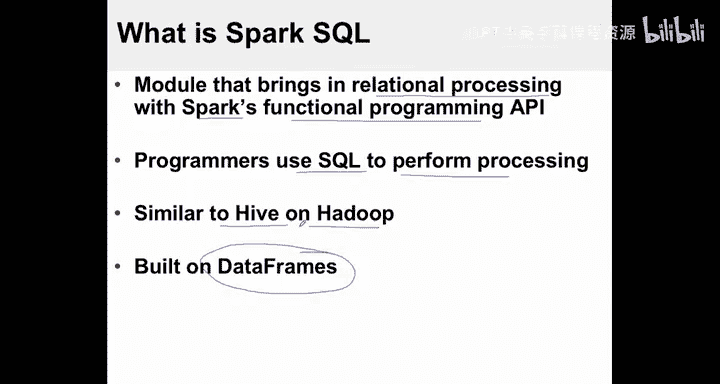

Spark SQL is based upon two papers， one is called Shark which is released in 2012 and then recently in 2015 they released these Spar SQL paper。

 This is the new paper on which PAk SQL is based upon I strongly suggest that you take a look at this paper to understand Spark SQL。

 the old shark paper is kind of obsolete at this particular point with a new implementation of SparRC on data frames。

So the foundation of Spark SQL is built on top of data frames。

 which is really a distributed collection of data organized into named columns because it does not have type erasure。

 it remembers the data types， so you can take a JSON object or you can take an Aro file that contains the field names and column names and you can basically load it up and now you can start using SQL like interface on top of that。

So it's almost like a table in a relational database except all this is in memory using data frame。

 which is really a distributor data set where all the fields have column names associated with it。

This technology is inspired by what is called pandas in Python and data frames in R。

 so data frames really come in from these two technologies。

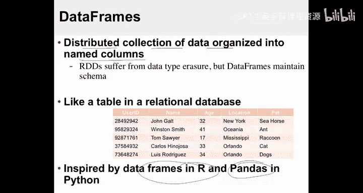

Let me kind of show you an example and as I go through this section。

 I'm going to show you an example in Java， Python so that you can kind of see the various different languages being used for different purposes。

So here I'm writing my Spar SQL example in Java here I have a variable called path that refers to a file which is a JSON file。

 and then I go to the SQL context object SQL context object is just like a regular spark context object it's an advanced version of it which honors the data frame objects you ask you to read a file passing to it a path and what it gives you back is a data frame rather than an RDT。

 Now if you go to this data frame object that you just got created。People from JSON file。

 you can go ahead and print the schema and we'll go ahead and print the schema and how does it know where the schema is because it looked at the JSON file in JSON file you have name value pair combinations。

 so it's kind of using that。Idea or that theory to get the data types and then what you do is you take your data frame object。

 you register a temptable in this case I'm calling it people and then now you can go ahead and start using the SQL context or SQL function and start applying the various functionalities and the reason you're able to use the word people is because you've registered people as a temporary table again。

 these are all some of the features of Spark SQL I'm giving you a highle view of how you might be doing Spark SQL if you're interested in doing those kind of functionalities for data science operations and you can look at the documentation for more details on the API。

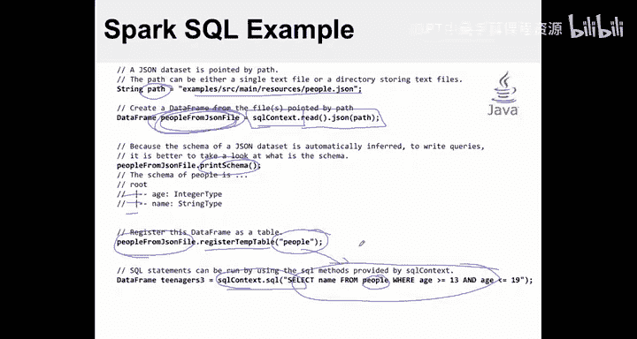

There's another project called Blink D。Wwhich is an experimental project that SparkSQL is in the process of integrating with BlinkDb again is a paper that was written by Samir Agarwal and a few of his colleagues as part of the UC Berkeley team the idea here is that when you have big data sometimes you want to make a query and you want to get an answer within a certain amount of time with certain confidence level so you can make a query and then you can say give me the answer within two seconds whatever you have。

Right or maybe make a querying and say give me an answer， but I'm willing to take an error rate of 0。

1% and a confidence rate of 95% So there's a lot of queryting that you want to do to get some kind of an answer。

It's not perfect answer。 you want to get some answers so you can make some decisions in big data processing。

 So this is an experimental technology that's coming along using the Blink TBb project and SparSQL plans to integrate with the Blink TB project so this is something that's going to be coming in soon。

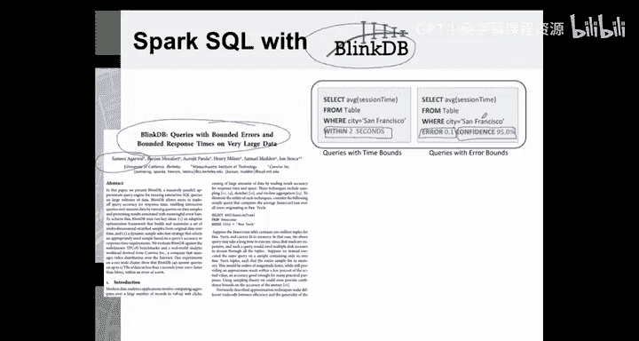

Now let's look at spark streaming streaming is really the idea where the data is coming in in real time and you want to process this data。

 typically when you have big data applications you have data that's brought in and loaded into HDFs or load into some kind of a store。

 and then you process the big set of data in some kind of a batch processing engine。

 but sometimes it may be worthwhile to process data in real time in Hadoop。

 we have something called Apache storm that is available that is typically used to integrate with Hadoop for doing stream processing。

In Spar we are something called Spark streaming which of course extends the code API for stream processing and the idea here is that you should be able to build a fully distributed for tolerant real-time processing engine on top of your sparkk platform but the most important thing to remember is that with spark streaming it is still what we call micro batches and the idea there is that the input stream is coming in and then the spark streaming basically breaks the input stream。

 the input data that's coming in， breaks it down into small chunks that are collected within a certain period of time because you may say that you want data within two seconds and so every two seconds the data will be collected and you'll be doing some calculation on top of that and splititting the results back to the user so you're consistently calculating over several micro batches。

That's really the idea behind spark streaming， take the input data， split into micro batches。

 and execute it in the Sp engine as batches。

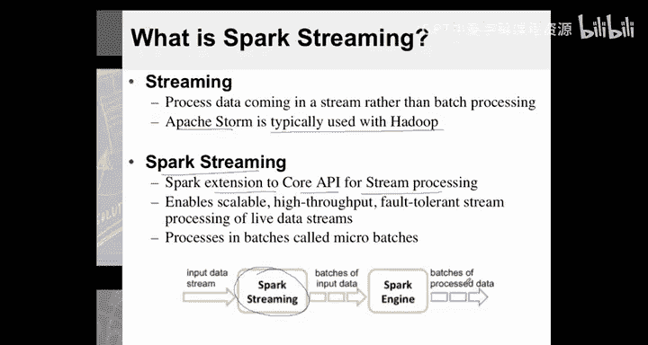

There is a paper for spark streaming， in fact there are a couple of papers。

 those was the original paper that came about in 2012 and then there's an updated paper in 2013 you should probably look at both the papers and they talk about this concept called discretized streams or also calledD streams which is really this idea of taking the data and break it down into discretereet pieces or discretereet batches and executing it over time。

So let's look at streaming features in Sp， the data can be ingested from many sources。

 It can be ingested from sources like Kafka， which is a queue Fme。

 which allows you to bring in data and real-time from different machines Of course we can bring in data from HDFS and S3 which are distributed file systems。

 it can also bring in data from Kinesis which is an AWs Q。

 it can bring in data from Twitter feeds which are really which is basically a socket stream feed you can ingest this data and then you can process the data and then you can put the results。

 you can put the results back into HDFS or to databases or even feed it into some kind of dashboard or maybe you put it into some other queue it could be Kafka or kinesis or some other message queue that you have The idea here is that if it spark streaming。

 you're able to bring in realtime data break it down into batches and execute the different batches as micro batches and put results wherever you want to。

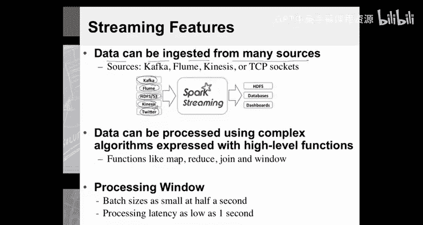

。Now how do you process these batches， the processing logic can be expressed using the same complex algorithms that we have learned before all the transformation functionality and all the action functionality that we learned can all be applied for this processing of a batch window。

In terms of the processing window itself。Batch sizes can be as small as half a second that's about 500 milliseconds so every 500 milliseconds you can process the data and then you can write results you want to make sure that you're able to process the data within the 500 milliseconds otherwise you'll actually go ahead and run out of you'll start lagging behind so you have to make sure that you have enough hardware in order to process the data within the 500 milliseconds typicallyy people process anywhere between one to two secondsd or maybe even 5 secondsd if you want to but 500 milliseconds is the lowest window that you can go to。

So let's look at some of these streaming use cases。

Let's say that users are coming to your website and they are clicking on these different links on the websites。

 that's what we call page views， these different page views can be fed into some kind of a queue such as the Kafka queue where all the page views are being put in and streaming can go ahead and read these different page views and keep track of what pages are very popular and basically indicating to the analyst in real time as to what stories are being clicked upon or what blogs are popular today on the website。

 so that would be an example of using streaming。

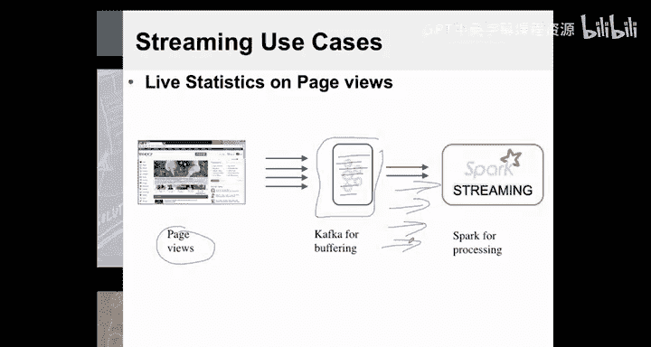

There is also anomaly detection， so for example， you may have data coming in from your smart meters into a queue which could be a Kafka queue and then you may have live weather data that might be coming in into flue and then what you can do is in your streaming you can bring in data from both data sets this is something that you need to understand you can bring in data from multiple data sets and join the data sets using union operations and things like that so you can bring in data from two different sets and then join them to understand oh the reason the electricity readings are high is because maybe there's a winterstorm so you're able to join these two live dataset sets to make sense in terms of data science so that's one of the use case of streaming it's data science in real time。

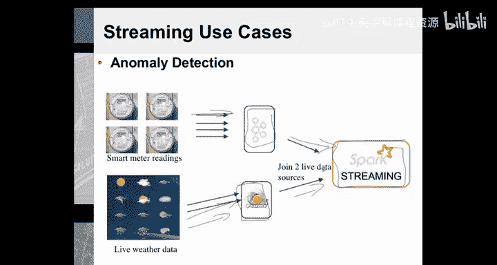

Once again， in terms of the spark streaming architecture。

 the key here is that the input data is coming in streams。

 it's given to the sparkar streaming engine， which batches every x seconds and it sends it to the spark core so that each batch can be executed as a separate spark application That's the idea it's micro batches it's not realtime streaming。

 I do want to tell you this is not like storm St is actually much more superior in storm it does do realtime streaming and it can go much lower than 500 milliseconds。

 This is micro batching。 This is not real streaming， but they call it spark streaming here。

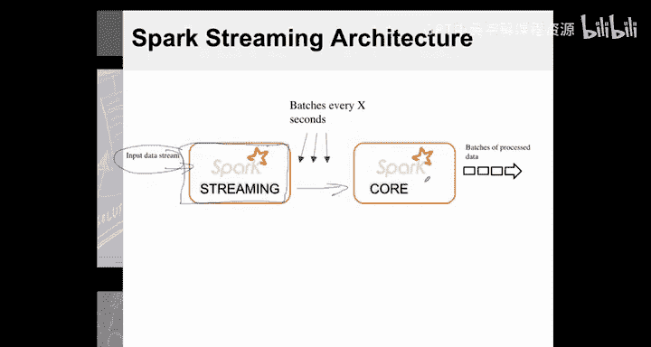

Here's an example of spark streaming。 The example is in Python。

 The idea here is that you create a spark context object here you're passing the master。

 which is a yarn and you want two threads here's the name of the application。

 you create a spark streaming context that's how you get a streaming application you're passing the streaming context you're passing these spark context into streaming context to create a spark streaming context and then you create a socket text stream。

 you're basically saying I would like to connect to the server on this particular port because that's where the real live data that's coming in and then you do various operations on top of that do your count and print and then you go ahead and start all over again So that's really the concept behind streaming。

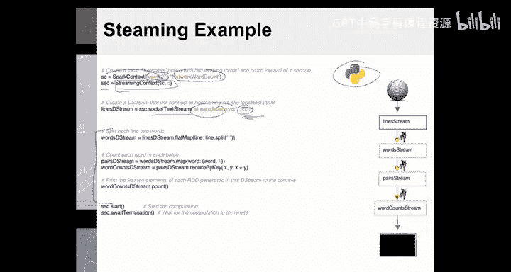

Now let's look at graphics。Graphs is graph processing engine built on top of Spark。

 it's very similar to Apache giraffe that is for Hadoop It extends the Spar RDD by introducing this new graph abstractstruction。

 this new graph API where what it's really doing is that it's taking your data and creating vertices and then joining many of these different vertices through what is called edges every one of these vertices represents a data set and every one of these edges represents a data and now you can do various kind of graph calculations on top of that that's really the idea behind graphra and there are several class of applications that can take advantage of this。

 for example， the social networking graph。

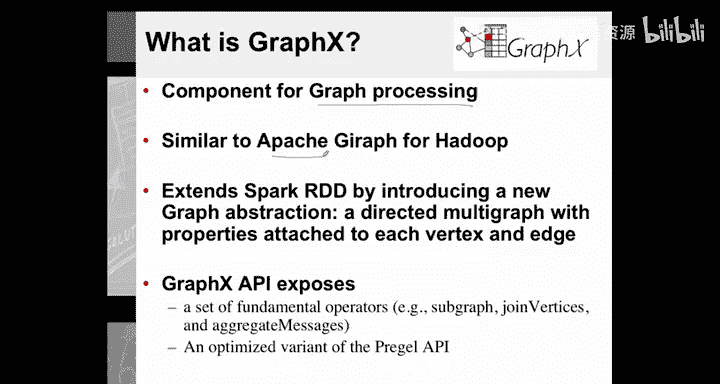

As you may have suspected， there is a paper that was released in 2014 that discusses this graphics。

 this graph processing API。

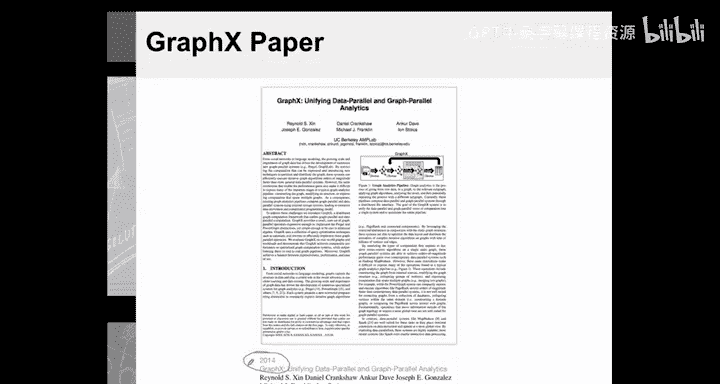

So what is the graphics architecture， the basics of graphics is that let's go ahead and represent data as vertex and as edges。

What you're seeing here is that I have some data， I have some IDs。

And for each ID it has the username and their corresponding role So for example。

 Auction is a student Jgononzll is a postdoc student。

 Franklin is a professor and Histoika is also a professor。

 so I'm representing each one of these students as a vertex。

 but then there might be data set that represents the relationship， for example。

 the relationship between。3 and 7。Wwhich are the two folks three and7 or Shi and Jaygononzal is that they both are collaborators right and the relationship between five and three are advisors and those relationships are actually being drawn using these edges that's really the idea behind the vertex and edge don't forget that when you're actually drawing a line between two and five notice it's actually a directed graph there's actually a direction associated with it Now once you have represented data this way there's a lot of API methods available for you to process this data。

Before I show you the API， I wanted to show you several use cases here in social networks。

 we have three people， A B and C， and then we have these different objects or different documents that these people are having access to people having access to other people that shows you the relationship these people have people having access to these different documents and they like it or not so there's all these different relationships that can be represented and then you can make an API call on top of that graph processing API There's also web graphs which is really what we call page rank type algorithm where you have this page links to that page and that page links to another page。

 which links to another page and then there are 17 pages that link to one page so by looking at a page and the number of people that are linking to that particular page。

 you can figure out which pages or which websites are more popular and so that would be graph processing again There's also user item graph or recommendation engines。

So for example， this person likes this laptop maybe five times they given five stars whereas this person only gives one star and then this person likes this headphones given four stars So you have all these relationship between user and the item and then you can start getting into recommendation engines and things like that This graph data structures fundamental data structure for many of the machine learning algorithms What I'm showing you here is a snippet of the graph API where the data is represented as vertic and edges and then you can。

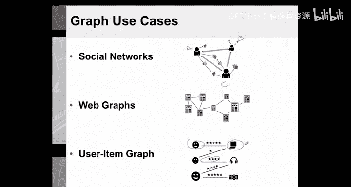

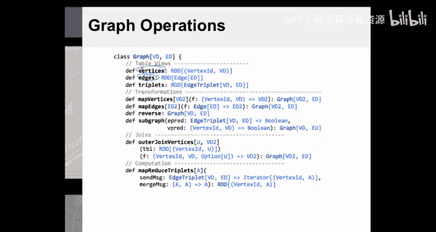

And then once you' have built a data structure， you can call upon several algorithms。

 including page rank algorithm， triangle count， connected components。

 all these are various algorithms that are used for graph processing。

 once again graph processing is a field of its own， it's like relational databases。

 which is a field of its own， this is graph databases， graph processing， a field of its own。

 you can take an entire course on it， there are several technologies， several algorithms。

 several machine learning algorithms that rely upon this technology。

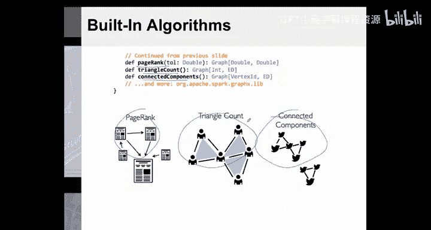

Now that leads us to MLB， MlibB is another layer that's built on top of Spark。

 it's the machine learning library that's available as part of Spark ecosystem。

 it's similar to the Apache Mahat for Hadoop。It makes it easy to scale and practice machine learning applications。

 there are several classic algorithms that are built into the machine learning library。

 MLB was originally based on RDD and as part of 2。0 they are being converted into a data frame based API。

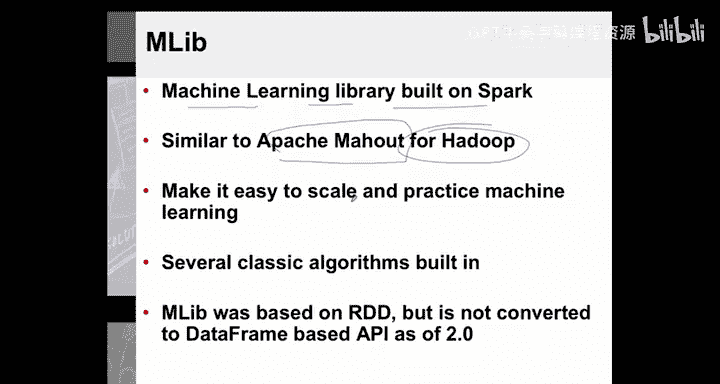

As you may have guessed， yes， there is an ML paper which is machine learning in Apache Spar。

 you're welcome to read that paper let me just kind of give you an overview of some of the algorithms that's available you have classification algorithms。

 regression， decision trees， recommendation， clustering， various kinds of clustering algorithms。

 modeling， transformations and ML pipeline which is really the idea that you create a pipeline of processing and then basic statistics。

 basic statistics because machine learning is all about statistics and so some of the foundational statistics functions are also available as part of the machine learning library。

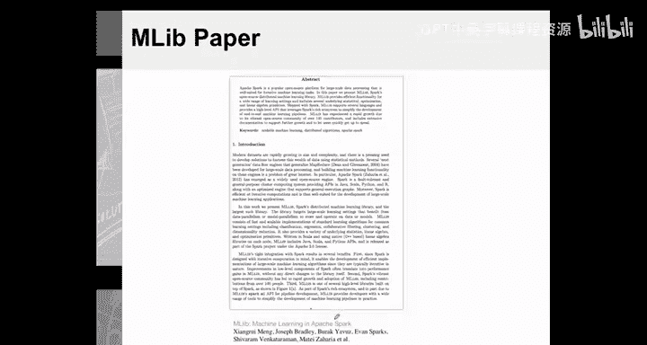

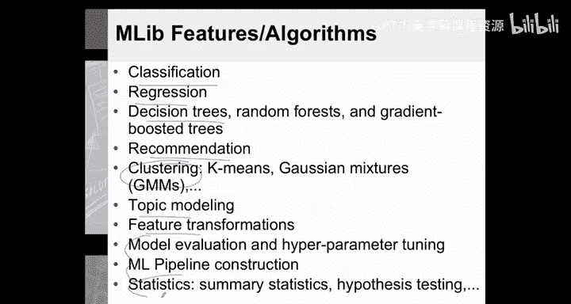

So as part of this section， I have kind of given you an overview of some of the data science functionalities that's available as part of Spark。

includingncluding Spark SQls， Sp streaming graphics and Spark MLl。

 I do want to tell you that there are two kinds of data developers there is the data engineers and there is the data scientists。

 data engineers are more that understand data processing technologies。

 they understand the video systems， they understand how these video systems work。

 they understand parallel computing， they are more of a developer whereas data scientists are more of people that are experimenting with the data Spark is great in terms of an interactive processing that allows you to experiment with the data。

 and then they would actually work with the data engineer to actually write the applications If you're a data scientist you're more inclined to use things like graphics and sparkarkml and sparkark streaming and sparkk SQL because you're more in the experimental phase trying and understand what the data is and once you've figured out the meaning behind the data than to productionize it and engineer comes in This class has been primarily focused on making。

You a data engineer， and then of course， you can take other classes in the field of data science from the university。

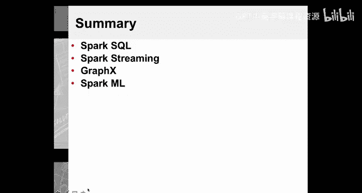

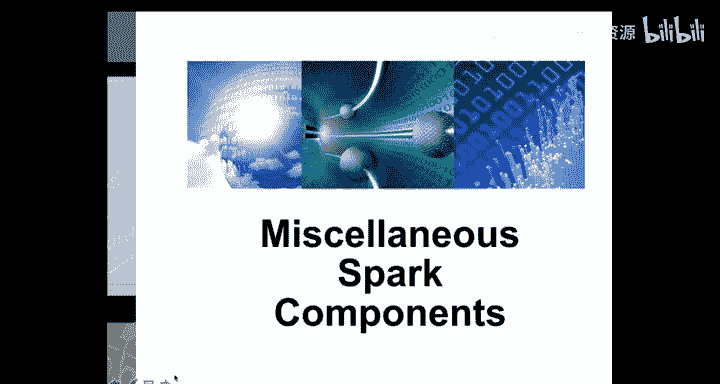