# 约翰霍普金斯大学《Hadoop大数据处理｜Big Data Processing Using Hadoop》中英字幕 - P98：33_Spark模块总结.zh_en - GPT中英字幕课程资源 - BV1g5u6zBExs

Spark framework summary so to summarize this module in terms of Spark in the Spk overview section。

 we learned that Spark is a fast cluster computing framework。

 which also has data processing framework built to it cluster computing is the aspect where it has its own schedulers and also works with other schedulers。

 the data processing is the Spk engine。

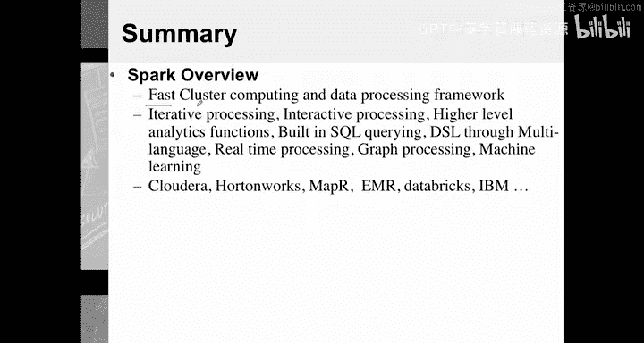

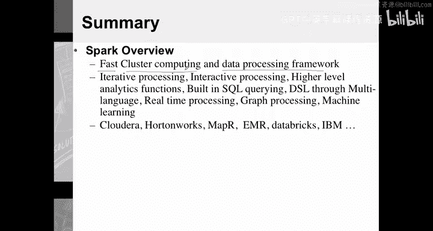

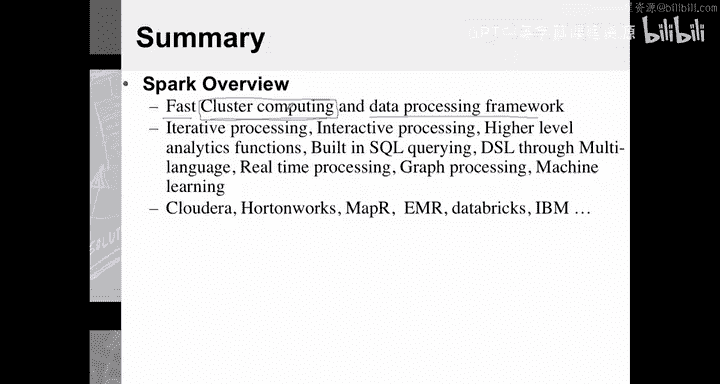

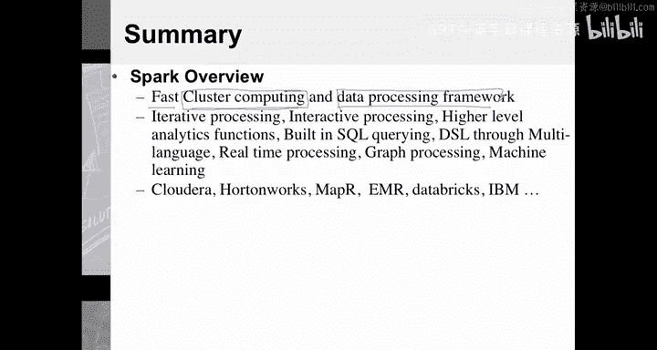

We learned that Spark allows you to do iterative processing。

 it also allows you to do interactive processing because it keeps all the data in memory and you can kind of keep on applying functions on all these data that's in memory across these RDDs or resilient distributed data sets。

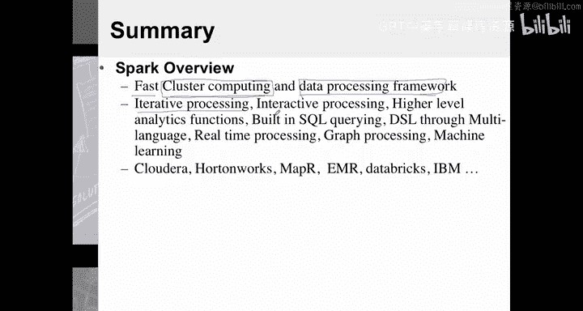

There is also highleve analytics functions rather than just having map introduced in its other functions that's possible for you to execute on top of your data。

 there's also built in SQL querying very similar to what we have in Hve it also has a DSL interface for multiple languages such as Scala。

 Java， Python and R There is also real-time processing that's available through Sp streaming in graphics and machine learning。

 there are several distributions available in the marketplace。

 the classic big data Hadoop distributions are offering Spk as one of the engines as part of the distribution。

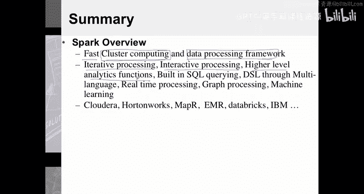

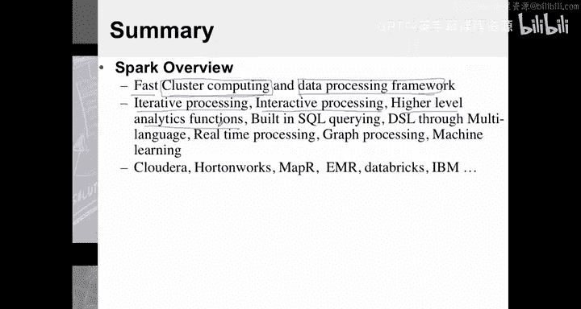

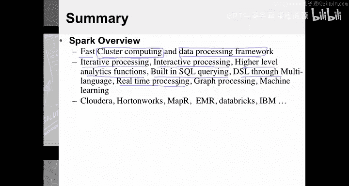

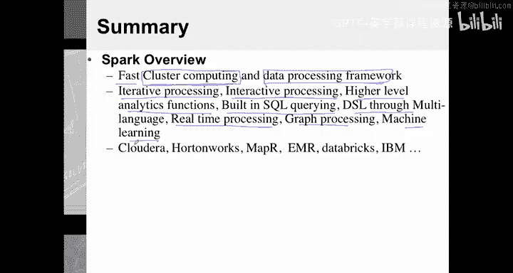

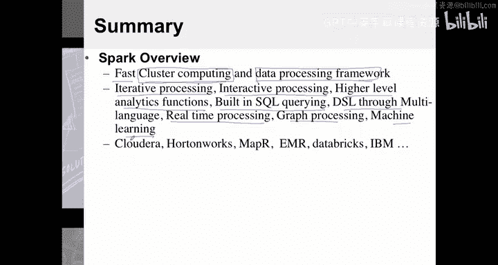

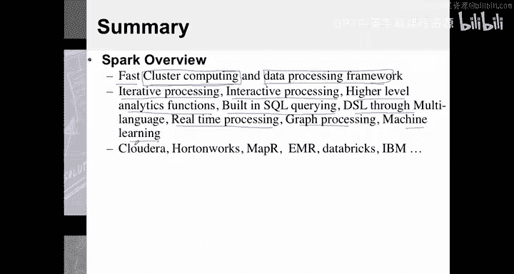

And then there is， of course， Databricks which specializes in Spark and they have partnered with other companies to provide Spark Engine for their own big data platform。

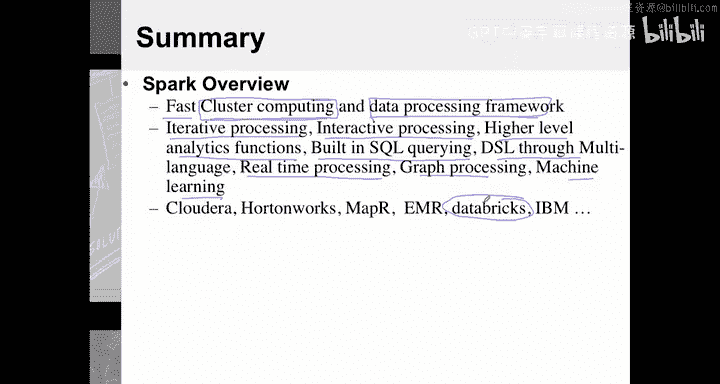

In terms of Spk architecture， we learned that in Spark we have RDD， which is a major component。

 which is the resilient distributor data， basically the idea there is that you load data from some kind of a data source。

Keep the data in a distributed data structure， distributor collection across multiple machines。

 there is something called the driver which controls the flow of the program。

 and then there is something called the executor， which is where these tasks and cores run as threads so typically in an application you have several executors and each executor has multiple threads or multiple tasks that are working on a portion of the RDD。

In terms of Spk application modes， Spark can run in interactive mode。

 which allows you to interact with Spark through command line interface。

 you can use Spark shellll for Scala basedase interface。

 Pipark for Python basedase interface and SparkA for Rb interface there's also batch programming available which you do using Spark Sub you can also run Spar in different kinds of master modes we have two major categories of that we have local where the driver and the executor all run within the same machine and then we have three categories of distributor master which is standalone mesos and yarn standalone is the Spark's own cluster computing engine scheduler engine whereas yarn and Mesos or external engine with which it integrates。

So typically when we are running Spark， we are running Spark in interactive mode or in batch mode。

 and within that we may run it as local or distribute it when it comes to standalone。

 yarn or Mesos mode， there is also something called deploy mode。

 which can be either client or cluster which defines where the driver is going to run。

 if it's client， then the driver is still controlling whereas if it's cluster。

 then the driver actually runs in the cluster environment itself。

When it came to setting up and running Spark， we learned how we can download and install Spark in our environment。

 we downloaded a version of Spark that would work in conjunction with our Hadoop deployment that we already have。

 and we actually downloaded a version of Spark that didn't have Hadoop because we had our own Hadoop installed already and we integrated with the existing Hadoop。

So as part of the process， we configured Spark so that it knows where Hadoop is and we also configured Hadoop so that it knows where Spark is。

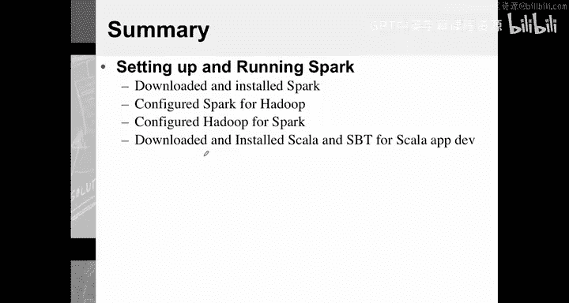

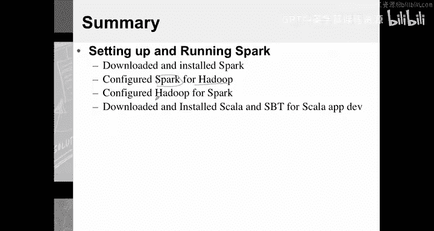

We also downloaded installed ScalA and SPT so that we can build ScalA based applications。

 and we also demonstrated several examples of how to do that in our hands on demo section。

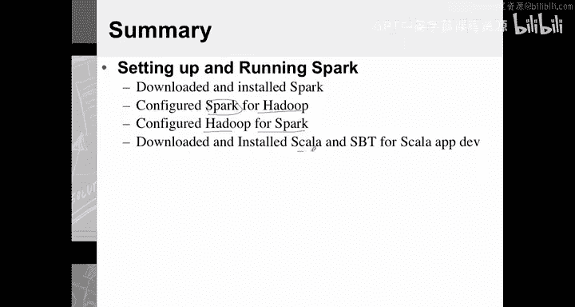

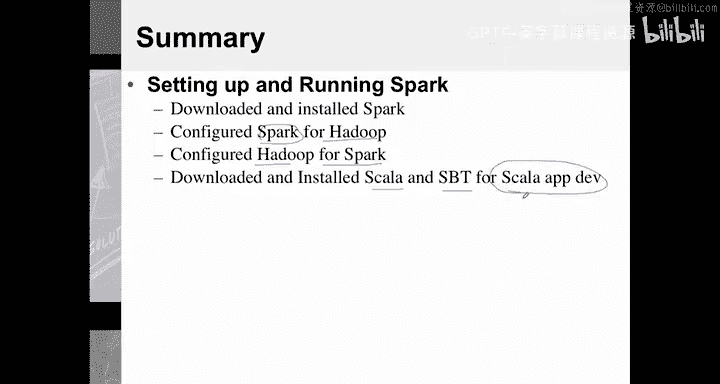

In terms of sparkark core programming， we learned that sparkark configuration represents the configuration object for Spark and there's also spark context that represents the Spk environment。

 you use these spark configuration to create sparkark context and once you have Spark context then you can create your RDD Now when you're running Spk shell。

The spark configuration and spark context are already created， so you just have to use them。

If you're writing an application， then you'll have to create the spa configuration of this spa context object and then create an RDD on top of that so typically you create an RDD from a stored data that may be in HDFS or in a regular file system or in a distributed database and then you apply RDD operations you can apply transformation operations or you can apply actions you can apply multiple transformation operations and those transformation operations don't really execute anything until the action takes place so the transformations are typically filters and map functions that say that the data has to be transformed but they don't transform the data because it's lazy transformation until an action takes place and once an action takes place the transformation gets executed based upon what is called a Dg which is directed basically graph。

So in terms of application development， you load data， you apply transformations， you apply action。

 and then you save results， you can apply multiple actions on the same data set if you want to and save multiple results。

 it all depends upon what your application is trying to do。Once again。

 you write your application in Java， Python， or ScalA。

 what we demonstrated you was how to write one in ScalA and you use the SPT and the ScalA compiler for building your applications。

We primarily concentrated on the Spk architecture and how to make it run with Hadoop。

 but there are lots of other components that are built on top of Spark that many data scientists use。

 for example， SparkSQs， Sp streaming graphics and Spark MLl。

 these are all miscellaneous or addon components on top of Spark。

 which comes with these Spk distribution itself， we got into a brief overview of some of these components。

 and once you get into some of the advanced classes on data science。

 you may be using many of these technologies to create your more complicated data science applications。

