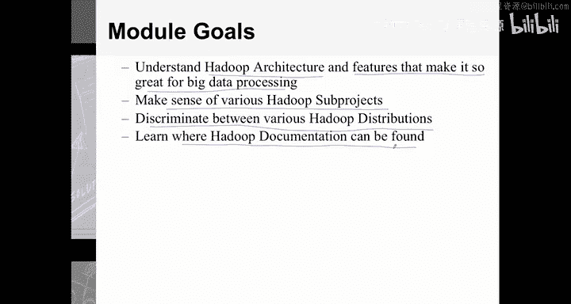

# 约翰霍普金斯大学《Hadoop大数据处理｜Big Data Processing Using Hadoop》中英字幕 - P9：8_Apache Hadoop架构与生态系统导论.zh_en - GPT中英字幕课程资源 - BV1g5u6zBExs

Welcome。Apache Hadoop architectureecture and ecosystem。In this module。

 we will look at the architecture of Hadoop and various components that make it so great for big data processing。

So what are the topics in this module？We will first look at Hado background。

Where we will cover the genesis and history of Hadop。

Then we will take a peek at Hadoop architectureitecture。In terms of its core components and modules。

Then we will learn about the key principles that make Hadoop so great for big data processing。

Then we would look at the Hadoop technology stack。Where we will make sense of the various projects that exist in the Hadoop ecosystem。

Then we look at various Hadoop distributions in the marketplace， like the CloudR distribution。

 Ma art distribution， or even the hotel and Work distribution。Finally。

I will point you to various sources where you can find documentation on more information for Codu and its sub projectsjects so you can stay up to date。

So what are the module goals？Understand Hadoop architecture from a big picture perspective and also understand the key features that make Hadoop so great for big data processing。

Make sense of the various Hadoop sub projectsjects like hive， pigG， H phase。

Discuinate between the various Hadoop distributions like the Cloud IR distribution for Hadoop。

 the Maport distribution and the Hworks distribution。And finally。

 learn where Hadoop documentation can be found so you can be up to date with latest information on Hadoop。

