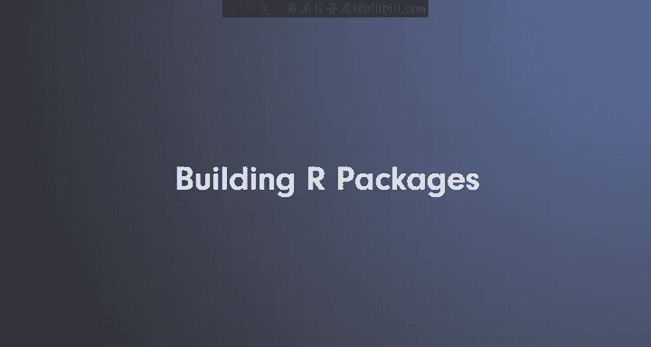

# 约翰霍普金斯大学《R 语言编程与数据科学工具开发｜Mastering Software Development in R》中英字幕（deepseek - P3：0_欢迎来到构建R包.zh_en - GPT中英字幕课程资源 - BV1RMFQebE4H

All right， so at this point， we've shown people how to write their own R code and then to wrap it into functions。

 and then this is the step where we show them how to wrap those functions into packages。 Yeah。

 so the bottom line， I think is if you want people to actually use your code it's got to be in a package sending them a script or sending them some file that has a bunch of functions is fine but know it's not organized there's not necessarily any documentation is's not necessarily a tutorial to explain to them how to use all these things and so a package is really a mechanism for organizing what organizing your code。

 organizing your documentation， explain to people how to use it and making it really kind of friendly and so it's really more about the user and kind of providing some of the nice cities that users need to learn how to use your code。

 I would agree， I also think that the process of writing the documentation and putting functions together helps organize the logic for the group of functions you're creating right I think it also helps you to think about what are the functions that users need and what are the functions that are just kind of in support。

😊。

rit the code and so it's kind of a natural extension of writing a function itself you know originally we started out with here's some code and then we kind of abstracted that to say here's a function and here the inputs and the outputs and now the package is kind of the natural next level where you talk about here are a bunch of functions that hear the functions that are kind of like the ones that you want to call that you need to do to accomplish a specific task right and then once you've written a package often you'll want to share it so we're going to talk some in this about how to use GitHub to share your package and to check out other people's packages to pull them into Yeah and I think another thing we're going talk about is quality control which is really important if you want to have a lot of people using your package and to kind of maintain the quality and make sure that the code is always working so we're gonna to talk about testing and kind of continuous integration for maintaining your packages Yeah because this builds on writing code and wrapping the code into functions。

 this is probably going be most comfortable I would say for somebody who's already taking the first two courses in this specialization Yeah definitely。

I'm so excited that people are interested in this topic and we're really excited that we're getting the chance to teach you how to build our packages。

 Yeah， I mean， it's a really important skill and I think that I'm just very excited to see what you can build。

😊。

