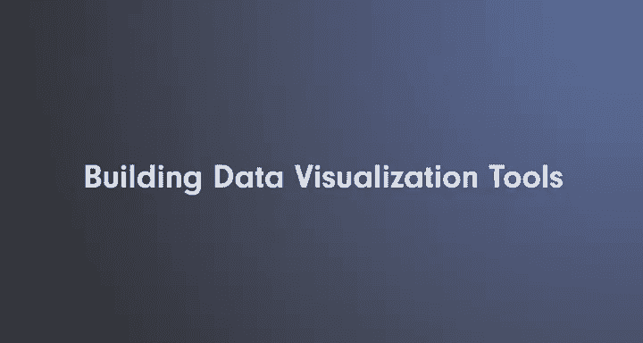

# 约翰霍普金斯大学《R 语言编程与数据科学工具开发｜Mastering Software Development in R》中英字幕（deepseek - P4：0_欢迎来到构建数据可视化工具.zh_en - GPT中英字幕课程资源 - BV1RMFQebE4H

One important part of data analysis is building high quality graphics in the first part of this course we'll show you how to use existing tools including GGplot to create graphics in R and the second part of the course will dig deeper and show you how to build custom graphics extensions。

This course will be most comfortable if you've already completed the first two courses in a specialization or if you have a lot of experience already programming in R。

 Thank you so much for enrolling in the course。 We're excited to see what you can build。😊。

