# 约翰霍普金斯大学《R语言数据可视化和仪表盘｜Data Visualization & Dashboarding with R》中英字幕 - P10：9_tidyverse中的数据导入和结构.zh_en - GPT中英字幕课程资源 - BV1YWPjeKEWz

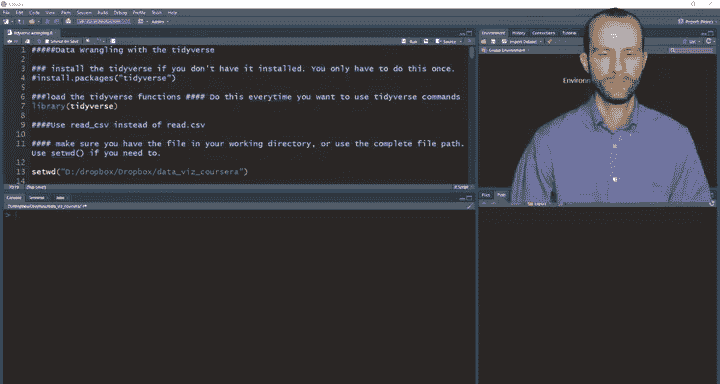

Now we are going to start importing data and looking at it using the tidyverse。

Let's begin by installing and loading the R package we need。

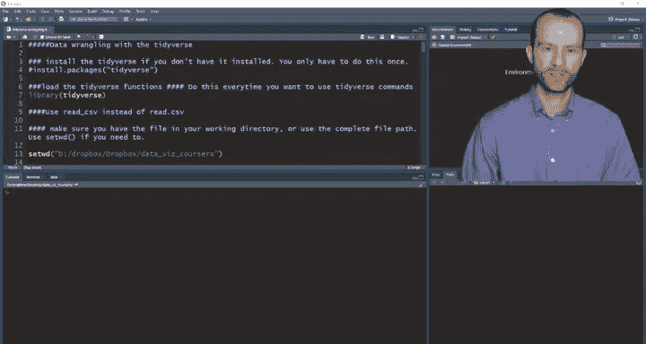

And as I've said before， software developers around the world have written hundreds of useful packages for R。

 which are sets of functions that you can download using ourSt。

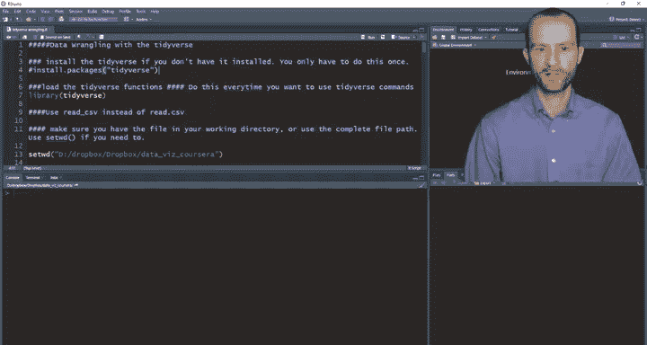

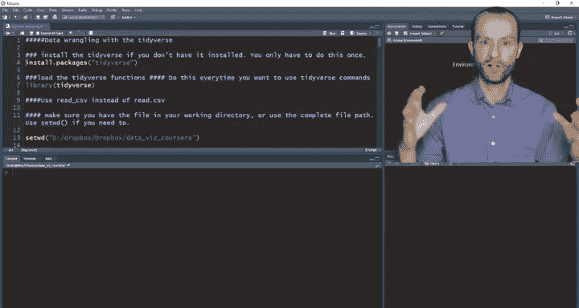

And these contain thousands of different functions that can be used for data wrangling and visualization。

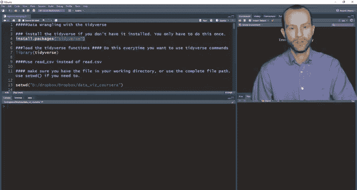

One of the most common and useful among these is the tidy first。

 so we'll start by installing that using the install package function。

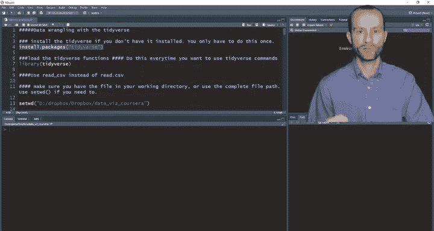

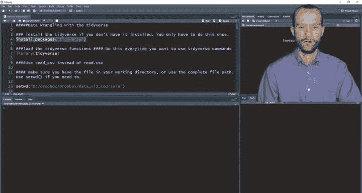

Once you have this package installed， you can load the library using library tidy verse。

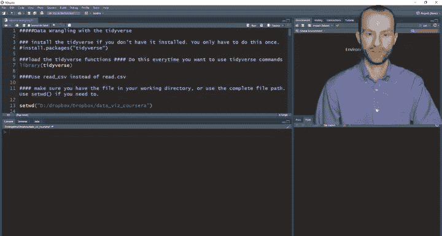

You don't need to reinstall the package every single time you open up our studio just the first time that you use it。

 or whenever you reinstall R or update R on your computer。

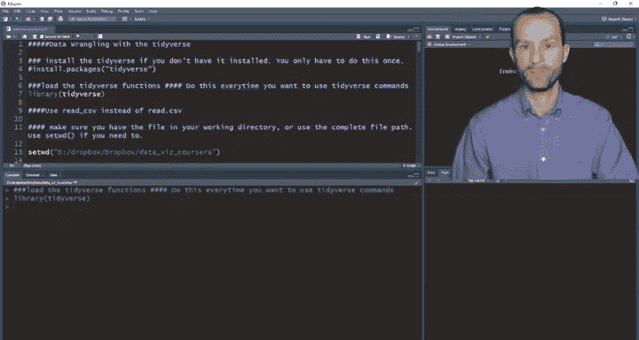

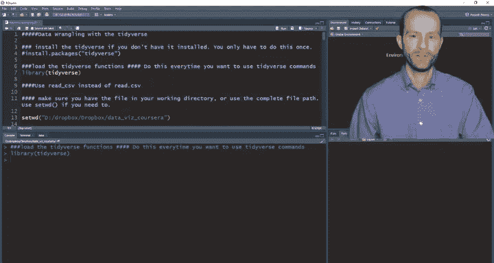

For this example of data wrangling， I'm going to use an example data set and what I've done is sampled 100 responses from the Cooperative Congressional Ection surveyvey。

 which is a major academic survey conducted by a number of political scientists in the United States。

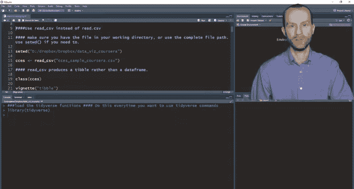

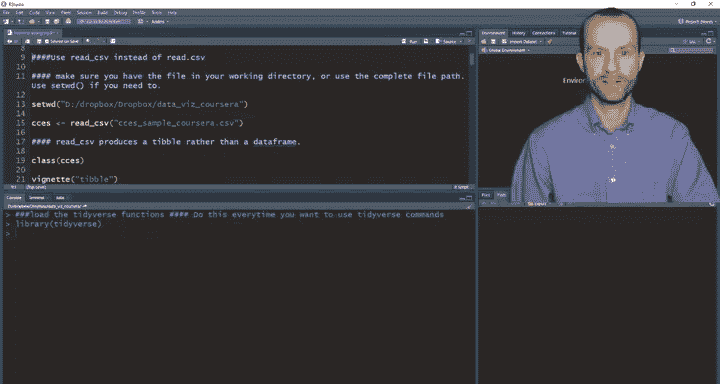

I've selected a few of the questions from the survey here。

And to further illustrate the process that you would probably use for data wrangling in many cases。

 I provided a codebook that explains what the different responses mean to the survey questions。

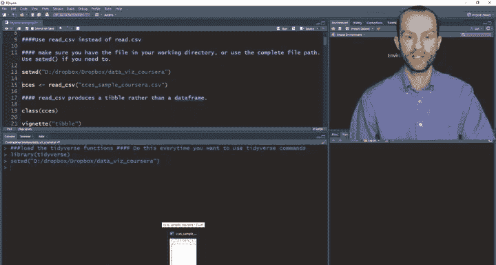

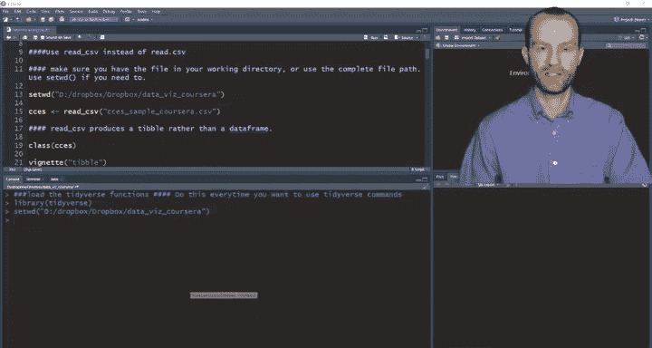

This is really the ideal circumstance for finding data。

 it's a rectangular spreadsheet that has a codebook that explains what all the different data mean。

You should take a few minutes now and open up this file in Microsoft Excel or some other kind of spreadsheet software。

And also open up the codebook and familiarize yourself with the questions and the codings through the different responses to the survey。

Understanding the documentation and the codebook for data is critical to organizing it and using it correctly。

Assuming you've taken a break to do that now， let's go ahead and load the data using the tidiverse approach。

So we'll set the working directory to the path where the data file is located。

And now from the very start， we start to diverge from the standard base R approach and we start to use tidyverse tools。

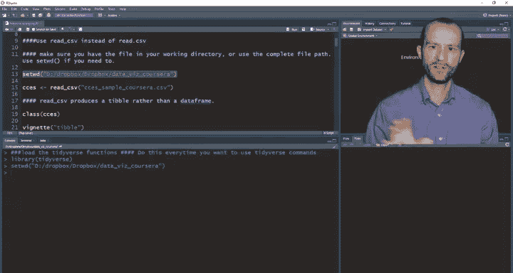

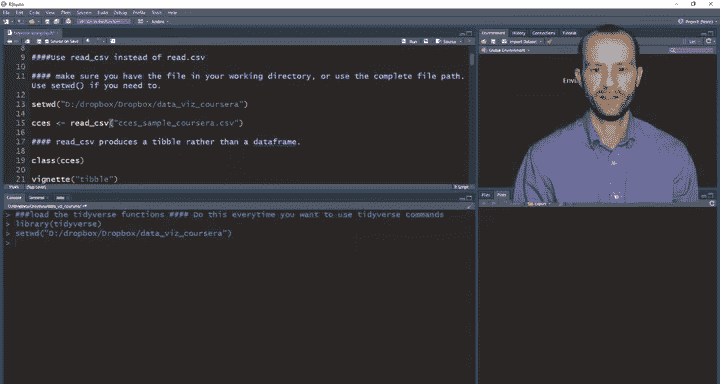

The tidyverse contains a command called Read_ CSV， which is a replacement for the read dot CSV function。

And read， underscoreV， read a CSV file very similarly to how a read dot CSV does。

 but the output is a little bit different。

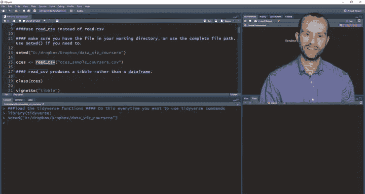

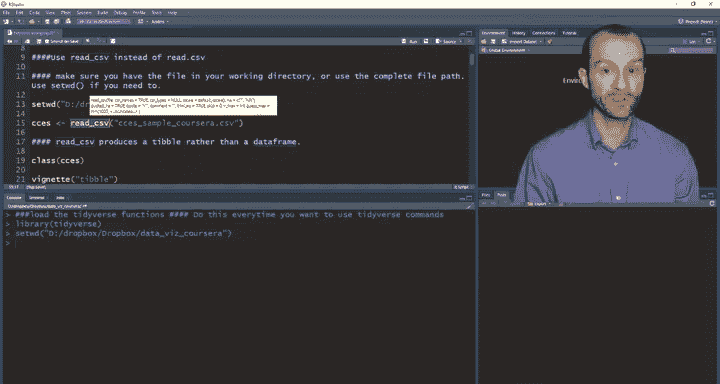

Read underscore CSV produces what's called a Tibble rather than a data frame。

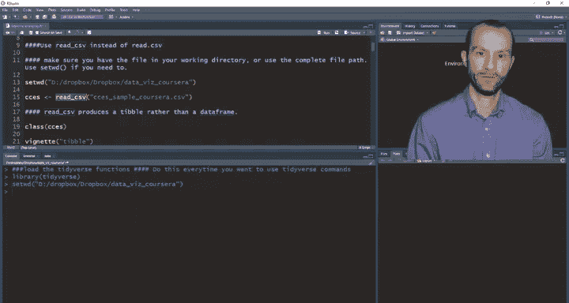

A Tple is kind of like a specialized version of a data frame that works well with the tidyverse。

 and it has several desirable properties。At the most cosmetic level。

 when you display a Tple in the R console， it will only show you the first tin rows rather than all the columns when you try to open it up。

So you don't have to use the head command。More under the surface。

 Tbbles also have some advantages with how they treat data and help prevent you from making mistakes when you're working with it。

You can read more about this if you type vignette Tbble into your console。

And if for some reason you need to convert a data frame into a Tbble or a Tbble into a data frame。

 you can do this conversion with the add_ Tbble or as that data frame commands。

 you can switch back and forth。At the very start， when you're wrangling data。

 you need to decide what you're going to do if you have any blank cells in the data。Now。

 depending on the quality of the data， this can be a very big problem。

 so you have to be extremely careful when you make this decision。And idealally。

 you want to just collect more data so you fill in those blanks or you determine some kind of systematic way to fill in the missing data。

Borring that， though， the simplest thing to do and has the benefit of making your coding life easier is to just drop any rows with missing data in any cell。

And you can do this with the drop underscore inA function。For demonstration purposes here。

 I will drop any row with missing data， but again， heat the danger warning here。

 this is not something you want to do lightly because it can really hurt your data quality and the quality of inference you're making using data。

Data scientists can be very picky about how missing data is handled。

 so be conscious of that especially depending on your audience。

