# 约翰霍普金斯大学《R语言数据可视化和仪表盘｜Data Visualization & Dashboarding with R》中英字幕 - P11：10_过滤、选择、重新编码、重命名和管道操作.zh_en - GPT中英字幕课程资源 - BV1YWPjeKEWz

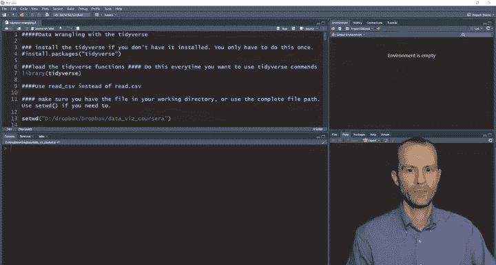

We're picking up in this video just where we left off in the last one in the course。

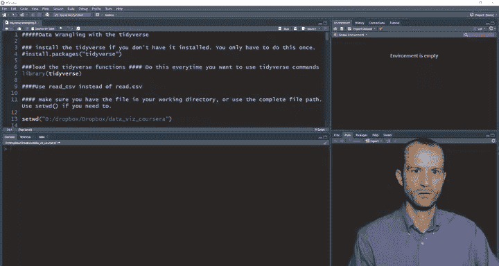

So open up the Asated R file for this video and import the code just as we have before。

 this is the example survey code from the Cooperative Congressional E survey。

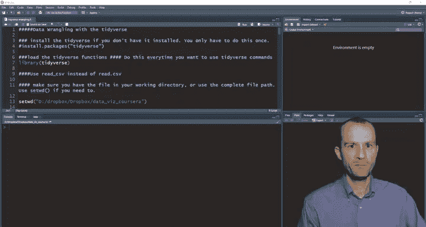

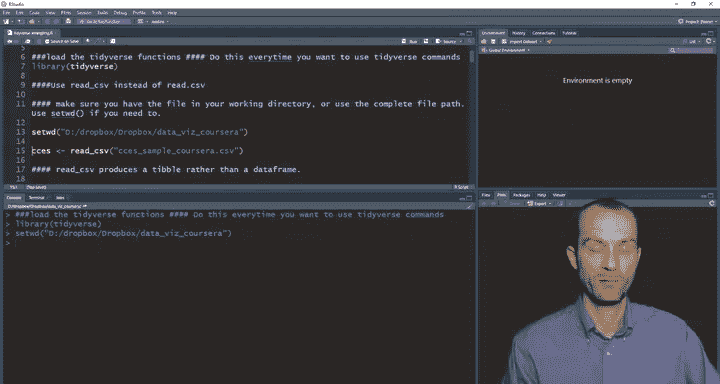

We'll start with filtering data。Once you have a complete and clean data set。

 probably the most straightforward data wrangling move is subsetting your data。

 which is pulling certain information from a bigger spreadsheet or data table based on some set of criteria。

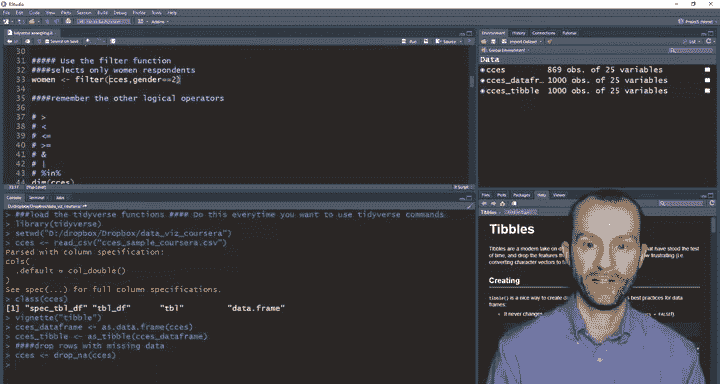

And in the TI diverseverse， you can do this with the filter command to select rows of the data and select to grab certain columns of the data。

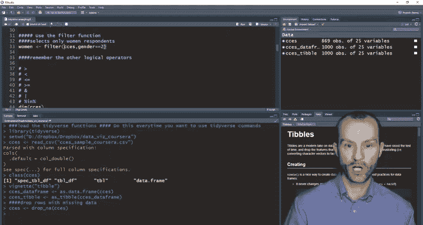

So thinking about our survey data， let's say that we want to examine the educational levels of women who identify as strong Republicans。

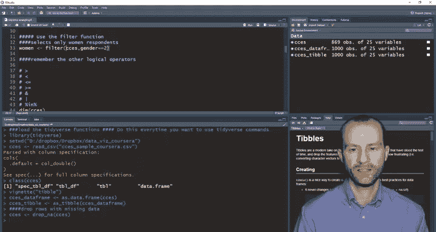

So how are we going to pull out that information from the data and create a smaller data set with just that subset of information？

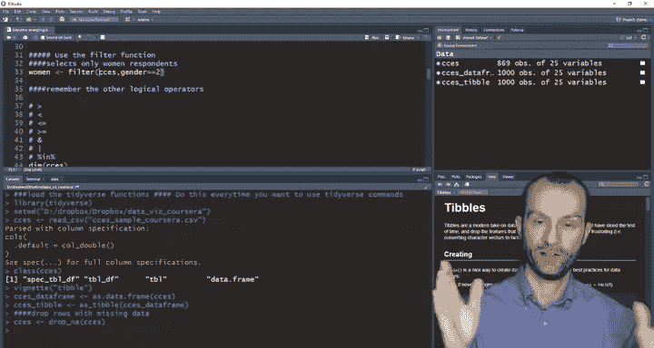

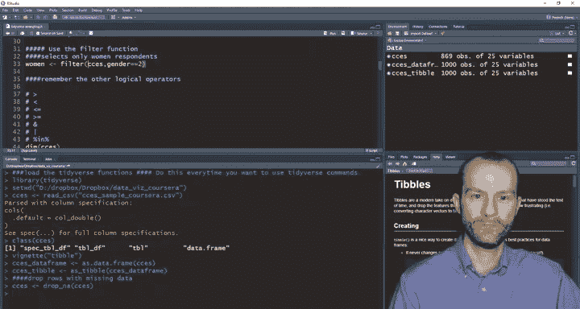

To use filterter， first you specify the data source that the function will use。

 which in this case is our example data， which I've named CCES。

Then in the second argument for the function， we specify a condition for the filter。

 which will tell R to pull out only rows in the data set that meet that condition for cells in that column。

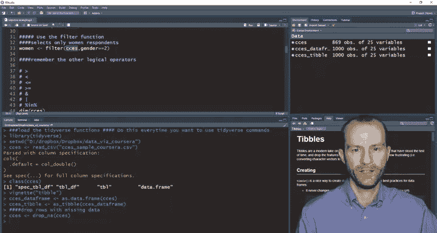

You separate arguments and functions with a comma， and in our data。

 survey answers that report respondent gender are coded as one or two with two being female。

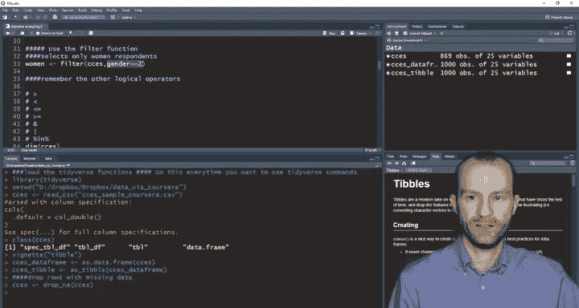

So we're going to set the filter to gender equals equals 2 using this logical operator。

Remember that R has logical operators for equals， does not equal less than or greater than or。

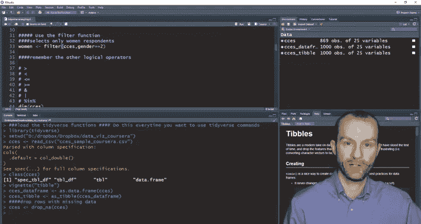

Less than or equal to or greater than or equal to。Therere also logic operators for and and or。

And additionally， whether a particular value is present in a vector。

So let's say this command the output of that dysfunction to the variable of women。

 and we've just used gender here as a single filter。

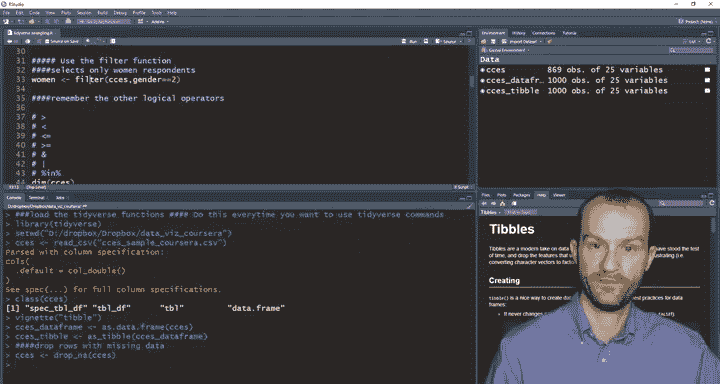

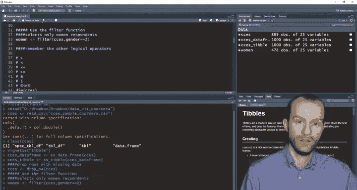

Now we can use a dim command and we see that we have a reduced data set that's smaller than the original Tbble and the size of our new Tbble corresponds to the number of women in the original data。

 and you can prove that with the frequency table。

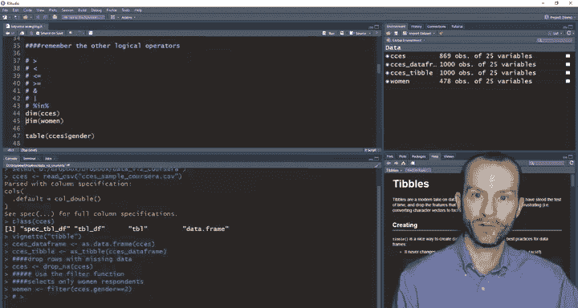

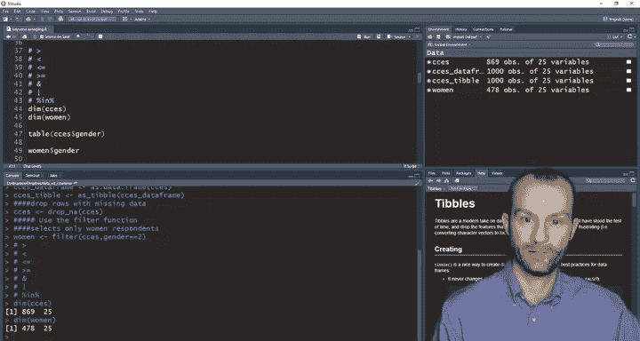

You could also prove it to yourself by just looking at this column for gender in the reduced data set。

 and you see that every column is now a two。

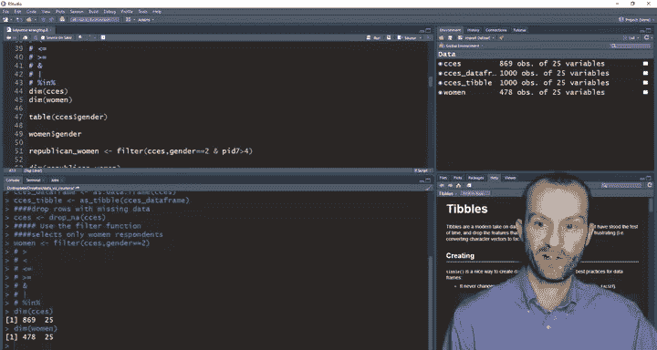

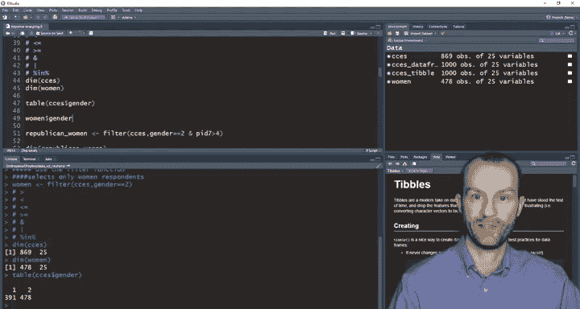

Now let's say that we wanted to add a second condition to our filter， we only want Republican women。

So if we look at our codebook， we'll see that the values of more than four on the PID7 variable correspond to the respondent identifying as a least leaning Republican。

Sort of capture this we'll modify our filter command by adding a second condition to take that into account。

Now we can save this output to the Republican women variable and we do the same checks to make sure that the filter works as we expected it to。

Now let's use the head commands and look at the Republican women object that we've created。

You'll see that it still includes all the columns from the original data， but fewer rows。

Now let's say that we didn't want all those columns and we only wanted to select a few of them。

 let's say educational levels and let's add employment status。

We can do this with a select command and to select certain columns of a data set。

 first you give the select command the data you want to select from here。

 which is our new reduced data set for Republican women。

 and then you identify the columns you want in quotations set off by commas。Once you run this。

 you'll see that now we only have two columns of the data for the education and employment columns。

And you remember from before that this is only Republican women。

One trick that you might want to use as you get more comfortable working with data in the ti versus combining different filter and select commands。

 or many other kinds of data wrangling commands actually。

 into a single line with what is called piping。In the tidy verse。

 you pipe with a series of three symbols， a percentage symbol， a greater than sign。

 and a percentage symbol all smush together in a little sandwich。And with piping。

 what you do is you pass an object on the left hand of the pipe into the first argument of the function on the right hand side。

Or to any argument in the right hand function where you put a period for that argument。

In a formal sense， in other words， you can look at it this way。

 X piped into function Y is the same thing as the function of X Y。

Or y piped into a function with X period Z is the same thing as function X， Y， z。

This is a little hard to get used to it first but you'll find it's pretty convenient。

 and so to see it in practice， you can combine all the lines of codes we've written here to filter and select into do a single set of piped commands and you'll get the same result as when we did all the different commands separately。

