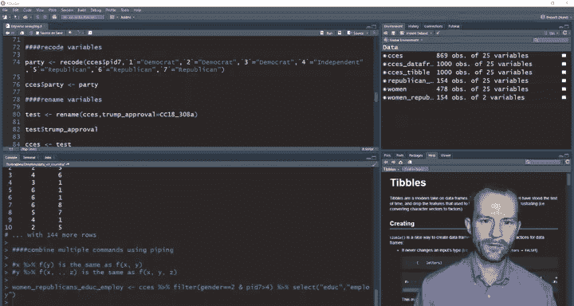
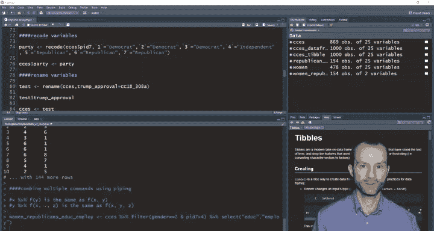
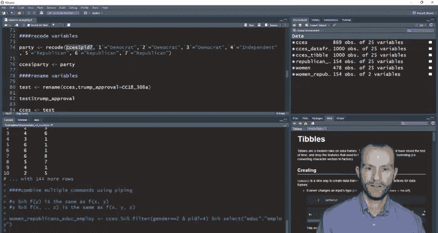
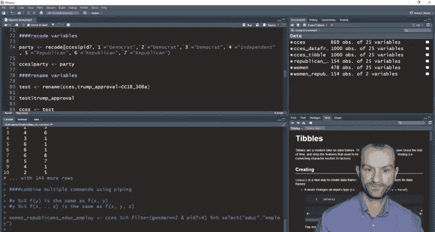
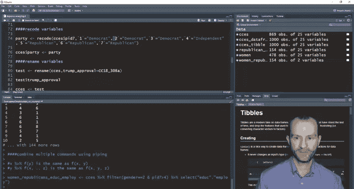
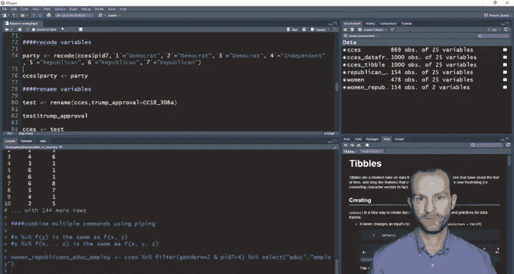
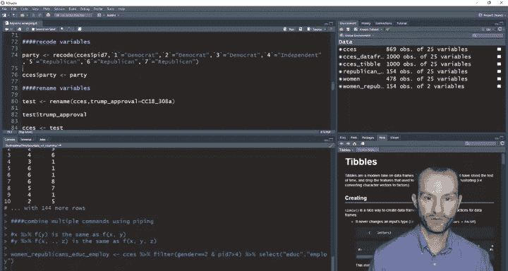
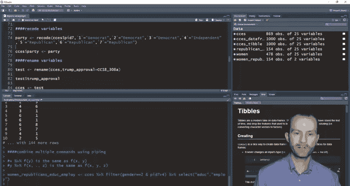
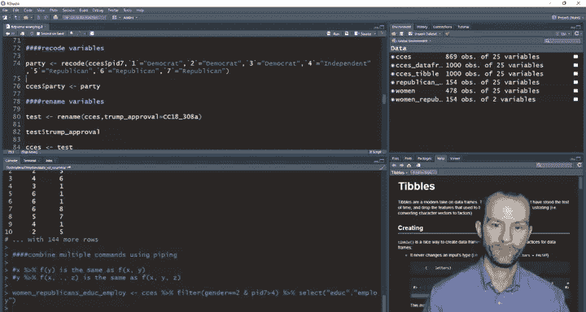
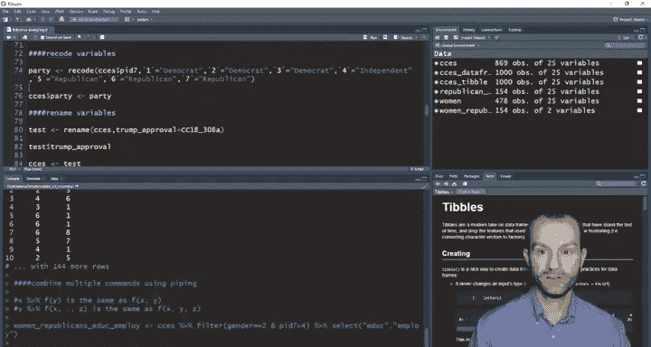

# 约翰霍普金斯大学《R语言数据可视化和仪表盘｜Data Visualization & Dashboarding with R》中英字幕 - P12：11_重新编码、重命名和计算列.zh_en - GPT中英字幕课程资源 - BV1YWPjeKEWz

I'm going to demonstrate several more data wrangling commands now。

And remember that this is just a foundation。It will ultimately be up to you to explore the other data Rrangling commands in the tidyverse once I've shown you the basics here and how to work with these functions。

And again， remember that for many different kinds of data manipulations。

 theres lots of different ways to doing it， you could actually accomplish quite a bit of what's done in the ti universe with base R if you wanted to。

 but it would just be a little more clunkier， a little clunkier and a little bit more difficult。

Make sure that you're looking through the reference materials I provided to help you get more oriented with this process and also to troubleshoot if you encounter problems。

Now that we know how to filter and select data， let's walk through how to recode variables。

Sometimes when you get data， you're going to want to modify how it's coded in your spreadsheet and you can do this with the recode function。

For instance， you might want to change numbers to characters or characters to numbers and other kinds of manipulations。

To use recode， you first put in the column of data that you want to recode into the function。

 and then you recode each one of the discrete values in the column。

So for instance， if I wanted to recode the PID7 variable to describe Republicans。

 Democrats and independents， rather than un went through seven scale。

 just have three different categories。

I would at first include the name of the column of data and then a series of equivalences。

 which would tell our how to recode each of the different values。

The equivalence is here， the left side is the original value and the right side is the new recoded value。

And you should note here that if you leave any values out in your recode command。

 so there's any the original values that you don't explicitly define a recode for。

 those will get recorded as missing data， so you want to make sure that you have a complete directions for how you recode all of your values。

It's really important to note here that punctuations are very important when you're doing recode。

 so on the left hand side of these equations， you include the original values and you enclose numeric values with a single back tick where and this is that keyboard key that is also a tiltde on your keyboard。

And you would enclose character strings with double quotation marks。

On the right hand side of the equation， you would put numbers in without any punctuation and again character strings with a double quotation mark。

So if you get stuck with the recode， double check your punctuation and experiment with this。

 and that might be what your problem is。

It's usually good practice to first test out recodes by saving them to a new value and inspecting those to make sure it worked the way you wanted it to。

And once you're satisfied with it， then you can add it back to your original data。

Along with recoding variables， sometimes you want to rename the columns in a data set。

 and you can do this very easily using the rename function。

The first argument for the rename function is the name of the data set。

 and then in the subsequent arguments separated by commas。

 you give new names for the columns and give it the equal sign to the name of the old column。

So in our example data， the variable CC18 underscore 308A is this really strange column name。

 and it's really just a question about presidential job approval。

So you'll rename the variable to something that's a little more sensible。

And then the output of this function is the entire original data set with the new columns added to it。

 so again I find it's usually good practice to save the output， inspect it。

 and then replace your original data。Now sometimes you want to add up values in different columns or do other kinds of mathematical operations to column data and put that output in a new column。

 so you might want to add up values across cells in a row and create some kind of third value based on some kind of mathematical calculation。

In the example data that Ive provided here， there are two questions to ask whether the respondents to the survey have ever heard of the senator for their state of residence。

And remember that in the United States， there are two senators per state。

So let's say that we wanted to create a really simple scale where the respondents would score two if they had heard of both senators。

 one if they had heard of one of their senators， and zero if they had not heard of either one of the senators。

We'll practice all the skills we developed here to do this。First。

 we need to go look up the names of these senator recognition variables in the codebook。

 and there are these CC18 underscore 310B for the recognition of the first senator and CC18 underscore 310C for the second senator。

And now we want to make new versions of these columns that recode the responses so that zero means that respondent has never heard of the person or is not sure if they've ever heard of the person and any other response means the person claims to recognize the person and that they think what they think the party identity of the senator is so these respondents get a1 so we're changing this into a dichotomist zero or1 variable。

We can do this with the recode command and then we save these to two new values。

This creates the two vectors of recoded values and we can use the mutate function to add the values of those columns together。

 creating a new column data that contains this very simple scale。

This is obviously a really simple example， but you can imagine doing much more complicated mathematical operations across different columns and using different sorts of data。

