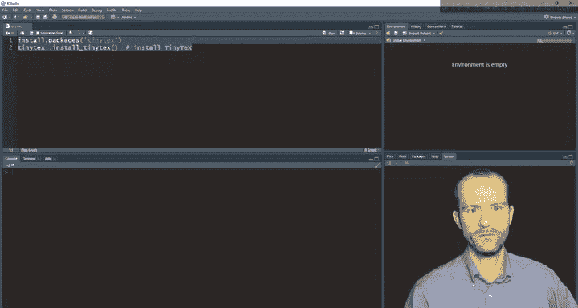
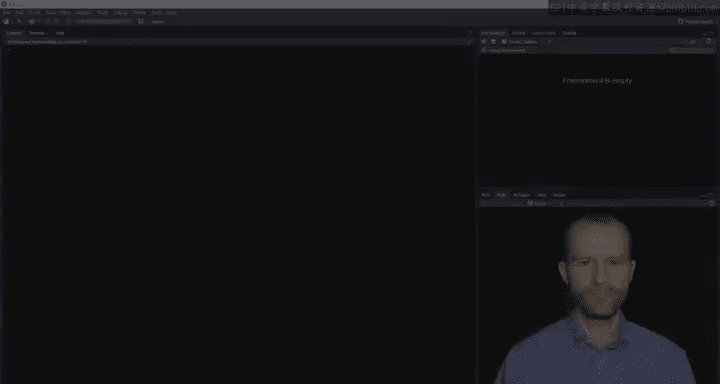
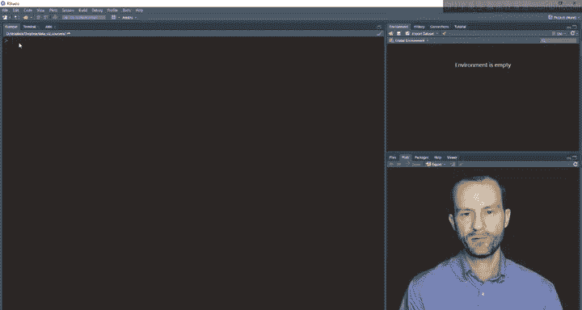
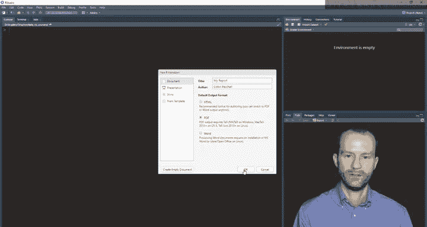
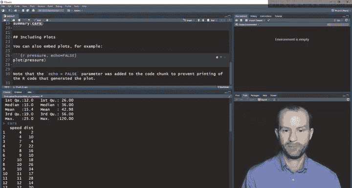
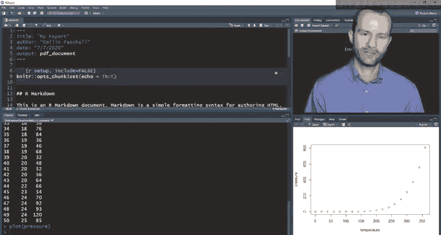
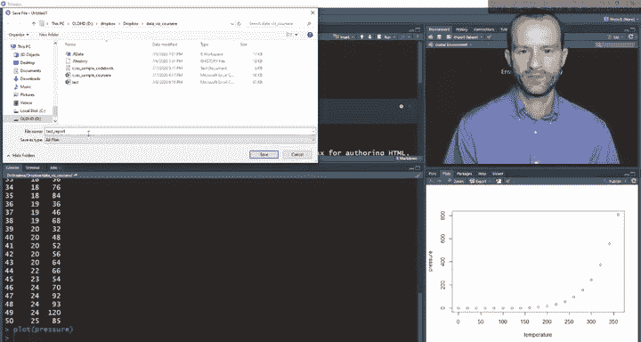
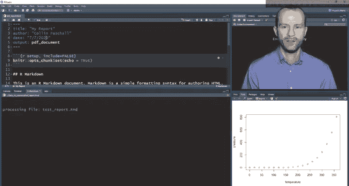
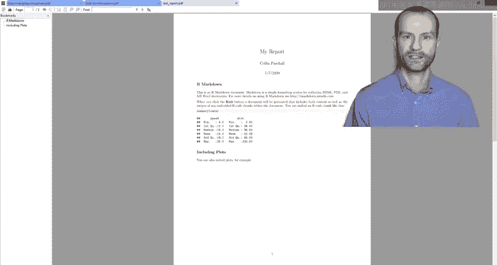

# 约翰霍普金斯大学《R语言数据可视化和仪表盘｜Data Visualization & Dashboarding with R》中英字幕 - P14：13_使用R Markdown创建报告.zh_en - GPT中英字幕课程资源 - BV1YWPjeKEWz

Before we get started with this video， we need to do one more quick software installation。

What we need to do is install lateEC on your computer。

 and this is going to enable you to compile R Markdown reports into PDF files。

If you already have lateTeek installed on your computer and you know you do， that's great。

 but if you don't know or you're not sure， just run these two lines of R code in ourSt and the correct files will download and install。

 and it will all take place in ourSt。You should be aware that this might take a few minutes。

 so be patient， there's a lot of files to download。But once this is finished。

 just come back to this video and we'll get started with making an R markdown report。

In this video， we're going to go through the process of how to create a report using our markdown。

A R markdown document is a file that contains text like what you might find in a word processing document。

 but it also incorporates our code and visualizations。

 and so it's a great way to do reproducible data science because you can hand somebody in our markdown file and they can from scratch。

 replicate whatever kind of analysis or visualizations that you're doing。

This dot RMD file is in contrast to just a R file， which is just a file of executable R commands。

This is kind of harder to explain than to just show you。

 so let's get started by making a document and this will become more concrete。To start with。

 you click the icon the leftmost icon and the menu bar in our studio。

 and you'll see a bunch of different kinds of files that you can create with R。

And we're going to start with an R Markdown file here。At this point。

 it's possible that you will see a pop up window that's going to ask you whether or not you want to install packages and if this kind of thing happens。

 you can click yes， just go through the process and download all the different files that you might need to start with an R markdown document。

But eventually you're going to get to this window that will say new R markdown and it will give you several choices for what kind of documents you want to create。

We're going to select document and PDF for right now。

 although you could also choose an HTML file or possibly a Microsoft Word file。

After you click OK here， you see that the RSt window changes and there's this editing window that's popped above the console。

 and this is not a dot R file， this is a dot RD file。

The first part of the document here includes the title information for your report and the type of output that you're creating。

 and again the common formats here would be an HTML document， a Word document or PDF document。

The next lines here set up some commands for the document， which you can just ignore for right now。

 it just some file setup information。And then here below that， you'll see the plain text。

 which when we actually compiled a report and put it together in a few minutes。

 it's going to look like we're processor output。The two pound signs here are not comments like there are in a do R file。

 instead this is directions for how to format the text that follows it。

The two pound signs indicate that the text is going to be a bold header。

 and the asterisks indicate that the text will be bold in the paragraph here。Next up。

 you see this chunk of our code and the chunk is set off by lines and start with three apostrophees。

Then there's a set of brackets in this first section here that enclosse the letter R and a title for the code chunk。

This title is not going to appear in the document itself， but it's a reference for you as you code。

And then within this line chunk here you see an R command。

 and it's a summary command for a data set that's built into R that will produce summaries of the object。

You can actually run that R code within our studio to see what kind of output it's going to generate once you compile the documents。

 and you just double click cars， select that text， and run the line as we've done before。

This is just a table with two columns， speed and distance， and a set of cars。After that code chunk。

 there is more text that will look like we're processing outputs。

 and then we have more R code that tells R to plot the pressure object。

And pressure is just this little piece of data built into R that will generate an example plot。

Note here that there's this bit of text following the comma in the title for the code chunk and what Echo equals false here means is it's telling our studio to hide the raw code in the final document。

 so you won't actually see the code that's executed， you'll only see the output for it。

So weve now that we understand the sort of architecture or the structure of this markdown file。

 let's go ahead and compile it and see what it looks like in final form。

First， you want to save the R Markdown file somewhere on your computer。

And once you've saved it somewhere， go ahead and click knit。

In our studio， click that button。

The computer is probably going to open up this new file automatically， and if it doesn't。

 you can navigate to the folder where you saved your R markdown file and you'll be able to open it up on your computer itself。

This is an R Markdown report created in our studio that includes embedded R code and commands。

It's got word processor like output， our code and our output。

That either is what would hope in the console or in the plot preview window。

As you can tell this is really cool because you can distribute these widely。

 anybody who has R and the right data files can run them and they can see exactly what you're doing。

 This is really critical for transparent reproducible data science。

