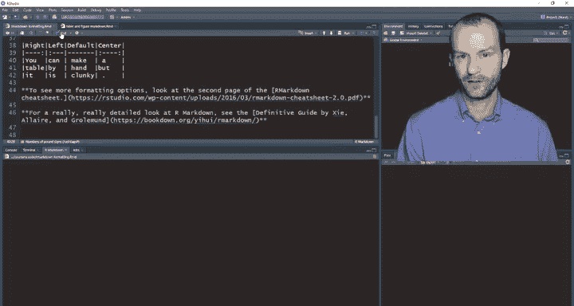
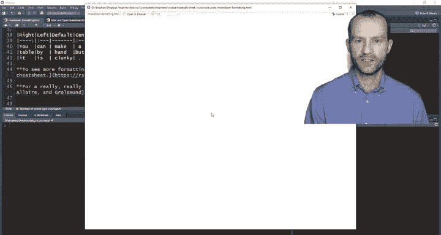
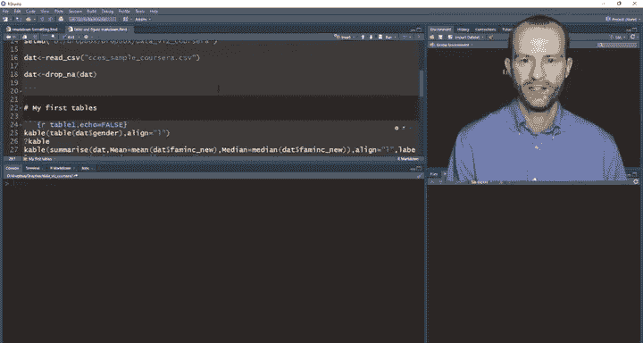
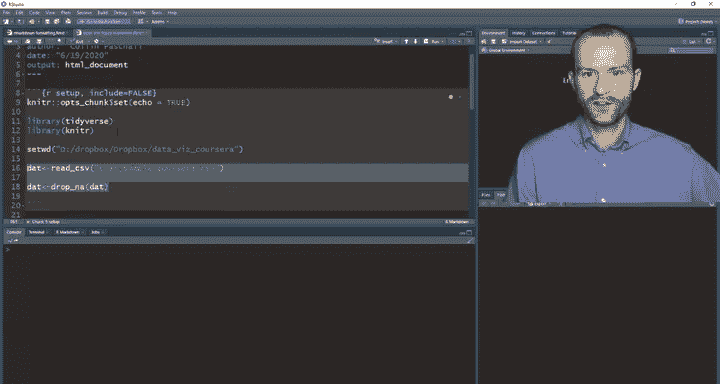
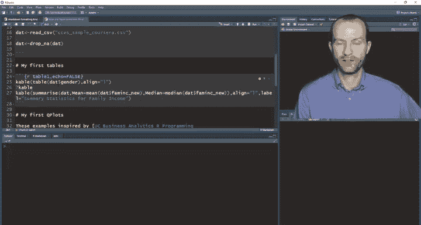

# 约翰霍普金斯大学《R语言数据可视化和仪表盘｜Data Visualization & Dashboarding with R》中英字幕 - P15：14_R Markdown语法和表格.zh_en - GPT中英字幕课程资源 - BV1YWPjeKEWz

In this video， what I'm going to do is give you more examples and more instruction on how to format an R Markdown report。

In the last video， we just showed you an example we didn't actually write anything original this time we're going to do a little more detailed walkthrough so you'll understand some of the many options you have。

When you're writing a report in our markdown， you need to write an R markdown syntax。

 and this is not as easy as like a point and click Word processor like Microsoft Word or Google Docs。

It's kind of like doing really simple HTML coding if that's something that you've done before。

And all it really means is that you have to tell our studio exactly how you want to format text explicitly using special syntax in the document itself。

I'll show you an example here of an R Markdown file that I've posted to the course site and we'll walk through this。

After the setup section of an R Markdown file， you can just write normal paragraph text with new paragraph starting after blank lines。

If you want to format the text a little bit more， you can use single asteriskes。

 a round text to make what's within it， italic， or two asteriskes to make the text bold。

You can also include what's called verbatim text， which would look like our code。

You can do superscripts， you can do dashes and block quotes。

 and all the syntax for each of those different kinds of formats is indicated here。

You can also create different levels of headers and bulleted or numbered lists。

And you can also make tables by hand if you want to， but this process can be kind of clunky。

 So you probably don't want to do it all that often。 It's easier to automate that。

 as we'll show you in a little bit。For a lot more information about how to use R markdown and more formatting tips。

 you can consult some of the materials that are included here with these lessons。

 and that includes the R Markdown cheat sheet， and if you really want the details you can consult what is called the definitive guide to R markdown that's more of a reference text that you should familiarize yourself with but probably don't need to read straight through。

For normal everyday word processing， word processing。

Markdown might not seem like that great of a tool， but as we saw it in the last video where Markdown shines is then the ability to integrate our output into the document and allow you to do reproducible data science。

So let's take a look again at the dot RMD file included in the materials that go along with this video。

And in this report I'm drawing on the sample survey data that we've been working with。

 and we're creating a table and figure by pulling data from the CSC file。When you do this。

 it's extremely important to remember to put the data file that you are going to work with in the Markdown file into the same folder where the markdown file is located。

 otherwise this isn't going to work。So make sure that those two files are in the same place on your computer。

In the setup code chunk， I am loading the tidyverse and the knitter packages。

 and I point R to the directory where both the markdown file and the CIC file are located。

We're importing the data file just like we have before， and we're dropping the missing values。Now。

 as I showed you in the other file， you can manually create a table in markdown。

 but it's clunky and better to just convert our output directly into the table。

If you have the knitter package loaded， you can use the cable function to easily convert our output into a table。

And cable doesn't work very well with all our objects。

 but it works well with tables and it will that with the table function and output that you generate with summarize from the tiverse。

If you fiddle around， you can get cable to work with other objects as well。

 but this is the place to start。You might have to do some converting of classes of different objects but if you do a little bit of selfding experimentation。

 you can get it to work and there are also some other R packages out there you can use to convert that you can convert our output into tables。

 you just need to do a little googling to find out what those are。

The cheat sheet and the online documentation can also help。

If you look at the documentation for cable， you see you also see that you can do things like change the alignment of text in the cells。

 You can add captions or titles to the table， and you can add column headers and row titles。

Keep this file open and in the next video， we're going to talk about how to add a new kind of plot to this report。

 one that looks a little prettier than the base visualizations in R。

