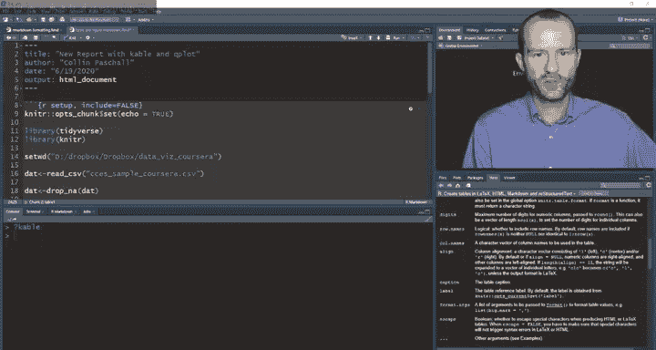
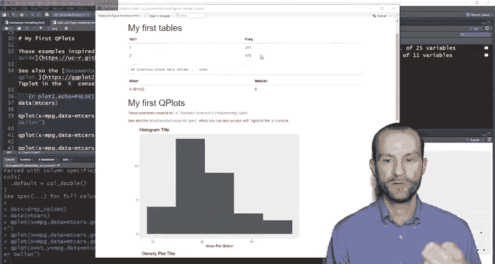

# 约翰霍普金斯大学《R语言数据可视化和仪表盘｜Data Visualization & Dashboarding with R》中英字幕 - P16：15_qplots和结束语.zh_en - GPT中英字幕课程资源 - BV1YWPjeKEWz

We are very nearly done now with our introduction to data wrangling。

 visualization and interactive report production and our。As the last step。

 I want to show you one more tool that will spiff up your interactive reports and provide a little bit of a preview of what we'll be covering going forward。

Along with many data wrangling tools， the tidyverse also includes an extremely powerful package of functions for data visualization。

 which is called Gigiplot 2。As you go forward learning more data visualizations。

 you'll want to learn G plot in its entirety because it's very powerful and it can help you make production quality visualizations。

But for really quick plotting tasks and as you're first starting to work with GGplot。

 there is a useful function called Quickplot or Qplot that incorporates some G plotot tools。

 but seems a lot like based visualization tools in R。

When you're using Q plot， you have to specify what are called x and y aesthetics。

And basically， this just is telling our what data to map to the X or y axis of your two dimensional plot that you're creating。

You can choose to use X， Y or both X and y based on whether you're doing univevariate or multivariate plots and what direction you want that information to plot on your figure。

Once you specify the x and or y aesthetics， you can specify the data you want to use for the for the Q plot。

And then finally， you tell Q plot what kind of figure you want to draw。

 And these are called geometries in G G plot language。The basic options are histogram， density。

 box plot， point and line。For a simple example here。

 we're going to use data from the M T cars data set that is built into R。 So let's load that up。

Then you see that I've created a number of different plots using the Q plot command。

 specifying the X and Y mappings， the Ge type， and adding additional requirements to help do some minor refining to the figures。

You'll find some more examples in the Tidy versus documentation for Q plotot。

 and there are other online sources of examples if you do a little searching。

A good resource that I drew from in creating this video is the University of California Business Anatics art programming guide。

Throughout all the materials we've covered here， we've come a very long way。

You may have entered this course with little or no experience using R。

 but because of all of your efforts， you are now able to import a spreadsheet of data。

 you can process and manipulate that spreadsheet using R commands。

 and you can create tables and figures with these data and integrate those into a reproducible R markdown document。

This is a great foundation if you're interested in doing open data science。

But there's a lot more to do and a lot more to learn。

 and we've only scratched the surface of what you can do with R to create data visualizations。

As you move forward， you can look forward to learning how to use Ggiplot to make many more kinds of figures。

 refining those in a number of ways， and eventually making interactive figures and dashboards。

You're well on your way。 and I hope that I see you again soon in future courses。

