# 约翰霍普金斯大学《R语言数据可视化和仪表盘｜Data Visualization & Dashboarding with R》中英字幕 - P17：0_欢迎来到课程.zh_en - GPT中英字幕课程资源 - BV1YWPjeKEWz

Welcome to our second course in the Data Viization specialization。

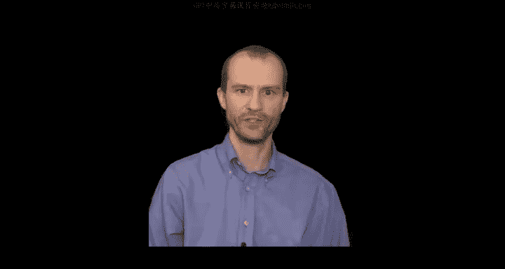

Once again， my name is Colin Pascal and I'm a faculty member in the Center for Advanced Governmental Studies at Johns Hopkins University。

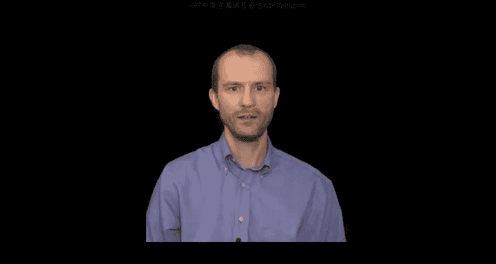

Where I teach in the data analytics and policy program and the government program。

I'm excited that you're going to join me as we continue to develop our skills with data visualization。

This course is an extension of what we covered in the last course in this specialization。

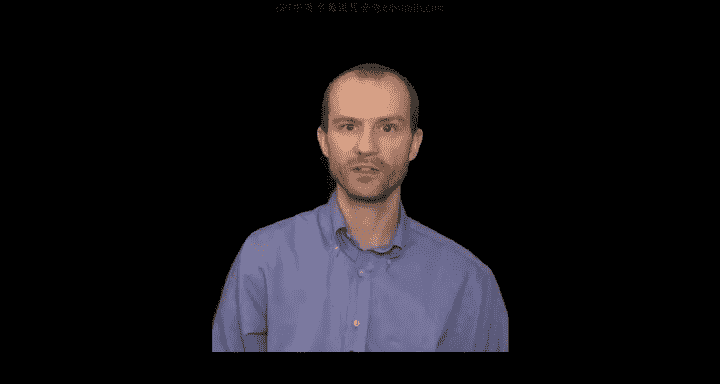

We're going to focus on learning how to use the GGP function to make a variety of different kinds of visualizations。

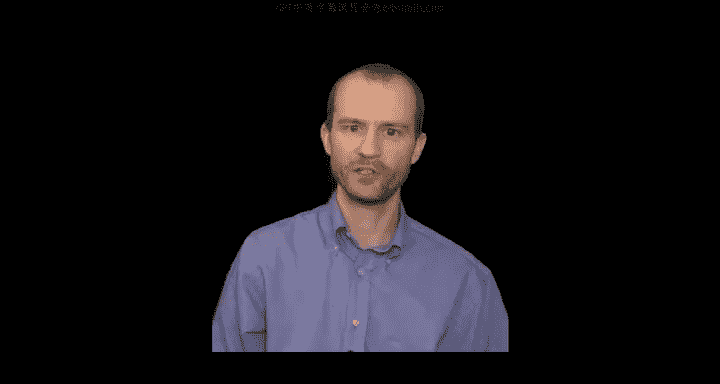

With the recipe that you will learn in this course。

 you will have a great starting point for using Gipl to make a wide variety of figures。

And you'll start to build your skills with refining those figures。

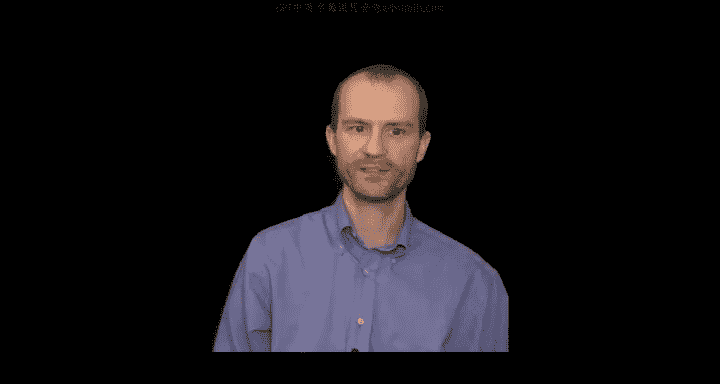

The course requires that you have a good command of what we covered in the last course in the specialization。

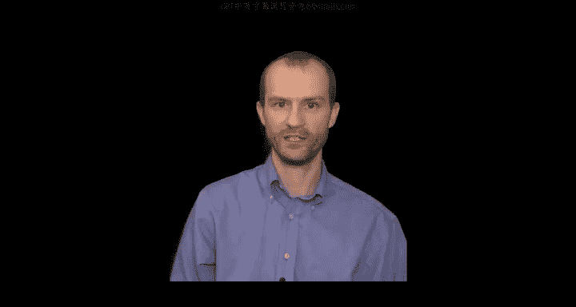

You must have R and R studio installed on your computer。

You must be familiar with the data wrangling commands from the tidy verse that we covered in the last course。

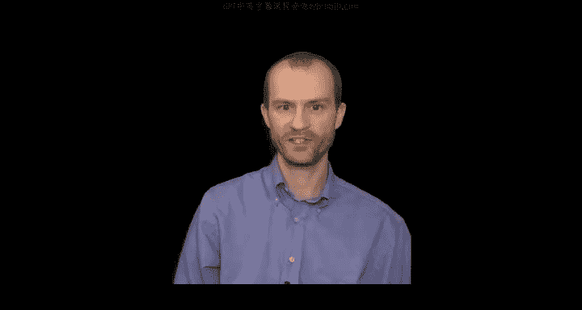

And you must be able to write and compile in our Markdown file。

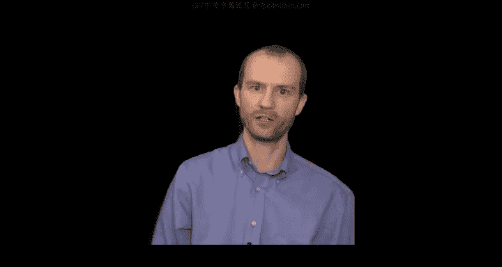

If you're a little rusty in these areas， you'll need to go back and review the materials from the last course again because I won't spend very much time explaining some of the R commands I use。

 especially if we covered them in the last class。

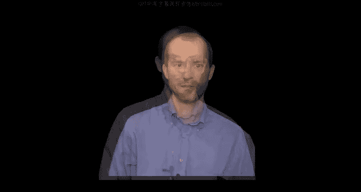

The emphasis in this course is on meta learning that is learning。

 how to learn and teach self skills using Juji plot。As you're going to find out。

 Ggiplloot is a powerful and fairly complex piece of software。

 so we can't be comprehensive in showing you every single command here。

You'll need to spend time reading the reference materials on your own if you really want to get a deep knowledge about how GGplot works。

The videos in the course are there to orient you and provide examples。

 so the learning curve won't seem as steep when you start looking at the reference materials yourself。

I strongly recommend watching the videos that begin each module。

 then familiarizing yourself with the readings， and then watching the videos again。

So you can really check your understanding。The assignments in the course build directly off the video examples。

 so there shouldn't be any major surprises once you get to those。

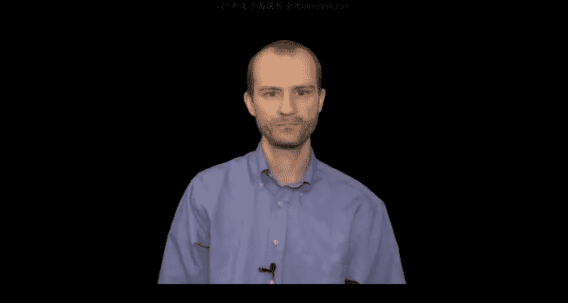

The course is divided into three sections， each of them building up new types of visualizations and skills with making graphics with UG plot and refining them。

By the end of the course you'll have a solid foundation with making figures with R and GGplot。

 and you'll be ready for even more advanced skills that we'll focus on in the third course in the specialization。

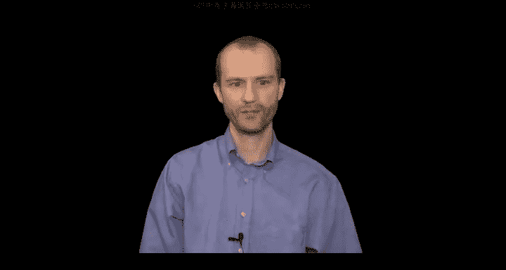

Good luck and have fun。

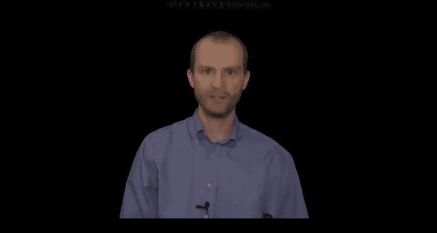