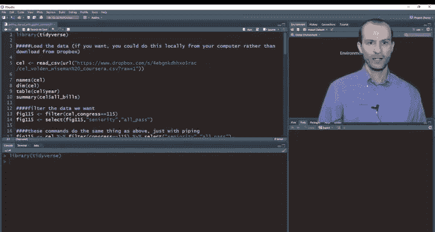

# 约翰霍普金斯大学《R语言数据可视化和仪表盘｜Data Visualization & Dashboarding with R》中英字幕 - P18：1_开始使用ggplot第1部分.zh_en - GPT中英字幕课程资源 - BV1YWPjeKEWz

Previously in this course sequence。We had an introduction to using R as a visualization tool。

We covered making reports in our Markdown。We imported data into R and made a quick example plot。

And we reviewed some of the basics of wrangling data in R。

Now we're going to continue practicing all these skills。

And we will also start to make a variety of different kinds of visualizations。

Get in a workout with many of the functions of the GG plot library。Gigiplot。

 as part of the tidyverse， is one of the most important tools for creating data visualizations with R。

 and it will be our focus going forward。Let's start by describing the basic structure of a GG plot figure。

The GG in Ggi Plo stands for Grmmar of Graphics。So what I'm going to do here is describe the grammar of how data visualization works with Ggiplloot。

The recipe for a G plot visualization has five ingredients。First， tidy data in long format。Second。

Mapping these data to the aesthetic features of a visualization like the X and the y axis。

 the size of the marks on the plot， or the color or the type of marks。GOs。

 which is what G plot calls the geometric shapes that go into a plot。Fourth， a coordinate system。

 and then finally labels and guides。Guides is what GgiP calls legendds。

This is all a little bit easier to see than to just here。

 so let's go ahead and just show you what I mean。For practice。

 we're going to use here a data set that comes from political scientists because that is what my academic discipline is。

I'm going to use data on the United States Congress。

 collected by a research team led by Alan Wiseman and Craig Woden of the University of Virginia and Vanderbilt University。

These two researchers collected a lot of information about members of Congress as part of a book project about how effective members of Congress are at making laws。

And as part of that， they counted every bill introduced that is written by members of Congress and all of them that were passed by members of Congress going back to the 1970s。

 meaning that these bills received a majority of votes in the United States House of Representatives。

These data are great because they provide a lot of opportunities to visualize congressional productivity。

I should note though that I've modified this data set very slightly for teaching purposes。

 so if you do want to do any original data analysis of the Volden and Wismman data。

 you should go to their website for the Center for effectiveffect lawmaking and download it yourself。

 and then you'll have the correct and updated data sheet data。Data table。

Before you go further here you should take a minute to read the codebook that I've attached to this video and to the materials associated with this video。

 and it will explain the meaning of all the different variables that you'll find in the data this is useful for interpreting it and you may want to revert to it later on when you're doing some of your practice visualizations。

So with all that is preamble， let me go ahead and just build some visualizations so you start to get some intuition about how JuGPloot works as a visualization tool。

To start with， let's say that we wanted to plot how many bills members of Congress pass as a function of how many terms they are in the chamber。

 so how long have they been a member of Congress？We might expect， generally speaking。

 that members that are in Congress longer tend to pass more bills in each。

 each term that they're in office， because they become more experienced lawmakers and become more powerful from the chamber。

Let's say that we want to visualize this for a single Congress and just arbitrarily。

 I'll pick a recent Congress in the data， which is the 115th Congress。

I'm going to walk you through every step of making a figure here and we'll start with the basics。

You're going to want to follow along with the R code that's included in the materials with this video。

 and that's what I'm going to be walking through here as we go through the code。

Before you do any visualizing。The first step is to get yourself ready to work。

So in the first few lines of this code， I'm loading the Tidyverse library。

 which includes the GGpl functions。And I also import the data。

In this example code， I've included a line of code that will import the data directly from a web address。

 but if you wanted to， you could download the CSV file that's associated with this video and you could open it up in your R session yourself if you save it to your local directory。

Now， once we have the data loaded， the next step is to inspect that data because you always want to make sure that your data import worked correctly。

We can check the column names， see how many observations are there。

 and check a few of the columns for our summary statistics and frequency tables。

Remember it's always really important to know your data if you're going to make visualizations。

 so check it and make sure it's there the way you expected it。

So we'll go ahead now and we'll do our first scatter plot。

I said we're going to look at the 115th Congress and we're going to look at seniority and the number of bills passed。

So let's go ahead and write the filter and select commands to do that。

 and this should be reviewed from you from the previous course in the specialization。

You could write this filter and select as two separate lines。

 or you can use a piping command to put all of it on one line。

If you don't understand what we're doing here， you might want to go ahead and refer to the tidyverse referenceference materials at tidyverse。

org， specifically for the D plier package， and that would give you a summary of what we're doing in case you need to refresh your memory。

Now it's called the E G G plot function。And first， you want to feed the function。

 the data you're going to use。And then you do your aesthetic mapping。

We're going to make a simple scatter plot to begin with， and so with the aesthetic mapping。

 we'll set x to seniority and y as all pass。Now， if we run that line of code。

 we see that we get a blank plot with X and Y axes。

And our next step is going to be to add marks to the plot using a GM command。

We're going to pick up at this point in the next video。

 so keep your R file open and join me in the next video。

