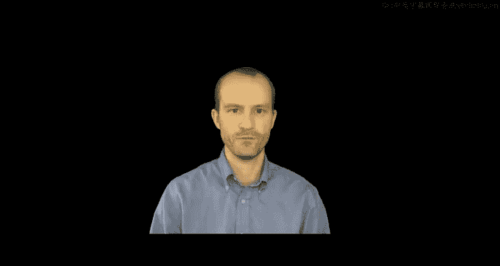
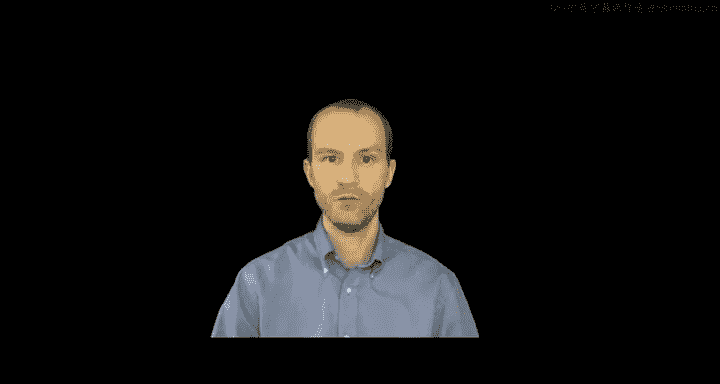

# 约翰霍普金斯大学《R语言数据可视化和仪表盘｜Data Visualization & Dashboarding with R》中英字幕 - P1：0_课程介绍.zh_en - GPT中英字幕课程资源 - BV1YWPjeKEWz

Welcome to our introductory course on Data visualualization with R。

My name is Colin Pascal and I'm a faculty member in the Center for Advanced Governmental Studies at Johns Hopkins University。

I teach in the data analytics and Policy program and the government program at Johns Hopkins。

I'm excited that you're going to join me as we develop your skills with data visualization。

Anybody who picks up a newspaper or reads any news content online today is going to encounter data visualization。

It's also extremely important in many business applications。

Whether you're working with customer or vendor data， evaluating any internal operations。

Or doing any kind of work with quantitative data that's important for your organization。

With the increased ease and power of data visualization， technology and tools。

 it's just as important today to be able to create effective data visualizations as it is to be able to write or speak clearly。

And in some cases， it may be even more important。In this first course。

 which is part of the data visualization specialization。

Our primary goal is to introduce you to the R programming language with a special emphasis on getting you to read and manipulate data using a set of tools known as the tidyverse。

In the process， we will cover how to generate reproducible data reports using our markdown and our studio。

So the course is divided into three modules， one is the introduction to R。

 one is the introduction to the tidy verse， and the last one is an introduction to R Markdown and an opportunity to practice your skills from the course。

This course and the rest of the specialization in data visualization is designed for anyone who has intermediate level computer skills。

You need to be comfortable moving and saving files on your computer。

And you have to have a willingness to engage with some technical content。

The videos for this course are there to structure learning。

 provide you examples and point out helpful reference material。

 but it's going to be up to you to do some independent reading and practice if you want to really master all the skills that we're going to introduce。

If you are up for the challenge， though， this course will equip you with an extremely valuable set of skills that will help you communicate in many professional settings。

Your work will have more impact if you can communicate effectively using data visualizations and the skills you develop in this course and the longer specialization will give you a great start。

I look forward to working with you。