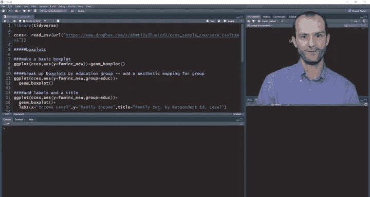
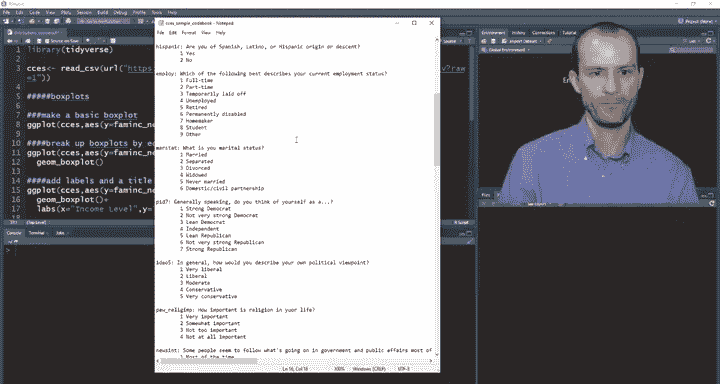

# 约翰霍普金斯大学《R语言数据可视化和仪表盘｜Data Visualization & Dashboarding with R》中英字幕 - P20：3_分布.zh_en - GPT中英字幕课程资源 - BV1YWPjeKEWz

Last time we did our first visualizations in GG plotot， and we created a scatter plot。

Scatter plots can be useful for seeing the relationship between two different variables。

But sometimes you want to see visualizations that display summaries of the data or underlying data distributions for single variables in the data。

One of the classic kinds of visualizations for doing this and giving a quick summary of a column of numerical data。

Is the box plot？A box plot is a visual summary of the data and the standard box plot in Ggi plot includes the medium。

 the first and third quartile in the box， and then the whiskers。

 which extended the highest and lowest values to at most 1。

5 times the interquartile range of the box。Points outside the 1。5 times IQR are plotted as outliers。

Making a box plot is very easy and it follows again the same basic methodology that we did when we made a scatter plot。

For demonstration purposes here， I'm going to use instead of the congressional data。

 I'm going to use survey data from the Cooperative Congressional election survey。

 which is a major academic survey that's focused on politics in the United States and it goes out to members of the general public who respond to it via phone。

Again， I've made some slight tweaks to the data here for teaching purposes。

 so if you're going to do original analysis of the data outside the course。

 you need to go to the official website for the CCES and you need to download the fresh data for yourself。

For teaching purposes， a codebook for the survey and the dot CSv file we're using are included in the materials that go along with this video。

If you look through the codebook， you'll see that one of the questions in this survey corresponding with the columnFam Inc_ new in the data set reports the approximate household income for a survey respondents broken into 16 categories from low to High。

Coated numbers 1 through 16。So let's just make a box plot of this data for example purposes。Again。

 the R code for this is attached to the materials that go along with this video and you should follow along with it。

Along with loading the tidyverse， video the code will import the data called CCES from the web。

 but of course again， if you wanted to， you could download the file locally and import it yourself。

To make the plot as before we get the data set up using G G plot。

The first argument for the function is the data set， which I've called CCES。

And then for the aesthetic mapping， we set y to the variable of interest。

Because we're only doing unitivariate distributions here。

The variable we're picking is y equals fing nu。And then once we have our GG plot command written here。

 we then add to that string of commands with the function G on box plot。

With these two functions entered， R knows just what to do， so we'll go ahead and run that。

As we expect， we get a box plot。Now， if we wanted to modify this box plot。

 we could do it as we've done before with other Ggi plot figures。For instance。

 let's say we wanted to compare the household incomes of individuals at different educational levels。

We have that question in our survey too， where respondents indicate the highest level of education they've achieved。

So we can break the box plot out by education levels by adding it into our aesthetic mappings and assigning it to the group。

You could also further modify the figure with labels and titles。So when we run that。

 we see that we now have the distribution for income levels by education level on the X axis here。

That's because we've broken it up by a group。Another tweak you might want to make is to convert the numeric coding for the educational level variable to a categorical qualitative variable。

And we can do that using the recode function once again。Here。

 what I've done is split the numeric variable into a dichotomous categorical variable where one category is individuals who don't have a four year college degree and the。

Other categories， individuals who have completed at least a four year college degree。

Now when you do this and this is a little tricky， you have to change the aesthetic mapping so that the categorical variable you've created is mapped to X rather than group。

And this will help ensure that the X axis appears correctly。

Sometimes the aesthetic mappings can be a little finicky。

 so you might have to experiment a little bit to figure out exactly which mapping will achieve the look that you desire。

Two other common visualizations that we can use to display the distributions of Uniivevaria data are the histogram and the density plot。

Hisisttogram is basically a special name for a frequency bar plot。

 which shows the count of the discrete values in a numeric vector。

And aity plot is in very informal terms， just a smooth out and rescaled histogram。

To make these two kinds of visualizations， we do almost the same thing we did to create the G box plot。

We call GG plot， identify the data， and map the variable that we want to the axis。

Here we're using the income level of the respondents for the survey again。

And once you have the GG plot function written， you can add the appropriate GO。

 either GO histogram or GO density。And of course， if you wanted to。

 you could make the same kinds of modifications to the color and the X axis， the axis labels。

 as you wanted to with the other figures you've done so far。Again， it's all the same process right。

 you start with a GG plot function， you add the GMO that you want。

 and then you later on you can mess around with the additional visual elements and tweak it to your liking。

