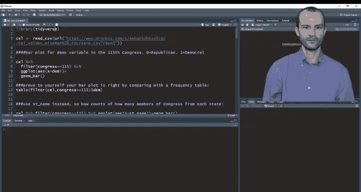

# 约翰霍普金斯大学《R语言数据可视化和仪表盘｜Data Visualization & Dashboarding with R》中英字幕 - P21：4_条形图第1部分.zh_en - GPT中英字幕课程资源 - BV1YWPjeKEWz

As we continue building our visualization toolt。Let's consider how to make another kind of classic visualization。

A bar plot。We're going to use the same approach that we have in previous videos。

 though I will show you a few small variations along the way。

 and you'll be able to pick up some new tricks。Again。

 you're going to want to follow along with the R code that's attached to this video。

TheR code has commands for importing the data you need。

 and again we're going to use data from the Center for effectiveffective lawmaking and a Cooperative Congressional E survey。

You'll also find in the materials associated with this video。

 the teaching data files and the codebooks themselves。

The code begins with loading the tidiverse package and includes the GGpl commands。

 that includes the GGpl functions， and it also imports the data for you。

So let's go ahead and make a bar chart or bar plot， these are interchangeable terms。

And let's say that we want a bar chart that shows counts of how many Republicans and Democrats there were in the 115th Congress。

So there are 435 members of Congress， and this bar plot would show you the number of Democrats and the number of Republicans as two separate bars。

Let's start doing some data wrangling and we'll practice using some data piping here。And again。

 this should be reviewed， but remember that if you are using piping。

 what you're doing is passing data from the left hand of the pipe， which is this percentage sign。

 the greater than sign， percentage sign， you're passing data from the left hand side of the pipe to the first argument in the function on the right hand side of the pipe。

And so here we're taking the CEL data and passing that into the filter command。

Filtering the data to include only the rows with values of 115 in the Congress column。

 so the 115 to Congress。And then we're passing those data to the GG plot function。

In the G G plot function itself， we do our aesthetic mapping。And in this particular case。

 because we're only working with a single variable in the data， which is dim。

Where one means that the member is democratic and zero means that the member is a Republican。

So we aren't actually going to set a y value in this aesthetic mapping because we're only using a single column or variable from the data。

This might be a little hard to understand in the abstract。

 so let's just go ahead and run it and look at what the output is。

And what we get is this bar chart with two bars， as I was describing。

 the bar on the left said that the value of zero is the count for how many members in the 115th Congress were Republicans。

In other words， members with a value of zero in the dim column。And in the bar on the right。

 set at the value of one， that's the count of the number of members of the 115th Congress who were Republicans。

In other words， those numbers that have a value of one in the dim column。

You can prove that this figure is displaying the data correctly by calling up a frequency table in R that shows the numbers of zeros and ones。

Now for comparison's sake。Let's say that we instead mapped the state name to our aesthetic rather than the dim variable。

What we get now is a figure that provides the count of how many members of Congress there are from each state in the USS。

The G bar function behind the scenes is doing this calculation。

 adding up the frequency for each distinct entry， so each one of the different states in the US。

And if you're curious what would have happened if you mapped this to y instead of X。

 it does what you might expect， it just flips the figure， so rather than displayed along the X axis。

 those frequency counts are displayed on the Y axis。

Now let's switch back to the party breakdown figure。

 and one thing that's unsatisying about the Xx here is that it's not intuitively labeled。

We know from the data that one equals Democrat and zero equals Republicans。

 but it looks strange in visualization to see it this way。

So let's recode the dim column and make it something like Democrat and Republican and add that back into the data set。

Now we change the aesthetic mapping into this new variable and we plot it again and it looks a little bit better。

But we can improve it by renaming the access labels using the Las function。Now。

 another thing we've done previously is that we've added color to the plot so we can do that again by setting the color aesthetic again to the party variable。

Still reviewing though， these colors don't make a lot of sense。

 given that the Democrats in the US are usually associated with blue and Republicans with red。

 so we will manually force that color scheme onto the plot by scaling the fill colors manually with the scale。

 feel， scale， fill manual function。Now finally， the legend doesn't really seem necessary here because it's traditionally understood that red is Republican and blue is Democrat in the US。

 so we can drop the legend entirely by adding the guides function to the figure which controls certain aspects of what legends look like and R。

And we'll just turn off the guides for the fill colors。We've done a lot here。

 so we're just going to pause for a minute， we're going to pick up with the same R code file in the next video and we'll do some more bar plots。

Leave your R file open。Maybe go back and review what we've done here， and when you're ready。

 go on to the next video。