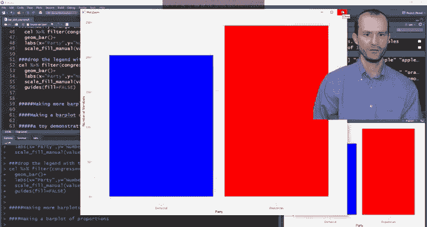
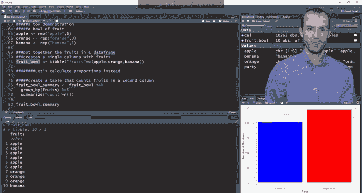

# 约翰霍普金斯大学《R语言数据可视化和仪表盘｜Data Visualization & Dashboarding with R》中英字幕 - P22：5_条形图第2部分.zh_en - GPT中英字幕课程资源 - BV1YWPjeKEWz

In this video， I'm going to show you a few more examples of how to play around with and modify bar plots。

I'm also going to give you a short workout manipulating data in R。Again。

 we're picking up in the R code file here exactly where we left off in the previous video。

So let's start by showing you a way to make a bar plot of proportions。

We've seen in the past that we've made a bar chart of the number of Democrats and Republicans in the 115th Congress。

And there we wanted R to manually count the frequency of those different values in that column。

Other times though you don't want R to do this manual calculation。

 you don't want R to do this calculation， anyone you want to tell R exactly what values to plot on the bar plot。

An instance of this might be if you want to plot a proportion of different responses or different values in a column。

Again， this is kind of hard to understand the abstract。

 so it's easier just to go ahead and show you and then you'll get a sense for what we're talking about here。

Instead of continuing to use these survey data here。

 we're going to do something a little bit different and to keep things interesting。

 I'm going to quickly make up a toy data set that you can use to create the visualization。

Making up these little toy or fake data sets is a good way to check your understanding of how a function works。

 and it's a good skill to be able to whip these up quickly。

When you're looking at reference materials online for GGPot。

 you'll often see folks that are doing this so they'll make up a little toy data set and then demonstrate the visualization using that brand new original data they've created。

So it's good to orient yourself to the process of doing this。

Let's say that I want to make a collection of fruits in a fictitious fruit bowl。First。

 I'm going to create a set of apples and I'll do this using the replicate function。

And what I'm doing here is I'm creating a character string for Apple and by putting it in quotation marks here。

And then I tell the function to replicate that character string six times。

And if I look at the object I've created， which I'm naming Apple， it has six apples in it。

We'll do the same thing now for three oranges and one banana， so we have 1 fruits in total。

Now I put all these fruits together into my fruit bowl by creating a tibble that combines all these with the C function。

Now we have this very small data set and we can use this to create the bar plot of proportions。

The first thing we need to do is to calculate proportions for each kind of fruit and fruit bowl。

And what we want is a table that has the fruits in one column。

The counts of each fruit in the next column， and then in the third column。

 we want to have their proportions。We can do all this with some fairly simple data wrangling。

We take the data， we group it by the different kinds of fruits。

And then we create a column of summary data called count。

 which is equal to the number of observations in each group。

If you need to take a minute and kind of untangle what this command does。

 you should go ahead and pause a video and backtrack and make sure you understand the steps of this。

After we create the counts， we can calculate the proportions for each fruit in the fruit bowl。

Now this is not very exciting because in this particular instance， there are tin fruits。

 so cc proportion is very easy， but you could see how you could extend this out to different numbers in the same process at work。

And so now we have a little table with the number of each different kind of fruit in the fruit bowl。

 so let's make that barpl。I'm going to do things a little bit differently here though。

 and rather than map a single aesthetic， I'm going to map both the X and the Y aesthetic with x as fruit and y as the calculated proportion。

Additionally， rather than just using the GM bar function with no input inside those parentheses。

 this time I'm going to include a stat equals identity option。

This is telling the function not to do its default action， which is to use that count function。

 but instead plot the different values for every single row of the data set directly based on the identity of that value in the table。

And that's why I map both the x and the y for every row。

 map the x value and the y value as the top of the bar in that bar plot。For review here。

 we can add a few additional commands for color， labeling and dropping the legend。

And the end result is a bar plot that has three bars that corresponds with the proportion of each kind of fruit in the fruit bowl。

Again， keep your R code open and in the next few lines of code。

 we're going to do a little bit more practice yet。