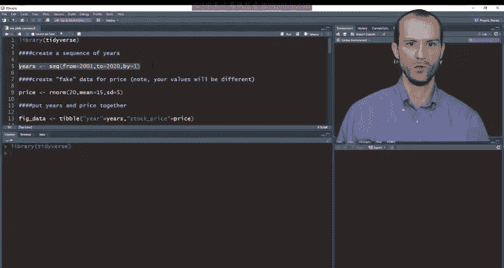
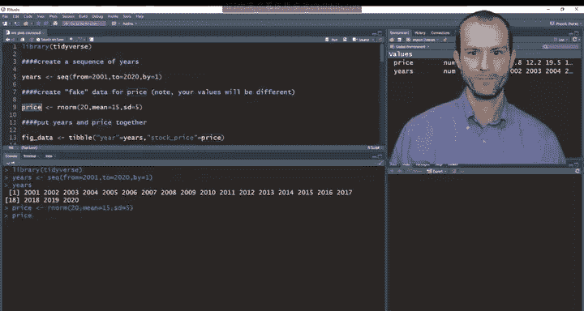
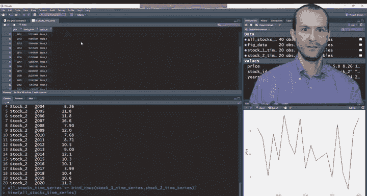

# 约翰霍普金斯大学《R语言数据可视化和仪表盘｜Data Visualization & Dashboarding with R》中英字幕 - P24：7_折线图第1部分.zh_en - GPT中英字幕课程资源 - BV1YWPjeKEWz

Now we're going to do another type of classic visualization， a line plot。

Line plots are generally used to show time trends， indicating fluctuation and a value across time。

To get a line chart you need data that has a column of time or date information。

And then additional columns that show the values to be plotted at each time point on one or more lines。

Let's make another toy data set to demonstrate what this looks like。First。

 create a vector of years from 2001 to 2020。And I'll do this using the sequence command。

Creating a sequence from 1 to 20 by intervals of 1。

Oh， I should mention here that this code is included in the R code file that's associated with this video。

 so make sure you have that opened up and are following along。

Then I need some kind of value to correspond to each of these years。

 and I'll just create a vector called price。And you could imagine this as the stock price of a company。

Across time。To create these prices， I will pull some values from a normal distribution that has a mean of 15 and a standard deviation of 5。

And if that doesn't make sense to you， you can just think of this function as creating a series of random numbers。

So we'll put all these together into a Tbble and we'll create the line chart using Ggipl。

We call the GG plot function。Point to the data that we want。

 and then we do the aesthetic mapping where we map years to the X axis and price to the Y axis。

As we expect， when we go ahead and add the GM line function to this string of GG plot commands。

 we can execute that and we will get a line plot。Which tracks the price value across the year value。

Now let's say that she wanted to add another line to this figure。

 so you have the price of two different stocks on the same figure showing both of them how they both vary across time。

We're going to add to our little toy data， another column that identifies the stock because we're going to have two stocks now。

And we'll call that column stock ID。We replicate the stock ID 20 times and we add it to the data frame。

And then we can rename the data frame， stock one time series。

So this is the stock price of one company over 20 years， we've got the price。

 the identity of the stock whose price we're referring to， and then the time。

 which in this case is yearss。Now we're going to do exactly the same thing and we're going to create information for a second stock。

The only difference here is that we're going to use the stock2 for the ID column and when we're setting the prices。

 we'll use a different mean and standard deviation so the two lines will look different。

 for example purposes。Now we have the two small data frames with the same number of columns and column titles。

 and then we'll combine them together and call the resultingult table， All stocks time series。

Now take a look at its object and understand what it looks like in practice。

Now when you're comparing here， realize that the values on your computer are going to look a little bit different than the ones that you're seeing on my screen here because when you run this yourself。

 you're going to be pulling different random des from the distributions。

 so don't worry about the exact values， worry about making sure that the data is formatted in the same way on your computer and in the example。

We're ready to go ahead and plot again here， so call JuG plot， set the data。

Set the aesthetic values the same way we did before for the x and y。

And now in order to break up those to two lines between the two different stock IDs。

 we're going to set the group aesthetic to stock ID here。

 so that's the change in our previous figure。When we add the group here。

 it's going to break the data into two groups until tell GG plotot to plot the line separately for stock1 and stock2。

So we go ahead and run this and it works to some degree。

 but of course it would be better here if the lines were different colors or had different styles。

 so like one was dashed and one was solid for instance。

We can do this by doing that aesthetic mapping， so for the line type we change that and we also go ahead and set the color aesthetic。

And finally， if you don't want the two lines to be on the same figure， again。

 we could do a facet wrap which will show two separate figures and split them apart for us。

 one figure for each line。In the next video， we're going to do a little practice with aligned plots and some of our example data。

 so once again， keep your our code file open。Review if you need to。

 and then move on to the next video。