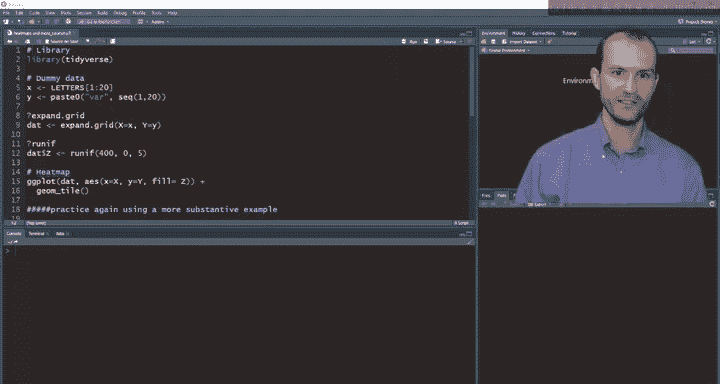
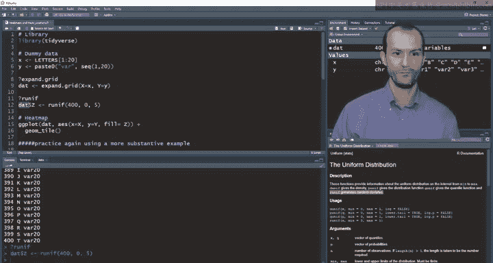

# 约翰霍普金斯大学《R语言数据可视化和仪表盘｜Data Visualization & Dashboarding with R》中英字幕 - P26：9_学习新图形第1部分.zh_en - GPT中英字幕课程资源 - BV1YWPjeKEWz

Between the lectures and the readings， we've now worked our way through many of the core features of GT plot and making visualizations with this tool and R。

At this point， you should be right to do some experimenting on your own， generating your own figures。

You're also ready to go out and find templates for other kinds of visualizations and learn to adapt them to your own data。

This is in fact a very important skill because。There are many。

 many open source resources for how to make data visualizations of the GGplot and you want to know how to access those and use them as you're trying to develop your skills。

One of these really great open source resources is the RGra galleryery。

 which is a freely available website that provides templates for many of the figures that you can create inOR。

 some using Ggipllo and some using other packages。

In this video， I'm going to walk you through making an additional type of figure based on the guidance in this gallery。

And the point is to model for you how to learn a new type of visualization。

In this particular instance， we're going to learn how to make a heat map。

Let's say that either because somebody told us we should do it or we saw an interesting example that we wanted to emulate。

 we were asked to develop a heat map with some data。

And a heat map is a handy way of summarizing a number of different variables across different units of observations。

 where the color of the different tiles in the heat map indicates the relative magnitude of different variables。

The color might go from light to dark or dark to light as the value gets higher。To start。

 we will go to the R Gra galleryery website。And once they're there。

 you can scroll down to the heat map style of visualization。Once you have the heatat map page open。

 you can see that the gallery provides several different functions for making heat maps。

Now as you'll see here， there are multiple ways to achieve the same kind of visualization using R。

And our G galleryery will provide you with these different choices。

Once you get familiar with R and after you've mastered Ggiplot。

 you'll find that you can actually pick up new packages in a fairly easy way because it's all sort of the same R programming process。

But we are most familiar with GP， and we'll go ahead and follow those instructions。

And we'll make the most basic kind of heat map available。

 the most basic heat map template on this website。You should take a moment on your own here to read through the instructions。

 and then you can come back to the video。But as they indicate。

 you can create a heat map in Ggi plot using the GeO tile function。

This is just another one of the Gs， right， like G box plot， G line， G point， G jitter。

 just a different style of G。To use Geome tile， you need a set of observations and then at least three variables per observation。

And these observations might be people， locations， companies， plants， whatever。

 it just needs to be some kind of thing that has at least three attributes。

The RG gallery shows you a very simple example of a heat map and the R code is right there。

 so what you can do is just copy that and paste it into R and then you can explore it on your own。

But for teaching purposes here， we'll go through it together。

All that I've done in the R code that's attached to this video is take this R code from RG gallery and copy and paste it in。

Go ahead and follow along with us。For this dummy example here。

 the first line assigns the letters 1 through 20 of the alphabet to the vector X。

And these are stands ins for the things that might have characteristics。

 they're just different cases or observations in a data set。

The next line takes the character string var and pastes that onto the sequence of the numbers 1 through 20。

And this is the set of characteristics that you're going to be plotting。

 so you have 20 cases with 20 different attributes。

 20 different variables associated with each one of them。The next function。

 expand dot grid is something that we have not encountered before。

So you might want to call up the help file in R to understand what that function does。

Remember that when you're going out and looking at reference materials。

 especially in the open source world， you may find functions that you're not familiar with。

 so you want to take a minute and make sure you understand what those are doing。In short。

 what expanded grid does is it creates a data frame of every combination of the supplied vectors of data that you put into the function。

So what that means is that takes every combination of the two vectors X and y and stacks those all together and composes them into a table。

If you look at the object that the code generates， you'll see how this works。

And this is a handy function for when you're making up simulated data like this。

 because now we have a long data table with a row for every variable observation pair。

And remember that this is the way we want data when we're making things in GGPot。

Long rather than wide format。The next line has this RUIF command， which again we haven't seen。

 so we might want to check the Help file to see how that works。

And you'll see that our UniIF is one of these functions that that allows you to pull sort of random numbers out of the air。

 and here it's going to provide numbers from a uniform distribution。

What you're doing here is you're saying you're pulling random numbers from the range of zero to 5。

 so this RUF command is creating a 400 cell long list of numbers。

And then we can add this to this Tore data to a new column， which we'll call Z。

This Ggipotot command should look pretty familiar to you now。The first argument is the data。

 the X and y axes are mapped to the X and Y columns in this toy data set we've created。

And the fill for each of these tiles is going to be mapped to the Z value。So when we run this。

 we see that what we have is this heat map。And on the bottom are the units of the observation。

 those letters。And on the y axis， you have the row for every characteristic。

 so those 20 different variables。The color of the tiles ranges up to five。

 which is what we indicated with the phistthetic。So in the next video。

 we're going to do another heat map to check your understanding。

 so keep your R file open and I'll see you in a minute。

