# 约翰霍普金斯大学《R语言数据可视化和仪表盘｜Data Visualization & Dashboarding with R》中英字幕 - P28：11_注释第1部分.zh_en - GPT中英字幕课程资源 - BV1YWPjeKEWz

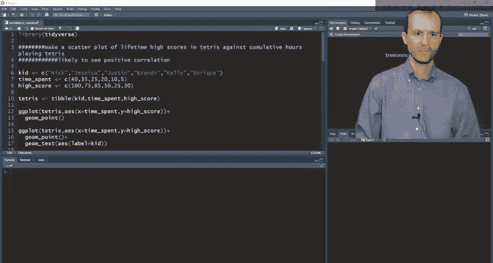

As we continue to develop our skills using Gci Plaot to make visualizations。

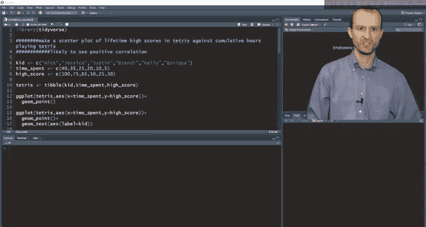

By now you should have a good grasp of the basic recipe of a GG plot figure。

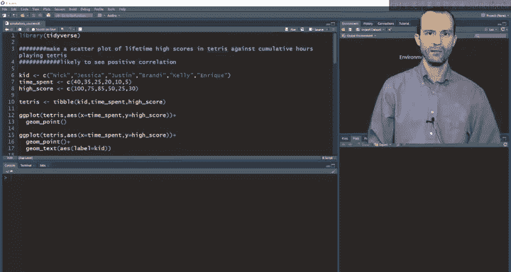

Tidy data， aesthetic mapping， and GMM functions。

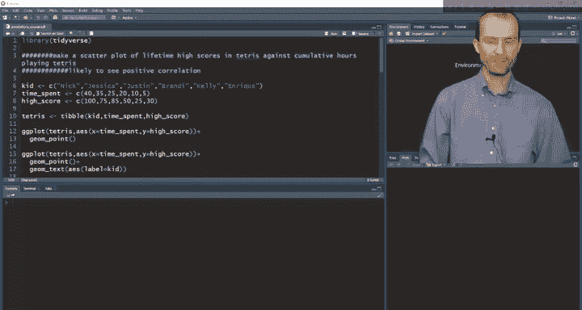

We've also done some basic tweaking of our figures using color， changing access labels， and so on。

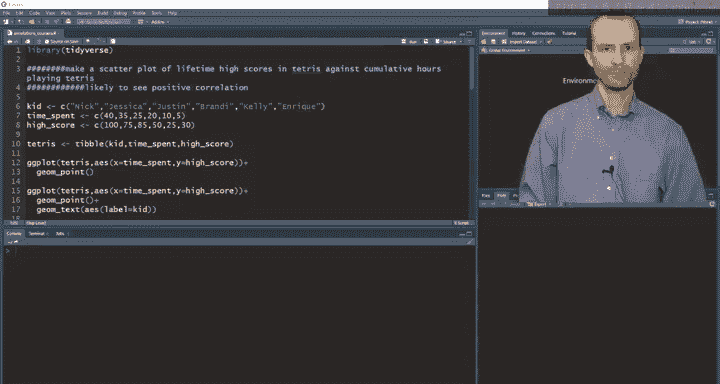

However， GgiPloot has a variety of other tools available for doing more advanced graphical refining。

 and we'll start working with those now。

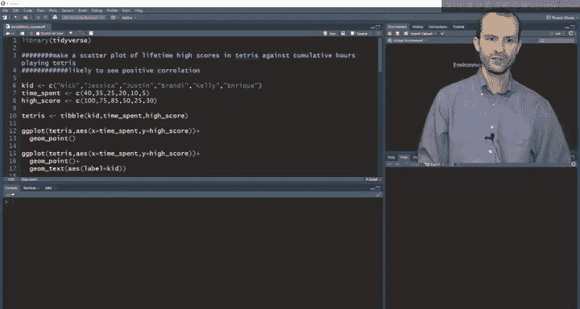

One skill that can be quite useful in GG plotot is plotting text directly into the figure。

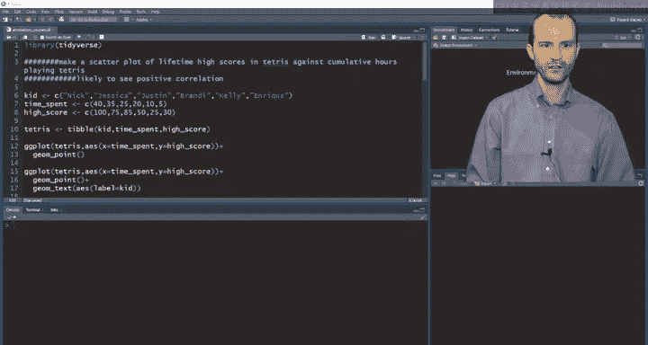

Let me show you an example of how this is done using the GMOM text function。

Gome text is quite analogous to the GM point function that we used to create a scatter plot。

Essentially， what you are doing is replacing the points that you would have in a scatter plot with text for each individual point。

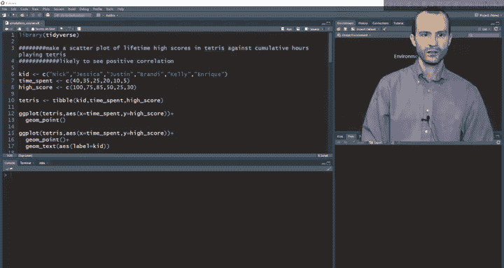

Let's get a little work making up some data again in R to demonstrate how this works。

So follow along with me in the R code that accompanies this video。

Let's say that we wanted to make a scatter plot of something like the number of hours playing the video game。

 Tetriris and lifetime high scores。

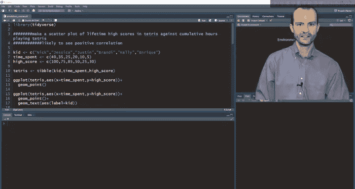

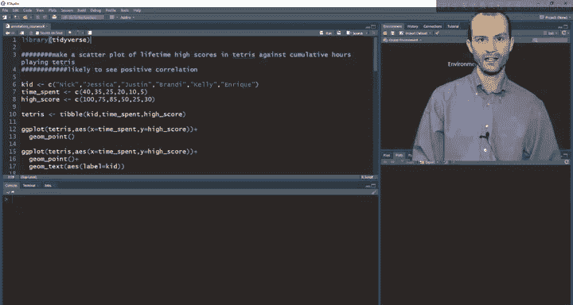

Presumably what you would see is a positive correlation between these two things as more time spent playing the game would allow you to have a higher best personal score。

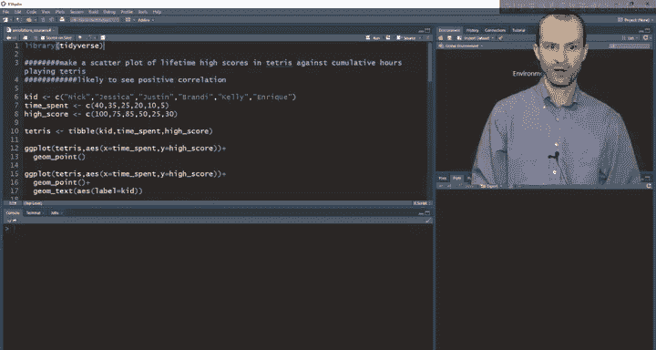

So let's make up some data that tracks a number of Teetris games played by a group of five kids and their high scores。

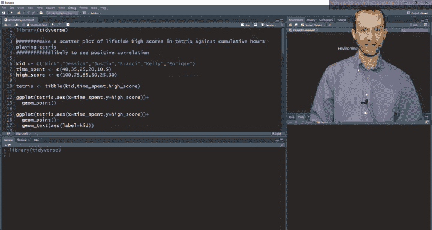

Our kids are Nick， Jessica， Justin， Brandy， Kelly， and Enrique。

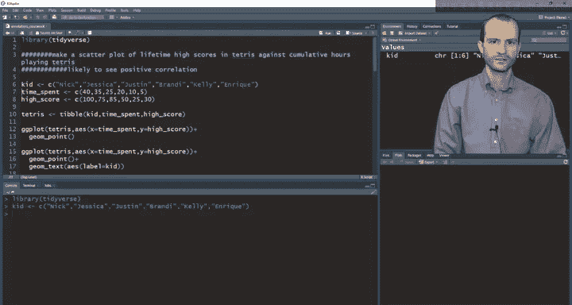

Let's say that these kids had cumulatively played for 40， 35， 25， 20， 10。

 and five hours respectively。

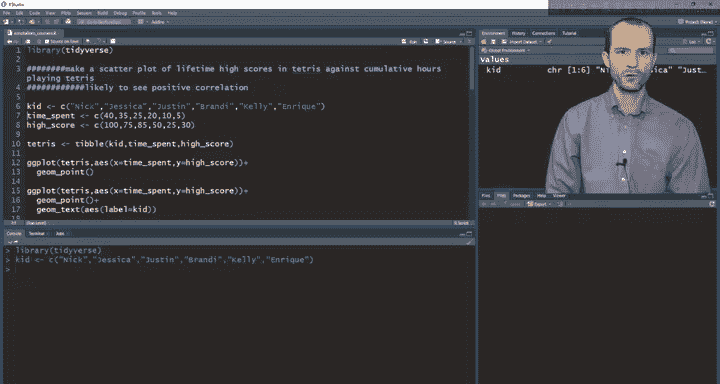

Their personal best all time high scores are 175， 85， 50， 25， and 30。

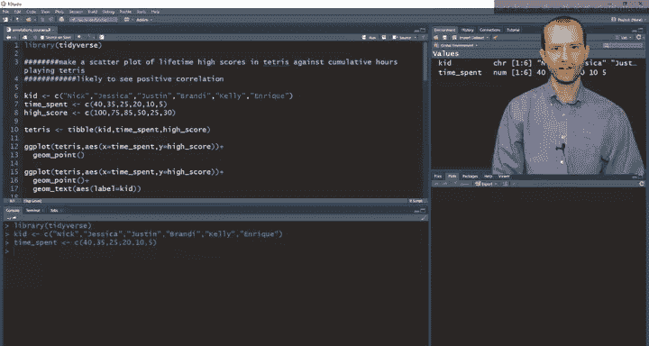

And so let's put those together into a tablebble。

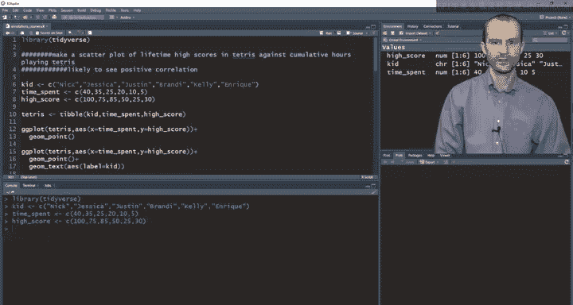

Now for review， we'll make a simple scatter plot as you've done before。

 so we call the GG plot function， specify the data， map the X and Y aesthetics。

 and add the GMM point command。Now let's say that we wanted to label these points。

All we have to do is add the GM text function。And here have this so now we have this additional aesthetic mapping which identifies the label for these points as the kid column in the Tbble。

And the label aesthetic will add the text to the plot。So now we have this choice to make。

 as you can see， the name and the points overlap significantly here and it doesn't look very attractive。

So to respond， we could remove the points entirely， so take out the GM point command。

 and this would leave only the text behind。Or alternatively。

 we might want to just move the labels so we have both the points and the labels。

 but avoid the overlapping problem。Now the way you want to do this is we want to use a nudge X or nudge Y option within the GMO text function。

And the way you would have found this out is if you were doing this on your own is you would have used the help function in order to look at the documentation for GM text。

 and you would have seen the option for nudge X and nudge Y。

 which will move the text just a little bit。Remember to look at the help file if you are confused about something you're trying to figure something out。

So looking at the plot we might be able to nudge the text up a little bit and we don't have the problem with overlapping。

 so we add the nudge Y option to the command here and as you can see this moves the text up five units in the figure。

In the next video， we're going to continue doing some more complex annotations。

 so keep your R code file open and we'll pick up where we left off here。

