# 约翰霍普金斯大学《R语言数据可视化和仪表盘｜Data Visualization & Dashboarding with R》中英字幕 - P2：1_R和软件安装介绍.zh_en - GPT中英字幕课程资源 - BV1YWPjeKEWz

R is an extremely powerful statistical programming language。Along with Python。

 it's one of the common tools used by data scientists。

Unlike point and click software like Tableau or even spreadsheing software。

 using R to create data visualizations requires you to write R code。

 both to create the visualization and to organize the underlying data。

This data management or wrangling is extremely important because if you don't have your data organized in a way that R can understand and process。

 it cannot make the visualization you want。If you're able to get your data into a format that R can understand。

 making the visualization itself is usually not that difficult。

 and R can do it almost instantly in most cases。The difficult part is getting the data to a place that R can understand and work with。

To begin with all of this， first make sure that you have a copy of R and R Studio installed on your Mac or PC。

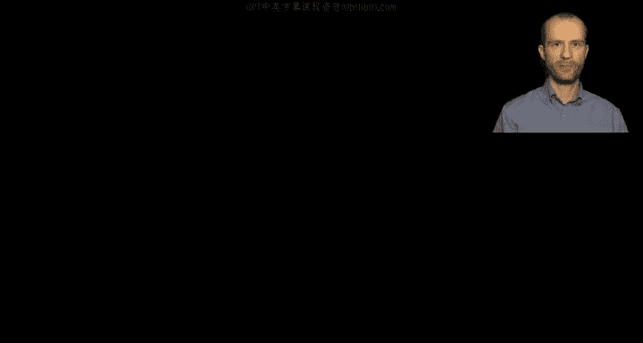

If you don't have R， go to this website。

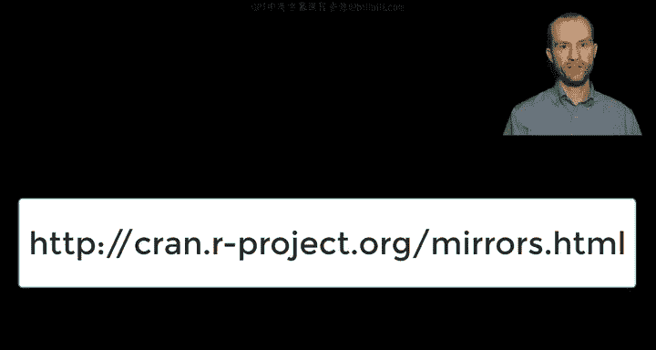

Which is part of the comprehensiveive R archiveive network or Crran。

This is where R and R packages are stored on servers around the world。

On this page you can find a server that's close to you and I'm using the one from the University of Michigan。

Once you find the right mirror for you。Use the download link for whatever operating system you are using。

Click installs R for the first time and click downloadload R as appropriate for your operating system。

You want to download the base files。And by the time you watch this video。

 there might be newer versions of R， but that's okay。

 just download whatever is the most recent version。

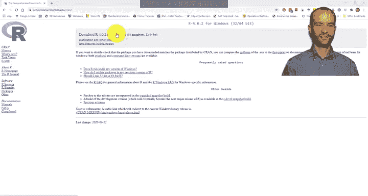

The file for R is going to download to your computer and when it's done。

 open it up and follow the directions for installation。

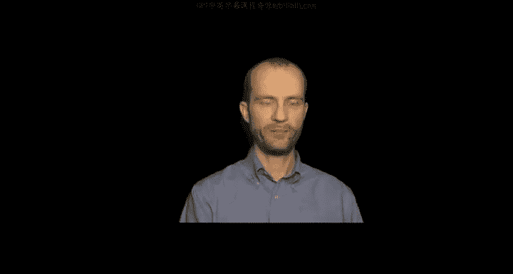

Once R is installed on your computer， you will also need to install our studio。

Our studio is what is called an integrated development environment or IDE。

And this is a separate application from R itself and it kind of sits on top of R。Essentially。

 our studio is just this sort of helpful editing program that allows you to work on a file or with our code very in a very straightforward way。

 and it allows you to see your R output as you code。It has a lot of other helpful functions as well。

 and we'll explore those throughout the course。

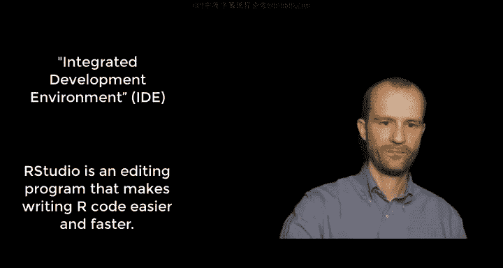

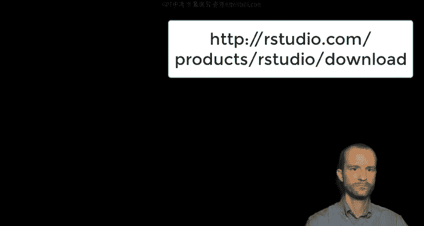

To install ourSt， go to ourstudio。com/ productss，/ ourstudio/ download。

And select the free version of our studio desktop。On the next page。

 click download and save that file somewhere on your computer。

Then open up that file and follow the directions for installation。

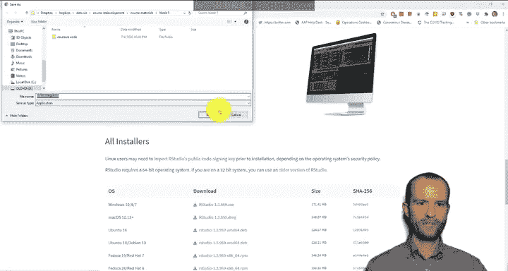

At this point， we're ready to go ahead and get started with R。

 so open up our studio on your computer。

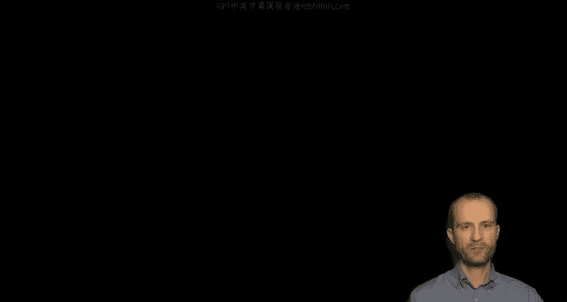

Your screen should look something like this。The main part of this screen here is the console where commands are entered into R to be executed by your computer。

On the right top， there's an area where the En tab is selected。

And here eventually you're going to see a list of different data and data objects that are currently open or have been created in R。

In the bottom right， you'll see a window with the plot tab selected。

 and here you're going to be able to see plots as they're generated。

You might also see a fourth pane when you open up our studio。

 and this is the editing pane where you can type in and save our commands。If you don't see that pane。

 you can open up a blank script file by clicking the new file icon and selecting our script。Overall。

 our studio is a pretty complex piece of software， so I'm not going to go through every single function now on all the different items in the menus。

It's easier to learn that kind of thing as you use them rather than doing some kind of complete inventory from the very beginning。

A good way to orient yourself to our studio is to take a close look at the R Studio cheat sheet。

 which I've included in the materials for this week。

This will provide you a more detailed walkthrough of all the different parts of our studio if you're interested in it。

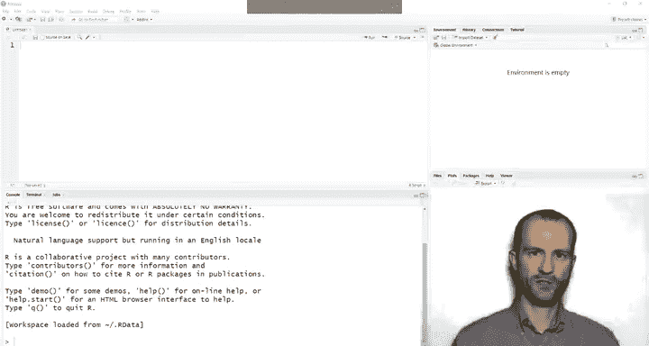

I do think it's useful at the beginning to know how to modify some of the appearance of ourSt。

 so if you go to the tools menu and select Global options。

 you can change the appearance options for code editing。

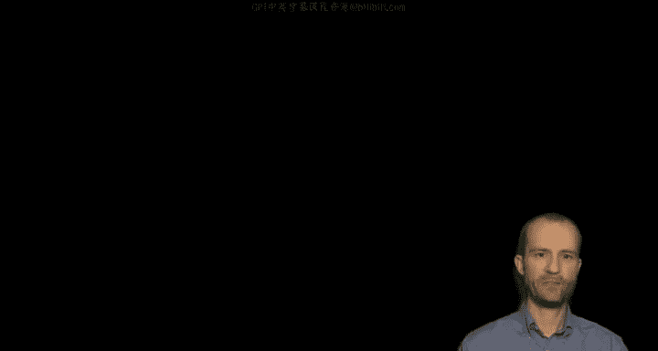

In the code section under editing， I always like to make sure that selectSo wrap for our source files is selected。

And in the appearance section， I like to increase the font size as well。

You can modify the color and other kinds of font options to make it look comfortable for you。

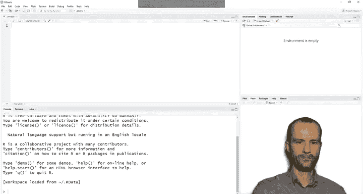