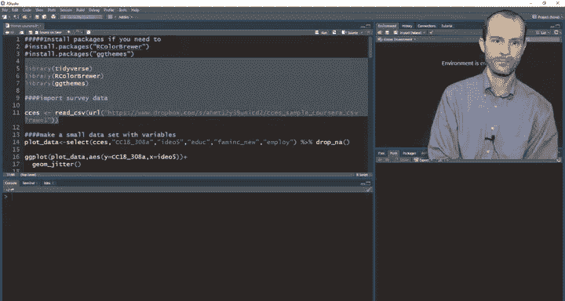

# 约翰霍普金斯大学《R语言数据可视化和仪表盘｜Data Visualization & Dashboarding with R》中英字幕 - P30：13_颜色、图例和主题第1部分.zh_en - GPT中英字幕课程资源 - BV1YWPjeKEWz

As we've worked with basic visualization so far。We've had occasion to do a little bit of refining。

 like changing the access labels of a plot， dropping a legend， changing some colors。

But what we're going to do here is focus primarily on this in this video。

 and I'll do a number of modifications to a visualization to show some different options for what you can do and some more advanced techniques。

So follow along again here with the R code associated with the video。

And make sure that you have the packages installed that are in the R code and load them in the first several lines of the code。

We're also going to go ahead and import the survey data again that we've been working with from the Cooperative Congressional E surveyvey。

Youll probably recall from before that this survey includes questions about individuals income and their education level。

 and there are also survey questions in there that we haven't used yet about the survey respondents。

 political ideology that is how liberal or conservative they are and their support for the presidents。

 so whether or not they approve or disapprove of the president's performance。

You can take another peek at the CSV file that goes along with this video and the code book if you need to reorrange yourself to these questions。

So we'll make a little data set that we'll make visualizations out of using these questions with some simple data wrangling commands here。

And we'll make a simple scatter plot that uses the data。And to avoid overclotting。

 we'll use GM jitter。And what we're doing here is plotting the question that covers support for the president on the Y axis and the ideology of the respondents on the X axis。

And what this scatterpl is telling us is that more liberal respondents increasingly disapprove of the president's performance。

As we have done before， we can do some simple modifications to this figure by adding color to the dots。

And we can also vary the size of the dots by the values in another column of the data。

So here I'm varying the size of the dots by the values for the fam ink new column for each point。

Remember that each point corresponds with a single row of the survey spreadsheet。

 which is a single respondent， so now we have the color and the magnitude of dots varying based on those columns in addition to their placement on the X and Y axis based on the values for each respondent。

So we're really adding a lot more data into the visualization by manipulating these different visual aspects of it。

Now， obviously this is not the most compelling visualization that's ever been made。

 but this is just for demonstration purposes to show you how you can change these different elements of the figure。

 gives you a workout on how to apply the techniques to real worldor data。To continue refining this。

 one thing to note again is that the R has manually selected a blue gradient for the color。

 so for the education values。In the past， we've done some manual manipulation of color scales like this using the scale color manual command。

 which we used to override R and it to use certain colors for discrete values in a column。

In the case of education， there really isn't a set of colors that naturally corresponds with increasing education levels。

 but if we just didn't want to use a blue gradient， we could use something else， so for instance。

 we could modify this string of GGpl commands by adding the scale color gradient command。

And we could set the high and low values to different colors。

 which would indicate how the colors are going to change as the value increases。

So here I'm just going to switch it so the gradient runs from gray to purple just as an example。

 but you could choose many different colors here depending on what you wanted to use in your own visualization。

Now， gradients are best used for continuous numeric variables。

 something that runs from  zero to 10 or0 to 16 or whatever。

 that has a definable high and low value on a scale on a continuum。

Education works okay for that because you can sort education from folks that have lower levels of education and grows continuously up to higher levels of education。

But other variables don't really map onto a scale like that， so they might be more categorical。

A person's employment status for instance， doesn't really work like this， you could be employed。

 retired， unemployed， a parttime worker， disabled， a student。

 or you could fall into some other category which isn't naturally sort of higher or lower than the other。

And when you have a categorical variable like this。

 you can control the colors in R a little bit differently。So to get some practice with this。

 let's make another plot。And referring to the codebook。

 what I'm doing here is reccoding the employment question from the survey that we grabbed earlier。

 and we're converting those numeric values into qualitative categorical variables like I described just a second ago。

Now I'm going to make a scatter plot again， and this time the color of the figure will be mapped to the recoded employment category variable as opposed to the education continuous variable that it was applieded to previously。

Now to set the colors here， rather than have to go through and manually assign a color to each of these different categories。

I'm going to use a command from the package our coloror Brewer。

 which we called up at the start of the code file here。Like the GG Reel package。

 our color brewer is one of these packages for R that is not in the tidy verse itself。

 but it plays very well with Gigi plot。And color brewrewer is nice because it has these aesthetically pleasing color palettes built right into it that you can grab and apply to your figures。

This avoids you having to make all these choices about what kind of colors go nicely together when you're assigning multiple colors to discrete values。

So in this new line of code here that we're adding to the Jugi plot string。

 we have scale color brewer， and we're telling Jugi plotot to apply the palette from color brewer red。

 yellow green to my figure。So those colors are going to map onto the employee category value。

 which I've created and that we're mapping to color。Now when we run this。

 we see that this new color palette has applied to our figure automatically。As you can probably tell。

 working with colors in your figures can be pretty complicated if you're starting to use lots of different colors。

 and so this is a situation where you just have to start doing some experimentation yourself。

Fortunately， there are good resources out there that will carefully go through all the different options you have。

The scales section of the Ggiplot2 reference page at tidyverserst。

org is quite comprehensive and provides nice code snippets that you can review if you're trying to master using different color schemes。

And the RGra gallery has a very handy reference page that will show you what the different R color brewer palettes look like。

So as you continue to experiment with colors， you're going to want to look back at those。

The same basic method here is going to be used， you're going to be adding some kind of scale color command to your string of GGpl functions。

 but for some of the details you want to make sure you read the documentation carefully。

So take a breath now， go back and review this code if you need to， and when you're ready。

 leave your R code open and go to the next video where we will continue to work with refining the visual elements of your plots。

