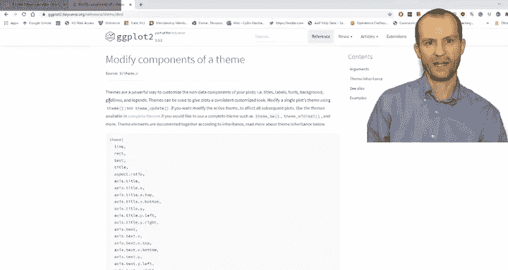
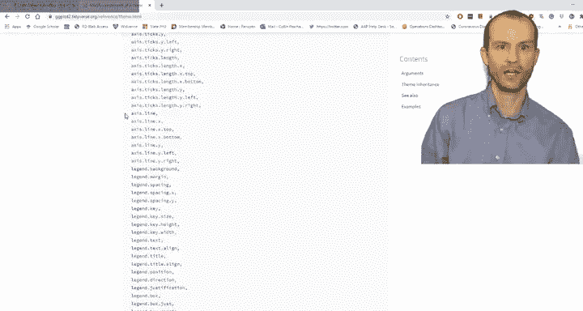
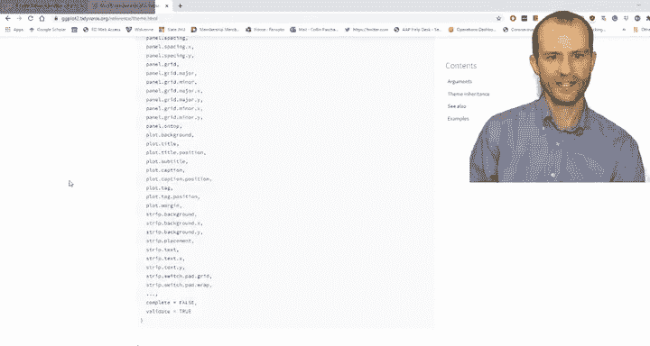
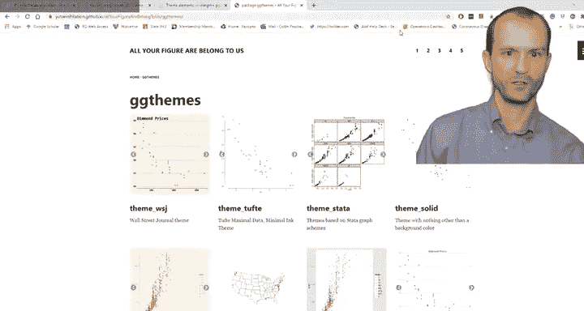
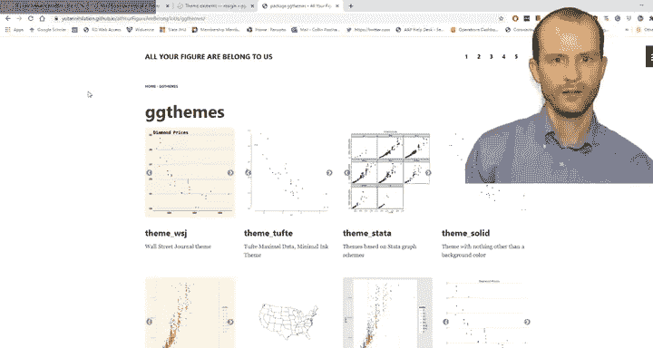
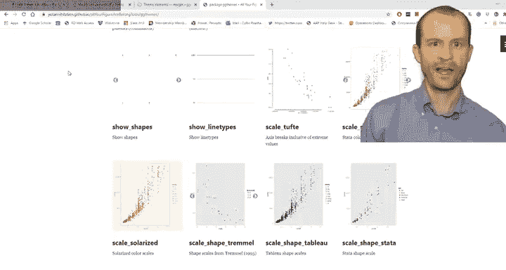
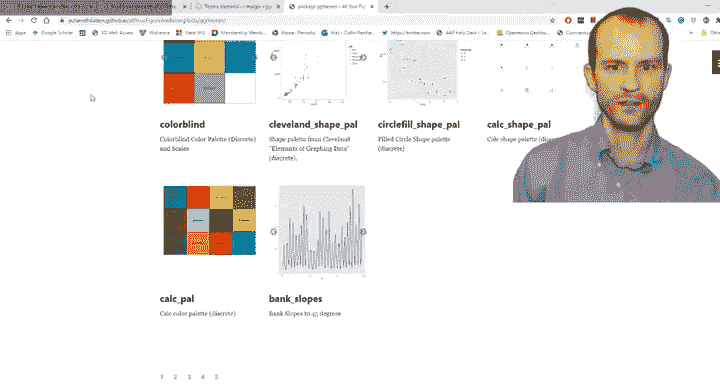
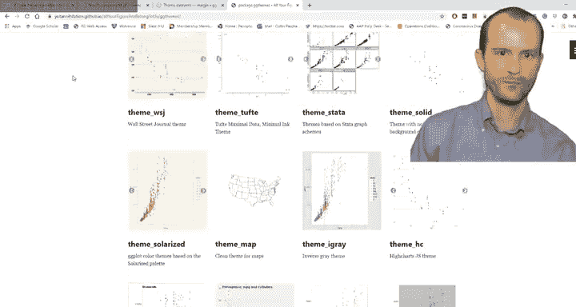

# 约翰霍普金斯大学《R语言数据可视化和仪表盘｜Data Visualization & Dashboarding with R》中英字幕 - P31：14_颜色、图例和主题第2部分.zh_en - GPT中英字幕课程资源 - BV1YWPjeKEWz

We're going to continue now doing refinements of the visual elements of our figures。

 picking up where we left off with the last video and picking up in the code file。

What we're going to focus on here is using the theme function to modify elements of the figure。

And theme is used to modify elements of a plot that are not tied directly to values of the data。

So for example， in the last video， we talked about how to change the color or size of points based on the data itself。

 but theme is generally used to modify elements that are consistent regardless of what the underlying data are。

 so these would be things like the typeface of the font in a figure the placement of the legend and some of the other aspects of that that would be static and are not tied to any aspect of your data。

Now theme is a pretty complicated function and there's a lot of arguments to it。

 so you want to make sure that you look at the documentation for theme in the tidy verse and look at all the different arguments and options and the things that you can control using this function。

What I'm doing here is just demonstrating a few of these。

 you're going to want to go back and look at some of the other options if you want to control other aspects of the plot that we're not covering here。

The theme function is added to a GG plus string of commands with a plus sign just like we've seen before。

 and it's quite a powerful function。

So let's just start with the plot that we left with last time here。

 and we're going to modify this in a few different steps。

Let's say that we wanted to move the legend of this plot to the bottom。

We can do this by modifying the argument and theme， legend dot position， and setting that to bottom。

Now let's change the format of the X axis text， and so again。

 this is going to be by going in and modifying an argument in the theme function。

And we do it with the axis dot text。t x argument。Now this is a little complicated because within that argument。

 you actually have to put another function into it， and that is the element text function。

This is a totally separate function with a separate documentation page。

 so you want to go check that out on the GGpl reference page as well in order to understand what all those different options are。

 but basically it's a function for controlling the format or the font of text。

Now we put that function into this argument and theme。

And by using the options within the element text function， we can set the angle。

 the horizontal spacing， the color of the text， and other options。Now， when we run the code again。

 we can see that those are added， those changes are added to our plot。

And let's say that we wanted to change the color of the axis titles and we can do that with the axis dot title arguments from the theme function。

 and again we use the element text function within that argument and we set the color to red。

So having done all that， now we can add labels again to our figure and we did that with the labs function previously and we'll do the same thing again here。

 so what we're doing is combining some modifications from the theme function along with the modification from the labs function。

As you can see by using the theme function and in conjunction with the Las function or the guides function。

You can have a very fine grained control of the elements of your figure。

But I also recognize that this is pretty complex and kind of difficult to follow until you start to really dig into it for yourself。

Fortunately， there is an easier way and that's the package Jugi themes。

We installed and loaded GG themes at the start of your R code。

 and this package included within it a large number of premate themes that you can apply to your own visualizations。

A list of available themes is available if you type Ggi themes into Google and go to this website called All Your figure Are B to Us。

 and there's a link to it in your course materials。

This website has a funny name， but basically it's just a gallery of all the different GG themes and you can see that there are a lot of different options here where the authors of this package have gone in and already tweaked the themes for Ggi plotot to manipulate them into these sort of pre-baked templates that you can use。

So you can browse through here and you can pick one of the themes that's appealing to you。

And for example， here in the code， I'm choosing the theme_ WSJ option。

 which will mimic the way that figures look in the Wall Street Journal。

 the newspaper in the United States。And you can see that when I run it with this additional theme argument。

 this makes a bunch of changes to the figure to make it more attractive。

It's useful to keep in mind though that even if you use Jugi themes。

 you can still go in and modify elements of the theme yourself using the theme function。

 and this will give you direct control over the features of the plot。So for instance。

 if I like theme_ Wall Street Journal， I could use that but then I can add my own theme function afterwards to rotate the angle of the axis text。

