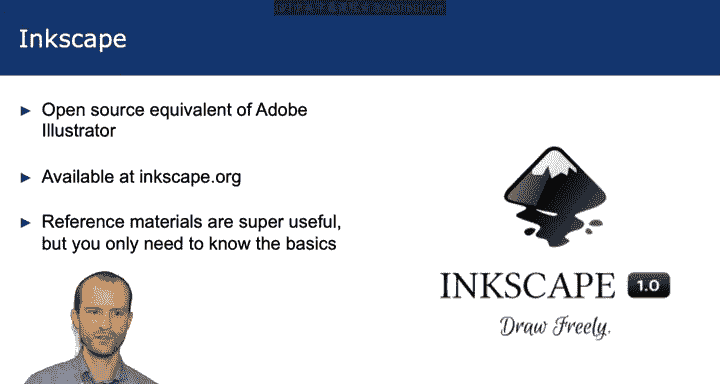
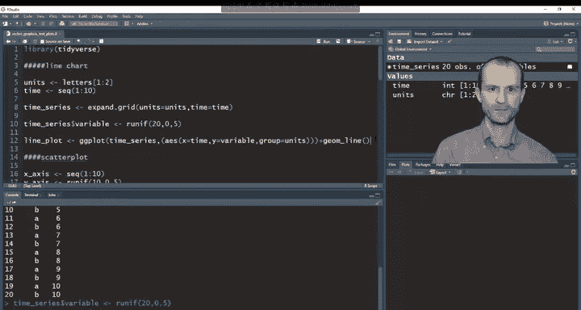

# 约翰霍普金斯大学《R语言数据可视化和仪表盘｜Data Visualization & Dashboarding with R》中英字幕 - P32：15_Inkscape第1部分.zh_en - GPT中英字幕课程资源 - BV1YWPjeKEWz

Inncscape is a vector graphics editing program， and it's essentially an open source equivalent of Adobe Illustrator。

You can download inksscapepe for free at inksscapepe。

org and version 1 just became available in spring of 2020。

InncSscapepe is a very powerful program with a lot of functionalities for graphic designers。

But for the purposes of tweaking Gigipl figures， you don't need to understand all the ins and outs of the program。

Though with reference materials that are available， you certainly could do that。Instead。

 all we really need to be able to do is to open up a file that we've created in R using GGplloot and use some basic tools to tweak those figures。

Let's go ahead and walk through how to do that。

First， we'll make up example visualization。This is another good chance to practice。

 so we'll just zoom through this real quickly。First， we're going to make a line chart。

So I'll set up two different units or cases along with 10 time points。

And we'll use expandand grid to create a data frame that has every possible combination of these two units。

Then， for example， data will create a vector of random values between0 and 5 that's 20 numbers long。

And we'll attach that to the variable column。We whip up that line plot quickly and we assign the figure to the line plot object。

This should all be pretty much review for you at this point。

 but if you need to go back and check out the video， check out the code again。

 pause it and review to make sure you've caught up。To create a scatter plot。

 we generate x and Y values and we bind them together into a data frame and we create a scatter plot。

Again， this should be review。And finally we'll create a barpl。

 so we'll set up five cases along with three additional columns that you can think of as different values for each of the five cases for different variables。

And we'll bind all those together。And you see here that we've created this in Y rather than long format。

 so we'll use pivot longer to transform the data into long format， which is what GDP likes。We the y。

 we stretch out the three y column headers for y1， y2 and y3 and two different row values。

And we take the values in those columns and put them in the column value。

And now we've got long data for a bar plot and we'll whip up the bar plot。

So now that we have these example visuals created， we will export them using our studio。

And you can either call up the plot in the ourSt window and export it from there。

 or you can use the GG Sa command。If you use GgiSave。

 you first provide a file name and the file extension。

 and then you provide the Ggi plot object you want to export to the image。

The file will be saved to the working directory for R。

You can save the file as common image files like dot PNG or dot JPG。

But if you want to tweak an image in inkscapepe， one of the easiest ways to do that is to save it as a dot SVG file。

In order to do that， it's helpful to go ahead and install an additional package that allows you to do that。

 and we're doing that here in the code。So for now， let's save these three plots2。

svG files and I'll meet you in the next video when we'll start to manipulate these in inscape。

