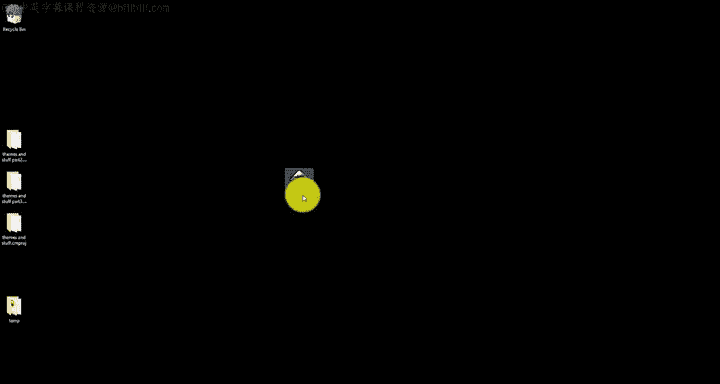
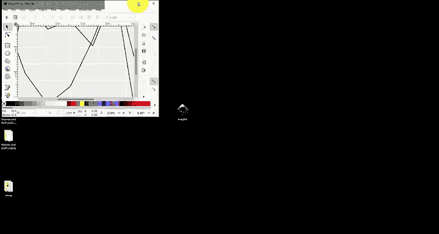
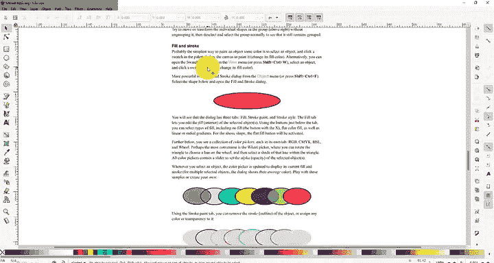
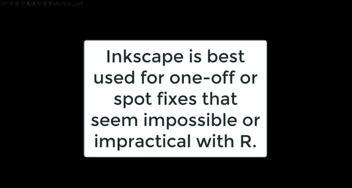

# 约翰霍普金斯大学《R语言数据可视化和仪表盘｜Data Visualization & Dashboarding with R》中英字幕 - P33：16_Inkscape第2部分.zh_en - GPT中英字幕课程资源 - BV1YWPjeKEWz

In this video， I'm going to show you some of the basics of using inkscape to modify a figure that you generate in Ggipl。

 and my goal here is really to show you that this is not a very intimidating process。

 And if you have any experience using，Any kind of graphics editing software。

 even Microsoft Paint or Microsoft PowerPoint， you're going to find that this is something that you can learn。

 I think reasonably quickly， at least at the basic level。Again。

 the advanced features of Ikscapepe can be very complex。

 but you don't need to know all of them in order to do the kind of basic finishing that you're going to want to do for this course。

So to begin， I would just find the dot svG file unless you saved using GGSave on your computer and here it's just on my desktop and if you double click that。

It will likely come up into inkscape for you。

Eventually there it is。

And if it doesn't open up that way， you can come up here to file and open in inkscape and you can get to the file that way。

So once you have the image up， you can zoom in and out on this by holding down control and moving the mouse wheel is how I do it。

 or there's also zoom out options here on the screen if you want to click the button to do that。

So you can zoom out and you see that the image itself is placed on this page which has this outline on it。

 so to start I'm just going to shrink this little bit so I'm going to select everything。

 that's associated with the image because there are different parts the lines， the background。

 the text， the numbers， all of these are different individual parts of the image so I'll select all of them by clicking control A and then I hold down the control button and click the corner of this image and that will keep the scale of it while I shrink it down。

And this just gives me a little bit more room to work as I modify the image。

So this is a G plot figure that's exported using the standard。packackage the standard theme。

 so there's no Bels and whistles associated with this and what it looks like is you have a gray background here and on top of that are a series of individual white lines and then you have the plotted lines that you can click on and you can see that。

Depending on which line you click on the selection box change the bit。

 and so you can tell which one you've clicked on。And then the text and the tick marks are all separate objects that you can click。

 So I mean， if you zoom in quite far， you can click on the individual tick marks here。So again。

 this is something that you're going to want to play around with a little bit on your own。

 just going to delete the background image here。And I'm not going to fuss with deleting the individual white lines here because that's actually takes a lot of point in clicking。

 but if you want to do that， you certainly could。To change the color of an object you can just click on it and then if you come down here you'll see that you have the whole range of color palette available to you。

 you can scroll and you can see that there are many。

 many many colors available and if you wanted to there are ways to specify an exact color using an RGB scale or some kind of other color matching。

Scale， but we don't need to worry about that for right now。

When you click an object that can be recolored， you can move your mouse down here and if you have a line like this。

 you change the stroke color， which is a line by holding down shift and clicking the color you want。

 so let's just change this line to blue。And then we'll click the other line。

 we hold down the shift key。And we can change that to red。So that's really straightforward。

 that's something that you've probably all done at some point in your life in some kind of program。

With respect to changing the labels， I find it usually the easiest just to click the old ones and delete them。

 so click press delete and click and press delete。And then if you want to draw a new label。

 you can come over here and click the text editing button。

And you can drag open a text box and you could say something like， you know， my X axis。

And once you do that， you also see that you have font options up here so we can select that text and you can change the font size to whatever you want it to be for your figure。

So I will grab the select button tool again and then I can to move that to her but I would like it to be on my figure。

To make text vertical， you can take a box。 I'm just going to copy this and paste it。

And jump in here and change oops。I will just jump in here with the text tool。And change x to a y。

And oh my。Moving all over the place on me。We'll change the x2 or Y。

And we'll click to select tool again。We'll drag it over here and then if you click an object twice。

 this is the resize buttons right now， if you click an object twice。

 it will switch to the rotate buttons so then you can just grab the corner of the dock of the image of the box or whatever you have selected and you can grab it and you can move it to be vertical。

If you wanted to come here and put a title， we could do that with the text tool。And again。

 you can switch to select and move that around and of course。

 you can you know modify the color of this and you can modify the all the other。あ。Features of this。

 if you want to change the color of it， you can click green， for instance， and you can do that。

You can also draw rectangles and other shapes if you wanted to mark up your document that way。

 there are plenty of shape tools over here and you could grab one， come over here。

 you can draw a shape， if you want to change the fill of this or the transparency， the fill。

 you could right click on it， you can come to fill and stroke。

And then you can change the RGB colors and also the transparency of the fill so you can change the transparency that way and you can mess with the RGB ranges in order to make it you the color that you want。

 and you can flew around with that to something that you like。

 or you can also click down here to change the colors that way。For the stroke。

 you can do the same thing， you can pick a color down here that you like。So。

This is pretty straightforward and I'm not going to belabor the point because a lot of you have probably messed around with this kind of software before and you could do a little self-teaching if you do find yourself stuck and you can't figure something out。

 the tutorials are really helpful for this so if you come up to the help menu and you go to tutorials here。

呃。For example， you just wanted to click the basic one。

Inncscape will actually open up a SVG file that has directions and little practice practice exercises and things that you can do it's really pretty quick and you can orient yourself to the software quite quickly。

Inkscapepe is probably best used for sort of spot fixes to your GG plot figures and most of the time I think it's better and will probably look more professional for you to do things within the software。

 but sometimes there's something you just cannot figure out how to get R to do and in those instances this is a good backup for you。

