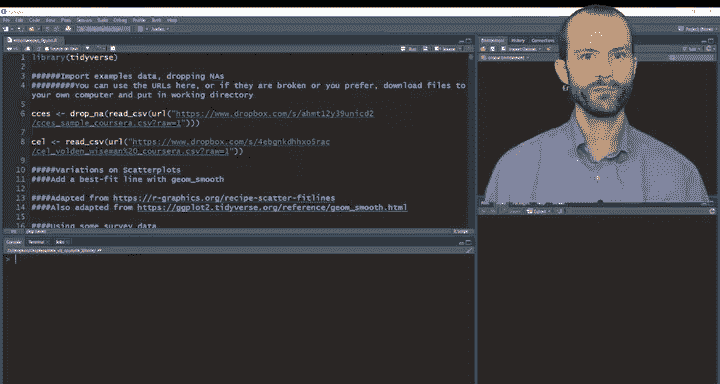
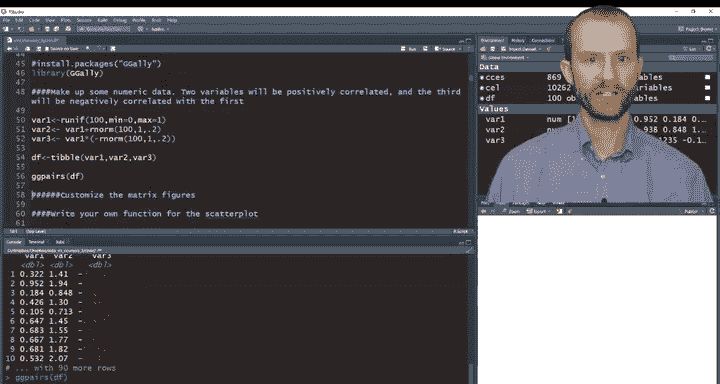
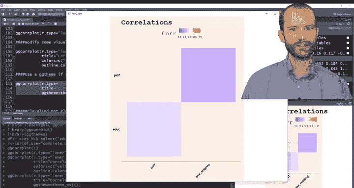

# 约翰霍普金斯大学《R语言数据可视化和仪表盘｜Data Visualization & Dashboarding with R》中英字幕 - P34：0_散点图的变体.zh_en - GPT中英字幕课程资源 - BV1YWPjeKEWz

In the next series of videos， we're going to work our way through a number of different kinds of figures。

 getting a real workout with Juji plotloot and some associated libraries。

The goal of these videos is to give you practice with making a wide variety of figures。

And so for these videos and really throughout this course。

 we're not going to do as much emphasis on data wrangling。

 but we're just going to make a lot of figures and get some practice。

We'll start with some variations on scatter plots。Many of you probably have some basic training and statistics。

 or at least you're familiar with the idea of putting a trend line through a scatterplot。

This allows you to get a better sense of the relationship between two variables than what you might be able to get from just looking at a cloud of points。

For example， I will use a set of survey data here that we've used in previous classes。

 courses from the Cooperative Congressional Ection surveyy。In that survey data。

 there are questions about the educational level of survey respondents in the United States and their political ideology。

If you pay attention to US politics at all or really to politics in many different parts of the world。

 you might be aware that an increased level of education is often associated with greater political liberalism。

In the survey data。The variable IDO5 captures political ideology。

 with five being the most conservative and one being the most liberal。

The Ejuke variable captures education level， with 16 being the highest and one being the lowest。

So we ought to see a negative correlation between these two variables。

It's hard to assess from a scatterplot what that relationship really looks like。

 but drawing a best fit line gives you a better sense for it。

We add a best fit line to the scatter plot here with Gm smooth。

There are a lot of different approaches for drawing a best fit line。

 but the default that GM smoothooth uses is the lowest curve。If you're statistically inclined。

 you can select several different methods for drawing that line。

 like a linear model or a generalized linear model。

You can also change the conference interval as drawn around the line。

But be very careful with this if you're not statistically inclined。

 because doing statistical inference with this kind of approach is pretty dicey。Exploratory analysis。

 however， is fine， and so if you want to draw some best fit lines through scatter plots to get a sense for the data。

 just sort of an intuition， that's an okay thing to do。In addition to a best fit line。

 another way to use scatter plots for exploratory visualization is to use a scatterplot matrix。

 which will show you the bivariate relationship between several different variables in your data at once。

The library Gi Ally， has a handy tool for creating a scatter plot matrix。In these lines of code。

 I've created some simple fake data with variable 1 and variable 2 being tightly correlated。

 and a third variable being negatively correlated with variable1。

When we put these together into a Tbble and we feed that into at the function GG pairs。

 it generates a scatterpl matrix for us， showing the distribution of the variables。

The binaryvari scatter plots and the correlation coefficients for each of the variables pairs。

If you want to modify the look of the scatter plots or the density plots in a scatter plot matrix that you make like this。

 you can write custom functions for the plotting functions。

 and then you can include those in the GG pairs function using the lower and di arguments。

This is a way that you can control color and fill and other aspects of the visualization。

A related way to drawing a plot for correlations is a shaded correlation matrix。

In the GG core plot package， the GG core plot function will generate these for us。

Here I'm selecting a few variables from the survey data。

 I calculate correlation coefficients for them， and I generate the correlation plot using G core plot。

GG corere plotot has a number of different options within it for modifying the colors and other visual features of the plot。

 and you can access those if you look at the help file。And you can also apply a GG theme if you like。

 if you recall doing this from the previous course。Beyond summarizing bivari relationships。

 you can also modify figures that you make with GM point to compare values across units of observation。

 kind of like a barpl。

In fact， many professional data visualizers prefer these kinds of plots to bar charts because of their visual simplicity。

One kind of figure we're talking about here is called a Cleveland dot plot。

 and to give you an example of this， I'll draw on the data about lawmaking in the US Congress that we've used in previous courses。

Here I'm selecting a sample of members from the 114th Congress。

And what I want to do is compare their legislative effectiveness。

 which is summarized by the variable LES in the data。Again。

 higher LS values mean more legislative productivity for the member。

 so we're basically going to compare sort of how good of a lawmaker a set of members are by seeing how productive they are。

In my GG plot function， I set the data and I do the aesthetic mapping。

 so the x axis is my outcome of interest and my Y value is the units of comparison。

When I add GN point to this， I get a single point analogous to the top of a bar chart。

In these next lines， I'm doing modifications through the theme function to drop some of the white vertical lines and adding some dash horizontal lines。

I also change the point size， the labels， and I reorder the units on the Y axis by their value of the outcome variable in descending order。

With those modifications， we get a nice refined minimal plot for comparison。Finally。

 a closely related variation of this dot plot is called a lollip plot。

 try saying that three times fast。And it's even more similar to a barpl。To make a lollipop figure。

 I flipped the Y and X axis in my aesthetic mapping， and I use GMm points。

 but rather than drop the grid lines， I use GMM underscore segment to draw lines that connect from the x axis at the y value of0。

 so at the bottom of that to the y value for the variable of interest。

 so going up for each category across。Again， this is just a very refined。

 simple way of making a bar plot essentially。