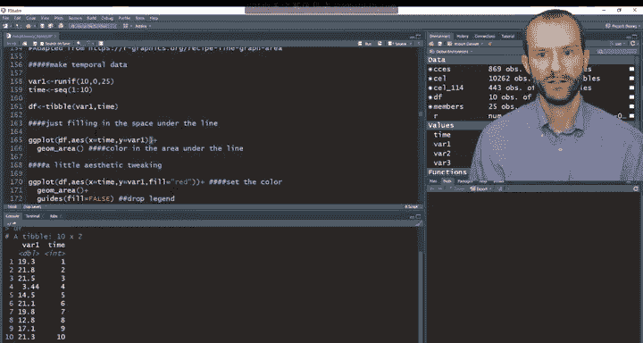
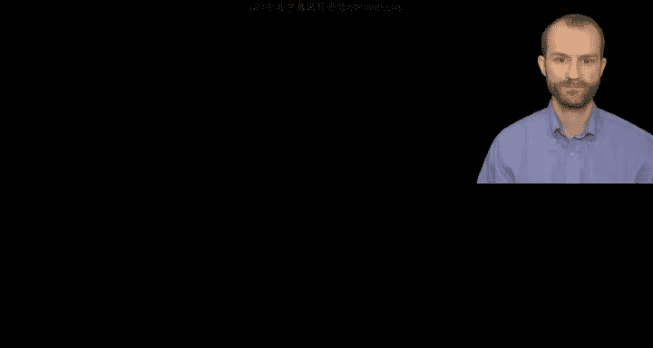

# 约翰霍普金斯大学《R语言数据可视化和仪表盘｜Data Visualization & Dashboarding with R》中英字幕 - P35：1_折线图的变体.zh_en - GPT中英字幕课程资源 - BV1YWPjeKEWz

In the past， we've done some simple line plots that have been useful for exploring temporal data。

Now we're going to do some additional work on a few visualizations that are useful for showing change over time。

We're picking up here in the Rcode where we left off in the last video。

 so find these lines of code in the attached Rcode file。

A very common visual effect that you see with line plots is to fill in the area underneath the line。

 underneath the curve。These are really easy to make and so here I've created some fake data with time as one value and an additional value associated with each time point。

 you can think about this as whatever you want， scores， temperature， weights， heights。

 whatever you desire。To plot a figure that fills in the area underneath the line。

 you might think that you should use a fillthe and a GO line。But actually。

 the best thing to do is to use a GeO area shape， so a completely different GeO。By default。

 when you use GO area， the fill in color underneath the curve is going to be black。

 but you can also set the fill color manually if you want。

Fillling in the area underneath a curve with a single color adds a certain aesthetic quality to the visual。

 but it doesn't really add much in terms of informational value。

 it says the same thing as a line plot。But you can use that space to convey additional information if you make a stacked line graph。

Let's say I have temporal data for three people， Bob， Sue and Lisa。

I record some value for each person at each of five time points。

Let's just say it's how much money's in their pockets at any given time。

 how much change they're carrying。The lines of code here create a fake data set in long format that records the amount of money that each person has in their pocket at each time point。

Now， if we use GMM area and set the phistthetic to the identifier for each person。

 the chart will display how much money each person has in their pocket on top of each other at each time point。

 so the total height of the line will be the cumulative amount of money that each of the three people has combined at each time point。

You can prove that this is what this figure is actually showing by calculating the cumulative total of change in each person's pocket at each time point。

 which I can do with these few lines of data wrangling code。

The nice thing is that GM area takes care of all this for you。

 and so now you're actually leveraging the area underneath the line for some additional information。

If you want to show change in value across units of observation and you want to compare two different time points。

 so let's say we wanted to compare the amount of change that these three people had at time one the amount of time with the amount of money that each of them had at time five。

A good choice for this is a dumbumbbell chart。

And we'll build one up here just to show you what I mean and what that looks like。

We make a dumbbell chart using the GG Alt package， so we load that up。

And then we're going to wrangle this data about Bob Sue and Lisa so that we only have their values at time one and time five。

And then we're going to pivot it into wide format。Making a dumbbell chart is one of these rare times when you actually want your data in wide rather than long format for purposes of plotting and GG plot。

 so you use the pivot function to take care of that for you。To make the chart itself。

 we call the Gigi plot and we put the Y axis as the unit of observation。

 which in this case is the different people， Bob Sue and Lisa。For x。

 we set that to the first time point we want to compare， which is the time point1。

And then for x n or which with the end of the segment we're going to draw here。

 that's going to be the last time point。Once we have this all set up。

 the GO dumbbell takes care of the rest。And like any other Ggi plot figure。

 we can do refinements to make it look more appealing。

