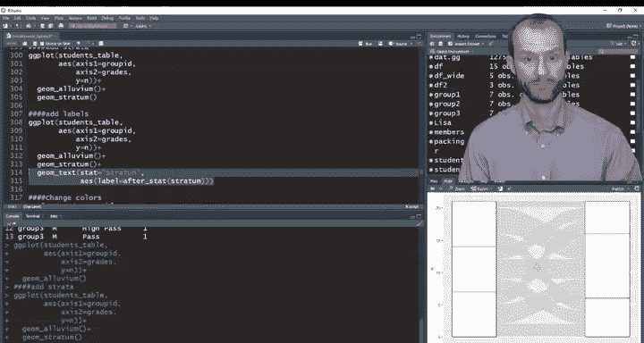

# 约翰霍普金斯大学《R语言数据可视化和仪表盘｜Data Visualization & Dashboarding with R》中英字幕 - P36：2_流和圆.zh_en - GPT中英字幕课程资源 - BV1YWPjeKEWz

By this point， we've done a wide range of figures in GGplot。

 so I think you probably have a good sense for how powerful the toolkit you developed is for making data visualizations。

I have just a handful of miscellaneous other figures to show you in this video。

 and then in the next portion of the course， we'll cover spatial data。

A pretty common kind of visualization that you see that is good for showing parts of the whole or connections between different categories and data is called an alluvial diagram。

This is one of those figures that you kind of have to make to really understand。

 so let's go ahead and get started。I'm going to create fake data here about student performance in classes。

I have 21 students divided into three groups of students。The students are men and women。

 and they get grades of high pass， pass or fail。It takes quite a bit of wrangling to generate all that。

 so pause the video here and step through the lines of code if you need to。

The important thing is to get to the final table here。

 and the row of this table tells you how many males and females in each group got each grade in the course。

An alluvial diagram is going to show you how these categories relate to each other and how collectively it all makes up part of the whole。

This is something that you just again kind of have to do in order to understand。

 so bear with me and let's power through this。The package Ggi alluvial is another one of these helper packages for GGPloot to provide some specialized tools that we need。

We start simply with a Ggi plot function and the data。

The aesthetics here are a little unusual because it's a specialized package。

We have to set access1 to the group ID and access2 to the grades and Y to N。

 which is a calculated count of how many males or female students and each group got which grades in the class。

Are you confused yet， I know it's a little hard to follow， but again。

 just keep going with me and then we can come back and you can review to put the pieces together after you see the finished product。

Once you have that setup， you can add Gm alluviium。

 and you're going to start to see this flow and connections between these categories。

Now obviously this doesn't break out the categories very clearly。

 so we have to add GM stratum to make this a little bit clearer。And to help even further。

 we can add text to the figure using the G text command。

Setting the stat as stratum and the label in the aesthetic。

Like any other Ggi plot， we can also add some colors。Now I' just blasted through that really quickly。

 and this is really kind of a special usage of Ggiplot tools that you just can't figure out on your own。

You're going to have to consult the GG alluvium documentation to really get a handle on the internal logic for how the pieces of this figure go together There's just no replacement for going and very carefully reading through and doing it on your own and trying to walk through it。

However， if you follow the examples that are in the documentation。

 you should be able to piece together the figure， especially if your data are formatted in the right way。

 aligned with the models that you find in the documentation。So again。Going back to meta learningning。

 which we've been talking about since the beginning of this course。

 what you want to do is find an example， work through the example carefully and understand the internal logic for that。

 and then start to look at your own data and figure out how to map that on to the example that you were working with。

Let me show you one other fancy figure in case you're not confused already。

 and that's a packed circle plot。A packed circle plot is sort of like another alternative to a bar plot because it allows you to compare values across units and see parts of a hole。

The library PAC circleircle provides the function that we need to make a circle plot。

And what I'm going to do here is to compare legislative effectiveness or productivity in 25 members of Congress during the 114 Congress。

Again， legislative effectiveness more or less measures how productive a member is in making laws。

 and we're going to compare and see how productive these members are relative to each other in the 114th Congress。

This is just the exact same thing that we did in the lolllly plot， the Loli， again。

 the lolllly pop plot a few videos ago。We're just going to show the information in a different way。

What we're going to do is draw a series of circles of different sizes with the radii of the circles indicating the magnitude of the legislative effectiveness score for each member in the 114th Congress。

 so a member that's very productive will have a really big circle。

 a member that's not as productive will have a small circle。

To start， we use a function in the package to get the measurement for the circles based on the legislative effectiveness column。

 the LES column of the data。And the output here provides the X and Y points。

 which are going to be the center of the circles on our XY plane along with the radius for each circle。

 so with that data you could imagine going and putting a pin in a point on the figure and drawing the circle around it。

Now that we have this information， we're going to put it back into our data using the Add column function here。

And from there， we use circle layout vertices to generate even more geometric information which GP is going to use to draw the edges of the circular polygons。

Because of course， the circle is just a polygon with infinite sides。

From here we're going to call Gigi plot and we're going to add the GO polygon function。

 which is going to draw our circle here， setting the data to the information about the circles which we created and setting the X and Y values to the center of those circles this is from that object a few lines ago。

We have to set here the group aesthetic to ID， as well as the fill to a factorized version of the ID。

And for aesthetic purposes， we're going to set the transparency using alpha here。

Then we add GM text to provide the labels and we do a little additional visual tweaking。

Now this creates a really cool plot and there's a certain visual flare to this， but again。

 it displays the same information as a bar chart wood or a lollipop plot just formatted differently。

I wouldn't seriously expect you to follow all the details here。

 but if you wanted to use this figure on your own work， again。

 you could consult the documentation and using the tools you developed。

 you could piece it together and go through the different components of this figure and make it work with your data。

And now we come to a somewhat anticchmactic end to all this stream of visualizations。

You might be wondering where are the pie charts？Well actually pie charts are kind of disfaavvoreed among many data visualization specialists。

 so I'm not emphasizing them in the course。The problem is that humans are not very good at comparing angles on the fly。

 so pie charts can lead the bad inference。But if you have to make a pie chart。

 just use base R and the P function just as demonstrated here。

This is pretty simple by comparison to everything we've just done， but you have so many skills now。

There's no need to settle for less than the best。