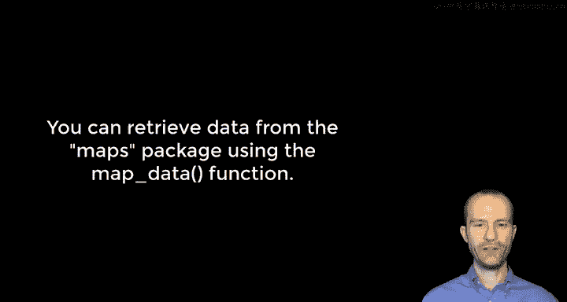
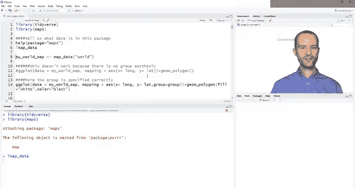

# 约翰霍普金斯大学《R语言数据可视化和仪表盘｜Data Visualization & Dashboarding with R》中英字幕 - P37：3_地图介绍.zh_en - GPT中英字幕课程资源 - BV1YWPjeKEWz

Today we get started with making maps and R。In this video， we're going to focus just on drawing maps。

 and then we'll move on down the road to organizing geographic data and mapping data in subsequent videos。

To really simplify things。Any geospatial visualization that you draw in R requires two things first you have to draw the map using some kind of data that directs R to draw the polygon shapes that constitute the map。

Then you add information to your map。That you will use to plot color and marks。And in that sense。

 it's the same basic logic that we've used for G plot figures so far。

The key thing is to have data sets that link the geographic data with the substantive information that you want to put on the plot。

This is all pretty abstract， so let's just jump right in with a straightforward example here。

The maps package in R contains a set of maps of the United States and the world drawn using longitude and latitude data。

Obviously， there are a lot of other geographic entities that you might want to draw a map for。

 but with a world map in a US map with the individual states。

 you can accomplish a lot of the mapping tasks and get an idea for how to do this。

Let's just make a map already， and this will start making more sense。To start。

 I said we need to get the data for R to draw the map。And in the Maps package。

 there's a command called Ma data that can be used to retrieve these pre baked maps that are included in the software package。

Let's take a look at the help file here for map data， and we see that in this command。

 the first input is map。

And this asks us to specify the map from the package that we want R to draw。

And we see here in the help file that the options are for US counties， France， Italy， New Zealand。

 US States， and two different versions of a world map。Unfortunately。

 we don't have other administrative subunits of the other countries in this database。

 and this is why you're going to have to go out and grab some of this data on your own in the future if you want to map other kinds of geographic units。

Now let's take a look at the world map data that is baked into the package。

 and we do that by using the commands map_ data， and we have the input world。

And then we save this to the object， My world map。Of course。

 you can name this object whatever you like， but my World mapap is what we'll use right now。

The object that is generated when you run this line is a data frame。

And we can take a peek at it here and see that the important columns are the set of latitude and longitude coordinates that are uses to draw the map。

A column of country names that correspond with each of these geographic points。

And a group column that specifies a group number for each country。

If you look through this entire table， you would see that for some countries， there are subregions。

 but we aren't going to worry about that for right now。

 and this order column is just a sequential vector that you can also ignore for the current purposes。

Now that we have map data at our fingertips， let's go ahead and use that to draw a map with Gigipl。

With the G G plot command， we set the data to。My world map。And for the aesthetics。

 we want longitude on the X axis because longitude changes as you move horizontally on a map。

 so on the X axis。And we set latitude to the Y axis because latitude varies as you move vertically on a map up and down。

On the Y axis。We also need to set the group here to the group column in order to get the borders to draw correctly。

Once we have these aesthetics mapped， we add GM Pogon to tell Gigi plot to draw the map for us。

Which after all， is just a bunch of polygons。This is a Gji plot GM in the same sense as points or lines or bar plots。

 or other things that we've done in the past。Let's go ahead and run this and we see that we get a map with black fill in the countries and white border lines。

So now we have a world map and that can be the basis for visualization so we can add color and dots to this in the future in order to draw different kinds of figures。

Now let's say that we wanted to look at just one part of the world map， a single country。

You can do this by setting a filter on the maps data that selects only a certain country or set of countries and creates a data frame with just the latitude and longitude for those selected countries。

We use the Tidyverse command filter， as we've done in the past for this。

And let's say that we wanted to create a map of just Germany。

We would create a subset of the world map data using the filter for just Germany。Or alternatively。

 we could filter by more than one country to draw several countries。

And it's best to use contiguous countries here。 Otherwise you get some strange issues about projection and scaling。

So let's do a filter here with Germany and France。And as expected。

 now we get the figure of France and Germany drawn because that's the only data that we selected from the world map data。

Another approach， if you didn't want to pick individual countries。

 would be to filter the map data by latitude and longitude。

 essentially zooming in on the box that you draw on the map。As I said。

 drawing these maps creates the backbone for your visualizations and we're going to add additional information going further that will show using color and shapes。

And we'll work on doing that in the next video。