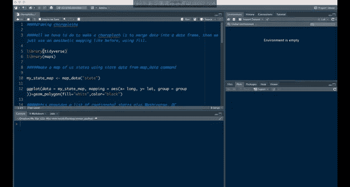
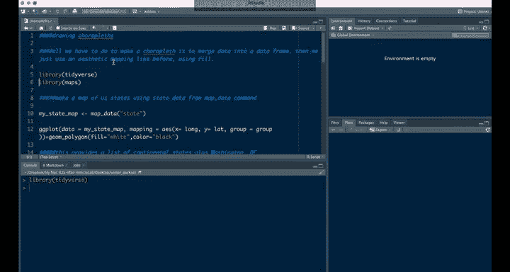

# 约翰霍普金斯大学《R语言数据可视化和仪表盘｜Data Visualization & Dashboarding with R》中英字幕 - P38：4_等值线图.zh_en - GPT中英字幕课程资源 - BV1YWPjeKEWz

Now that we have drawn maps using R， we are ready to start adding data to those maps。

Let's get ourselves cut back up here， so we'll load the libraries we need and we'll make a blank map of US states。

Let's examine the US state map object here。This is just a data frame like those we've used before。

This region column has the list of the continenttal US states plus the District of Columbia。Now。

 to paint data into this map， we need to add some data to the data frame。And to do this。

 we merged some data into the map data frame。For example， let's make up some fake data。

That will correspond to each of the states in this region column。For demonstration purposes。

 I'll just make a sequence of letters。And so we'll create a data frame with three columns。

 region and qual underscore value for qualitative values and quant underscore value for quantitative values。

For regionion， we'll make that equal to the list of unique names in the region column of the map data frame。

 so it's just a list of the US states plus the District of Columbia。For the qualitative value。

 I'll just create a sequence of 49 letters with a few repeats。

Apologies to Hawaii and Alaska for leaving you out here for demonstration purposes。

You could think of these letters as qualitative data of some type。

And for the quantitative of value column， I'll just create a sequence of 49 numbers。

After playing with this， we have a letter and a number assigned to every state。

And now we can merge the original map data frame with the values that we've created。

And we do this with a left join command If you're ha about how to use joins。

 you should check the Der cheat sheet and the reference materials on the tidyverse。

But region here is a linking column， so the corresponding。

 qualitative and quantitative values are attached to every row that matches the corresponding state。

And we'll assign that to a new object。This is the good time to point out that you should be very careful when you're doing these kind of data merges。

 it's easy to have spelling or capitalization or spa errors that can really mess up your joins。

 so it's always good to check manually and make sure that that's working。Now。

 using our newly supplemented map data， we use a GG plot function。

And this time we set the aesthetic to fill and we'll drop the fill command in GO_ Pogon。

When we do this， what we have now is called a core pth with colors filling in the state boundaries that correspond with different letter values。

And because this is just a normal juci plot function。

 we could do all the same kinds of formatting we have in the past， like changing the color palette。

 adding a title， removing elements， using themes， and so on。

We can also use exactly the same approach here for adding the continuous quantitative data to the map and make a core pth using that。

And again， you could do all the same kinds of refinements that we've seen before。

