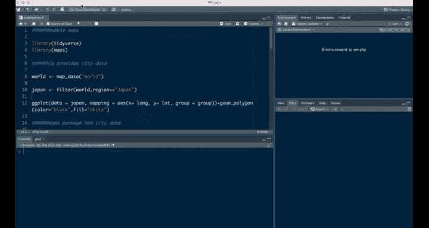
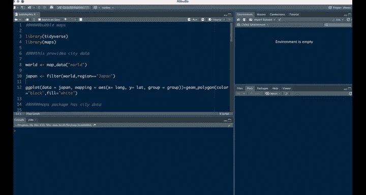
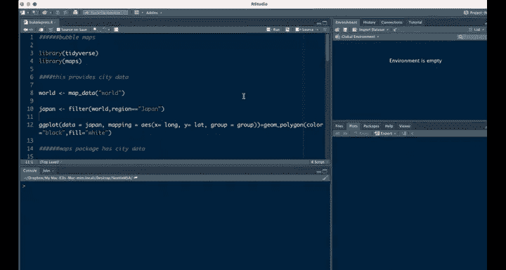
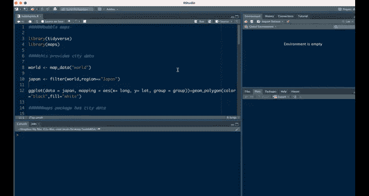
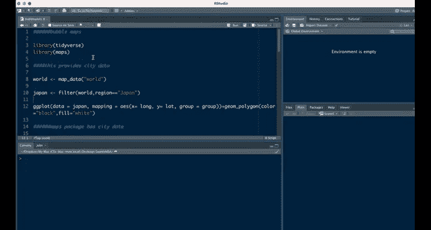
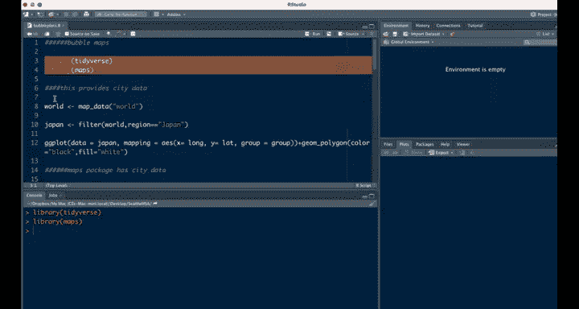

# 约翰霍普金斯大学《R语言数据可视化和仪表盘｜Data Visualization & Dashboarding with R》中英字幕 - P39：5_气泡地图.zh_en - GPT中英字幕课程资源 - BV1YWPjeKEWz

Another type of map you may want to make is what is called a bubble map。

Where different points vary in size or color based on some set of values in your data。

For instance， let's say that she wanted to create a map that included some of the largest cities in Japan。

And you wanted to vary the size of the marks by population and the color of the marks by some other categorical or quantitative variable。

Let's go ahead and make this using the Maps package and Ggiplot。

Open up a new R script and we'll load the required packages。

Let's also make a blank map of Japan using the techniques we've learned before。

The Maps package has data on many cities built into it。

And we can access that using the following line of code。Save the list of cities to an object。

If we look at the object， we see that it is a list of many cities in Japan and their corresponding populations and their latitude and longitude coordinates。

Now we first map all the cities in Japan。To the blank map of Japan， we add a GMM point function。

And when we make a bubble plot like this， we don't need to merge the point data into the map data frame。

Instead， we specify the data specifically once again in the GMM point function。

 and then we specify longitude and latitude。Although we use a group command in the original aesthetic mapping。

 we don't need one here， so we just set it to null。And just for some variety。

 we are going to set the color here to red。And recall here that we don't set the color in the original Gigi plot function or set it to a value in the data in the aesthetics function。

 because for now we don't want the color of the points to vary in conjunction with any value in the data。

 we just unconditionally want all the points to be read。When we plot this。

 we see that we now have points for all the cities in Japan， at least the ones that we have data for。

There are a lot of points in the map though， so we might want a smaller subset of cities to display。

We can filter the cities to select only those cities in Japan with populations above 500，000。

Population is contained in the P column， so filter for greater than 500。

000 in that column and map again。If we want to add more information to these points。

 we can change the size and color of the points， mapping them to features of the data。

Revisiting the GG plot function， we set the size of the points in the aesthetics function of the GM point function to pop。

It's not dramatic， but you can see that the size of the points now varies based on the population size。

What if we wanted to vary the size of dots by population and the color of the dots by some other criteria？

Let's say we wanted to vary the color by some qualitative or categorical variable。Again。

 for practice， we'll just use the letters here as stand ins for qualitative variables。

 and I'll create a string of letters and attach them to the dataset。

With a few modifications to the GG plot function that should look familiar。

 we see that color and size now are associated with the categorical variable and the size of the city。

Note especially here that I am setting the color within the aesthetic function because I want the color mapped to a feature of the data。

 whereas before color was set outside of the aesthetic function because I just wanted every point to be one color。

Now we just do some quick practice polishing and we are done with the figure varying both size and color of the cities。

